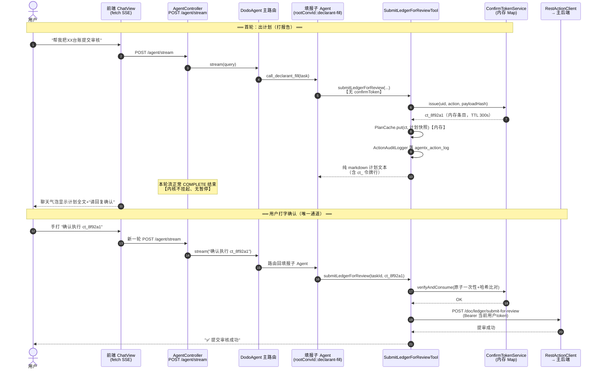
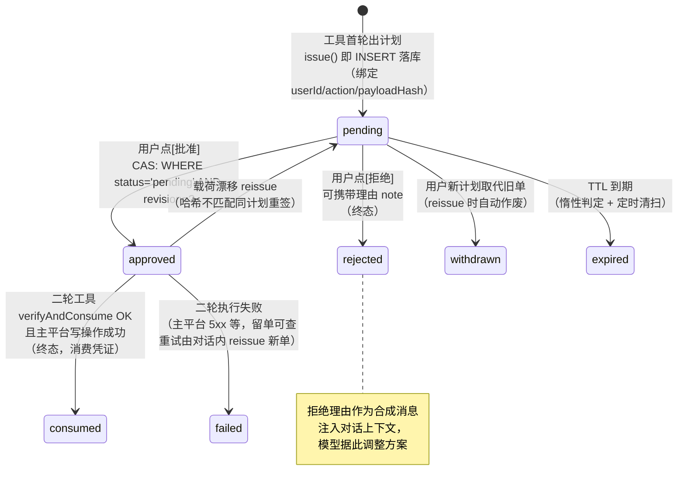
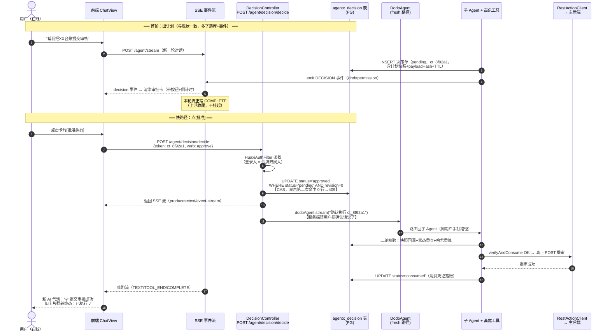
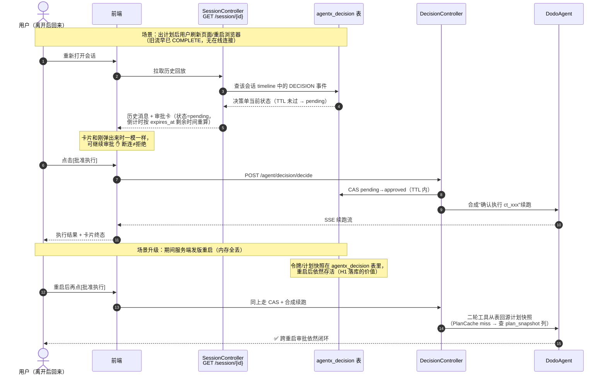
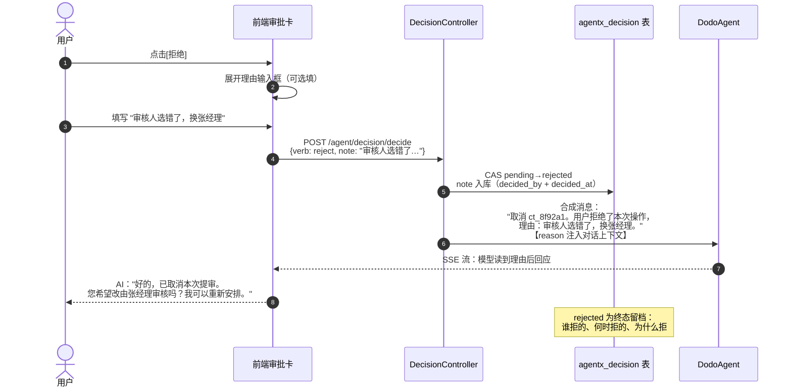
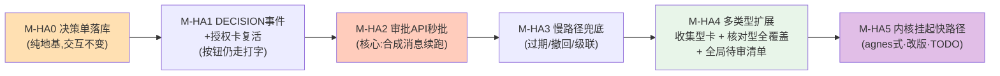

# HITL 人工决策与审批技术方案（华西 data-agent）

> **定位**：本文档参考 [Agnes Harness 用户确认框与 HITL 机制分析](file:///d:/work/agnes-harness-manage/docs/03-用户确认框与HITL机制分析.md) 的设计思想，结合本项目已落地的 **D7 两段式 ConfirmToken 协议**（见 [02-主路由与有状态垂类子Agent架构演进技术方案](file:///d:/work/zrkj-huaxi/code/huaxi-data-agent/docs/多agent技术调研/单agent演进多agent文档/02-主路由与有状态垂类子Agent架构演进技术方案.md)），给出把现有「对话式打字确认」升级为「**结构化 HITL 卡片体系 + 决策单落库 + 多类型支持**」的完整方案，附分场景里程碑实施手册。
>
> **快路径改版（终态路线）**：本文档 M-HA0~M-HA4 采用 **fresh 重开** 快路径（一期过渡，见 [§3-H2](#3-核心架构决策h1h8)）；终态改为 agnes 式 **内核挂起原地唤醒**（零 LLM 开销），已单独立档 → [HITL改版-内核挂起快路径方案(M-HA5).md](file:///d:/work/zrkj-huaxi/code/huaxi-data-agent/docs/HITL改版-内核挂起快路径方案(M-HA5).md)（**状态：TODO / 待启动**）。
>
> **一句话总纲**：AI 只负责"打报告"，系统负责"卡脖子"，人负责"签字拍板"——**报告要先存档（决策单落库），签字要点按钮（审批 API），档案柜断电也不丢（跨重启恢复）**。

---

## 1. 大白话：HITL 是个"家族"，我们目前只做了最重的那一员

我们现在的两段式确认，打个比方就像**微信里跟财务同事说"帮我报销"**：

1. **首轮（打报告）**：你说"帮我提交 XX 台账审核"，AI 干活干到最后一步发现这是高危操作，**不动手**，而是写一份《报销申请单》（执行计划 + 一个 5 分钟有效的暗号 `ct_xxx`），把单子全文贴在聊天里说"请回复确认"——这一轮对话到此**正常结束**，后台没有任何挂起的任务；
2. **你签字**：你打字回复"确认执行 ct_xxx"（或者取消）；
3. **二轮（拿单子办事）**：新一轮对话开始，AI 看到历史里的申请单和暗号，拿着暗号去"财务窗口"核销——系统核对暗号没过期、没被用过、单子内容没被人偷改过（参数哈希），**核对全过才真正去主平台执行写操作**。

这套机制**安全底线已经守住了**（暗号一次性、参数防篡改、失败即拒绝），但有四个明显的不爽：

| # | 不爽的点 | 大白话 | 后果 |
| :--- | :--- | :--- | :--- |
| 1 | **单子没存档** | 暗号和申请单只记在服务器**内存**里 | 服务一重启全丢，用户"确认"过去也查无此单，只能重新走一遍 |
| 2 | **签字必须打字** | 用户必须手打"确认执行 ct_xxx" | 容易打错（`ct_` 后面 16 位十六进制！）；不打字流程就卡死；体验像在跟机器对暗号 |
| 3 | **只能说"行/不行"** | 没有拒绝理由，没有"这单为什么被毙"的留痕 | AI 不知道错哪了，下一轮还会原样再提一遍；审计查不到拒绝原因 |
| 4 | **离开就断片** | 5 分钟内没回复，暗号过期，单子无声无息消失 | 用户吃个饭回来，界面上的计划文本还挂着"等待确认"，点了也没用，没有任何状态提示 |

**更重要的是：我们只做了 HITL 家族的一个成员。** 按"人拍板的目的"，HITL 分三族：

```text
                        HITL（人在回路）家族图谱
                                 │
        ┌────────────────────────┼────────────────────────┐
        ▼                        ▼                        ▼
   ① 授权型                  ② 收集型                   ③ 核对型
   （要权限：批不批）        （要信息：问问题）          （要事实：对个账）
   强阻塞·验身份·留消费凭证   不阻塞·轻量·               防重复副作用·
   拒绝=流程终止              答案喂给模型                人去外部系统看一眼
        │                        │                        │
  tool.permission         ask_user_question         unknown-outcome
  （我们已有 = 方案主体）    （需求澄清·本方案新增）    （结果核对·本方案新增）
```

- **授权型**：AI 想干高危操作，"批不批？"——批了才动，拒了流程终止。**我们的现状就是这一族**；
- **收集型**：AI 写报告前问"受众是领导还是班组？口径用官方版还是简易版？"——不卡流程，答案喂给模型继续干；
- **核对型**：AI 的写请求发出去了但网络断了，"到底成没成？"——人去主平台看一眼告诉系统，**严禁盲目重发**（否则重复提审）。

**本方案 = 授权型做深（落库+按钮+拒绝理由）+ 收集型/核对型补齐（HA4）**。

---

## 2. 现状盘点：代码级资产清单（改造的起点）

> 改造原则：**全部在现有资产上加固，不推倒重来**。以下资产位置以当前 main 分支为准。

### 2.1 现有 HITL 链路全景（一次高危提审的完整旅程）



### 2.2 可直接复用的资产

| 资产 | 位置 | 在新方案中的角色 |
| :--- | :--- | :--- |
| 令牌签发/原子消费/哈希绑定 | [ConfirmTokenService.java](file:///d:/work/zrkj-huaxi/code/huaxi-data-agent/backend/data-agent-server/src/main/java/com/llmetor/dataagent/dataagent/action/ConfirmTokenService.java)（`issue`/`verifyAndConsume`/`payloadHash`） | **保留为防伪核心**，存储层从内存 Map 迁到 `agentx_decision` 表 |
| 计划快照缓存（3 个） | [SubmitPlanCache.java](file:///d:/work/zrkj-huaxi/code/huaxi-data-agent/backend/data-agent-server/src/main/java/com/llmetor/dataagent/dataagent/action/fill/SubmitPlanCache.java)、[ReviewPlanCache.java](file:///d:/work/zrkj-huaxi/code/huaxi-data-agent/backend/data-agent-server/src/main/java/com/llmetor/dataagent/dataagent/action/review/ReviewPlanCache.java)、[ActionPlanCache.java](file:///d:/work/zrkj-huaxi/code/huaxi-data-agent/backend/data-agent-server/src/main/java/com/llmetor/dataagent/dataagent/action/task/ActionPlanCache.java) | 保留内存热路径，**增加表回源**（miss 时查 `agentx_decision.plan_snapshot`） |
| 写操作审计 | [ActionAuditLogger.java](file:///d:/work/zrkj-huaxi/code/huaxi-data-agent/backend/data-agent-server/src/main/java/com/llmetor/dataagent/dataagent/action/ActionAuditLogger.java)（`agentx_action_log`） | 继续记执行结果，与决策单 `decision_id` 关联 |
| 登录态与凭证注入 | HuaxiAuthFilter → `DodoAgent.buildToolParams` → `ToolCallExecutor.injectToolParams`（inputSchema 白名单强制覆盖，LLM 无法伪造） | **审批 API 鉴权直接复用**：审批人=登录人=令牌归属人 |
| 执行/连接解耦 | [InMemoryLiveStreamRegistry.java](file:///d:/work/zrkj-huaxi/code/huaxi-data-agent/backend/data-agent-server/src/main/java/com/llmetor/dataagent/dataagent/stream/InMemoryLiveStreamRegistry.java)（replay+attach 断线续传） | 审批续跑流沿用同一注册表，前端渲染逻辑零改动 |
| 四路径入口 | [AgentController.java](file:///d:/work/zrkj-huaxi/code/huaxi-data-agent/backend/data-agent-server/src/main/java/com/llmetor/dataagent/dataagent/controller/AgentController.java)（recovery/takeOver/resume/fresh） | 审批 API 内部走 **fresh 全新执行路径**（审批时旧流早已 COMPLETE，无并发冲突） |
| 工具事件发射通道 | `ToolContext` 为 Map 形态，工具可取 `ctx.get("stepEmitter")`（`Consumer<AgentStreamEvent>`，见 [ToolCallExecutor.java](file:///d:/work/zrkj-huaxi/code/huaxi-data-agent/backend/mini-agentx-core/src/main/java/com/llmetor/miniagentx/agent/ToolCallExecutor.java) L84/L176） | 工具出计划/出核对卡时直接 emit `DECISION` 事件（子 Agent 场景经 SubAgentTool 透传上浮） |
| 前端确认卡渲染（休眠） | [ChatView.vue](file:///d:/work/zrkj-huaxi/code/huaxi-data-agent/frontend/src/views/ChatView.vue) L263-314 `.confirm-card` 样式与结构 | **复活**：数据源从 `__card` 文本尾巴改为结构化 `DECISION` 事件 |
| `PauseState.Reason.HITL_TOOL_REQUEST` | [PauseState.java](file:///d:/work/zrkj-huaxi/code/huaxi-data-agent/backend/mini-agentx-core/src/main/java/com/llmetor/miniagentx/model/PauseState.java)（**占位未接线**） | M-HA5 终态快路径的兑现口（见 [改版文档](file:///d:/work/zrkj-huaxi/code/huaxi-data-agent/docs/HITL改版-内核挂起快路径方案(M-HA5).md)） |

### 2.3 写通道现状盘点（核对型全覆盖的改造起点）

**写调用点共 9 处，分布在 7 个工具类**（不止提审/审批三个）：

| 工具 | 写调用 | 幂等性 | 当前核对型覆盖 |
| :--- | :--- | :--- | :--- |
| `SubmitLedgerForReviewTool` | POST 提审 | 非幂等 | ❌ |
| `ApproveTaskTool` | POST 审批 | 非幂等 | ❌ |
| `RejectTaskTool` | POST 驳回 | 非幂等 | ❌ |
| `PartialApproveLedgerTool` | POST 部分审批 | 非幂等 | ❌ |
| `ResubmitLedgerTool` | PUT 暂存 + PUT 重提（2 处） | 非幂等 | ❌ |
| `StageDraftTool` | PUT 暂存 | 幂等（覆盖写） | ❌（可豁免） |
| `FillFileEntryTool` | PUT/POST 补传文件（2 处） | 部分幂等 | ❌ |

**[RestActionClient.java](file:///d:/work/zrkj-huaxi/code/huaxi-data-agent/backend/data-agent-server/src/main/java/com/llmetor/dataagent/dataagent/action/RestActionClient.java) 现状与隐患**：

- ✅ 已有正确纪律：**写请求（POST/PUT/DELETE）一律不重试**，GET 才允许重试 1 次；
- ⚠️ **隐患**：`ResourceAccessException`（网络异常）与 5xx 被笼统归为 `UNREACHABLE`/`SERVER_ERROR`，统一话术是"主系统暂不可达，**请稍后再试**"（L190-198）——**但对写操作，"已发出但响应没回来"绝不能"稍后再试"**：重复提交会造成重复提审/重复审批。**"连接都没建起来"（确定无副作用，可重试）与"已发出但结果不明"（必须人工核对）今天被混为一谈** → 这是核对型全覆盖必须先收口的地方（[§6-M-HA4](#6-分场景里程碑实施手册一步一步来)）。

---

## 3. 核心架构决策（H1~H8）

| 编号 | 决策维度 | 结论 | 决策依据 |
| :--- | :--- | :--- | :--- |
| **H1** | **决策承载** | 新建 **`agentx_decision` 决策单表**；`ct_` 令牌即决策单业务键，签发即落库，内存 Map 降级为热缓存 | "先落库，再弹窗"是 Agnes 第一原则；令牌、计划快照、审批状态、拒绝理由、消费凭证**一表全收**，重启可恢复、审计有单据 |
| **H2** | **快路径执行模型（一期）** | **维持 D7 上浮收尾 + fresh 重开**：审批 = 服务端合成确认消息 → 走现有 fresh 路径续跑 | ① 一期不引入挂起机制，避免动内核主循环（9e19053 刚修完僵尸循环/脏上下文，属高危区）；② 合成消息复用已实测可靠的 LLM 单路径协议，SKILL 红线+哈希绑定双保险；③ **代价是每批一次审多一轮 LLM——已登记为 M-HA5 改版议题**（工具变多后成本线性堆积，终态必须换 agnes 式原地唤醒） |
| **H2′** | **快路径执行模型（终态）** | **M-HA5 改为 agnes 式内核挂起**：在线原地唤醒（审批零 LLM）+ 超时转快照挂起（慢路径） | agnes 的挂起唤醒是终态正解；我们已有 `agentx_pause_state`/`resumeStream`/`PAUSED`/`HITL_TOOL_REQUEST` 预留口，改造成本可控；详见 [改版文档](file:///d:/work/zrkj-huaxi/code/huaxi-data-agent/docs/HITL改版-内核挂起快路径方案(M-HA5).md) |
| **H3** | **HITL 卡片通道** | 新增 SSE 事件类型 **`DECISION`**（`kind` 区分三型）；统一骨架 + `sections` 内容块 + `options` 按钮；**废弃 `__card` 文本尾巴私有协议** | 文本尾巴协议脆弱（靠前端正则从 markdown 抠 JSON，已下线休眠）；结构化事件天然进 timeline 落库、支持历史回放与状态刷新 |
| **H4** | **HITL 类型三分** | **授权型（permission）/ 收集型（collect）/ 核对型（verify）**，同一事件家族、**回传通道分家** | 三族语义边界不同：授权型=权限边界变化（必须落单+鉴权+CAS）；收集型=喂信息（**永不授权**）；核对型=要事实（防重复副作用）。统一渲染、分离通道，是既不重复造轮子又不污染权限语义的最优解 |
| **H5** | **鉴权防伪** | 审批 API 走 HuaxiAuthFilter 登录态；`decided_by` 必须等于令牌 `user_id`；双击幂等靠 `revision` CAS | 复用现有全链路；LLM 无法构造审批请求（API 不经模型，直接 HTTP 层拦住） |
| **H6** | **多卡单焦点** | 不做额外排队机制——现有执行模型**天然串行**（一个 Turn 最多出一张卡即收尾），多卡即平铺、各自独立 | agnes 需要单焦点槽位是因为它有批量工具并发；我们上浮式架构免单，这是架构红利，写明防止后人误加复杂度 |
| **H7** | **收集型通道隔离** | 收集型**不落 `agentx_decision`**、**不进 `/agent/decision/decide`**；答案只能作为**一条用户消息**进 chat 流；decide 接口对 `kind=collect` 直接 400 | 收集答案物理上不可能变成授权——这是安全属性而非实现细节，必须靠接口层强制而非约定 |
| **H8** | **核对型全覆盖** | 在 **RestActionClient 统一出口**做"副作用结算分级"（`FAILED_BEFORE_EFFECT` / `OUTCOME_UNKNOWN` / `FAILED_WITH_RESPONSE`），**所有外调写请求**（9 处调用点/7 个工具，未来新增自动覆盖）统一转核对卡 | 逐个工具改会漏（新增工具必漏）；统一出口收口 = 一次改造长期生效。判定原则 **fail-closed：不确定即判 OUTCOME_UNKNOWN**（宁可多问一次，不可重复副作用） |

---

## 4. 目标架构

### 4.1 授权型决策单状态机



### 4.2 快路径时序图（一期 fresh 模式——在线点按钮秒批）



**快路径的大白话**：用户点按钮的那一刻，服务端干的事 = **替用户把"确认执行 ct_xxx"这句话打进聊天框**，后面走的路和用户手打一字不差（fresh 路径 → 路由 → 子 Agent → 二轮工具）。所以 LLM 侧协议、SKILL 红线、路由提示词**一行都不用改**——我们只是给"打字确认"装了一个按钮外壳，再加上了落库、鉴权、幂等三道保险。

> ⚠️ **已知代价**（M-HA5 改版动机）：上图的第 11 步会**重进一轮 LLM**（加载历史链→推理→路由→工具）。工具少时无所谓，工具多 / 批量审批场景下成本与延迟线性堆积 → 终态改为 agnes 式原地唤醒，见 [改版文档](file:///d:/work/zrkj-huaxi/code/huaxi-data-agent/docs/HITL改版-内核挂起快路径方案(M-HA5).md)。

### 4.3 慢路径时序图（刷新 / 重启 / 离开后回来）



### 4.4 拒绝带理由闭环时序图（agnes userWords 语义）



### 4.5 `agentx_decision` 表设计（PG）

```sql
-- HITL 决策单：一单 = 一次人工拍板动作的完整生命周期（H1）
-- kind 说明：permission=授权型（审批）；verify=核对型（结果不明）
--            collect=收集型【不落此表】，见 H7
CREATE TABLE IF NOT EXISTS agentx_decision (
    id                VARCHAR(64)  PRIMARY KEY,      -- 即 ct_ 令牌（如 ct_8f92a1b2c3d4e5f6）
    kind              VARCHAR(20)  NOT NULL DEFAULT 'permission',  -- permission / verify
    conversation_id   VARCHAR(100) NOT NULL,          -- rootConvId（会话窗口归属，回放/待审清单检索键）
    session_id        VARCHAR(64),                    -- 签发轮 sessionId（审计溯源到具体一问）
    user_id           BIGINT      NOT NULL,           -- 签发给谁（审批人必须一致，H5）
    agent_code        VARCHAR(50),                    -- 归属子 Agent（declarant-fill / reviewer-workflow / …）
    tool_name         VARCHAR(100),                   -- submitLedgerForReview / approveTask / …
    action            VARCHAR(100) NOT NULL,          -- 业务动作名（与令牌 action 绑定一致）
    payload_hash      VARCHAR(80)  NOT NULL,          -- SHA-256(canonical JSON)，防参数偷换
    plan_snapshot     TEXT,                           -- 计划 JSON 快照（PlanCache 的持久化形态）
    card_view         TEXT,                           -- 卡片渲染 JSON（sections/options，见 §5）
    status            VARCHAR(24)  NOT NULL,          -- pending/approved/rejected/withdrawn/expired/consumed/failed
                                                        -- verify 型终态：resolved_success/resolved_missing/held
    revision          BIGINT       NOT NULL DEFAULT 0,-- 乐观锁（CAS 防双击/并发审批）
    decided_by        BIGINT,                         -- 实际拍板人
    decided_at        TIMESTAMP,                      -- 拍板时间
    decision_note     TEXT,                           -- 拒绝理由/核对答复（userWords）
    expires_at        TIMESTAMP,                      -- TTL 截止（permission 型；verify 型为 NULL=不限时）
    consumed_at       TIMESTAMP,                      -- 消费时间（二轮执行成功时）
    created_at        TIMESTAMP    DEFAULT NOW(),
    updated_at        TIMESTAMP    DEFAULT NOW()
);
CREATE INDEX IF NOT EXISTS idx_decision_conv   ON agentx_decision (conversation_id, created_at DESC);
CREATE INDEX IF NOT EXISTS idx_decision_user   ON agentx_decision (user_id, kind, status);
```

### 4.6 三型 HITL 协议总表（H4）

| 维度 | 授权型 permission | 收集型 collect | 核对型 verify |
| :--- | :--- | :--- | :--- |
| **谁触发** | 高危写工具（提审/审批/驳回/部分审批/重提） | LLM 调 `askUser` 提问工具 | **所有外调写请求结果不明**（9 处写调用点统一收口） |
| **阻塞什么** | 工具执行（批了才动） | 无（当轮收尾，等下条用户消息） | 后续动作（核实前不重发、不收尾） |
| **时效** | TTL 5 分钟（过期作废） | 当轮有效（下条消息前答完） | **不限时**（人工查证为准） |
| **鉴权强度** | 强：登录人=归属人 + CAS + 消费凭证 | 无（就是对话用户在答题） | 强：同授权型 |
| **回传通道** | `POST /agent/decision/decide` | **打包成一条用户消息进 chat 流** | `POST /agent/decision/decide` |
| **落决策单？** | ✅ `kind=permission` | ❌ **不落**（H7：无权限语义） | ✅ `kind=verify` |
| **答案去向** | 驱动工具二轮执行（HA5 后零 LLM） | 注入对话上下文喂模型 | 驱动"继续收尾 / 撤销重来 / 继续挂起"分支 |
| **进全局待审清单？** | ✅ | ❌（当下互动，隔天无意义） | ✅ **置顶**（可能隔天回） |
| **终态** | consumed/rejected/expired/withdrawn/failed | answered（消息留档即可） | resolved_success/resolved_missing/held |
| **前端位置** | 消息流内嵌 | **输入框上方 dock** | 消息流内嵌 + 清单置顶 |

### 4.7 统一事件协议（前端一套渲染管线）

```json
// DECISION 事件家族（kind 区分交互模式，前端按 kind 选渲染器）
{
  "type": "DECISION",
  "kind": "permission | collect | verify",
  "token": "ct_xxx（collect 型可空）",
  "title": "提交台账审核",
  "sections": [
    {"type": "kv",   "rows": [["项目", "天府新区市政二期"]]},
    {"type": "diff", "headers": ["类别","字段","从","改为"], "rows": [["前期资料","状态","草稿","待审核"]]},
    {"type": "list", "items": ["备案表", "产值证明"]},
    {"type": "text", "text": "影响面：流程进入部门审核（会签）节点"}
  ],
  "options": [
    {"id": "approve", "label": "批准执行", "style": "primary", "needNote": false},
    {"id": "reject",  "label": "拒绝",     "style": "danger",  "needNote": true}
  ],
  "expiresInSeconds": 300,      // permission: 300 / collect: null(当轮) / verify: null(不限时)
  "multiQuestion": {            // 仅 collect 型：多题数据
    "questions": [
      {"id": "q1", "title": "填报哪个项目？", "options": ["天府新区市政二期", "锦江绿道三期"], "required": true},
      {"id": "q2", "title": "到哪个阶段？",   "options": ["主体施工", "装饰装修"], "required": true}
    ],
    "answered": []
  }
}
```

**通道分家铁律（H7）**：
- `/agent/decision/decide` **只接 `permission` 与 `verify`**——进 CAS、进状态机、进消费凭证；
- `collect` 的提交**永远只是一条用户消息**——decide 接口对 `kind=collect` 直接 **400 拒绝**；
- 即便有人绕过前端直接构造请求，**收集答案物理上不可能变成授权**。

---

## 5. 界面交互设计（ASCII）

### 5.1 授权型卡片（消息流内嵌 · pending 待审态）

现有 `.confirm-card` 样式直接复活（amber 边框 #fde68a + 背景 #fffbeb），数据源改为 DECISION 事件：

```text
┌──────────────────────────────────────────────────────────────────┐
│                            聊天消息流                              │
│                                                                  │
│  👤 用户                                                          │
│  ┌────────────────────────────────────────────┐                  │
│  │ 帮我把"天府新区市政二期"的台账提交审核          │                  │
│  └────────────────────────────────────────────┘                  │
│                                                                  │
│  🤖 AI                                                           │
│  │ 🛠 提交计划已生成                                    ✓ 完成   │
│  │                                                                │
│  │ ⚠️  ──────────────────────────────────────────────             │
│  │ ⚠️  高危操作确认 · 提交台账审核                     ⏱ 4分52秒   │
│  │ ⚠️  ──────────────────────────────────────────────             │
│  │ ⚠️  项目：天府新区市政二期  |  台账编号：DOC-2026-1107          │
│  │ ⚠️                                                              │
│  │ ⚠️  本次提交将变更以下内容（尚未执行，等待您的确认）：          │
│  │ ⚠️  ┌──────────┬────────────┬──────────┬────────────────┐     │
│  │ ⚠️  │ 类别      │ 字段        │ 从       │ 改为            │     │
│  │ ⚠️  ├──────────┼────────────┼──────────┼────────────────┤     │
│  │ ⚠️  │ 前期资料  │ 状态        │ 草稿     │ 待审核          │     │
│  │ ⚠️  │ 审批流程  │ 下一节点    │ —        │ 部门审核(会签)  │     │
│  │ ⚠️  │ 指派      │ 审核人      │ —        │ 李经理          │     │
│  │ ⚠️  └──────────┴────────────┴──────────┴────────────────┘     │
│  │ ⚠️                                                              │
│  │ ⚠️  📌 单号 ct_8f92a1 · 5 分钟内有效 · 一次性                  │
│  │ ⚠️  ┌──────────────┐  ┌──────────┐  ┌──────────┐              │
│  │ ⚠️  │ ✅ 批准执行    │  │ ❌ 拒绝   │  │ 🕐 稍后  │              │
│  │ ⚠️  └──────────────┘  └──────────┘  └──────────┘              │
│                                                                  │
│  ┌────────────────────────────────────────────────────┐           │
│  │ 💬 也可以直接回复"确认执行"或"取消"（打字通道保留）    │           │
│  └────────────────────────────────────────────────────┘           │
└──────────────────────────────────────────────────────────────────┘
```

交互细节：
- **倒计时**按 `expires_at` 实时刷新（每秒 -1），≤60s 变红色并闪烁提示；
- 流式输出期间按钮 `disabled`（沿用现有 `.biz-btn` 流式禁用逻辑）；
- 打字通道**保留**（可访问性兜底 + `isConfirmCmd` 正则已存在，零成本）；
- **同一时间只有 1 张活跃交互卡**（最新优先），其余置灰只读。

### 5.2 收集型卡片（输入框上方 dock · 点击式）

> **一期只做点击式**（不做数字键/Enter 键盘导航）：点击选项 = 选中并自动跳下一题；保留「上一题」可回改；最后一题点「提交」。打字自由文本始终可用。

```text
│ 🤖 AI（本轮收尾）                                                │
│ │ 📋 填报前需要确认 2 个信息，已在下方答题卡中等您 ~              │
│ │    （本轮对话到此结束，不阻塞、不等待）                        │
│                                                                  │
├──────────────────── 聊天区 / 输入区分界 ──────────────────────────┤
│ ┌─ 📋 答题卡 dock（输入框上方常驻，直至答完）─────────────────┐ │
│ │  生成填报计划前，请回答 2 个问题                    [2/2]    │ │
│ │ ──────────────────────────────────────────────────────────  │ │
│ │  Q2：本次填报到哪个阶段？                                    │ │
│ │                                                          │ │
│ │    ▣ 主体施工                                            │ │
│ │    ▢ 装饰装修                                            │ │
│ │    ▢ 机电安装                                            │ │
│ │                                                          │ │
│ │  [‹ 上一题]                              [下一题 ›]           │ │
│ │ ──────────────────────────────────────────────────────────  │ │
│ │  ● Q1 项目 ✓      ◉ Q2 阶段（点击选项即选中并自动跳下一题）    │ │
│ └──────────────────────────────────────────────────────────────┘ │
│ ┌────────────────────────────────────────────┐                   │
│ │ 💬 也可以直接打字回答（自由文本兜底）___      │ ← 输入框        │
│ └────────────────────────────────────────────┘   始终可用       │
```

答完后 dock 收起，答案**打包成一条用户消息**进聊天流（新一轮 chat）：

```text
│ 👤 用户                                                          │
│ │ 【表单答复】项目: 天府新区市政二期；阶段: 装饰装修              │
│ 🤖 AI                                                            │
│ │ 好的，信息齐了。我现在生成填报计划……（继续干活）              │
```

**四条铁律**（收集型与授权型的本质区别）：
1. **绝不授予工具权限**——选项里永远没有 approve 语义，填什么都只是"告诉 AI 事实"；
2. **不落 `agentx_decision`**（H7）——它没有状态机、没有消费凭证，不是审批；
3. **不阻塞轮次**——AI 发完卡本轮就收尾，不存在"等待中"的执行流；
4. **打字通道兜底**——dock 只是快捷方式，用户手打"选装饰装修"等效。

### 5.3 核对型卡片（消息流内嵌 · 结果不明）

```text
│ 🤖 AI                                                            │
│ │ ⚠️ 提审请求已发出，但结果不明，需要您核实                     │
│ │                                                                │
│ │ 🔍 ══════════════════════════════════════════════             │
│ │ 🔍  请求结果不明 · 需人工核对          ⏱ 不限时（人工核实）   │
│ │ 🔍 ══════════════════════════════════════════════             │
│ │ 🔍  我已向主平台发出「提交审核」请求（单号 ct_8f92a1），       │
│ │ 🔍  但等待返回时网络中断，无法确认主平台是否已收到。           │
│ │ 🔍                                                            │
│ │ 🔍  ⚠️ 在您核实之前，我不会重发该请求（防止重复提审）。       │
│ │ 🔍                                                            │
│ │ 🔍  请到「资料台账管理 → 待审核列表」确认：                   │
│ │ 🔍  「天府新区市政二期」是否已出现在待审核列表中？             │
│ │ 🔍                                                            │
│ │ 🔍  ┌──────────────────────┐  ┌──────────────────┐           │
│ │ 🔍  │ ✅ 已提交成功，继续   │  │ ❌ 没查到，重新提审 │           │
│ │ 🔍  └──────────────────────┘  └──────────────────┘           │
│ │ 🔍  ┌──────────────────────┐                                  │
│ │ 🔍  │ ❓ 暂不确定，先挂起    │                                  │
│ │ 🔍  └──────────────────────┘                                  │
│ │ 🔍 ══════════════════════════════════════════════             │
```

- 与授权型的视觉区分：**蓝灰基调**（它是"求助"不是"警告"），无倒计时（不限时）；
- **进全局待审清单置顶**（人可能要隔天才回来处理）；
- 答复分支：
  - `已提交成功` → 合成消息"该提审实际已成功，**不要重发**，继续后续收尾" → 单据置 `resolved_success`，原 permission 单置 `consumed`；
  - `没查到` → 合成消息"该请求未生效，请重新生成提审计划" → 单据置 `resolved_missing`，原 permission 单置 `withdrawn`，走全新两段式；
  - `暂不确定` → 单据置 `held`（保持挂起，清单里继续置顶，可再次答复）。

### 5.4 卡片终态（回放/审批后状态翻转——H1 落库的直接收益）

```text
  ══ 已批准并执行成功（consumed） ══
│  │ ✅  ──────────────────────────────────────────────             │
│  │ ✅  已执行 · 提交台账审核                    11-25 14:32       │
│  │ ✅  李四 批准 → 提审成功，台账进入"审批中"                      │
│  │ ✅  ──────────────────────────────────────────────             │

  ══ 已拒绝（rejected，理由留档） ══
│  │ ⛔  ──────────────────────────────────────────────             │
│  │ ⛔  已拒绝 · 提交台账审核                    11-25 14:35       │
│  │ ⛔  李四 拒绝 · 理由：审核人选错了，换张经理                    │
│  │ ⛔  ──────────────────────────────────────────────             │

  ══ 已过期（expired——告别"无声消失"） ══
│  │ ⏹  ──────────────────────────────────────────────             │
│  │ ⏹  已过期 · 提交台账审核                    11-25 14:29       │
│  │ ⏹  超时未确认，单据已作废。回复"重新提交"可重新生成计划        │
│  │ ⏹  ──────────────────────────────────────────────             │

  ══ 核对型终态 ══
│  │ 🔍  已核实成功 · 提审结果核对               11-25 15:10       │
│  │ 🔍  李四 确认：主平台待审核列表中已存在该单（未重复提交）       │
│  │ 🔍  ──────────────────────────────────────────────             │
```

### 5.5 慢路径恢复（刷新/重启后回来——卡片随历史回放重建）

```text
┌──────────────────────────────────────────────────────────────────┐
│  用户刷新页面 → 重新打开会话                                       │
│                                                                  │
│  🤖 AI（历史回放）                                                 │
│  │ 🛠 提交计划已生成                                    ✓ 完成   │
│  │ ⚠️  高危操作确认 · 提交台账审核                     ⏱ 3分12秒 │
│  │ ⚠️  …（diff 表格同 5.1，状态按 agentx_decision 实时拉取）     │
│  │ ⚠️  ┌──────────────┐  ┌──────────┐                            │
│  │ ⚠️  │ ✅ 批准执行    │  │ ❌ 拒绝   │     ← 卡片"活着"，继续可点  │
│  │ ⚠️  └──────────────┘  └──────────┘                            │
│                                                                  │
│  ┌────────────────────────────────────────────┐                  │
│  │ ℹ️ 此确认单在服务重启后依然有效（已持久化）     │  ← 已过期则显示  │
│  └────────────────────────────────────────────┘     过期终态卡   │
└──────────────────────────────────────────────────────────────────┘
```

### 5.6 全局待审清单（M-HA4 ——跨会话汇聚）

```text
┌─────────────────────────────────────────────────────────────┐
│  🌟 华西智能问数          待我处理(2)🔔            李四 ▾       │
├───────────────┬─────────────────────────────────────────────┤
│ 历史会话       │  📋 待我处理                                  │
│               │ ┌─────────────────────────────────────────┐ │
│ ● 今天的会话   │ │ 🔍 [核对·置顶] 提审结果核对 · 市政二期      │ │
│   市政二期     │ │    会话：市政二期资料 · 不限时              │ │
│               │ │    [✅ 已成功] [❌ 没查到] [❓ 挂起]         │ │
│   审批流程     │ ├─────────────────────────────────────────┤ │
│ ● 昨天         │ │ ⚠️ 提交台账审核 · 天府新区市政二期          │ │
│   …            │ │    会话：九月台账批注 · 剩 3分12秒         │ │
│               │ │    [✅ 批准]  [❌ 拒绝]  [→ 去会话]         │ │
│               │ └─────────────────────────────────────────┘ │
│               │  （数据源：agentx_decision WHERE user_id=?   │
│               │   AND kind IN ('permission','verify')        │
│               │   AND status='pending'）                     │
│               │  ⚠️ 收集型不进入本清单（当下互动，隔天无意义）    │
└───────────────┴─────────────────────────────────────────────┘
```

### 5.7 三卡共存排版（一个会话里同时出现时）

```text
┌──────────────────────────────────────────────────────────────┐
│ 🌟 华西智能问数                          待我处理(2)🔔          │
├──────────────┬───────────────────────────────────────────────┤
│ 历史会话      │  ……消息流……                                   │
│              │  🔍 [核对卡: 提审结果不明]  ⏱不限时  ← 置顶置灰 │
│ ● 市政二期    │  ⚠️ [授权卡: 审批任务通过]  ⏱3:12              │
│   资料填报    │  （当前轮次活跃卡，正常交互）                   │
│ ● 九月台账    │  ……历史消息……                                 │
│              ├───────────────────────────────────────────────┤
│              │  📋 [收集卡 dock: Q2/2]        ← 输入框上方     │
│              │  💬 输入框                                     │
└──────────────┴───────────────────────────────────────────────┘
  规则：同一时间只有 1 张「活跃交互卡」（最新优先）；
        其余卡片置灰只读（点可跳详情）；收集 dock 独立不抢焦点
```

---

## 6. 分场景里程碑实施手册（一步一步来）

> 实施纪律沿用 03 文档铁律：**严格串行闯关，每个里程碑独立可验收、可回滚**；改造前后全量单测保持绿（当前基线：内核 + server 全绿）。

### M-HA0：决策单落库地基（令牌跨重启存活）

**改造目标**：`ConfirmTokenService` 存储层内存 → PG 表，令牌、计划快照、状态生命周期全部持久化。**本阶段不改任何交互**（用户仍打字确认），纯地基加固。

#### 功能点 F0.1：令牌签发/消费/作废的表化改造

**涉及场景**：提审出计划 → 服务重启 → 用户确认 → 执行成功。

**大白话**：现在暗号记在服务员脑子里，重启就失忆；这一步把暗号、申请单、审批状态全刻进档案柜（PG），服务员换了人照样办公。

**改造清单**：
- 新建 `agentx_decision` 表（DDL 见 §4.5，走 `ActionAuditLogger` 同款建表模式）；
- [ConfirmTokenService.java](file:///d:/work/zrkj-huaxi/code/huaxi-data-agent/backend/data-agent-server/src/main/java/com/llmetor/dataagent/dataagent/action/ConfirmTokenService.java)：
  - `issue()`：INSERT 决策单（`status='pending'`，写入 `payloadHash`、`expires_at`）；
  - `verifyAndConsume()`：改为 `UPDATE … SET status='consumed', consumed_at=NOW() WHERE id=? AND status='approved'` 原子 SQL（**过渡期兼容**：一期尚无审批 API，"用户打字确认"也是合法放行路径，故接受 `pending` 或 `approved` 消费；M-HA2 上线后收紧为**仅 `approved`**）；
  - `revoke()`：UPDATE 置 `withdrawn`；
- 三个 PlanCache 增加**表回源**：`get(token)` miss 时查 `plan_snapshot` 列回填内存。

**测试验收（T-HA0）**：
1. 单测：签发 → 直接连库断言 `agentx_decision` 行存在且 `status='pending'`；
2. **重启存活测试**：签发令牌 → 重启 Spring 上下文 → 二轮带令牌调用 → 执行成功（旧版本此场景必 NOT_FOUND）；
3. 全量单测回归绿。

---

### M-HA1：结构化 DECISION 事件与授权型卡片复活

**改造目标**：高危工具出计划时推送结构化 `DECISION`（`kind=permission`）事件，前端渲染审批卡（按钮**仍走打字通道** `sendText`——本阶段零后端 API 新增，先把卡复活、把数据通道铺好）。

#### 功能点 F1.1：DECISION 事件推送与卡片渲染

**涉及场景**：首轮出计划 → 聊天流出现审批卡（含倒计时）→ 刷新页面回放 → 卡片重建。

**大白话**：以前 AI 把申请单当"一段文字"贴出来，用户要瞪大眼睛找暗号；现在 AI 递上来一张**正式单据卡片**，有表格、有倒计时、有按钮。

**改造清单**：
- [AgentStreamEvent.java](file:///d:/work/zrkj-huaxi/code/huaxi-data-agent/backend/mini-agentx-core/src/main/java/com/llmetor/miniagentx/model/AgentStreamEvent.java)：新增 `DECISION` 类型 + `kind` + `decision` 载荷字段；
- 三个高危工具（SubmitLedgerForReview / ResubmitLedger / ApproveTask 等）`planRound` 尾部：签发后经 `ctx.get("stepEmitter")` emit DECISION 事件（同时写 `card_view` 列）；
- [SubAgentTool.java](file:///d:/work/zrkj-huaxi/code/huaxi-data-agent/backend/mini-agentx-core/src/main/java/com/llmetor/miniagentx/agent/SubAgentTool.java) 透传白名单：放行 `DECISION`（现有拦截只针对子 COMPLETE/PAUSED）；
- DECISION 事件随轮次落 timeline（保证历史回放可重建）；
- [ChatView.vue](file:///d:/work/zrkj-huaxi/code/huaxi-data-agent/frontend/src/views/ChatView.vue)：
  - `onStreamEvent` 新增 `case 'decision'` → timeline 插入 `decision` 条目（卡片渲染复用 L263-314 模板与 `.confirm-card` 样式）；
  - 按钮点击 = `sendText('确认执行 ${token}')`（**打字通道，本阶段不变**）；
  - 倒计时组件：`expiresInSeconds` 每秒递减；
  - `hydrateCards` 回放路径：扫描 timeline 中 `decision` 条目，回放时调 `GET /agent/decision/{token}/status` 拉实时状态渲染终态卡。

**测试验收（T-HA1）**：
1. 浏览器验收：触发提审 → 聊天流出现卡片（diff 表格 + 倒计时）；点[批准执行] → 等效发送"确认执行 ct_xxx" → 执行成功后卡片翻转为"已执行 ✓"；
2. 刷新页面 → 卡片随历史回放重建，倒计时按 `expires_at` 剩余时间重算；
3. 等待 5 分钟过期 → 卡片翻"已过期"终态（依赖 M-HA0 落库）；
4. 子 Agent 场景（multi 模式）：卡片从子 Agent 上浮到顶层 timeline。

---

### M-HA2：审批 API 与快路径秒批（核心里程碑）

**改造目标**：新增 `POST /agent/decision/decide`，点按钮直达后端（绕开用户打字），服务端合成确认消息走 fresh 路径续跑；拒绝支持带理由。

#### 功能点 F2.1：DecisionController 与合成消息续跑

**涉及场景**：在线审批（秒回）/ 拒绝带理由 / 双击幂等 / 非本人审批被拒。

**大白话**：以前签字要自己拿笔写"确认执行 ct_xxx"投进聊天框；现在按钮直接连着"代笔服务"——你一点，服务端替你把这句话说了，还顺手查了你的工牌（鉴权）、查了单据没被改过（哈希）、把结果记进档案（落库）。

**改造清单**：
- 新建 `DecisionController`（data-agent-server）：
  - `POST /agent/decision/decide`（`produces = TEXT_EVENT_STREAM_VALUE`，与 `/agent/stream` 同构返回 SSE）：
    1. `HuaxiAuthContext` 鉴权（登录人 userId）；
    2. 查决策单：`token` 归属 `user_id` 必须等于登录人（否则 403 = "排除他人代签"）；
    3. **kind 校验**：`permission`/`verify` 放行，`collect` 直接 400（H7）；
    4. CAS：`UPDATE … WHERE id=? AND status='pending' AND revision=?`（命中 0 行 → 409，**双击/并发幂等**）；
    5. `approve` → 内部调 `dodoAgent.stream("确认执行 ${token}", …)`（凭证从当前请求构建，与 AgentController fresh 路径同构）；**M-HA0 的过渡兼容在此收紧：`verifyAndConsume` 仅接受 `approved`**；
    6. `reject` → 合成消息 `"取消 ${token}。用户拒绝了本次操作，理由：${note}…"`（进对话上下文，模型据此纠偏）+ 返回续跑 SSE 流；
  - `GET /agent/decision/{token}/status`（M-HA1 已建，此处补齐 decided 字段）；
- [ChatView.vue](file:///d:/work/zrkj-huaxi/code/huaxi-data-agent/frontend/src/views/ChatView.vue)：
  - 审批卡按钮改为调 `api/agent.js` 新增 `decideDecision(token, verb, note)`（复用 `openAgentStream` 的 SSE 解析内核）；
  - 返回流接续渲染为新的 AI 消息（复用现有 timeline 渲染，零新概念）；
  - 拒绝按钮展开理由输入框（§5.1），提交后携带 `note`；
  - 打字通道保留兜底。

**测试验收（T-HA2）**：
1. 在线秒批：点[批准执行] → 无需打字 → 1~2 秒内续跑流开始 → 执行成功 → 卡片翻终态；
2. 拒绝带理由：填理由 → AI 回应体现对理由的理解 → 决策单 `rejected + note` 留档；
3. 双击幂等：快速连点两次[批准] → 第二次返回 409 → 仅一次执行；
4. 越权拦截：B 账号审批 A 账号的决策单 → 403；
5. 前后端全量回归。

---

### M-HA3：慢路径兜底与生命周期闭环

**改造目标**：过期清扫（告别无声消失）、新单取代旧单、会话删除级联清理、待审查询端点。

#### 功能点 F3.1：过期/撤回/级联清理闭环

**涉及场景**：超时过期 → 卡片显式终态；同任务重新出计划 → 旧单自动 withdraw；删除会话 → 决策单级联清理。

**大白话**：以前暗号过期就"人间蒸发"，界面上还挂着一张死单；现在每张单**生老病死都有台账**：到期盖"已过期"章，被新单取代盖"已作废"章，会话删了连档案一起归档。

**改造清单**：
- 过期判定双轨：**惰性**（decide/status 查询时 `expires_at < NOW()` 且 `pending` → 顺手 UPDATE `expired`）+ **定时清扫**（Spring `@Scheduled` 每 5 分钟批量 UPDATE，抄 ActionAuditLogger 的降级风格）；
- `tokensByTask` 的"同任务重出计划自动作废旧令牌"逻辑（内存）同步表化：reissue 时旧单 UPDATE `withdrawn`；
- [SessionService.java](file:///d:/work/zrkj-huaxi/code/huaxi-data-agent/backend/data-agent-server/src/main/java/com/llmetor/dataagent/dataagent/session/SessionService.java) 级联删除补一条：`DELETE FROM agentx_decision WHERE conversation_id = ?`；
- `GET /agent/decision/pending`：查当前用户全部待办单（供 §5.6 待审清单与卡片状态查询）。

**测试验收（T-HA3）**：
1. 等待过期（单测可把 TTL 调成 2s）→ 卡片翻"已过期"终态，回放刷新后保持终态；
2. 同一草稿先出单 A → 改动后重出单 B → A 自动 `withdrawn`；
3. 删除会话 → `agentx_decision` 对应行清空；
4. 定时清扫：人为插入超期 pending 行 → 触发清扫后变 `expired`。

---

### M-HA4：多类型扩展（收集型 + 核对型 + 全局待审）

**改造目标**：把 HITL 从"只有授权型"扩展为三族齐全。

#### 功能点 F4.1：收集型（需求澄清）——点击式答题卡

**涉及场景**：填报 SOP 里 AI 需要用户"选项目 → 选阶段"；一次交互打包收齐。

**大白话**：以前 AI 问一句你答一句，来回三轮；现在它一次把两个问题做成一张卡片，你点两下就完事。

**改造清单**：
- 后端新增 `askUser` 工具（挂到各垂类子 Agent 工具池）：入参 `questions[{id,title,options[],required}]`；
  - 工具**不等待**、直接 emit `DECISION(kind=collect, multiQuestion=...)` 事件，返回文本"问题已呈现，等待用户作答"，本轮收尾；
  - SKILL.md 补充红线："生成填报计划/审核方案前，先用 `askUser` 收齐关键选项，**不要靠反复追问**"；
- 前端新增 `QuestionDock` 组件（**点击式**）：
  - 点击选项 = 选中并自动跳下一题；「‹ 上一题」可回改；最后一题「提交」；
  - 提交后 dock 收起，把答案打包成**一条用户消息** `【表单答复】q1=xxx；q2=yyy` 走现有 send 通道（下一轮 chat，LLM 拿到答案继续）；
  - 打字通道始终可用（用户自由文本回答，LLM 自己能对上）；
- **零决策单改动**（H7：收集型不落 `agentx_decision`、不走 decide 接口）。

**测试验收（T-HA4-1）**：
1. 触发填报流程 → dock 出现 2 题 → 点击选项自动跳题 → 提交 → 生成一条表单答复消息 → AI 继续生成计划；
2. 「上一题」回改生效；打字回答等效；
3. 决策单表**无新增行**（验证 H7 隔离）；decide 接口对 collect 单据返回 400。

#### 功能点 F4.2：核对型（结果不明）——全外调写请求覆盖

**涉及场景**：**任何**外调写请求（提审/审批/驳回/部分审批/重提/暂存/补传文件，未来新增工具自动覆盖）出现"已发出但结果不明"。

**大白话**：现在主平台一断线，系统只说一句"稍后再试"——但对写操作，这句话是**危险**的（重试就重复提审了）。改法是：先判断"这请求到底发出去没有"，**发不出去**才算失败（可重试），**发出去了但没收到回音**就出核对卡请人看一眼。

**改造清单**：

1. **[RestActionClient.java](file:///d:/work/zrkj-huaxi/code/huaxi-data-agent/backend/data-agent-server/src/main/java/com/llmetor/dataagent/dataagent/action/RestActionClient.java) 错误分类重构**（H8，统一出口收口）：
   - 新增 `ErrorType.OUTCOME_UNKNOWN`（**结果不明**：请求已发出，未拿到确定应答）；
   - 细化 `UNREACHABLE` → `FAILED_BEFORE_EFFECT`（**连接都没建起来，确定无副作用**，可安全重试）；
   - 判定细则（**fail-closed：不确定即判 OUTCOME_UNKNOWN**）：

     | 场景 | 判定 | 是否可重试 | 后续 |
     | :--- | :--- | :--- | :--- |
     | DNS/连接建立失败（UnknownHost / ConnectException） | `FAILED_BEFORE_EFFECT` | ✅ 可 | 普通失败话术 |
     | 已发出后读超时 / 连接重置 / 响应提前 EOF | **`OUTCOME_UNKNOWN`** | ❌ **严禁** | **出核对卡** |
     | 502 / 504 网关类错误 | **`OUTCOME_UNKNOWN`** | ❌ | **出核对卡** |
     | 500 且无明确业务错误体 | **`OUTCOME_UNKNOWN`** | ❌ | **出核对卡** |
     | 4xx / CommonResult `code≠0` / 5xx 且有明确业务错误体 | `FAILED_WITH_RESPONSE`（主平台明确答复） | ❌ | 普通失败话术（结果确定） |
   - 现有 "主系统暂不可达，请稍后再试" 话术**仅保留给 `FAILED_BEFORE_EFFECT`**，`OUTCOME_UNKNOWN` 改用核对卡话术；
2. **工具层统一收口**（避免 9 处调用点各写一遍、未来新工具必漏）：
   - 新增 `ActionOutcomeSupport`（工具侧公共支撑，或抽象基类 `AbstractActionTool`）：统一"REST 调用 → 结果分类 → 审计 → **`OUTCOME_UNKNOWN` 则落 verify 决策单 + emit `DECISION(kind=verify)`** → 返回'需人工核对'人话"；
   - 7 个写工具 / 9 处写调用点接入：`SubmitLedgerForReviewTool` / `ApproveTaskTool` / `RejectTaskTool` / `PartialApproveLedgerTool` / `ResubmitLedgerTool`(×2) / `StageDraftTool` / `FillFileEntryTool`(×2)；
   - `StageDraftTool`（幂等覆盖写）可配置豁免核对卡（`data-agent.action.verify.exclude-tools`）；
3. **核对型决策单与分支**：
   - 落 `agentx_decision`（`kind='verify'`，`expires_at=NULL` 不限时）；
   - 终态 `resolved_success` / `resolved_missing` / `held`；
   - `resolved_missing` 时自动把关联的 permission 单置 `withdrawn`（避免重复执行）；
   - decide 的两个主选项分别合成不同消息（"实际已成功，不要重发，继续收尾" / "实际未生效，请重新生成提审计划"）；
4. 前端：核对卡变体（蓝灰基调、无倒计时）+ 进 §5.6 全局待审清单置顶。

**测试验收（T-HA4-2）**：
1. Mock 写接口在**发出后**断网 → 出核对卡（不是普通报错），且**系统不自动重试**；
2. Mock **连接失败**（端口不通）→ 普通失败话术（可重试），**不出**核对卡；
3. Mock 5xx 带业务错误体 → 普通失败（结果确定）；5xx 空体 → 核对卡；
4. 覆盖全部 9 处写调用点（参数化单测：每个写工具都验证"结果不明 → verify 决策单"）；
5. 核对答复"已成功" → AI 不重发、继续收尾；"没查到" → 走重新提审（新两段式）。

#### 功能点 F4.3：全局待审清单（跨会话汇聚）

**大白话**：同时开 5 个会话，A 等批提审、B 等核对结果——顶栏小铃铛把所有"等我拍板"的事聚到一处，点一条跳过去。

**改造清单**：
- 后端：`GET /agent/decision/pending`（查当前用户 `kind IN ('permission','verify') AND status='pending'`，verify 置顶）；
- 前端：顶栏 badge（轮询 30s 或 SSE 推送）+ 待处理列表抽屉，点击跳对应会话。

**测试验收（T-HA4-3）**：多会话各产生待审单 → 铃铛计数正确 → 点击跳转定位到对应卡片。

---

### M-HA5：内核挂起快路径（改版 · 终态）→ 独立文档

> **状态：TODO / 待启动**。一期（M-HA0~HA4）维持 fresh 重开；本里程碑把快路径换成 agnes 式**内核挂起原地唤醒**，消除"每批一次审多一轮 LLM"的开销。
>
> 详细设计见 → [HITL改版-内核挂起快路径方案(M-HA5).md](file:///d:/work/zrkj-huaxi/code/huaxi-data-agent/docs/HITL改版-内核挂起快路径方案(M-HA5).md)

**一句话目标**：审批结果**不进 LLM**，直接驱动工具二轮执行（在线原地唤醒）；超时/离线转快照挂起（慢路径），复用现有 `agentx_pause_state` + `resumeStream` + `PAUSED` + `HITL_TOOL_REQUEST` 预留口。

---

## 7. 与 Agnes Harness 的映射取舍（为什么这么搬/不搬）

| Agnes 机制 | 我们的决策 | 理由 |
| :--- | :--- | :--- |
| 决策单先落盘 + revision CAS + 消费闭环 | **✅ 照搬**（M-HA0/HA2） | 四大 HITL 治理特征的根基，`agentx_decision` 一表承载 |
| `answeredBy` 人类身份鉴权 | **✅ 照搬**（复用 HuaxiAuthFilter） | 审批 API 不经 LLM，HTTP 层直接拦住；令牌归属比对 = 防代签 |
| `rejected + userWords` 拒绝理由回灌 | **✅ 照搬**（M-HA2） | 拒绝理由进合成消息 → 对话上下文 → 模型纠偏，链路现成 |
| 统一决策卡骨架 + 内容块 + 语义化选项 | **✅ 照搬并扩展**（`sections` + `options` + `kind`） | 一套渲染管线承载三型 HITL，前端不认业务 |
| `ask_user_question` 多题收集 | **✅ 照搬（改点击式）**（M-HA4-1） | 填报 SOP 选项目/选阶段的现实需求；**但绝不授予权限**（H7） |
| `unknown-outcome` 人工核对 | **✅ 照搬并做全覆盖**（M-HA4-2） | 场景真实（主平台写接口非幂等）且**必须全覆盖**——只修三个工具会漏；统一出口收口 |
| `action.confirm` 前端防误触 | **✅ 已有同类**（删会话 `window.confirm`） | 不动 |
| 快路径：`Promise.race` 在线等待 + 原地唤醒协程 | **⏳ 一期不搬，终态搬**（H2/H2′ → M-HA5） | 一期动内核风险高（9e19053 刚修完僵尸循环）；终态工具变多后每批一轮 LLM 成本不可持续。**改版方案已单独立档** |
| 慢路径：Turn `parked` + `approval-resume` 续跑 | **⏳ 一期不搬，M-HA5 搬** | 我们一期靠"上浮收尾 + 历史链 + 决策单落库"天然跨重启；M-HA5 补齐"挂起中挂起"的精细语义 |
| `TOOL_NOT_STARTED` 批次截断 | **❌ 一期不需要**（H6） | 我们一个 Turn 出一张卡即收尾，无批量工具并发需要截断 |
| `allowed-permanent` 持久授权表 | **⏸ 暂缓** | 华西审核/提审合规要求逐单确认；permanent 授权的滥用面大于收益 |
| `budget` 预算确认 | **❌ 不做** | LoopGuard 硬熔断够用，问人反而打断节奏 |
| 事件账本（SQLite ledger）全套 | **❌ 不搬** | 异构底表迁移原则（01 文档）：搬状态机与不变量，不搬存储形态——PG `agentx_decision` 表 + CAS 等价落地 |
| 全局 OwnerInputList 待办汇聚 | **✅ 搬**（M-HA4-3） | 跨会话待审是真实管理场景（审核人视角） |

**一句话总结取舍**：**搬"治理灵魂"（落库/鉴权/语义/闭环/三型分类），不搬"执行躯壳"（挂起唤醒/parked 续跑）——但躯壳部分已排进 M-HA5 改版路线，终态补齐。**

---

## 8. 验收测试用例总表

| 序号 | 测试场景 | 操作步骤 | 通过标准 |
| :--- | :--- | :--- | :--- |
| **T1** | **在线秒批（授权型快路径）** | 触发提审 → 3 秒内点[批准执行] | 无打字、无页面跳转，1~2s 内续跑流启动，审批请求与裁决均已持久化，卡片翻"已执行 ✓" |
| **T2** | **拒绝带理由（userWords）** | 点[拒绝]填"审核人选错了" | 决策单 `rejected+note` 留档；AI 回应体现理由理解；后续重提方案按理由调整 |
| **T3** | **刷新页面恢复（慢路径 A）** | 出卡后刷新浏览器 → 重新打开会话 | 卡片随历史回放重建且可继续审批；倒计时按剩余时间重算；断连**不当作拒绝** |
| **T4** | **服务重启恢复（慢路径 B）** | 出卡后**强杀并重启后端** → 再点[批准执行] | TTL 内决策单从 PG 恢复，计划快照表回源，审批续跑成功（旧版本此场景必失败） |
| **T5** | **双击与并发幂等（CAS）** | 快速连点[批准] 5 次 / 双开标签页同时批 | 仅一次执行生效，其余 409；状态唯一、无死锁 |
| **T6** | **越权与过期拦截** | B 账号批 A 的单；TTL 过期后点[批准] | B → 403；过期 → 卡片已翻终态且 decide 返回 409/410 |
| **T7** | **参数偷换防护（继承现有）** | 出卡后 LLM 在二轮偷偷改 payload | `PAYLOAD_MISMATCH` → 单据作废重签（现有能力回归验证，不回退） |
| **T8** | **多卡平铺独立** | 连续触发两个不同草稿的提审计划 | 两卡平铺互不干扰，各自状态机独立流转（H6 天然串行验证） |
| **T9** | **收集型答题闭环** | 触发需选项的填报流程 → 点选 2 题 → 提交 | dock 逐题点击、自动跳题、可回改；打包成一条表单答复消息；**决策单表无新增行**；decide 拒收 collect |
| **T10** | **核对型：结果不明** | Mock 写接口发出后断网 | 出核对卡而非普通报错；**系统未自动重试**；答复"已成功"→ 不重发继续收尾；"没查到"→ 走重新提审 |
| **T11** | **核对型全覆盖** | 参数化遍历 9 处写调用点，逐一 Mock "已发出后断网" | 每一处都出核对卡（无一遗漏）；连接失败则出普通失败而非核对卡 |
| **T12** | **待审清单汇聚** | 多会话各产生待审单 | 铃铛计数正确；verify 置顶；collect 不入清单；点击跳转定位到卡片 |

---

## 9. 风险与边界

1. **合成消息的 LLM 失真残余风险**（H2 的代价）：理论上模型收到"确认执行 ct_xxx"仍可能不调用工具——三层兜底：① RouterAgent 系统提示词已有"确认指令原样透传"铁律；② SKILL.md 红线（二轮只传 taskId+confirmToken）；③ 哈希绑定 + 一次性令牌（就算模型乱传参也执行不了脏动作）。**实测（e3fcde2 修复后）该路径稳定**。终态由 M-HA5 消除（零 LLM 直驱）。
2. **审批期间业务现状漂移**：用户在主平台手工改了台账再点批准 → 二轮"状态重查 + 重算哈希"守卫已拦截（现有能力），决策单按 `PAYLOAD_MISMATCH` 处理作废重签。
3. **核对型的误报成本**：判定过严（把"确定失败"误判为结果不明）会让用户多跑一趟主平台。**策略：fail-closed 偏保守**——不确定即问人；但对**幂等写**（`StageDraftTool` 覆盖写）默认豁免，避免高频打扰。
4. **核对型的漏报风险（更严重）**：把"已发出"误判为"未发出"→ 自动重试 → **重复提审**。因此判定实现必须基于**异常发生的阶段**（连接建立前 vs 响应读取中）而非错误文案；无法判定阶段时一律 `OUTCOME_UNKNOWN`。
5. **多实例部署**：`agentx_decision` 落 PG 后天然多实例安全（CAS 走数据库）；M-HA5 的在线唤醒注册表是**进程内内存**（同 agnes 现状），多实例下需 Redis Pub/Sub 或路由亲和（M-HA5 文档内列为待办）。
6. **timeline 兼容**：DECISION 事件落库进 `answer` 的 timeline 数组，旧前端（无 `decision` case）回放时自然忽略未知类型——向前兼容，无破坏性迁移。
7. **收集型的答案解析**：打包格式 `【表单答复】k=v；k=v` 是**约定式**解析，LLM 需能稳定理解（提示词里明确该格式）；若解析失败，退化为"用户自然语言回答"路径，不阻塞。

---

## 10. 实施顺序总览



| 里程碑 | 一句话交付 | 风险 | 预估体量 |
| :--- | :--- | :--- | :--- |
| M-HA0 | 暗号进档案柜（跨重启存活） | 低（存储层平移） | 表 1 张 + 4 类改造 |
| M-HA1 | 申请单变正式卡片（事件+渲染） | 低（新增事件类型，向前兼容） | 内核 1 类 + 工具 5 处 + 前端 1 视图 |
| M-HA2 | 签字点按钮（审批 API + 合成续跑） | 中（新端点 + 上下文合成，重点测试） | Controller 1 个 + 前端 API/交互 |
| M-HA3 | 单据生老病死有台账（过期/撤回/清理） | 低 | 定时任务 + 级联删除 |
| M-HA4 | HITL 三族齐全（收集/核对/清单） | 中（核对型涉及写通道语义重构） | RestActionClient 重构 + 9 处调用点 + 2 前端组件 |
| M-HA5 | 审批不再过 LLM（改版·TODO） | 高（动内核主循环） | 独立文档，见链接 |

> 每个里程碑完成后：更新本文档对应 `- [ ]` 为 `- [x]`（完成于 YYYY-MM-DD），并在 `/testhub/scenarios/` 新增 `m-ha.js` 浏览器自验证场景（对齐 m-sa.js 模式）。
