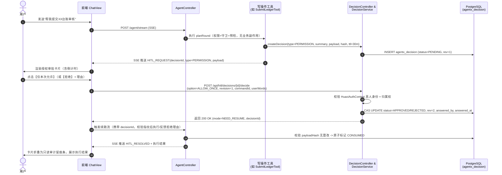
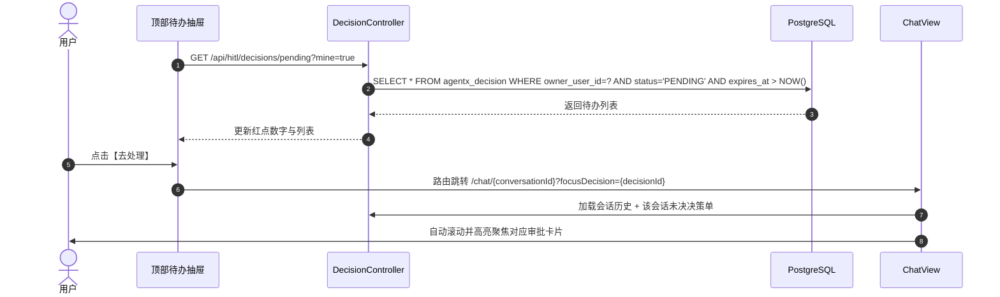

# 一期：HITL 底座与授权型闭环方案

> **里程碑定位**：一期（M-HITL-1）—— 把现有“内存令牌 + 手打暗号”升级为“**决策单落库 + 结构化授权卡片 + 拒绝理由 + 刷新/重启可恢复 + 全局待办汇聚**”。
>
> **总纲**：AI 只负责“打报告”，系统负责“卡脖子（先落库再弹窗）”，人负责“点按钮签字拍板”。
>
> **关联文档**：
> - 二期：[二期-HITL快路径原地唤醒与串行队列方案.md](./二期-HITL快路径原地唤醒与串行队列方案.md)
> - 三期：[三期-HITL多类型扩展(收集型_核对型_计划确认型)方案.md](./三期-HITL多类型扩展(收集型_核对型_计划确认型)方案.md)
> - 规范：[审计留痕_权限追责_与同类放行安全规范.md](./审计留痕_权限追责_与同类放行安全规范.md)

---

## 1. 一期目标与核心约定

### 1.1 解决什么问题（大白话）
目前项目里的高危写操作（如 `SubmitLedgerForReviewTool`、`ApproveTaskTool`、`RejectTaskTool`、`ResubmitLedgerTool`）靠 `ConfirmTokenService` 在内存里存一个 `ct_xxx` 令牌，用户必须**手打“确认执行 ct_xxx”**。存在 4 个核心痛点：
1. **重启全丢**：令牌与执行计划全在 JVM 内存，发版重启后用户点确认直接查无此单。
2. **体验割裂**：必须人工复制/输入 16 位十六进制暗号，容易输错。
3. **缺拒绝理由**：只能“执行/取消”，AI 不知道被拒原因，无法纠偏。
4. **状态无感知**：刷新页面、离开 5 分钟、多会话同时等待审批时，前端没有任何状态提醒与汇聚入口。

### 1.2 一期拍板参数
- **业务单据默认有效期（TTL）**：**30 分钟**（按工具可独立配置，如审批类 30 分钟、填报草稿类可配置更长）。
- **一期执行路径**：先稳妥走**持久化决策单 + 按钮触发审批 API + 会话恢复/续跑**（确保零内核高危改动、零回滚风险，为二期快路径原地唤醒铺好全部表结构与前后端协议）。
- **灰度开关**：`data-agent.hitl.enabled=true`（支持按工具粒度灰度）。

---

## 2. 核心业务场景与界面设计（含验收测试项）

### 场景 1.1：授权型 HITL —— 结构化卡片审批（批准 / 带理由拒绝）

#### 大白话场景
用户说：“帮我把 2026 年 Q3 的XX项目台账提交审核”。AI 完成数据核对后触发提审工具。系统拦截并先在数据库落一张决策单（锁定台账 ID、参数哈希 `payloadHash`、发起人），前端在聊天区弹出结构化审批卡片。用户核对关键信息后：
- 点击【仅本次允许】：系统校验真人登录态与乐观锁，消费决策单并触发执行，卡片折叠为不可编辑的审计留痕条。
- 点击【拒绝】：弹出轻量输入框填写理由（如“附件还没传完，先别提”），AI 收到理由后自动给出调整建议。

#### 界面呈现设计
卡片锚定在**当前 AI 回答气泡底部 / 输入框正上方单焦点槽位**，审批期间输入框提示“您有待确认的审批项，处理后继续（直接发新消息将作废当前审批单）”：

```text
┌──────────────────────────────────────────────────────────┐
│ ⚠️ 需要您的授权确认                         [剩余 29:56] │
│──────────────────────────────────────────────────────────│
│ 动作类型：提交台账审核 (submitLedgerForReview)            │
│ 影响对象：华西院区设备采购台账 #L-20260901                │
│ 关键参数：                                               │
│   • 审核人：张主任（科研处）                              │
│   • 附件数：3 份（已校验完整）                            │
│ [展开完整原始参数 JSON ▾]                                │
│──────────────────────────────────────────────────────────│
│ [拒绝 ▾]（可填拒绝理由）     [仅本次允许]  [本会话同类放行] │
└──────────────────────────────────────────────────────────┘
```
- **点击中态**：按钮置灰 Loading，前端生成幂等 `commandId` 防双击。
- **批准后留痕态**：折叠为只读条 `✅ 张三 于 2026-11-26 14:02:15 批准「提交台账审核」（仅本次）`。
- **拒绝后留痕态**：折叠为只读条 `❌ 张三 于 2026-11-26 14:02:15 拒绝「提交台账审核」｜理由：附件还没传完，先别提`。
- **注意**：L3 不可逆高危工具（如终审通过、驳回）前端不渲染【本会话同类放行】按钮（规则见 [审计留痕与安全规范](./审计留痕_权限追责_与同类放行安全规范.md)）。

#### 时序图



---

### 场景 1.2：跨会话全局待办汇聚（多任务并行审批）

#### 大白话场景
用户同时开了 4 个会话，其中 3 个分别在等审批。用户在顶部导航栏看到**【待我处理 (3)】**红点，点开右侧抽屉即可一览所有未决单据，点击任意一条【去处理】直接跳转对应会话并高亮定位到那张卡片。

#### 界面呈现设计
```text
顶部导航栏：[ 💬 对话 ]  [ 🔔 待我处理 (3) ]

点击展开右侧抽屉：
┌─────────────────────────────────────────────┐
│ 待我处理 (3)              [全部] [授权]     │
│─────────────────────────────────────────────│
│ ⚠️ [授权] 提交台账审核 #L-20260901          │
│    会话：Q3设备采购提审  • 剩 24:12  [去处理]│
│─────────────────────────────────────────────│
│ ⚠️ [授权] 暂存项目草稿 #D-202608            │
│    会话：科研项目申报    • 剩 18:05  [去处理]│
└─────────────────────────────────────────────┘
```

#### 时序图



---

## 3. 一期必须覆盖的异常场景

### 异常 1.1：刷新页面 / 切换会话 / 后端发版重启
- **表现**：审批卡片弹出后，用户按 F5 刷新页面、切去别的会话，或者后端刚刚发版重启。
- **处理机制**：
  - 决策单已持久化在 `agentx_decision` 表，与 JVM 内存解耦。
  - 前端重新进入会话时，拉取 `GET /api/hitl/decisions/pending?conversationId=xxx`，按服务端 `expiresAt` 精准还原卡片与剩余倒计时，用户依然可以直接点击【批准】或【拒绝】。

### 异常 1.2：超过 30 分钟有效期未处理（过期失效）
- **表现**：用户去开会 1 小时后回来看到卡片。
- **处理机制**：
  - 前端倒计时归零自动禁用按钮，卡片变为灰色：`⌛ 该审批单已于 14:32 过期失效，如需继续请重新发起`。
  - 后端双重兜底：定时任务（每 5 分钟）或 `decide` 接口校验 `NOW() > expires_at` 时将其置为 `EXPIRED` 并拒绝放行。

### 异常 1.3：用户不点按钮，直接发新消息顶掉（TakeOver）
- **表现**：卡片挂着，用户直接在聊天框打字说“算了不用提审了，帮我查下本月预算”。
- **处理机制**：复用现有 M3 TakeOver 机制，发新消息时自动将该会话下 `PENDING` 决策单置为 `SUPERSEDED`（已取代），旧卡片自动灰显“已被新对话取代”。

### 异常 1.4：双击并发 / 越权审批 / 现状漂移
- 详见 [审计留痕_权限追责_与同类放行安全规范.md](./审计留痕_权限追责_与同类放行安全规范.md)（CAS `revision` 乐观锁 + `commandId` 幂等 + `HuaxiAuthContext` 归属权校验 + `payloadHash` 防篡改）。

---

## 4. 结合现有代码的改造清单

### 4.1 数据库（`sql/agentx_pg.sql`）
新增 2 张核心表（完整 DDL 见 [审计留痕与安全规范](./审计留痕_权限追责_与同类放行安全规范.md)）：
1. `agentx_decision`：决策单主表（替代内存 `ConfirmTokenService`）。
2. `agentx_decision_grant`：会话级同类授权表。

### 4.2 内核层（`backend/mini-agentx-core`）
- `AgentStreamEvent.java`：新增 3 个事件类型 `HITL_REQUEST`、`HITL_RESOLVED`、`HITL_WITHDRAWN`，并新增对应字段（`decisionId`、`hitlType`、`hitlPayload`）。
- 穿透支持：子 Agent（`SubAgentTool`）通过 `ToolContext` 中的 `stepEmitter` 直接把 `HITL_REQUEST` 推送到主会话 SSE 流，决策单归属 `rootConversationId`。

### 4.3 服务端（`backend/data-agent-server`）
- **新增 `hitl` 包**：
  - `DecisionEntity` / `DecisionMapper` / `DecisionGrantMapper`
  - `DecisionService`：封装 `createDecision`、`decide`（CAS+鉴权+幂等）、`verifyAndConsume`、`markSuperseded`、`listPending`、`checkSessionGrant`、`revokeGrant`。
  - `DecisionController`：
    - `POST /api/hitl/decisions/{id}/decide`
    - `GET /api/hitl/decisions/pending`
    - `POST /api/hitl/grants/{grantId}/revoke`
- **改造现有写工具**：
  - `SubmitLedgerForReviewTool`、`ApproveTaskTool`、`RejectTaskTool`、`ResubmitLedgerTool`、`StageDraftTool`、`FillFileEntryTool` 等接入 `DecisionService`（保留原有 `ConfirmTokenService` 的 `canonicalMapper` SHA-256 哈希算法；支持通过配置开关平滑切换）。

### 4.4 前端（`frontend/src`）
- 新增 API 封装：`frontend/src/api/hitl.js`。
- 新增组件：
  - `HitlActionDock.vue`（单焦点锚点容器）
  - `HitlPermissionCard.vue`（授权卡片 + 倒计时 + 拒绝理由弹窗 + 留痕折叠态）
  - `PendingHitlDrawer.vue`（顶部导航栏红点 + 右侧待办抽屉）
- 改造 `ChatView.vue`：监听 `HITL_REQUEST` / `HITL_RESOLVED` / `HITL_WITHDRAWN`，进页面自动回显未决卡片，发新消息自动清理旧卡片。

---

## 5. 一期验收测试清单（TestHub 覆盖项）

- [ ] **TC-1.1 正向批准**：触发提审弹窗，点击【仅本次允许】，成功执行并折叠为带时间戳与审批人姓名的只读留痕条。
- [ ] **TC-1.2 带理由拒绝**：点击【拒绝】输入理由“附件缺失”，不调用主平台写接口，AI 下一轮明确采纳该理由。
- [ ] **TC-1.3 刷新与重启恢复**：弹窗后刷新浏览器 / 重启后端服务，重新打开会话卡片依然存在，倒计时准确，点击批准可正常执行。
- [ ] **TC-1.4 30 分钟过期**：将测试单据 `expires_at` 调至过期，前端禁用按钮，后端接口返回 `EXPIRED` 拒绝执行。
- [ ] **TC-1.5 双击与并发防重**：连续快速点击【批准】2 次，主平台只收到 1 次写请求，第 2 次幂等或返回 409。
- [ ] **TC-1.6 越权拦截**：用户 B 拿着用户 A 的 `decisionId` 调 `decide` 接口，返回 `403 Forbidden`。
- [ ] **TC-1.7 新消息顶掉**：弹窗未处理时直接发新消息，旧单据变为 `SUPERSEDED`，旧卡片灰显。
- [ ] **TC-1.8 全局待办汇聚**：同时在 3 个会话触发审批，顶部红点显示 `3`，点击抽屉【去处理】准确跳转并高亮对应卡片。
- [ ] **TC-1.9 子 Agent 穿透**：通过主路由调用 `declarant-fill` 子 Agent 触发提审，审批卡片直接呈现在主聊天窗口，无需点开子 Agent 抽屉。
