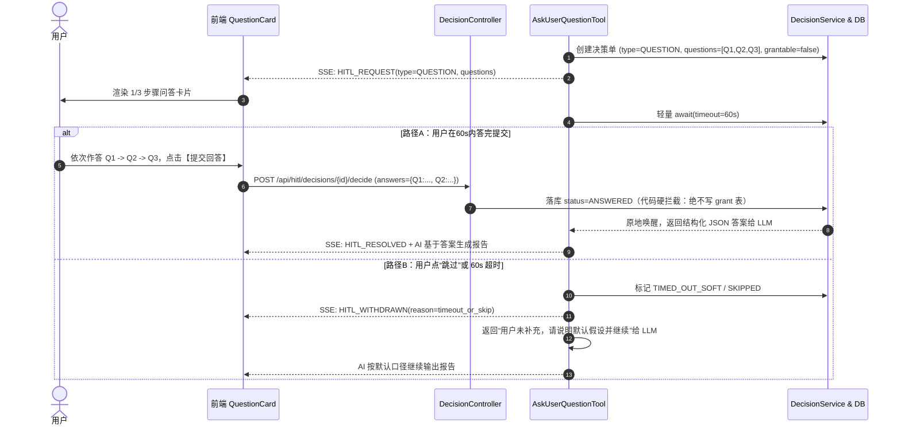
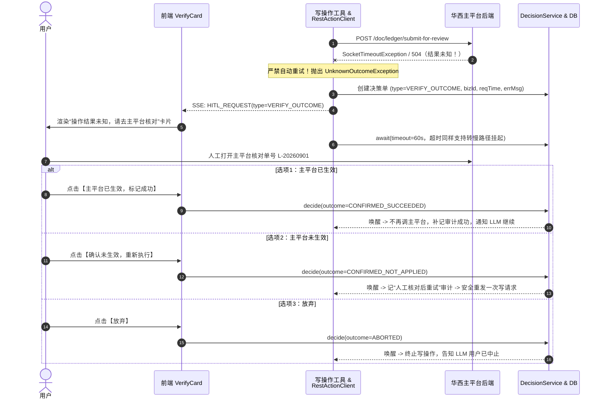
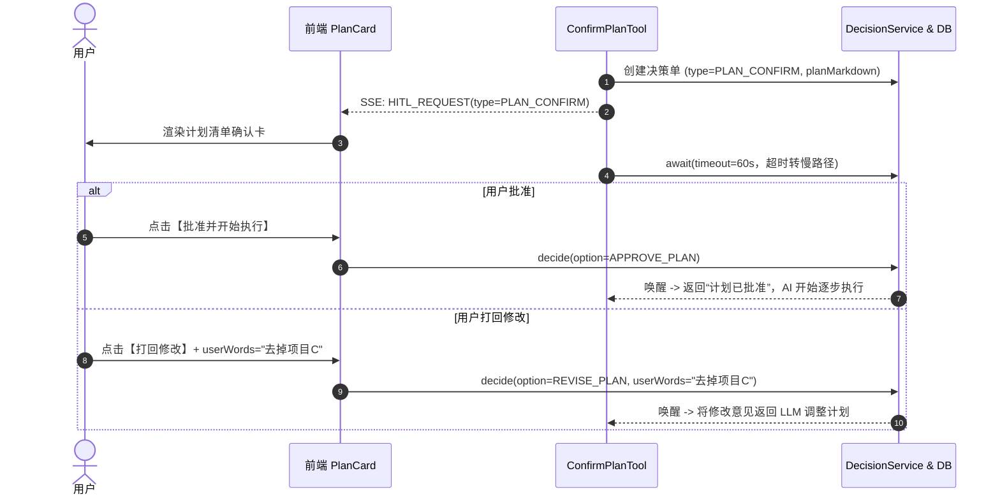

# 三期：HITL 多类型扩展（收集型 / 核对型 / 计划确认型）方案

> **里程碑定位**：三期（M-HITL-3）—— 在一期底座 + 二期快慢双路径引擎之上，补齐 HITL 完整家族，让系统不仅能管“高危授权”，还能优雅处理 **需求澄清提问（收集型）**、**外部写接口超时对账（核对型）** 和 **复杂任务方案审批（计划确认型）**。
>
> **前置依赖**：一期 + 二期已完成（复用了 `agentx_decision`、`DecisionAwaitRegistry`、`HitlActionDock` 单焦点槽位与快慢双路径）。
>
> **关联文档**：
> - 一期：[一期-HITL底座与授权型闭环方案.md](./一期-HITL底座与授权型闭环方案.md)
> - 二期：[二期-HITL快路径原地唤醒与串行队列方案.md](./二期-HITL快路径原地唤醒与串行队列方案.md)
> - 规范：[审计留痕_权限追责_与同类放行安全规范.md](./审计留痕_权限追责_与同类放行安全规范.md)

---

## 1. 三类新 HITL 的定位对比（大白话）

| 类型 | 枚举值 | 大白话目的 | 阻塞策略 | 权限红线 |
| :--- | :--- | :--- | :--- | :--- |
| **收集型** | `QUESTION` | AI 干活前缺信息，主动问 1~4 个选择题/填空题 | 轻量短等待（60s），**超时不卡死**，支持跳过让 AI 按默认假设继续 | **绝对永不授予任何工具权限** |
| **核对型** | `VERIFY_OUTCOME` | 调外部写接口中途断网/超时，不知道成没成，请人去主平台看一眼 | 强阻塞（同快慢双路径），**严禁自动重试** | 只记录核对结论，重试需重新走幂等校验 |
| **计划确认型** | `PLAN_CONFIRM` | 复杂多步任务先出《执行计划清单》，人拍板或提修改意见后再动手 | 阻塞等待拍板（同快慢双路径） | 仅确认方案方向，后续若含 L3 高危动作仍需单独授权 |

---

## 2. 场景 3.1：收集型 HITL —— 多题需求澄清步骤卡（`ask_user_question`）

### 大白话场景
用户说：“帮我出一份本季度科室经费分析报告”。由于汇报对象、统计口径、关注指标不明确，AI 调用内置工具 `ask_user_question` 一次性抛出 3 个问题。前端弹出蓝色的“步骤问答卡”（1/3 → 2/3 → 3/3），用户点选完提交，AI 拿到结构化答案立刻生成精准报告。如果用户懒得答（点跳过）或 60 秒没理它，系统不会报错卡死，而是让 AI 说明默认口径继续生成。

### 界面呈现设计
采用**蓝色/中性信息风格**（与红色的授权警示卡片在视觉上严格区分），支持单选、多选、“其他（自定义输入）”以及键盘快捷切换（`Enter` 下一题）：

```text
┌──────────────────────────────────────────────────────────┐
│ 💬 AI 需要向您确认几个细节                  步骤 1 / 3   │
│ ━━━━━━━━━━░░░░░░░░░░░░░░░░░░░░░░░░░░░░░░░░░              │
│                                                          │
│ Q1. 这份经费分析报告主要面向谁？ (单选)                  │
│   ◉ 院领导（侧重总览趋势与异常预警）                     │
│   ○ 科室主任（侧重明细拆解与预算执行率）                 │
│   ○ 财务审计（侧重合规性与凭证核对）                     │
│   ○ 其他：[ 请输入自定义说明... ]                        │
│                                                          │
│                     [跳过，让AI自行决定]      [下一题 →] │
└──────────────────────────────────────────────────────────┘
```
- 提交后卡片折叠为简洁留痕条：`💬 已补充 3 项需求细节 [展开查看 ▾]`。

### 时序图



---

## 3. 场景 3.2：核对型 HITL —— 写操作超时/未知副作用人工对账（`unknown-outcome`）

### 大白话场景
最容易引发生产重复提交事故的场景：用户批准了“提交台账审核”，后端 `RestActionClient` 发出 POST 请求后，等待主平台返回时遇到 **ReadTimeout（504 / 连接重置）**。此时谁也不知道主平台到底受理了没有。
- 系统**严禁自动重试**，而是捕获 `UnknownOutcomeException`，自动生成一张**核对型决策单**；
- 前端弹出橙色警戒卡片，给出业务单号、请求时间和主平台直达链接，请用户去主平台看一眼后拍板：【已生效，标记成功】、【确认未生效，重新执行】或【放弃】。

### 界面呈现设计
采用**橙色警戒风格**，提供单号一键复制与外部系统跳转：

```text
┌──────────────────────────────────────────────────────────┐
│ 🔍 操作结果未知，请人工核对（严禁自动重试）              │
│──────────────────────────────────────────────────────────│
│ 系统在调用「提交台账审核」时发生网络超时，无法确认主平台 │
│ 是否已受理。为避免重复提交，请前往主平台核对后告知结果： │
│                                                          │
│   • 业务单号：L-20260901 [复制]   [打开主平台查看 ↗]     │
│   • 请求时间：2026-11-26 14:05:12                        │
│   • 错误摘要：Read timed out after 15000ms               │
│──────────────────────────────────────────────────────────│
│ [主平台已生效，标记成功]  [确认未生效，重新执行]  [放弃] │
└──────────────────────────────────────────────────────────┘
```

### 时序图



---

## 4. 场景 3.3：计划确认型 HITL —— 复杂多步骤任务方案审批

### 大白话场景
用户说：“帮我把这 5 个项目的填报资料按新规范批量校对并暂存草稿”。AI 先盘点完差异，调用 `confirm_plan` 工具输出一份结构化《执行计划清单》，弹出计划确认卡让用户先审核方向。用户如果发现第 3 个项目不需要改，点击【打回修改】输入“去掉项目 C，其余照做”，AI 立刻修改计划重新确认；用户点【批准并开始执行】后再进入正式批量执行。

### 界面呈现设计
```text
┌──────────────────────────────────────────────────────────┐
│ 📋 执行计划确认                              [剩余 29:50] │
│──────────────────────────────────────────────────────────│
│ AI 拟定按以下 5 步执行（共涉及 5 个项目草稿更新）：      │
│   1. 项目A：补全采购预算明细字段                         │
│   2. 项目B：修正申报日期格式                             │
│   3. 项目C：替换旧版附件模板                             │
│   ...                                                    │
│──────────────────────────────────────────────────────────│
│        [打回修改（附意见）]             [批准并开始执行] │
└──────────────────────────────────────────────────────────┘
```

### 时序图



---

## 5. 结合现有代码的改造清单

### 5.1 服务端（`backend/data-agent-server`）
- **新增内置工具**：
  - `AskUserQuestionTool.java`：校验最多 4 题、单选/多选结构，调用 `DecisionService` 创建 `QUESTION` 单据，硬性保证不写入任何权限表。
  - `ConfirmPlanTool.java`：承接复杂任务的计划确认卡片。
- **改造 `RestActionClient.java`**：
  - 对写请求（`POST/PUT/DELETE`）精细区分异常类型：
    - `ConnectTimeoutException`（连接都没建立，确定未发送）→ 按常规失败报错；
    - `SocketTimeoutException` / `ReadTimeout` / `504` / 响应体中途断流（已发出但结果未知）→ 抛出 `UnknownOutcomeException`，由写操作基类统一截获并拉起 `VERIFY_OUTCOME` 核对型 HITL。
- **监控中心接入（`agentx_monitor_*`）**：
  - 上报 HITL 专项指标：各类型触发次数、平均人工响应耗时、快/慢路径占比、批准/拒绝/跳过率、核对型触发率。

### 5.2 前端（`frontend/src`）
- 新增 3 张卡片组件并注册到 `HitlActionDock.vue`：
  - `HitlQuestionCard.vue`（步骤条、键盘快捷键、跳过按钮）
  - `HitlVerifyCard.vue`（橙色警戒、复制单号、跳转主平台链接）
  - `HitlPlanCard.vue`（Markdown 计划渲染、打回意见输入）
- 改造 `PendingHitlDrawer.vue`：顶部筛选项扩展为 `[全部] [授权] [核对] [提问] [计划]`，并按紧急度排序（核对 > 授权 > 计划 > 提问）。

---

## 6. 三期验收测试清单（TestHub 覆盖项）

- [ ] **TC-3.1 收集型多题作答**：触发 3 题步骤卡，测试单选/多选/自定义输入及上一步/下一步切换，提交后 AI 准确按答案生成内容。
- [ ] **TC-3.2 收集型权限隔离红线**：完成收集型问答后，核查 `agentx_decision_grant` 表无任何新增授权记录。
- [ ] **TC-3.3 收集型跳过与超时**：点击【跳过】或等 60s 超时，流程不报错，AI 给出默认假设继续作答。
- [ ] **TC-3.4 核对型-已生效**：Mock `RestActionClient` 抛 `SocketTimeoutException`，弹出橙色核对卡；点【主平台已生效】，确认不重发外部请求并补记成功审计。
- [ ] **TC-3.5 核对型-未生效重试**：核对卡点【确认未生效，重新执行】，确认重发 1 次外部请求并记录“人工核对后重试”审计。
- [ ] **TC-3.6 核对型-挂起恢复**：核对卡超 60s 挂起后，5 分钟后回来点核对结果，依然正常恢复执行。
- [ ] **TC-3.7 计划确认型打回**：计划卡点【打回修改】并写意见，AI 准确剔除指定步骤后重新输出计划。
- [ ] **TC-3.8 全局待办分类汇聚**：不同会话分别挂起授权、核对、提问、计划 4 类卡片，待办抽屉按紧急度准确汇聚并支持一键跳转。
