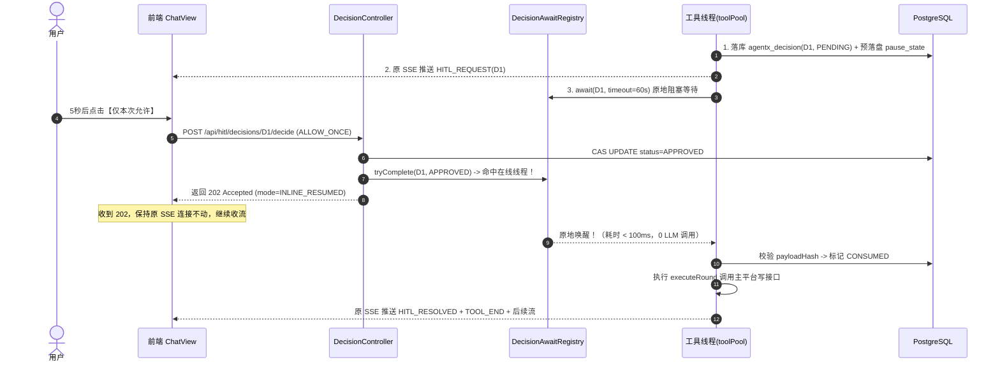
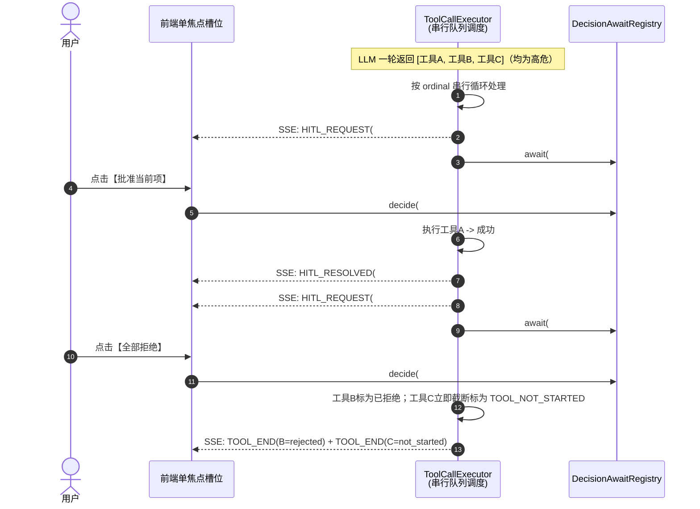
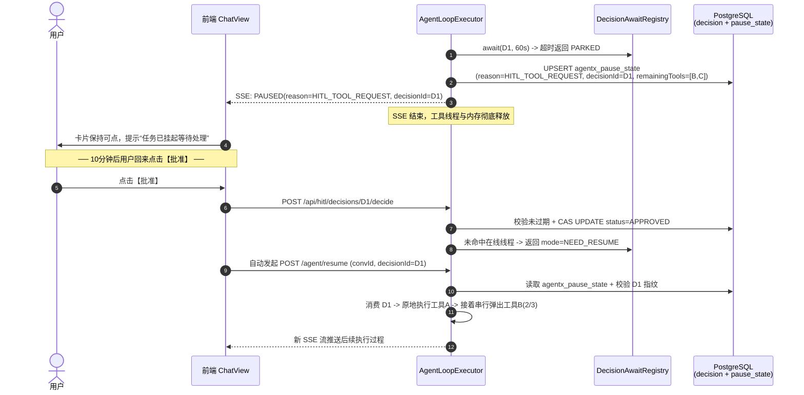

# 二期：HITL 快路径原地唤醒与串行队列方案

> **里程碑定位**：二期（M-HITL-2）—— 在一期底座之上，把执行引擎升级为 Agnes Harness 同款的 **“快路径在线原地唤醒（0 额外 LLM 开销） + 慢路径优雅挂起恢复（Park & Resume） + 多高危动作串行排队”**。
>
> **核心理念**：**审批是“人在回路”，不是“模型在思考”——用户点完批准，系统应该毫秒级原地继续执行，而不是让 LLM 重新读一遍上下文再想一遍。**
>
> **前置依赖**：一期（`agentx_decision` 落库与前端卡片协议）已完成上线。
>
> **关联文档**：
> - 一期：[一期-HITL底座与授权型闭环方案.md](./一期-HITL底座与授权型闭环方案.md)
> - 三期：[三期-HITL多类型扩展(收集型_核对型_计划确认型)方案.md](./三期-HITL多类型扩展(收集型_核对型_计划确认型)方案.md)
> - 规范：[审计留痕_权限追责_与同类放行安全规范.md](./审计留痕_权限追责_与同类放行安全规范.md)

---

## 1. 二期目标与核心参数

### 1.1 为什么需要二期（大白话）
一期虽然实现了按钮审批和落库，但用户点【批准】后还要重新跑一轮 LLM 才能真正执行工具：
- 单次审批多等 1~3 秒、多烧一轮 Token；
- 如果一次批量审批 5 个动作，就白白多跑 5 轮 LLM，而且模型还有可能抽风路由错工具；
- 如果模型一轮吐出 3 个高危工具，并发执行会导致同时弹 3 个审批框轰炸用户。

二期彻底解决这三个问题：
1. **快路径原地唤醒（Online Fast Path）**：用户在线时，工具线程原地阻塞等待 **60 秒**；用户点批准后毫秒级唤醒原线程直接干活，**0 额外 LLM 开销**。
2. **慢路径挂起恢复（Park & Resume Slow Path）**：超过 60 秒用户没点（比如去开会/吃午饭），工具线程自动把现场存入 `agentx_pause_state`（启用已预留的 `Reason.HITL_TOOL_REQUEST`）并优雅释放线程；用户 30 分钟内回来点批准，自动触发 `/agent/resume` 无缝续跑。
3. **多高危工具串行队列**：一轮命中多个高危动作时，后端按顺序逐个弹出审批，前端单焦点槽位展示 `1 / 3` → `2 / 3` → `3 / 3`；前序被拒或挂起，后续立即截断不偷跑。

### 1.2 二期拍板参数
- **快路径在线等待超时**：**60 秒**（与单据 30 分钟业务有效期彻底解耦）。
- **工具改造红线**：**进入 `await` 之前，工具绝对不允许产生任何业务写副作用**（只允许只读预检与落决策单/审计）。
- **跨实例部署兜底**：内存 `CompletableFuture` 唤醒为主 + DB 状态 2 秒轻轮询兜底（零额外中间件依赖，天然兼容多节点部署）。

---

## 2. 核心业务场景与界面设计（含验收测试项）

### 场景 2.1：在线秒批 —— 原地唤醒（0 额外 LLM 开销）

#### 大白话场景
用户点击【仅本次允许】的瞬间，后端 `DecisionController` 校验通过并更新 DB 后，发现 `DecisionAwaitRegistry` 里正有一个工具线程在等这个 `decisionId`。立刻 `future.complete(approved)` 原地唤醒该线程，100ms 内直接调华西主平台接口执行，并在**同一条 SSE 流**里继续把结果吐给前端，整个过程完全不重新调大模型。

#### 界面呈现设计
与一期卡片一致，但体验显著提速：点击【仅本次允许】后，卡片立即折叠，**页面不会出现新的“AI 思考中...”气泡**，而是紧接着在原进度条下方毫秒级显示工具执行结果。

#### 时序图



---

### 场景 2.2：多高危动作串行排队审批

#### 大白话场景
用户说：“把草稿 A 提审、把任务 B 驳回、再把台账 C 归档”。AI 一轮同时吐出 3 个高危工具调用。
- `ToolCallExecutor` 识别出这 3 个工具均为非并发安全（`isHitlTool = true`），自动切入串行队列，按顺序逐个处理。
- 前端同一时刻只展示 **1 张活跃卡片**（顶部标明 `第 1 项 / 共 3 项`），下方以只读方式预览第 2、3 项正在排队。
- 批完第 1 项并执行成功后，自动弹出第 2 项；如果用户点击【全部拒绝】，或第 1 项等待超 60s 进入挂起，第 2、3 项直接标为 `TOOL_NOT_STARTED`，绝不偷跑。

#### 界面呈现设计
```text
┌──────────────────────────────────────────────────────────┐
│ ⚠️ 待审批队列 (当前第 1 项 / 共 3 项)        [剩余 29:55] │
│──────────────────────────────────────────────────────────│
│ 当前操作：1. 提交草稿 A 审核                             │
│ 影响对象：项目草稿 #D-101                                │
│──────────────────────────────────────────────────────────│
│ 后续排队中（需逐项审批，只读预览）：                      │
│   2. 驳回任务 B（等待中）                                 │
│   3. 归档台账 C（等待中）                                 │
│──────────────────────────────────────────────────────────│
│              [全部拒绝]    [拒绝当前项]    [批准当前项]   │
└──────────────────────────────────────────────────────────┘
```

#### 时序图



---

## 3. 二期必须覆盖的异常场景

### 异常 2.1：弹窗期间刷新页面 / 网络闪断（60s 内）
- **核心原则**：**前端断连 ≠ 用户拒绝！**
- 依赖现有 `InMemoryLiveStreamRegistry`（执行与连接解耦），前端按 F5 刷新后：
  1. `GET /agent/stream/status` 发现流仍活跃；
  2. 发 `recovery=true + startSeq` 续接 SSE，并拉取 `pending` 决策单原样恢复卡片；
  3. 用户点击【批准】依然命中内存 `AwaitRegistry`，走快路径原地唤醒！

### 异常 2.2：用户离开超 60 秒（快路径自动降级为慢路径 Park & Resume）
- **大白话**：弹窗后用户去倒水/开会，60 秒内没点。系统不想白白占着线程池，于是把现场（包括排在后面还没跑的工具 B、C）存进 `agentx_pause_state` 表，发一个 `PAUSED(HITL_TOOL_REQUEST)` 结束当前 SSE 流，线程释放。
- **界面呈现**：卡片**依然保持可点击**，顶部提示条温柔切换为：`⏸ 任务已转入后台等待您的审批（有效至 14:35）`。
- **10 分钟后用户回来点【批准】**：
  - `DecisionController` 查 `AwaitRegistry` 未命中，返回 `200 OK (mode=NEED_RESUME)`；
  - 前端自动发起 `POST /agent/resume (conversationId, decisionId)`；
  - 内核从 `agentx_pause_state` 恢复现场，直接消费决策单执行原工具，再继续后续排队工具与 ReAct 循环。

#### 时序图（快路径超时降级 → 慢路径恢复）



### 异常 2.3：快路径 60s 等待期间，后端突然发版 / 优雅停机 / 意外宕机
- **双保险机制**：
  1. **进入 `await` 前预落盘**：在工具线程调用 `await` 前，先把最小化的 `PauseState` 预写入 `agentx_pause_state`（若快路径正常唤醒完成，终态自动清理）。
  2. **优雅停机钩子（`SmartLifecycle.stop()`）**：收到停机信号时，`DecisionAwaitRegistry` 主动唤醒所有正在 `await` 的线程返回 `PARKED`，确保体面收尾发 `PAUSED` 再停机。
- **结果**：新实例启动后，用户刷新或直接点击原卡片，无缝自动走慢路径 `NEED_RESUME` 恢复执行。

---

## 4. 结合现有代码的改造清单

### 4.1 内核层（`backend/mini-agentx-core`）
- **`PauseState.java`**：正式启用已预留的 `Reason.HITL_TOOL_REQUEST`，扩展 `decisionId` 字段与 `remainingToolCalls` 列表。
- **`ToolCallExecutor.java`**：
  - 区分只读并发工具与 HITL 非并发安全工具；高危工具按 `ordinal` 串行执行。
  - 捕获工具返回的 `HitlParkSignal`（超时挂起信号）或 `REJECT_ALL`，立即截断同批次后续工具。
- **`AgentLoopExecutor.java`**：
  - 接管 `HitlParkSignal` → 写 `JdbcPauseStateStore` → 发射 `PAUSED(HITL_TOOL_REQUEST)` → 释放流。
  - 扩展 `initMessagesFromResume()`：针对 `HITL_TOOL_REQUEST` 快照，直接消费已批准的决策单重放对应工具（不经过 LLM），并把 `remainingToolCalls` 接回串行队列。

### 4.2 服务端（`backend/data-agent-server`）
- **新增 `DecisionAwaitRegistry`**：
  - 管理 `ConcurrentHashMap<String, CompletableFuture<DecisionOutcome>>`。
  - 实现 `SmartLifecycle` 优雅停机钩子。
  - 集成 2 秒 DB 轮询兜底（支持多实例部署场景下跨节点唤醒）。
- **`DecisionController`**：
  - `decide()` 返回体增加 `mode` 字段：`INLINE_RESUMED`（HTTP 202，命中快路径）或 `NEED_RESUME`（HTTP 200，走慢路径）。

### 4.3 前端（`frontend/src`）
- **`ChatView.vue` & `HitlActionDock.vue`**：
  - 兼容 `decide` 返回的两种模式：`INLINE_RESUMED` 保持原 SSE 连接；`NEED_RESUME` 自动调用 `/agent/resume`。
  - 渲染队列进度（`1 / 3`）、只读排队预览列表及【全部拒绝】按钮。
  - 收到 `PAUSED(HITL_TOOL_REQUEST)` 时不隐藏卡片，仅切换顶部状态条为“后台挂起等待中”。

---

## 5. 二期验收测试清单（TestHub 覆盖项）

- [ ] **TC-2.1 快路径零 LLM 开销**：监控 `agentx_trace` 轮次，在线点击【批准】后，工具在 200ms 内执行且**没有新增多余的 LLM 推理轮次**。
- [ ] **TC-2.2 60s 超时降级慢路径**：弹窗后等待 65 秒（超过 60s 但在 30m 有效期内），确认 SSE 正常以 `PAUSED` 结束且线程释放；第 70 秒点击【批准】，前端自动触发 `/agent/resume` 并成功执行。
- [ ] **TC-2.3 60s 内刷新不断**：弹窗第 10 秒按 F5 刷新，重新进入会话恢复流并点击【批准】，依然命中快路径原地唤醒。
- [ ] **TC-2.4 串行多动作排队**：一轮触发 3 个高危工具，界面只显示 `1/3`；批准第 1 个执行后切 `2/3`；第 2 个点【全部拒绝】，第 3 个标记 `TOOL_NOT_STARTED` 不执行。
- [ ] **TC-2.5 挂起截断防偷跑**：3 个高危工具串行时，第 1 个超 60s 挂起，确认第 2、3 个未执行；恢复批准第 1 个后，自动接着弹出第 2 个审批。
- [ ] **TC-2.6 服务重启恢复**：弹窗等待期间重启后端进程，启动完成后用户点击原卡片【批准】，成功走慢路径续跑完成。
