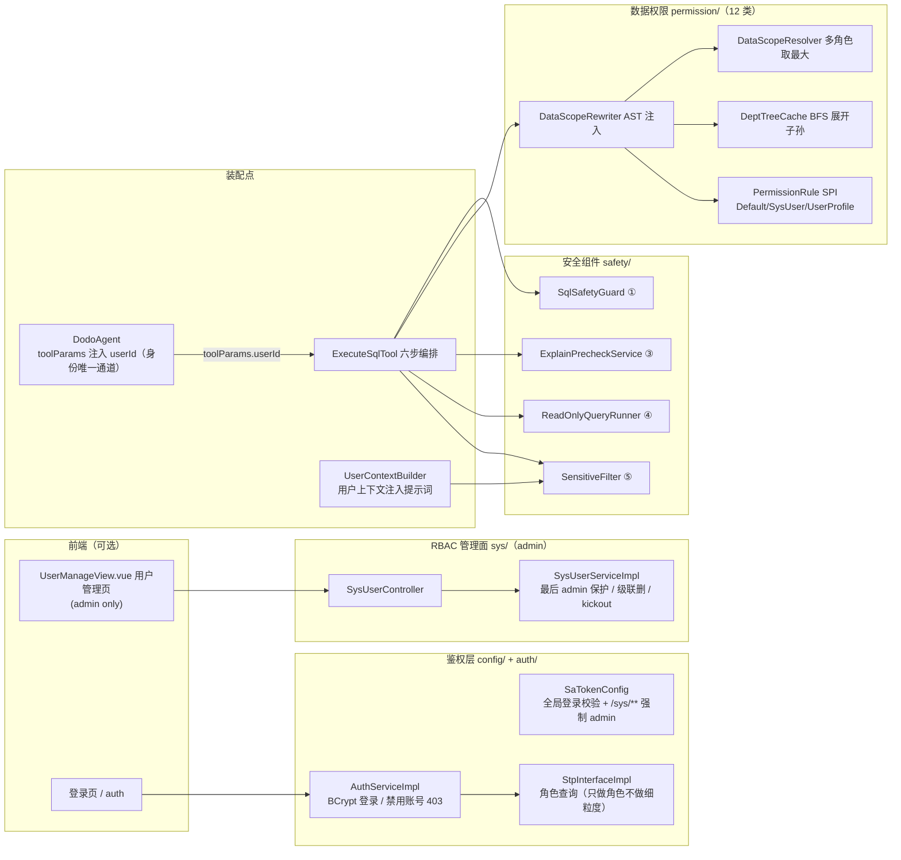

# 06 · 安全纵深与 RBAC 迁移方案（从 0 移植到另一个 Agent）

> 对应里程碑 M4（README「M4 安全纵深与 RBAC」+「M4 架构说明」）。本文回答一个问题：
> **把这套"安全纵深与数据权限（RBAC）"移植到另一个 Agent 工程里，从 0 开始怎么做。**
> 代码全部来自本项目真实源码（`data-agent-server`），标注了哪些可零修改拷贝、哪些必须适配。
> 源码位置统一在 `backend/data-agent-server/src/main/java/com/llmetor/dataagent/` 下，下文简写包名。

---

## 1. 设计总览（先看懂再动手）

### 1.1 一句话本质

**让"谁在问"真正决定"能看到什么"**：LLM 生成的 SQL 不直接执行，而是走一条固定的六步安全流水线，在其中一步把当前用户的 RBAC 数据范围（ALL / DEPT_AND_SUB / DEPT / SELF）以 WHERE/ON 条件的形式**注入 SQL AST**，LLM 看不到也绕不过这条注入。

它解决的是 Agent 场景特有的安全问题：传统系统里权限拦"接口"，Agent 系统里 LLM 可以生成**任意 SQL**——接口级权限拦不住"查全表"，必须在"SQL 文本 → 数据库"之间再放一道按行过滤的闸门。

### 1.2 六步流水线（顺序固定，docs/01 §2.2）

```
LLM 生成 SQL
   ↓
① SqlSafetyGuard 静态校验     白名单只放行 SELECT/WITH、危险函数黑名单、
  （fail-closed）             JOIN≤3、禁笛卡尔积、LIMIT 治理（缺失注入/超限下调）
   ↓ safeSql
② DataScopeRewriter 改写      按用户 dataScope 把过滤条件注入 SQL AST：
  （fail-closed 分层）        FROM 主表/INNER JOIN → AND 进 WHERE；
                              LEFT JOIN 右表 → AND 进 ON（防 LEFT 退化 INNER）；
                              USING/NATURAL 注入不进去 → 拒绝执行
   ↓ executableSql（改写后 SQL）
③ ExplainPrecheckService      聚合查询直接放行；明细查询读 EXPLAIN 计划，
  （fail-open 成本护栏）       规则 1 大表明细扫描（rows≥10万）、规则 2 JOIN 扩张（乘积≥100万）拦截
   ↓
④ ReadOnlyQueryRunner 执行    只读连接 + 30s 超时 + maxRows+1 硬限 + 瞬态重试
   ↓ SqlResult
⑤ SensitiveFilter 脱敏        JDBC 列元数据三级匹配（表.列 → 纯列名 → label），
  （fail-open）               敏感值原地替换 ********
   ↓
⑥ 面向 LLM 格式化             executedSql = **改写后 SQL**（LLM 能看到注入条件并如实呈现）
```

任何一步拒绝都以"❌ + 原因 + 改写引导"回灌消息链，ReAct 循环不终止——**错误即养料**，LLM 会自行改写 SQL 重试（≤3 次）。

### 1.3 模块架构



依赖方向：permission/safety 单向被工具层依赖，内核（Agent 循环）不感知安全组件；**PermissionRule 注册即生效**（Spring @Component 扫入改写器规则表），新增管控表零侵入。

### 1.4 身份流转时序（userId 从登录态到 SQL 注入条件）

```
用户登录 → StpUtil.login(userId)（Sa-Token 签发 token）
→ 每次对话 AgentController 从会话取 userId
→ DodoAgent.stream(query, convId, userId, ...)
     .toolParams(Map.of("userId", userId.toString()))   ← 身份唯一通道
→ mini-agentx 内核执行工具前按 inputSchema 强制覆盖 userId 参数
   （executeSql 的 userId 参数 required=false，LLM 可见参数名但值被框架覆盖）
→ ExecuteSqlTool.executeSql(sql, userId)
→ DataScopeResolver.resolve(userId) 查 RBAC 五表 → DataScopeContext
→ DataScopeRewriter 注入 WHERE/ON
→ 执行的是改写后 SQL
```

关键点：**改写器不读 ThreadLocal**（工具在异步线程执行，ThreadLocal 不可靠）、**不信 LLM 传的 userId**（内核强制覆盖）、userId 无效时 fail-closed 回落 SELF（最小权限）。

### 1.5 七个关键设计决策（迁移时不要改掉）

| # | 决策 | 理由 |
|---|---|---|
| 1 | **改写走 SQL AST，不走正则/字符串拼接** | 正则改写 SQL 是安全反模式（注释/嵌套/别名即可绕过）；JSqlParser 解析失败即拒绝，绕不过去 |
| 2 | **LEFT JOIN 权限条件进 ON，不进 WHERE** | 右表条件进 WHERE 会把 NULL 扩展行过滤掉，LEFT 退化 INNER——左表行数变少是"越权"之外的第二种语义错误 |
| 3 | **fail-closed 分层**：注入不进去 → 拒绝；意外异常 → 回落 SELF；SELF 失败 → 拒绝 | 权限出错的正确姿势是"少给数据"，任何分支都不存在"改写失败就放行原 SQL" |
| 4 | **EXPLAIN 是护栏不是边界**（fail-open，聚合放行） | 安全边界是 guard + 只读连接 + 超时/行数硬限；EXPLAIN 判断失误的代价应是"多跑一条慢查询"而非"业务被挡死" |
| 5 | **executedSql 回灌改写后 SQL** | LLM 看到的 SQL 与真实执行的严格一致，报告里出现的注入条件能如实呈现——不出现"看到的和跑的不是同一条" |
| 6 | **mask-fields 一份配置四处复用**（结果集/M-Schema 示例值/档案展示/登录态接口） | 新增敏感列只改配置，四处同步生效，不存在"结果集脱了、示例值漏了" |
| 7 | **userId 只经 toolParams 白名单注入** | 不暴露给 LLM（参数值被强制覆盖）、不依赖 ThreadLocal（异步线程）、提示词注入拿不到别人身份 |

### 1.6 各组件失败方向速查表

| 组件 | 失败方向 | 失败时的行为 |
|---|---|---|
| SqlSafetyGuard ① | fail-closed | 拒绝执行，回灌修改建议 |
| DataScopeResolver ② | fail-closed | 回落 SELF（最小权限），不阻断对话 |
| DataScopeRewriter ② | 分层 fail-closed | 结构性注入不进去 → RewriteException 拒绝；意外异常 → 回落 SELF 重试；SELF 再失败 → 拒绝 |
| DeptTreeCache 未就绪 ② | fail-closed | 拒绝执行（不被 SELF 兜底吞掉） |
| ExplainPrecheckService ③ | fail-open | 非超时失败放行；超时才拦 |
| SensitiveFilter ⑤ | fail-open | 仅 warn，不炸已成功的查询 |
| ReadOnlyQueryRunner ④ | 瞬态重试 → 失败回灌 | 超时/断连透明重试 2 次，仍失败把分类错误回灌 LLM 修 SQL |

---

## 2. 迁移总览：文件清单与拷贝性评估

按"拷过来能不能直接编译跑"分四档。**零修改**=只改 package 名；**改引用**=替换 mapper/实体/配置键名；**适配**=必须按目标工程重写部分内容；**参考**=按目标工程接口风格重写。

### 2.1 permission/ 包（数据权限，核心）

| 文件 | 行数 | 拷贝性 | 适配点 |
|---|---|---|---|
| `PermissionRule.java` | 37 | 零修改 | — |
| `ConditionBuilder.java` | 41 | 零修改 | — |
| `DataScopeContext.java` | 31 | 零修改 | — |
| `RewriteResult.java` | 12 | 零修改 | — |
| `RewriteException.java` | 12 | 零修改 | — |
| `DeptTreeCacheNotReadyException.java` | 13 | 零修改 | — |
| `DataScopeRewriter.java` | 278 | 零修改 | — |
| `DataScope.java`（common/enums） | 54 | 零修改 | — |
| `DataScopeResolver.java` | 105 | 改引用 | sys 五个 mapper 的包名/import |
| `DeptTreeCache.java` | 93 | 改引用 | SysDeptMapper import |
| `DefaultPermissionRule.java` | 34 | **适配** | MANAGED_TABLES=payment/rental → 换成目标库的业务表 |
| `SysUserPermissionRule.java` / `UserProfilePermissionRule.java` | 39/39 | 适配 | 目标库没有这两张表就不搬，或按目标表重写条件 |

### 2.2 safety/ 包（安全组件）

| 文件 | 行数 | 拷贝性 | 适配点 |
|---|---|---|---|
| `SqlSafetyGuard.java` | 335 | 零修改 | — |
| `ReadOnlyQueryRunner.java` | 183 | 零修改 | DataSource 用目标工程的业务库 |
| `SqlResult.java` / `ValidationResult.java` / `ExplainVerdict.java` | 33/16/15 | 零修改 | — |
| `ExplainPrecheckService.java` | 249 | 零修改 | 依赖 MySQL 传统 EXPLAIN 输出列（type/rows/Extra）；非 MySQL 见 §7.3 |
| `SensitiveFilter.java` | 110 | 零修改 | mask-fields 配置按目标库改 |

### 2.3 装配与提示词

| 文件 | 行数 | 拷贝性 | 适配点 |
|---|---|---|---|
| `tools/ExecuteSqlTool.java` | 212 | 改引用 | `@Tool` 注解是 Spring AI 的；工具描述文案建议原样保留 |
| `agent/DodoAgent.java`（节选） | — | 适配 | 只迁 `.toolParams(...)` 注入这一个动作，挂到目标 Agent 的工具调用入口 |
| `prompt/UserContextBuilder.java` | 155 | 参考 | 依赖 AuthService/登录态 VO；可裁剪 |

### 2.4 鉴权与 RBAC 管理面

| 文件 | 行数 | 拷贝性 | 适配点 |
|---|---|---|---|
| `config/SaTokenConfig.java` | 82 | 参考 | 路由清单按目标工程改 |
| `config/StpInterfaceImpl.java` | 63 | 改引用 | mapper import |
| `auth/*`（Controller/Service/DTO） | ~400 | 参考 | R<T> 响应包装换成目标工程的 |
| `sys/*`（entity 5 + mapper 5 + dto + service + controller） | ~900 | 改引用 | 表名不变即可整体搬；R<T> 同上 |
| `common/DisabledAccountException.java` | ~10 | 零修改 | + GlobalExceptionHandler 映射 403（参考） |
| `frontend/UserManageView.vue` + `api/sys.js` | ~700 | 参考 | 可选，先有 API 也能用 |

### 2.5 单测（强烈建议随代码一起搬）

| 测试 | 数量 | 覆盖 |
|---|---|---|
| `DataScopeRewriterTest` | 20 | FROM/INNER 进 WHERE、LEFT 进 ON、UNION/WITH/嵌套子查询、USING/NATURAL 拒绝、异常回落 SELF |
| `DeptTreeCacheTest` | 6 | BFS 展开、未就绪拒绝 |
| `ExplainPrecheckServiceTest` | 12 | evaluate() 直测两规则、聚合放行、fail-open |
| `SensitiveFilterTest` | 9 | 三级匹配、label 兜底 |
| `SqlSafetyGuardTest` | （M2 已有） | 白名单/危险函数/LIMIT 治理 |

---

## 3. Phase 0 · 前置准备（依赖与配置）

### 3.1 版本矩阵（本项目实测组合）

| 依赖 | 版本 | 用途 |
|---|---|---|
| Java | 21 | — |
| Spring Boot | 3.5.6（parent） | — |
| Spring AI | 1.1.0（BOM） | `@Tool`/`@ToolParam` 注解（仅工具声明处需要） |
| Sa-Token | 1.39.0（`sa-token-spring-boot3-starter` + `sa-token-redis-jackson`） | 登录态/角色/kickout；单体无 Redis 可只用 starter 内存版 |
| MyBatis-Plus | 3.5.12（`mybatis-plus-spring-boot3-starter`） | RBAC 五表 CRUD |
| JSqlParser | **5.1**（经 `mybatis-plus-jsqlparser` 3.5.12 传递引入） | SQL AST 解析/改写，**勿手工引入低版本**（4.6 以下 API 不兼容） |
| spring-security-crypto | 随 Boot | 只为 BCryptPasswordEncoder，不引入整个 Spring Security |
| MySQL Connector | 8.0.33 | 业务库 + EXPLAIN |

### 3.2 pom 依赖片段

```xml
<!-- 登录鉴权 -->
<dependency>
    <groupId>cn.dev33</groupId>
    <artifactId>sa-token-spring-boot3-starter</artifactId>
</dependency>
<!-- 多实例部署才需要；单体内存会话可不引 -->
<dependency>
    <groupId>cn.dev33</groupId>
    <artifactId>sa-token-redis-jackson</artifactId>
</dependency>

<!-- RBAC 数据层 + SQL 解析（jsqlparser 5.1 由此传递引入） -->
<dependency>
    <groupId>com.baomidou</groupId>
    <artifactId>mybatis-plus-spring-boot3-starter</artifactId>
</dependency>
<dependency>
    <groupId>com.baomidou</groupId>
    <artifactId>mybatis-plus-jsqlparser</artifactId>
</dependency>

<!-- BCrypt 密码加密（仅 crypto，不引入整个 Spring Security） -->
<dependency>
    <groupId>org.springframework.security</groupId>
    <artifactId>spring-security-crypto</artifactId>
</dependency>
```

### 3.3 application.yml 配置片段（全部带默认值，可按需覆盖）

```yaml
data-agent:
  safety:
    max-rows: 200              # LIMIT 治理上限 + 读取行数硬限
    max-joins: 3               # JOIN 数上限
    query-timeout-seconds: 30  # 只读查询超时
    explain:                   # ③ EXPLAIN 预检
      enabled: true
      timeout-seconds: 5
      max-estimated-rows: 100000   # 规则1阈值；规则2 = 该值 ×10
  data-permission:             # ② 数据权限改写总开关（false 时全量放行，先灰度后开启）
    enabled: true
  sensitive-filter:            # ⑤ 脱敏
    enabled: true
    mask-fields: sys_user.password,user_profile.id_card,user_profile.home_address
```

> **灰度建议**：三个 `enabled` 全部独立可关。迁移期先 `data-permission.enabled=false` 跑通 ①③④⑤，再开 ②——这样每个组件可单独回归，出问题可单独回退。

---

## 4. Phase 1 · 数据层：RBAC 五张表

### 4.1 表结构（MySQL DDL，直接执行）

五张表构成"用户 ↔ 角色（带 data_scope）↔ 部门（多对多）"模型。**目标工程已有用户表时**：不强制换表，只需保证 DataScopeResolver 能查到 `用户 → 角色列表（含 data_scope 字符串）` 与 `用户 → 部门 ID 集合`，可写两个适配 SQL 替代。

```sql
-- 角色表（data_scope 是数据权限的锚点）
CREATE TABLE `sys_role`
(
    `id`         bigint      NOT NULL COMMENT '主键ID',
    `code`       varchar(64) NOT NULL COMMENT '角色代码（如 admin）',
    `name`       varchar(64) NOT NULL COMMENT '角色名称（如 系统管理员）',
    `data_scope` varchar(32) NOT NULL DEFAULT 'DEPT' COMMENT '数据范围：ALL/DEPT_AND_SUB/DEPT/SELF',
    `sort`       int         NOT NULL DEFAULT 0,
    `status`     varchar(16) NOT NULL DEFAULT 'ACTIVE' COMMENT 'ACTIVE/DISABLED',
    `created_at` timestamp   NOT NULL DEFAULT CURRENT_TIMESTAMP,
    `updated_at` timestamp   NOT NULL DEFAULT CURRENT_TIMESTAMP ON UPDATE CURRENT_TIMESTAMP,
    PRIMARY KEY (`id`),
    UNIQUE INDEX `uk_sys_role_code`(`code`)
) ENGINE = InnoDB CHARSET = utf8mb4 COMMENT = '角色表';

-- 部门表（树形；数据权限 DEPT_AND_SUB 的展开依赖）
CREATE TABLE `sys_dept`
(
    `id`         bigint       NOT NULL COMMENT '主键ID',
    `name`       varchar(100) NOT NULL,
    `parent_id`  bigint       NOT NULL DEFAULT 0 COMMENT '父部门ID（顶级为0）',
    `ancestors`  varchar(500) NOT NULL DEFAULT '0' COMMENT '祖先路径（展示用；子孙展开走邻接表 BFS，不依赖此列）',
    `sort`       int          NOT NULL DEFAULT 0,
    `status`     varchar(16)  NOT NULL DEFAULT 'ACTIVE',
    `created_at` timestamp    NOT NULL DEFAULT CURRENT_TIMESTAMP,
    `updated_at` timestamp    NOT NULL DEFAULT CURRENT_TIMESTAMP ON UPDATE CURRENT_TIMESTAMP,
    PRIMARY KEY (`id`),
    INDEX `idx_sys_dept_parent_id` (`parent_id`)
) ENGINE = InnoDB CHARSET = utf8mb4 COMMENT = '部门表（树形）';

-- 用户表（密码 BCrypt 哈希存储）
CREATE TABLE `sys_user`
(
    `id`         bigint       NOT NULL,
    `username`   varchar(64)  NOT NULL,
    `password`   varchar(128) NOT NULL COMMENT 'BCrypt 哈希',
    `nickname`   varchar(64)  DEFAULT NULL,
    `status`     varchar(16)  NOT NULL DEFAULT 'ACTIVE' COMMENT 'ACTIVE/DISABLED',
    `created_at` timestamp    NOT NULL DEFAULT CURRENT_TIMESTAMP,
    `updated_at` timestamp    NOT NULL DEFAULT CURRENT_TIMESTAMP ON UPDATE CURRENT_TIMESTAMP,
    PRIMARY KEY (`id`),
    UNIQUE INDEX `uk_sys_user_username` (`username`)
) ENGINE = InnoDB CHARSET = utf8mb4 COMMENT = '用户表';

-- 用户-角色关联
CREATE TABLE `sys_user_role`
(
    `user_id`    bigint    NOT NULL,
    `role_id`    bigint    NOT NULL,
    `created_at` timestamp NOT NULL DEFAULT CURRENT_TIMESTAMP,
    PRIMARY KEY (`user_id`, `role_id`),
    INDEX `idx_sys_user_role_role_id` (`role_id`)
) ENGINE = InnoDB CHARSET = utf8mb4 COMMENT = '用户-角色关联表';

-- 用户-部门关联（多对多，支持跨部门兼职；DEPT/DEPT_AND_SUB 走该表）
CREATE TABLE `sys_user_dept`
(
    `user_id`    bigint    NOT NULL,
    `dept_id`    bigint    NOT NULL,
    `created_at` timestamp NOT NULL DEFAULT CURRENT_TIMESTAMP,
    PRIMARY KEY (`user_id`, `dept_id`),
    INDEX `idx_sys_user_dept_dept_id` (`dept_id`)
) ENGINE = InnoDB CHARSET = utf8mb4 COMMENT = '用户-部门关联表（多对多）';
```

### 4.2 种子数据（最小可用集）

```sql
-- 至少一个 admin（data_scope=ALL）+ 一个普通角色做数据权限验证
INSERT INTO sys_role (id, code, name, data_scope, sort, status) VALUES
(1, 'admin',   '系统管理员', 'ALL',           0, 'ACTIVE'),
(2, 'mgr',     '部门经理',   'DEPT_AND_SUB',  1, 'ACTIVE'),
(3, 'analyst', '本部门分析', 'DEPT',          2, 'ACTIVE'),
(4, 'staff',   '普通员工',   'SELF',          3, 'ACTIVE');

-- 内置 admin：userId=1 是代码里的 BUILTIN_ADMIN_ID（禁删禁禁用），不要改
INSERT INTO sys_user (id, username, password, nickname, status) VALUES
(1, 'admin', '$2a$10$....BCrypt哈希....', '管理员', 'ACTIVE');
INSERT INTO sys_user_role (user_id, role_id) VALUES (1, 1);
```

> 建议像本项目一样预置**四个角色各一个测试账号**（如 admin_test/mgr_test/analyst_test/sh_sales），验收 §12 的"四档逐档收窄"用例直接可用。

### 4.3 实体 + Mapper 样例（其余四组同构）

```java
@Data
@TableName("sys_role")
public class SysRole implements Serializable {
    @TableId(type = IdType.ASSIGN_ID)   // 雪花 ID（种子数据显式指定 id 插入，不受影响）
    private Long id;
    private String code;
    private String name;
    private String dataScope;   // ALL/DEPT_AND_SUB/DEPT/SELF
    private Integer sort;
    private String status;
}

@Mapper
public interface SysRoleMapper extends BaseMapper<SysRole> {}
```

换 ORM（JPA/JDBC 等）只改这层实体与 mapper，permission/ 包对 ORM 零依赖（只在 DataScopeResolver/DeptTreeCache 里用到）。

---

## 5. Phase 2 · 安全链地基：guard ① + 只读执行器 ④（M2 基础，先于数据权限落地）

数据权限改写建立在"guard 已产出可解析的安全 SQL"之上（改写器二次 parse 失败直接拒绝），所以 ①④ 必须先行。

### 5.1 SqlSafetyGuard（safety/SqlSafetyGuard.java，零修改拷贝）

静态校验七件事，全部走 AST（文本预扫只做危险模式的兜底）：

```java
public ValidationResult validate(String sql) {
    // ...去末尾分号、空判...
    try {
        return doValidate(trimmed);
    } catch (JSQLParserException pe) {
        return ValidationResult.reject("SQL 语法解析失败：" + truncate(pe.getMessage(), 200));
    } catch (Exception e) {
        return ValidationResult.reject("SQL 校验异常：" + e.getClass().getSimpleName()); // fail-closed
    }
}

private ValidationResult doValidate(String sql) throws JSQLParserException {
    // 1. 文本预扫：LOAD_FILE( / INTO OUTFILE|DUMPFILE / SYSTEM_USER( / FILE_READ|WRITE
    // 2. parseStatements 拦多语句（size != 1 拒绝）
    // 3. 白名单：stmt 必须 instanceof Select（WITH 是 Select 子类；INSERT/DDL/CALL 全拦）
    // 4. AST 全树递归找危险函数：sleep/benchmark/get_lock/load_file/sys_exec... 
    //    （复用 TablesNamesFinder 的遍历能力，重写 visit(Function)）
    // 5. 形态递归校验（CTE/UNION 分支/括号子查询/FROM·WHERE 子查询全覆盖）：
    //    禁 FOR UPDATE/SHARE、禁 SELECT INTO、OFFSET 必须带 ORDER BY、
    //    JOIN ≤ maxJoins、禁 CROSS JOIN/逗号连接/无 ON·USING 的 JOIN（防笛卡尔积）
    // 6. 用户 LIMIT 超阈值下调到 maxRows
    // 7. 无 LIMIT 注入一个 LIMIT maxRows
    ...
    return ValidationResult.ok(select.toString());
}
```

**迁移提醒**：第 7 步"无 LIMIT 注入"很重要——数据权限改写不依赖 LIMIT，但 201 行硬限（maxRows+1）是 EXPLAIN fail-open 之后的最后成本兜底，两者配合才构成"护栏不是边界"的完整语义。

### 5.2 ReadOnlyQueryRunner（safety/ReadOnlyQueryRunner.java，零修改拷贝）

```java
public SqlResult execute(String safeSql) {
    long t0 = System.currentTimeMillis();
    for (int attempt = 0; attempt <= MAX_TRANSIENT_RETRIES; attempt++) {   // 瞬态错误重试 2 次
        try (Connection conn = dataSource.getConnection()) {
            trySetReadOnly(conn);                                          // 只读连接（尽力而为）
            try (Statement stmt = conn.createStatement(
                    ResultSet.TYPE_FORWARD_ONLY, ResultSet.CONCUR_READ_ONLY)) {
                stmt.setQueryTimeout(timeoutSeconds);                      // 30s 超时
                stmt.setMaxRows(maxRows + 1);                              // 行数硬限（+1 识别截断）
                try (ResultSet rs = stmt.executeQuery(safeSql)) {
                    return readResultSet(rs, safeSql, t0);                 // 读取循环再硬限 + 列元数据采集
                }
            }
        } catch (SQLException e) {
            SqlErrorType type = classify(e);                               // SQLState 分类
            if (type == SqlErrorType.TRANSIENT && attempt < MAX_TRANSIENT_RETRIES) { /* 退避重试 */ continue; }
            return SqlResult.fail(safeSql, buildClassifiedError(e, type), System.currentTimeMillis() - t0);
        }
    }
    ...
}
```

两个迁移必留细节：

1. **列元数据采集**（`readResultSet` 里把 `md.getTableName(i)`/`md.getColumnName(i)`/label 存进 `SqlResult.ColumnMeta`）——⑤ 脱敏的三级匹配全靠它，丢了表归属脱敏就只剩裸列名兜底。
2. **错误按 SQLState 分类**（TRANSIENT/SCHEMA/SYNTAX/FATAL）并附修复建议——这是回灌给 LLM 的"养料"，让 ReAct 循环能自愈。

> 只读双保险：guard 拒绝非 SELECT（第一道）+ 连接 setReadOnly（第二道）。目标库账号再配只读权限则是第三道，生产建议三层都上。

---

## 6. Phase 3 · 数据权限改写（②，核心中的核心）

### 6.1 DataScope 枚举（common/enums/DataScope.java，零修改）

```java
public enum DataScope {
    ALL,           // 全部数据，不注入 WHERE
    DEPT_AND_SUB,  // 本部门及子部门，注入 dept_id IN (...)
    DEPT,          // 仅本部门，注入 dept_id IN (...)
    SELF;          // 仅本人，注入 user_id = ?

    /** 字符串安全解析，失败返回 SELF（fail-closed：最小权限） */
    public static DataScope fromString(String s) {
        if (s == null || s.isBlank()) return SELF;
        try { return DataScope.valueOf(s.trim().toUpperCase()); }
        catch (IllegalArgumentException e) { return SELF; }
    }

    /** 返回范围更大的那个（ordinal 越小范围越大）。null 视为 SELF。 */
    public static DataScope max(DataScope a, DataScope b) {
        DataScope sa = a == null ? SELF : a, sb = b == null ? SELF : b;
        return sa.ordinal() <= sb.ordinal() ? sa : sb;
    }
}
```

**ordinal 即优先级**：枚举声明顺序就是范围从大到小，多角色合并 `max()` 取 ordinal 最小者。迁移时**不要重排枚举值**。

`DataScopeContext`（record）：`(userId, dataScope, deptIds)`，携带 `all()/self()` 工厂与 `injectNothing()`（ALL 时短路）。

### 6.2 DataScopeResolver：userId → 生效范围（改 mapper 引用后拷贝）

```java
public DataScopeContext resolve(Long userId) {
    if (userId == null) return DataScopeContext.self(null);           // 无身份 = 最小权限
    try {
        SysUser user = sysUserMapper.selectById(userId);
        if (user == null) return DataScopeContext.self(userId);       // 用户不存在 → SELF

        // 多角色取最大范围（只统计 ACTIVE 角色；全部禁用视为 SELF）
        DataScope max = null;
        List<SysUserRole> userRoles = sysUserRoleMapper.selectList(...);
        if (!userRoles.isEmpty()) {
            List<SysRole> roles = sysRoleMapper.selectList(/* in roleIds, status=ACTIVE */);
            for (SysRole role : roles) {
                max = DataScope.max(max, DataScope.fromString(role.getDataScope()));
            }
        }
        if (max == null) max = DataScope.SELF;

        // 直接挂载部门（多部门并集去重；DEPT_AND_SUB 的子孙展开改写时经 DeptTreeCache 做）
        Set<Long> deptIds = loadDeptIds(userId);
        if (max == DataScope.DEPT && deptIds.isEmpty()) {
            max = DataScope.SELF;   // DEPT 但无部门挂载：归一为 SELF（等价于 IN (NULL) 但更直白）
        }
        return new DataScopeContext(userId, max, deptIds);
    } catch (Exception e) {
        log.warn("[data-permission] 数据范围解析失败，回落 SELF: userId={}, err={}", userId, e);
        return DataScopeContext.self(userId);                          // 查库失败 → SELF，不阻断对话
    }
}
```

**整个类的灵魂是三个回落 SELF**：用户不存在、角色脏数据、查库异常，一律最小权限，永不抛异常阻断对话。

### 6.3 DeptTreeCache：邻接表 + BFS（改 mapper 引用后拷贝）

```java
@PostConstruct
public void load() {
    try {
        List<SysDept> depts = sysDeptMapper.selectList(/* status=ACTIVE */);
        Map<Long, List<Long>> adjacency = new HashMap<>();
        for (SysDept dept : depts) {
            adjacency.computeIfAbsent(dept.getParentId(), k -> new ArrayList<>()).add(dept.getId());
        }
        this.children = Collections.unmodifiableMap(adjacency);
        this.ready = true;
    } catch (Exception e) {
        this.ready = false;   // 不阻断启动，但 DEPT_AND_SUB 改写将拒绝执行
        log.warn("[data-permission] 部门树缓存加载失败，DEPT/DEPT_AND_SUB 改写将拒绝执行: {}", e.getMessage());
    }
}

public Set<Long> expandWithDescendants(Set<Long> deptIds) {
    if (!ready) {
        throw new DeptTreeCacheNotReadyException("部门树缓存未就绪，无法展开 DEPT_AND_SUB 范围");
    }
    // BFS：queue + visited 去重，结果含自身、保序（LinkedHashSet）
    ...
}
```

`DeptTreeCacheNotReadyException extends RewriteException`——**刻意继承**，让"树没加载好"走结构性拒绝通道，不会被改写器的"意外异常回落 SELF"兜底吞掉（树都没加载好，展开子孙无从谈起，回落 SELF 反而扩大了 DEPT_AND_SUB 用户的可见范围预期混乱）。目标工程若部门可增删改，需把"启动加载一次"换成"变更时刷新"（本项目部门只读，无需刷新）。

### 6.4 PermissionRule SPI + 三条规则（唯一必须按目标库动手的部分）

接口（零修改拷贝）：

```java
public interface PermissionRule {
    /** 该规则管控的表名集合（小写、不带库名） */
    Set<String> managedTables();

    /** SELF 范围条件：ref.user_id = userId */
    Expression buildSelfCondition(String ref, Long userId);

    /** DEPT/DEPT_AND_SUB 条件：可能空集合 → 应生成恒假条件（IN (NULL)） */
    Expression buildDeptCondition(String ref, Set<Long> deptIdAndSubIds);
}
```

兜底规则（**按目标库适配**——这是迁移的主要工作量）：

```java
@Component
public class DefaultPermissionRule implements PermissionRule {

    static final Set<String> MANAGED_TABLES = Set.of("payment", "rental");  // ← 换成你的业务表

    @Override
    public Set<String> managedTables() { return MANAGED_TABLES; }

    @Override
    public Expression buildSelfCondition(String ref, Long userId) {
        return ConditionBuilder.eqUser(ref, "user_id", userId);            // ← 属主列名
    }

    @Override
    public Expression buildDeptCondition(String ref, Set<Long> deptIdAndSubIds) {
        return ConditionBuilder.inDept(ref, "dept_id", deptIdAndSubIds);   // ← 部门列名
    }
}
```

**给目标库定规则的三条路径**（按表结构选）：

| 表结构形态 | 规则写法 | 例 |
|---|---|---|
| 同时有属主列 + 部门列 | Default 式：SELF=`ref.user_id=?`，DEPT=`ref.dept_id IN (...)` | payment/rental |
| 主键即属主、部门经关联表 | SysUser 式：SELF=`ref.id=?`，DEPT=`EXISTS (SELECT 1 FROM sys_user_dept sud WHERE sud.user_id = ref.id AND sud.dept_id IN (...))` | 用户表 |
| 属主列 + 部门经关联表 | UserProfile 式：SELF=`ref.user_id=?`，DEPT=`EXISTS (... sud.user_id = ref.user_id ...)` | 档案表 |
| **没有属主/部门列** | 不建规则 = 该表不受数据权限管控（ALL 语义）——**要么给表补列，要么接受全可见** | 字典表 |

规则注册即生效：`DataScopeRewriter` 构造器注入 `List<PermissionRule>`，Spring 把所有 @Component 规则收进来，新增管控表 = 新写一个规则类，改写器零改动。匹配顺序：`managedTables().contains(lowerTableName)` 先命中先用——具体表规则放前面注册，Default 兜底最后（本实现按表名精确匹配，无重叠即无顺序问题）。

### 6.5 ConditionBuilder：条件构造（零修改拷贝，包私有）

```java
final class ConditionBuilder {

    /** ref.col = userId */
    static Expression eqUser(String ref, String column, Long userId) {
        return parse(ref + "." + column + " = " + userId);
    }

    /** ref.col IN (id1, id2, ...)；集合为空 → ref.col IN (NULL)（恒不命中，比漏条件安全） */
    static Expression inDept(String ref, String column, Set<Long> deptIds) {
        String values = deptIds.isEmpty() ? "NULL"
                : deptIds.stream().map(String::valueOf).collect(Collectors.joining(", "));
        return parse(ref + "." + column + " IN (" + values + ")");
    }

    static Expression parse(String condText) {
        try { return CCJSqlParserUtil.parseCondExpression(condText); }
        catch (Exception e) { throw new IllegalStateException("权限条件表达式构造失败: " + condText, e); }
    }
}
```

**无注入面**：拼进 SQL 的值全部是服务端解析出的 Long（userId/deptIds），不是用户输入。空部门 `IN (NULL)` 恒不命中——比"漏条件"安全一个数量级。

### 6.6 DataScopeRewriter：AST 递归注入（零修改拷贝）

入口与 fail-closed 分层：

```java
public RewriteResult rewrite(String safeSql, Long userId) {
    if (!enabled) return new RewriteResult(safeSql, DataScope.ALL, List.of());   // 总开关
    DataScopeContext ctx = resolver.resolve(userId);
    if (ctx.injectNothing()) return new RewriteResult(safeSql, DataScope.ALL, List.of());  // ALL 不注入
    try {
        return doRewrite(safeSql, ctx);
    } catch (RewriteException e) {
        throw e;                                   // 结构性注入不进去 → 直接拒绝（含部门树未就绪）
    } catch (Exception e) {
        log.warn("[data-permission] 改写异常，回落 SELF 重试: userId={}, err={}", userId, e);
        return doRewrite(safeSql, DataScopeContext.self(userId));   // 意外异常 → 最小权限重试
    }
}
```

AST 递归 walk（形态全覆盖的关键）：

```java
private void rewriteSelect(Select select, RewriteScope scope) {
    if (select.getWithItemsList() != null) {                 // WITH 逐项
        for (WithItem<?> item : select.getWithItemsList()) {
            if (item.getSelect() != null) rewriteSelect(item.getSelect(), scope);
        }
    }
    if (select instanceof PlainSelect ps) {
        rewritePlainSelect(ps, scope);
    } else if (select instanceof SetOperationList sol) {     // UNION 逐分支
        for (Select branch : sol.getSelects()) rewriteSelect(branch, scope);
    } else if (select instanceof ParenthesedSelect p && p.getSelect() != null) {  // 括号组向内
        rewriteSelect(p.getSelect(), scope);
    }
}

private void rewritePlainSelect(PlainSelect ps, RewriteScope scope) {
    rewriteFromItem(ps, scope);                              // FROM 主表
    if (ps.getJoins() != null) {
        for (Join join : ps.getJoins()) rewriteJoin(ps, join, scope);
    }
    if (ps.getWhere() != null)  rewriteSubSelectsIn(ps.getWhere(), scope);   // WHERE 内嵌子查询
    if (ps.getHaving() != null) rewriteSubSelectsIn(ps.getHaving(), scope);  // HAVING 内嵌子查询
}
```

**LEFT JOIN 条件进 ON**（本组件最精妙的一处）：

```java
private void rewriteJoin(PlainSelect ps, Join join, RewriteScope scope) {
    FromItem right = join.getRightItem();
    if (right instanceof Table t) {
        PermissionRule rule = matchRule(t.getName());
        if (rule != null) {
            Expression cond = buildCondition(rule, refOf(t), scope);
            if (join.isNatural()) {
                throw new RewriteException("NATURAL JOIN 无法注入数据权限条件，请改写为明确的 JOIN ON 写法");
            }
            if (join.isLeft()) {
                // LEFT JOIN：条件必须进 ON——进 WHERE 会过滤掉 NULL 扩展行，LEFT 退化为 INNER
                if (join.getOnExpressions() != null && !join.getOnExpressions().isEmpty()) {
                    Collection<Expression> onExps = join.getOnExpressions();
                    List<Expression> original = new ArrayList<>(onExps);
                    onExps.clear();
                    // AND 可交换：组合条件放回集合即可，顺序无关语义
                    onExps.add(new AndExpression(original.get(0), cond));
                } else if (join.getUsingColumns() != null && !join.getUsingColumns().isEmpty()) {
                    throw new RewriteException("LEFT JOIN 的 USING 写法无法注入数据权限条件，请改用 JOIN ON 写法");
                } else {
                    throw new RewriteException("LEFT JOIN 无 ON 条件，数据权限过滤注入不进去，请补充 ON 后重试");
                }
            } else {
                andIntoWhere(ps, cond);   // INNER（含 RIGHT）语义下进 WHERE 等价
            }
            scope.injectedTables.add(t.getName().toLowerCase());   // 审计
        }
    } else if (right instanceof ParenthesedSelect p && p.getSelect() != null) {
        rewriteSelect(p.getSelect(), scope);
    }
    // JOIN 的 ON 表达式里再嵌子查询 → 继续向内
    ...
}

private void andIntoWhere(PlainSelect ps, Expression cond) {
    ps.setWhere(ps.getWhere() == null ? cond : new AndExpression(ps.getWhere(), cond));
}
```

细节三条，迁移时别丢：

1. **原地修改**：JSqlParser 的子查询对象是共享引用，改完 `select.toString()` 即得全量新 SQL，不需要把节点塞回父级。
2. **refOf**：条件里引用的表名优先用别名（`p.dept_id IN (...)`），无别名用剥掉库名的表名——alias 不处理会直接 SQL 报错。
3. **stripSchema**：`db.table` 写法要剥掉库名前缀再做规则匹配。

### 6.7 异常体系（12 行代码，语义分量最重）

```
RewriteException                    结构性注入不进去 → 拒绝执行（RewriteException 直接向上抛）
  └── DeptTreeCacheNotReadyException    部门树未就绪 → 拒绝执行（继承上面，不被 SELF 兜底吞掉）
其它一切 Exception                  意外缺陷 → 回落 SELF 重试 → SELF 再失败才拒绝
```

**拒绝≠报错炸链路**：RewriteException 在 ExecuteSqlTool 里被 catch，转成"❌ 已拦截（未执行）。原因：…请改写 SQL：JOIN 使用明确的 ON 条件，不要用 USING/NATURAL JOIN"回灌给 LLM——LLM 换个写法重试即可，对话不中断。

---

## 7. Phase 4 · EXPLAIN 预检 ③ 与脱敏 ⑤

### 7.1 ExplainPrecheckService（零修改拷贝）

```java
public ExplainVerdict precheck(String sql) {
    if (!enabled) return ExplainVerdict.allow(0);
    if (isAggregateQuery(sql)) return ExplainVerdict.allow(0);   // 聚合直接放行（不触库）
    ExplainOutcome outcome = runExplain(sql);                    // "EXPLAIN " + sql，5s 超时
    if (outcome.error() != null) {
        if (outcome.timeout()) {
            return ExplainVerdict.block("执行计划预检超时（EXPLAIN 5s 未完成），查询复杂度过高。"
                    + "请改写为聚合查询（GROUP BY），或先加更严的 WHERE 条件缩小数据范围。", 0);
        }
        log.warn("[explain-precheck] EXPLAIN 失败放行（fail-open）：{}", outcome.error());
        return ExplainVerdict.allow(0);                          // 非超时失败放行
    }
    return evaluate(outcome.planRows());
}

// evaluate() 独立成纯函数，单测不需要数据库即可构造 PlanRow 直测
ExplainVerdict evaluate(List<PlanRow> rows) {
    // 规则 1：任一计划行 access_type=ALL/index 且 rows ≥ 10万 → "大表明细扫描"
    // 规则 2：rows 乘积 ≥ 100万 且命中风险信号（Using join buffer / 非首行全扫 / ≥2 行没走索引）
    //         → "JOIN 扩张风险"（实测拦过 2.7 亿行估算的自连接）
}
```

判聚合是**归一化文本匹配**（`GROUP BY|HAVING|COUNT(|SUM(|AVG(|MIN(|MAX(`），子查询里的聚合也算——宽松判定偏向放行，因为聚合输出行数有界，拦它只会误伤正常分析题。超时识别：MySQL `HY000/3024` 或驱动消息特征 `"Statement cancelled due to timeout"`（不引驱动类，按消息识别）。

### 7.2 SensitiveFilter（零修改拷贝）

```java
public SensitiveFilter(
        @Value("${data-agent.sensitive-filter.enabled:false}") boolean enabled,
        @Value("${data-agent.sensitive-filter.mask-fields:sys_user.password,user_profile.id_card,user_profile.home_address}")
        List<String> maskFields) {
    // 配置解析：含 '.' → 进 fullNames（表.列）同时剥出裸列名进 bareColumns；不含 → 只进 bareColumns
}

/** 列是否敏感：表.列 全名 → 纯列名 → label 三级匹配 */
private boolean isSensitive(SqlResult.ColumnMeta meta) {
    String table = meta.tableName() == null ? "" : meta.tableName().toLowerCase();
    String column = meta.columnName() == null ? "" : meta.columnName().toLowerCase();
    String label = meta.label() == null ? "" : meta.label().toLowerCase();
    if (!table.isEmpty() && !column.isEmpty() && fullNames.contains(table + "." + column)) return true;
    return bareColumns.contains(column) || bareColumns.contains(label);
}

/** 结果集脱敏（原地替换；失败仅 warn 不阻断） */
public void filter(SqlResult result) { ... row.put(meta.label(), MASK) ... }
```

两个供外部复用的口子：`isEnabled()` / `isSensitiveBareColumn(列名)`——档案展示、M-Schema 示例值跳过、登录态接口档案脱敏都用它，保证**单一事实源**。已知局限：`AS 别名`改写后列丢失表归属，靠 label 兜底覆盖"别名=列名"场景（与原版一致，记录不修）。

### 7.3 非 MySQL 目标库

- EXPLAIN 输出格式不同（如 PG 没有 `type=ALL`，是 `Seq Scan`）→ `readTraditionalPlan`/`evaluate` 按目标库计划输出重写，两条规则的**阈值思想**（单表扫描行数、JOIN 行数乘积 + 风险信号）保留。
- `classify()` 的 SQLState 分类（08*/40001 瞬态、42S02/42S22 schema、42000 语法）大部分是标准 SQLState，PG/Oracle 通用；不匹配的归 FATAL 不影响正确性。

---

## 8. Phase 5 · 装配点：六步编排 + userId 注入通道

### 8.1 ExecuteSqlTool 六步编排（tools/ExecuteSqlTool.java，核心方法）

```java
@Tool(name = "executeSql", description = "执行只读 SELECT/WITH 查询并返回结果数据。"
        + "参数名严格为 sql 和 userId，严禁使用任何其他参数名……"
        + "内部会强制做 SQL 安全校验（白名单/强制 LIMIT）、数据权限过滤（按当前用户可见范围自动注入 WHERE，"
        + "无需手写权限条件）与执行计划预检（大表明细扫描/JOIN 扩张会被拦截），"
        + "敏感列的返回值可能是 ********（系统脱敏，属正常数据，不是空值）。"
        + "若执行失败或被拦截，会返回 error 字段——请根据错误信息重写 SQL（最多重试 3 次）……"
        + "严禁写 INSERT/UPDATE/DELETE/DROP 等。")
public String executeSql(
        @ToolParam(description = "要执行的 SELECT 或 WITH 查询语句……") String sql,
        @ToolParam(description = "用户身份标识。参数名必须是 userId，由框架自动注入真实值", required = false) String userId) {

    // ① 强制校验兜底（双保险）
    ValidationResult vr = guard.validate(sql);
    if (!vr.valid()) return "❌ 已拦截（未执行）。原因：" + vr.reason() + "\n请根据原因重写 SQL：……";
    String safeSql = vr.safeSql();

    // ② 数据权限改写
    String executableSql;
    try {
        RewriteResult rr = dataScopeRewriter.rewrite(safeSql, parseUserId(userId));
        executableSql = rr.sql();
    } catch (RewriteException e) {
        return "❌ 已拦截（未执行）。原因：数据权限过滤无法安全注入——" + e.getMessage()
                + "\n请改写 SQL：JOIN 使用明确的 ON 条件，不要用 USING/NATURAL JOIN。";
    }

    // ③ EXPLAIN 预检
    ExplainVerdict verdict = explainPrecheck.precheck(executableSql);
    if (!verdict.allowed()) return "❌ 已拦截（未执行）：" + verdict.reason();

    // ④ 只读执行
    SqlResult result = queryRunner.execute(executableSql);

    // ⑤ 敏感字段脱敏
    sensitiveFilter.filter(result);

    // ⑥ 审计日志 + 面向 LLM 格式化（executedSql = 改写后 SQL）
    return format(result);
}
```

工具描述是**面向 LLM 的契约文档**：参数名纪律、"******** 属正常"、"改写引导"都在里面，迁移时原样保留（顶多翻语言）。⑥ 的 format 里还有两句关键话术：空结果时提示"系统会按当前用户的数据权限自动注入范围过滤，若上方 SQL 含非你手写的 WHERE 条件，那是权限注入，属正常行为"；超 20 行截断时引导分页/聚合——都是让 LLM 与安全机制**协作而非对抗**的设计。

### 8.2 DodoAgent 的 toolParams 注入（身份唯一通道，adapter 代码）

```java
public Flux<AgentStreamEvent> stream(String query, String conversationId, Long userId, ...) {
    ReactAgent agent = buildAgent(userId, conversationId, fileIds, online);   // 用户上下文进提示词
    return chatClient...                     // mini-agentx 内核调用
            .userId(userId == null ? "" : userId.toString())
            // executeSql 的 inputSchema 有 userId 参数 → 内核执行前强制覆盖为真实值，不暴露给 LLM
            .toolParams(userId == null ? Map.of() : Map.of("userId", userId.toString()))
            ...;
}
```

内核侧行为（若目标工程也自研内核，需实现同等语义）：工具执行前，若工具参数 schema 里声明了 `userId`，**无论 LLM 生成的参数里有没有、是什么，都强制覆盖为 toolParams 里的真实值**。userId 从哪来：HTTP 会话（本项目是 Sa-Token `StpUtil`）→ Controller → Agent 入参，全程服务端传递。

### 8.3 非 Spring AI 框架的等价做法

| 你在用什么 | 等价机制 |
|---|---|
| LangChain/LangGraph（Python） | tool 函数第二参走 `InjectedToolArg`（`InjectedState`/`InjectedToolCallId` 同族），executeSql 的 userId 声明为注入参数，schema 里 `required=false` 但执行前由框架覆写 |
| OpenAI function calling 手写循环 | 工具 schema 照常带 `userId`（防 LLM 编造），执行前 `args["userId"] = session_user_id` 覆写；**绝不从 args 原样取值** |
| 自研内核 | 在"工具调度器"层加一个白名单参数注入位：`Map<String,String> toolParams` 随请求传递，调度时按参数名覆盖 |

通用原则只有一条：**身份来自会话，不来自 LLM 输出**。

---

## 9. Phase 6 · 登录鉴权与 RBAC 管理面

目标工程已有登录体系时，本 Phase 只需做两件事：把既有会话的 userId 接到 §8.2 的注入位；给管理接口挂角色校验。没有登录体系时，按下面整套搬。

### 9.1 SaTokenConfig：路由级登录 + admin 强制（参考路由清单）

```java
registry.addInterceptor(new SaInterceptor(handler -> {
    // 全局登录校验：排除登录接口与静态资源
    SaRouter.match("/**")
            .notMatch("/auth/login")
            .notMatch("/")
            .check(r -> {
                if (isStaticResource()) return;
                StpUtil.checkLogin();
            });
    // 管理面强制 admin 角色
    SaRouter.match("/sys/**").check(r -> StpUtil.checkRole("admin"));
})).addPathPatterns("/**");
```

### 9.2 StpInterfaceImpl：角色查询（改 mapper 引用后拷贝）

只做角色不做细粒度功能权限——`getRoleList` 查"用户 → ACTIVE 角色的 code 列表"，`getPermissionList` 留空占位。RBAC 里的"A"（功能访问）由路由 + 前端菜单收口，粒度到角色即可。

### 9.3 AuthServiceImpl.login：BCrypt + 禁用账号 4xx（参考）

```java
public LoginUserVO login(LoginRequest request) {
    SysUser user = sysUserMapper.selectOne(...);
    if (user == null) throw new IllegalArgumentException("用户名不存在");
    if (!PASSWORD_ENCODER.matches(request.getPassword(), user.getPassword()))
        throw new IllegalArgumentException("密码错误");
    if (!"ACTIVE".equals(user.getStatus()))
        throw new DisabledAccountException("账号已被禁用，请联系管理员");  // 独立异常 → HTTP 403
    StpUtil.login(user.getId());
    return buildLoginUserVO(user);   // 含角色/部门/dataScope/档案（敏感列走 SensitiveFilter 脱敏）
}
```

`DisabledAccountException` 必须独立建类型并在全局异常处理器映射 403——否则被兜底成 500，前端无法把"账号已被禁用"透出到登录页。

### 9.4 SysUserServiceImpl：三条 admin 自毁保护 + 禁用即失联（参考核心逻辑）

```java
// 保护 1：内置 admin（id=1）禁删
if (id == BUILTIN_ADMIN_ID) throw new IllegalArgumentException("内置 admin 账号禁止删除");

// 保护 2：最后一个活跃 admin 禁删 / 禁移除 admin 角色
if (hasAdminRole(id) && activeAdminUserIds().size() <= 1)
    throw new IllegalArgumentException("该账号是最后一个 admin 角色，禁止删除/移除其 admin 角色");

// 保护 3：admin 角色账号禁 DISABLED
private void ensureAdminCanBeDisabled(SysUser user) {
    if (user.getId() == BUILTIN_ADMIN_ID || hasAdminRole(user.getId()))
        throw new IllegalArgumentException("admin 角色账号不允许禁用，请先移除其 admin 角色");
}

// "最后一个 admin"的判定源：ACTIVE admin 角色 ∩ 挂该角色的 ACTIVE 用户
private Set<Long> activeAdminUserIds() {
    List<SysRole> adminRoles = sysRoleMapper.selectList(/* code=admin, status=ACTIVE */);
    List<SysUserRole> bindings = sysUserRoleMapper.selectList(/* roleId in adminRoles */);
    Set<Long> userIds = bindings.stream().map(SysUserRole::getUserId).collect(Collectors.toSet());
    return sysUserMapper.selectList(/* id in userIds, status=ACTIVE */)
            .stream().map(SysUser::getId).collect(Collectors.toSet());
}

// 禁用即失联：DISABLED / DELETE 都立即踢下线，已签发 token 全部失效
private void kickout(Long userId) {
    try { StpUtil.kickout(userId); } catch (Exception e) { log.warn("kickout 失败: {}", e.getMessage()); }
}
```

其余管理面约定：username 不可改（编辑请求直接忽略该字段）；角色/部门更新一律"先删后插"+ `@Transactional`；密码只存 BCrypt 哈希；列表用 3 次 IN 批量回填角色/部门/档案（无 N+1）；业务校验失败抛 `IllegalArgumentException` → 全局处理器映射 400。

### 9.5 接口清单（SysUserController）

```
GET    /sys/user                分页列表（page/size/keyword 模糊 username/nickname）
POST   /sys/user                新建（重名校验 + 角色部门关联 + 档案 upsert）
PUT    /sys/user/{id}           编辑（username 不可改；字段非空才更新）
DELETE /sys/user/{id}           删除（三条保护 + 级联删关联 + kickout）
PUT    /sys/user/{id}/roles     角色全量替换（最后 admin 禁移除）
PUT    /sys/user/{id}/depts     部门全量替换
PUT    /sys/user/{id}/status    状态切换（admin 禁 DISABLED；DISABLED 即 kickout）
PUT    /sys/user/reset-password 重置密码（BCrypt）
GET    /sys/role/list           ACTIVE 角色按 sort
GET    /sys/dept/tree           parentId 组装 children 树
```

---

## 10. Phase 7 · 提示词侧配套：UserContextBuilder

数据权限不只是"注入 WHERE"——**LLM 得知道自己在替谁答题**，否则"我的部门业绩"这类问题无从消解。`UserContextBuilder.build(userId)` 在每次构建 Agent 时拼一段用户上下文进 system prompt：

```
## 当前用户上下文
- 用户ID / 用户名 / 昵称
- 角色：数据分析员(analyst)
- 部门：上海销售部(华东大区/上海分公司/销售部)
- 生效数据范围：DEPT——仅本部门（不含子部门）
- 档案：真实姓名=…，身份证号=********，家庭住址=********   ← mask-fields 同一份配置脱敏

### 用户问"我的 xxx"时的指代
- 指当前用户（ID=20，…）的数据。

### 执行模式说明（系统行为，与你的 SQL 写法无关）
- 数据权限已开启：SQL 执行前系统会按上面的数据范围自动注入 WHERE/ON 过滤条件……
  你不需要（也不应该）在 SQL 里手写权限过滤；不要尝试用子查询/JOIN 绕过——绕不过去。
- 敏感字段脱敏已开启：******** 是系统脱敏后的展示，不是数据为空……不要尝试绕过、反推或猜测真实值。
```

**执行模式说明是提示注入的第一道防线**：把系统行为"明牌"告诉 LLM，绝大多数越权尝试在提示词层就被劝退，剩下的交给 AST 改写硬拦。档案脱敏复用 `SensitiveFilter.isSensitiveBareColumn`——配置改一处，提示词里的档案展示同步变。

---

## 11. Phase 8 · 前端用户管理页（可选，最后做）

`UserManageView.vue` + `api/sys.js`（Element Plus）：列表分页搜索、新建/编辑弹窗（角色多选带 dataScope 徽标 + `el-tree-select` check-strictly 跨部门勾选 + 档案表单）、状态开关（禁用需确认且提示踢下线）、重置密码、删除确认。菜单与路由仅 admin 可见（`meta.adminOnly` 路由守卫）；admin 行的状态开关禁用，删除走后端保护兜底。

先有 API 就能整条链路跑通（curl/评测脚本都行），前端放最后。

---

## 12. 验收清单（迁移完成的判定标准）

全部来自本项目 2026-10-30 真实链路实测口径，建议照抄为目标工程的验收用例：

| # | 验收项 | 判定 |
|---|---|---|
| 1 | **四档逐档收窄**：同一统计题（"统计每个部门的租金单数"）用 ALL/DEPT_AND_SUB/DEPT/SELF 四个账号跑 SSE | ALL 无注入见全量；DEPT_AND_SUB 注入 `dept_id IN (子树部门集)`；DEPT 注入 `dept_id IN (本部门)`；SELF 注入 `user_id = ?`——executedSql 里的注入条件逐档收窄，行数同步收窄 |
| 2 | **LEFT JOIN 语义不退化** | 改写后条件在 ON 里、顶层无新增 WHERE；无 ON/USING 的 LEFT JOIN 命中权限表被拒绝（单测覆盖） |
| 3 | **USING/NATURAL JOIN 被拒** | 返回"❌ 已拦截 + 改写引导"，LLM 换 ON 写法重试成功 |
| 4 | **脱敏生效** | 查敏感表：配置列输出 `********`，其余列原样；登录态接口与提示词档案展示同步脱敏 |
| 5 | **EXPLAIN 拦明细放聚合** | 明细形态（无索引大表自连接，估算 2.7 亿行）被拦并给出聚合引导；聚合形态直接放行 |
| 6 | **改写失败不放行** | 解析异常回落 SELF（日志可见"回落 SELF 重试"），SELF 注入失败才拒绝 |
| 7 | **解析失败=SELF** | 角色脏 data_scope 字符串 / 用户不存在 / userId 为空 → 一律按 SELF 注入，不报错不阻断 |
| 8 | **最后 admin 不可自毁** | 删最后一个 admin / 移除其 admin 角色 / 禁用 admin 三条路径全被拒 |
| 9 | **禁用即失联** | DISABLED 后旧 token 立即 401（kickout）；重新登录返回 403 + "账号已被禁用" |
| 10 | **username 不可改** | 编辑请求带 username 被忽略 |
| 11 | **单测** | DataScopeRewriterTest（含 LEFT JOIN 进 ON / UNION 分支 / 嵌套子查询 / USING 拒绝 / 异常回落 SELF）全绿 |

---

## 13. 架构不变量（动权限/脱敏前先对照）

1. **改写即执行**：executeSql 回灌的 executedSql 永远是改写后 SQL——不出现"看到的 SQL 和跑的 SQL 不是同一条"
2. **fail-closed 分层**：确定注入不进去 → 拒绝；意外异常 → 回落 SELF（最小权限）；SELF 失败 → 拒绝。任何分支都不存在"改写失败就放行原 SQL"
3. **身份唯一通道**：userId 只经 toolParams 白名单注入，改写器不读 ThreadLocal、不信 LLM 参数
4. **脱敏配置单一事实源**：mask-fields 一份配置四处复用——新增敏感列只改配置，四处同步生效
5. **最后 admin 不可自毁**：删号/移除 admin 角色/禁用三条路径都过"活跃 admin 集合"判定
6. **EXPLAIN 是护栏不是边界**：聚合放行 + fail-open 是显式契约，成本兜底由只读执行器的超时/行数硬限承担
7. **禁用即失联**：DISABLED 与 DELETE 立即 kickout；禁用登录返回 4xx

---

## 14. 设计问答（为什么这样设计）

**Q1：权限条件为什么要注入 SQL，而不是查完结果再按行过滤？**
结果集过滤有两个致命伤：一是拦不住聚合（`SELECT dept, SUM(amount)` 已经把别人的行加进去了，过滤无从下手）；二是拦不住大扫描（越权查询的成本已经发生）。注入 WHERE 让数据库在扫描阶段就只碰可见行——权限、性能、正确性一次解决。这也是必须走 AST 的原因：要往 JOIN 的 ON 里塞条件、要覆盖 UNION 分支和嵌套子查询，正则做不到可靠。

**Q2：改写失败为什么有时拒绝（RewriteException）、有时回落 SELF？**
按"失败原因是否可安全降级"分层：结构上确定注入不进去（无 ON 的 LEFT JOIN、USING、部门树未就绪）——回落 SELF 也一样注入不进去，拒绝是唯一正确答案，且拒绝信息带改写引导，LLM 换个写法就过；改写过程的意外异常（AST 未知节点等程序缺陷）——"只看自己的数据"永远优于"报错"或"放行"，SELF 条件构造路径简单必然可注入，回落重试。配套约束：DeptTreeCacheNotReadyException 继承 RewriteException，不会被 SELF 兜底吞掉。

**Q3：LLM 明明能看到 executedSql 里的注入条件，不怕它"理解后绕过"吗？**
不怕，反而刻意让它看到。明牌（executedSql + 提示词执行模式说明）让 LLM 成为协作方——报告里如实呈现注入条件；真要对抗，改写发生在**每一条** SQL 上（含 LLM 下一步生成的任何变体），UNION/WITH/嵌套子查询全覆盖，USING/NATURAL 注入不进去就拒绝——结构性绕过不存在。唯一真正的"软肋"是业务列本身不含权限维度（如全局字典表），那属于数据建模问题，不是改写器能修的。

**Q4：多角色用户取最大范围，不怕提权吗？**
取最大是产品语义（兼职工位不该比本职看得少），提权风险由管理面收口：角色分配是 admin 专属接口 + 最后 admin 保护 + 禁用即失联。真正要防的"降权失败"已经防住：解析失败一律回落 SELF，永不放大。

---

## 15. 已知局限与边界（迁移前想清楚）

| 局限 | 说明 | 建议 |
|---|---|---|
| `AS 别名`脱敏失效 | 改写列别名后丢失表归属，label 兜底只覆盖"别名=列名" | 与原版一致，记录不修；高危场景可在 guard 拒绝对敏感列起别名 |
| 无属主/部门列的表不受控 | PermissionRule 没管的表 = ALL 语义 | 迁移时盘点目标库表：该补列补列，该接受全可见写进安全评审 |
| 部门树启动加载一次 | 部门变更不刷新（本项目部门只读） | 目标工程部门可变 → 加"变更时重建邻接表"（volatile 换引用，无锁） |
| EXPLAIN 依赖 MySQL 计划格式 | type/rows/Extra 是 MySQL 传统 EXPLAIN 列 | 非 MySQL 按 §7.3 重写计划行解析，规则阈值思想保留 |
| 100 万级 dept_ids 的 IN 列表 | 超大部门树会生成超长 IN | 部门数 >千级时改临时表 JOIN 或分段；常规组织树（数百部门）无压力 |
| 数据权限只管 SELECT | guard 白名单本身保证了这一点 | 若目标 Agent 要开放写操作，整个模型需重新设计（改写器只覆盖查询形态） |

---

## 16. 迁移步骤总览（一页执行清单）

```
Phase 0  pom 三件套（sa-token / mybatis-plus+jsqlparser / security-crypto）+ yml 三段配置
Phase 1  RBAC 五表 DDL + 种子（admin + 四档测试角色账号）
Phase 2  safety/ 拷 SqlSafetyGuard + ReadOnlyQueryRunner + 三个 record   —— 单测可跑
Phase 3  permission/ 拷 12 类 + DataScope 枚举；DefaultPermissionRule 按目标库重写
         —— DataScopeRewriterTest 20 例全绿即可单独收工
Phase 4  safety/ 拷 ExplainPrecheckService + SensitiveFilter             —— mask-fields 按目标库配
Phase 5  ExecuteSqlTool 六步编排 + 目标 Agent 工具入口的 userId 注入位（toolParams 等价物）
Phase 6  登录鉴权（SaTokenConfig/StpInterfaceImpl/AuthServiceImpl）+ sys/ 管理面
Phase 7  UserContextBuilder 提示词配套（数据范围 + 档案脱敏 + 执行模式说明）
Phase 8  前端用户管理页（可选）
验收     §12 十一项逐条过；重点 1（四档收窄）、5（EXPLAIN 拦明细）、8（最后 admin）
```

迁移优先级建议：**Phase 2+3+5 是最小可用集**（没有管理面和前端，手插数据库行也能让数据权限跑起来）——先让四档收窄用例通过，再补管理面。
