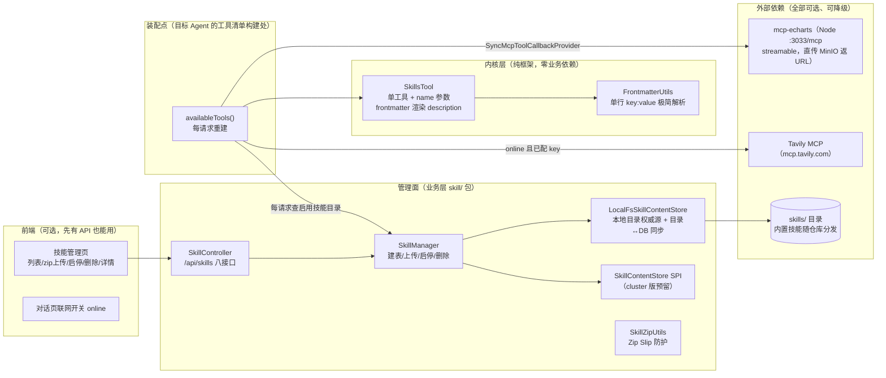

# 04 · 技能系统 + MCP 外部工具迁移方案（从 0 移植到另一个 Agent）

> 对应里程碑 M6（README「M6 技能系统 + MCP 外部工具」）。本文回答一个问题：
> **把这套"能力插拔层"移植到另一个 Agent 工程里，从 0 开始怎么做。**
> 代码全部来自本项目真实源码（`mini-agentx-core` + `data-agent-server`），标注了哪些可零修改拷贝、哪些必须适配。

---

## 1. 设计总览（先看懂再动手）

### 1.1 两条主线

| 主线 | 本质 | 载体 |
|---|---|---|
| **技能系统** | 技能 = 一段专业提示词包（SKILL.md + 附属资源），经**渐进式披露**进入对话：元数据常驻、正文按需加载 | `SkillsTool`（单工具）+ `SkillManager`（管理面） |
| **MCP 外部工具** | 图表/联网等外部能力走 MCP 标准协议接入，客户端未就绪时**优雅降级**（不阻断主链路） | `AgentxMcpConfig`（两个 McpSyncClient） |

### 1.2 三层架构



### 1.3 一次带图问答的完整时序

```
用户提问 → 目标 Agent 构建本次请求工具清单：
  ① 查 DB enabled=1 的技能目录 → new SkillsTool(目录s)   （每请求重建，停用立即生效）
  ② mcp-echarts 图表工具（启动时拉取一次，常驻/延迟均可）
  ③ online=true 且 Tavily 就绪 → 注入联网工具
→ LLM 看到 Skill 工具 description 里的 <可用技能列表>（XML 清单，只有元数据）
→ 命中 data-analysis → 调 Skill(name="data-analysis")
→ 返回「技能工作目录 + SKILL.md 正文」→ LLM 按正文 SOP 调 executeSql 等工具
→ 需要 图表 → LLM 调 mcp-echarts 工具 → Node 进程直传 MinIO → 返回图片 URL 进对话
```

### 1.4 五个关键设计决策（迁移时不要改掉）

| # | 决策 | 理由 |
|---|---|---|
| 1 | **单一工具 + name 参数**（不是每技能一个 load 工具） | 技能数量增长不膨胀工具清单；元数据进工具 description 常驻、正文只在调用时返回（渐进式披露，控上下文成本） |
| 2 | **SkillsTool 每请求重建**（不是启动时建一次单例） | `getEnabledSkillDirs()` 实时查 DB，管理页停用立即从工具清单消失，无需重启 |
| 3 | **本地目录是权威源**（standalone），DB 只是索引 | 手动往目录放技能也能被定时同步自动发现；zip 上传/手动新建最终都落目录 |
| 4 | **Tavily 未配 key → Bean 返回 null → 工具不注入** | 服务照常启动，联网开关打开也只是没有该工具，不报错不阻断（优雅降级） |
| 5 | **MCP 超时 60s**（不是 300s） | 本地图表渲染秒级完成；宕机时快速失败回灌错误 JSON，LLM 优雅降级而非长挂。联调实测 300s 会让 LLM 反复换工具重试 |

---

## 2. 迁移总览：文件清单与拷贝性评估

**总量：约 12 个后端类 + 1 个前端页面。后端核心（不含前端、不含管理页联调）约 2–3 人天。**

| 文件 | 层 | 依赖 | 迁移方式 |
|---|---|---|---|
| `utils/FrontmatterUtils` | 内核 | 纯 JDK | ✅ 零修改拷贝 |
| `tools/SkillsTool` | 内核 | Spring AI `ToolCallback`/`FunctionToolCallback`/`@ToolParam` | ✅ 零修改拷贝（目标也是 Spring AI 1.x 时） |
| `skill/SkillContentStore` | 管理面 | 纯 JDK | ✅ 零修改拷贝 |
| `skill/SkillZipUtils` | 管理面 | 纯 JDK | ✅ 零修改拷贝（注意它是包级私有类，拷过去去掉 `final class` 的包内限制或放同包） |
| `skill/LocalFsSkillContentStore` | 管理面 | MyBatis-Plus mapper + FrontmatterUtils | 🔧 改 mapper 引用 |
| `skill/SkillManager` | 管理面 | MyBatis-Plus + JdbcTemplate + FrontmatterUtils | 🔧 改 mapper / 统一返回 |
| `skill/AgentxSkill` + `mapper/AgentxSkillMapper` | 管理面 | MyBatis-Plus | 🔧 按目标 ORM 改写（JPA/JDBC 均可，表结构不变） |
| `skill/SkillInfo`/`SkillDetail`/`SkillUpsertRequest` | 管理面 | 无 | ✅ 零修改拷贝 |
| `skill/SkillController` | 管理面 | `R<T>` 统一返回 + Sa-Token | 🔧 换目标工程的返回体与鉴权注解 |
| `config/AgentxMcpConfig` | 装配 | spring-ai mcp-client + mcp-core 1.1.0 | ✅ 零修改拷贝（版本对齐时） |
| DodoAgent `availableTools` 等装配段 | 装配 | 本项目特有 | ❌ **必须重写**——这是唯一真正的适配工作（见 §8） |
| 前端 `SkillManageView.vue` + `api/skill.js` | 前端 | Vue3 + Element Plus | 🔧 参考重写（接口契约见 §9） |

> **若目标 Agent 不是 Spring AI**：SkillsTool 需要按目标框架的工具 SPI 重写，但**协议不变**（见 §5.3 的接口契约），管理面与 MCP 装配逻辑完全复用。

---

## 3. Phase 0 · 前置准备（依赖与配置）

### 3.1 版本矩阵（本项目实测组合）

| 依赖 | 版本 | 说明 |
|---|---|---|
| JDK | 21 | 文本块/record/switch 表达式 |
| Spring Boot | 3.5.x | — |
| Spring AI | **1.1.0**（BOM） | `FunctionToolCallback`、`SyncMcpToolCallbackProvider` |
| MCP SDK | **io.modelcontextprotocol:mcp-core:1.1.0 显式锁版** | 保证 `HttpClientStreamableHttpTransport` 可用（starter 传递版本可能不一致） |
| ORM | MyBatis-Plus 3.5（任意，表结构不变即可） | — |
| Node.js | ≥ 18 | 仅 mcp-echarts 需要 |

### 3.2 pom 依赖片段

```xml
<!-- Spring AI BOM（1.1.0） -->
<dependency>
    <groupId>org.springframework.ai</groupId>
    <artifactId>spring-ai-starter-mcp-client</artifactId>  <!-- M6 MCP 客户端 -->
</dependency>
<!-- MCP SDK：显式锁 1.1.0，保证 HttpClientStreamableHttpTransport 可用 -->
<dependency>
    <groupId>io.modelcontextprotocol</groupId>
    <artifactId>mcp-core</artifactId>
    <version>1.1.0</version>
</dependency>
```

### 3.3 application.yml 配置片段

```yaml
data-agent:
  chart:                     # mcp-echarts（本地 Node 服务，streamable 模式）
    mcp-url: http://localhost:3033/mcp

skills:                      # 技能目录（standalone 本地目录为权威源）
  directory: ./skills        # 相对后端工作目录，内置技能随仓库分发

tavily:                      # api-key 未配置 = 联网开关降级不可用（服务不受影响）
  api-key:
  mcp-url: https://mcp.tavily.com/mcp/

deploy:
  mode: standalone           # 技能内容存储实现切换（standalone=本地目录）
```

### 3.4 外部服务准备（全部可选，缺谁降级谁）

```bash
# mcp-echarts：npm 全局安装后以 streamable 模式启动（必须 -t streamable，
# 否则图片 base64 直塞对话上下文会爆炸），MinIO 直传经环境变量注入 Node 进程
export MINIO_ENDPOINT=http://localhost:9000
export MINIO_PORT=9000
export MINIO_ACCESS_KEY=xxx
export MINIO_SECRET_KEY=xxx
npm install -g @mcp-echarts/server   # 包名以实际分发为准（原版 dodo-agentx 12-echarts-mcp 模块）
mcp-echarts -t streamable            # → MCP ECharts Streamable HTTP server running on :3033/mcp
```

> 没有图表需求可以整个跳过 mcp-echarts；没有联网需求跳过 Tavily。**两条 MCP 线互相独立，技能系统也不依赖它们**——最小迁移路径是只做 §4–§6 + §8。

---

## 4. Phase 1 · 数据层：agentx_skill 表

### 4.1 表结构（建议直接手工执行 DDL；代码里也保留了启动幂等建表）

```sql
CREATE TABLE agentx_skill (
    id           BIGINT       NOT NULL,
    name         VARCHAR(500) NOT NULL,
    skill_path   VARCHAR(3000) DEFAULT NULL,   -- standalone 存本地目录绝对路径；cluster 存 MinIO objectKey
    description  VARCHAR(3000) DEFAULT '',     -- frontmatter description，渲染进 SkillsTool 工具描述
    enabled      TINYINT      NOT NULL DEFAULT 1,
    file_name    VARCHAR(255) DEFAULT NULL,    -- 上传时的原始 zip 文件名（目录直放为 null）
    source       VARCHAR(20)  DEFAULT NULL,    -- builtin / upload / manual
    created_at   TIMESTAMP    DEFAULT CURRENT_TIMESTAMP,
    updated_at   TIMESTAMP    DEFAULT CURRENT_TIMESTAMP ON UPDATE CURRENT_TIMESTAMP,
    PRIMARY KEY (id),
    UNIQUE KEY uk_agentx_skill_name (name)
) DEFAULT CHARSET=utf8mb4 COLLATE=utf8mb4_general_ci;
```

### 4.2 实体 + Mapper（MyBatis-Plus 版；换 ORM 只改这两个文件）

```java
@Data
@TableName("agentx_skill")
public class AgentxSkill implements Serializable {
    @TableId(type = IdType.ASSIGN_ID)
    private Long id;
    private String name;         // 技能名（唯一；frontmatter 的 name，缺省用目录名）
    @TableField("skill_path")
    private String skillPath;
    private String description;
    private Integer enabled;     // 1=启用（进 SkillsTool 清单） 0=停用
    @TableField("file_name")
    private String fileName;
    private String source;       // builtin / upload / manual
    private LocalDateTime createdAt;
    private LocalDateTime updatedAt;
}
```

```java
/** ⚠️ 必须放独立 mapper 子包：若与 SkillContentStore SPI 同包，
 *  @MapperScan 按包扫描会把 SPI 接口误注册为 Mapper（启动报 found 2 beans）。 */
@Mapper
public interface AgentxSkillMapper extends BaseMapper<AgentxSkill> {
}
```

---

## 5. Phase 2 · 内核层（零修改拷贝）

### 5.1 FrontmatterUtils —— 单行 key:value 极简解析

**刻意不引入 YAML 依赖**：SKILL.md frontmatter 约定只用单行 `key: value`（description 写长句不写列表）。完整源码拷贝自 `mini-agentx-core/src/main/java/com/llmetor/miniagentx/utils/FrontmatterUtils.java`：

```java
public final class FrontmatterUtils {

    private static final String DELIMITER = "---";

    private FrontmatterUtils() {
    }

    /** 直接从文件读取并提取 frontmatter 值（文件不存在或 key 不存在返回 null） */
    public static String extractFromFile(Path file, String key) {
        if (!Files.isRegularFile(file)) {
            return null;
        }
        try {
            return extract(Files.readString(file), key);
        } catch (IOException e) {
            return null;
        }
    }

    /** 提取指定 key 的 value（两个 --- 之间的首个 key: value 行），去成对引号 */
    public static String extract(String content, String key) {
        if (content == null) {
            return null;
        }
        String[] lines = content.split("\\r?\\n");
        boolean inFrontmatter = false;
        for (String line : lines) {
            String trimmed = line.trim();
            if (DELIMITER.equals(trimmed)) {
                if (inFrontmatter) {
                    break;
                }
                inFrontmatter = true;
                continue;
            }
            if (inFrontmatter && trimmed.startsWith(key + ":")) {
                return removeQuotes(trimmed.substring((key + ":").length()).trim());
            }
        }
        return null;
    }

    /** 解析全部键值对（LinkedHashMap 保持声明顺序）；无 frontmatter 返回空 Map */
    public static Map<String, Object> parseAll(String markdown) {
        Map<String, Object> frontMatter = new LinkedHashMap<>();
        if (markdown == null || !markdown.startsWith(DELIMITER)) {
            return frontMatter;
        }
        int endIndex = markdown.indexOf(DELIMITER, 3);
        if (endIndex == -1) {
            return frontMatter;
        }
        for (String line : markdown.substring(3, endIndex).split("\n")) {
            String trimmed = line.trim();
            int colonIndex = trimmed.indexOf(':');
            if (trimmed.isEmpty() || colonIndex <= 0) {
                continue;
            }
            String key = trimmed.substring(0, colonIndex).trim();
            String value = removeQuotes(trimmed.substring(colonIndex + 1).trim());
            frontMatter.put(key, value);
        }
        return frontMatter;
    }

    /** 剥离 frontmatter 首段，返回其后正文；无 frontmatter 原样返回 */
    public static String stripFrontmatter(String markdown) {
        if (markdown == null || !markdown.startsWith(DELIMITER)) {
            return markdown;
        }
        int endIndex = markdown.indexOf(DELIMITER, 3);
        if (endIndex == -1) {
            return markdown;
        }
        return markdown.substring(endIndex + DELIMITER.length()).stripLeading();
    }

    /** assemble：parseAll 逆操作，value 换行折叠为空格（解析器只支持单行） */
    public static String assemble(Map<String, Object> frontmatter, String body) {
        StringBuilder sb = new StringBuilder(DELIMITER).append('\n');
        for (Map.Entry<String, Object> entry : frontmatter.entrySet()) {
            String value = String.valueOf(entry.getValue()).replaceAll("\\s*\\r?\\n\\s*", " ").trim();
            sb.append(entry.getKey()).append(": ").append(value).append('\n');
        }
        sb.append(DELIMITER).append("\n\n");
        String stripped = stripFrontmatter(body);
        if (stripped != null && !stripped.isBlank()) {
            sb.append(stripped.stripLeading());
            if (sb.charAt(sb.length() - 1) != '\n') {
                sb.append('\n');
            }
        }
        return sb.toString();
    }

    private static String removeQuotes(String value) {
        if (value.length() >= 2
                && ((value.startsWith("\"") && value.endsWith("\""))
                || (value.startsWith("'") && value.endsWith("'")))) {
            return value.substring(1, value.length() - 1);
        }
        return value;
    }
}
```

### 5.2 SkillsTool —— 渐进式披露的载体（核心中的核心）

完整源码拷贝自 `mini-agentx-core/.../tools/SkillsTool.java`，**迁移时原样拷贝，只改包名**。三个要点：

1. **build 时**把所有技能 frontmatter 渲染成 XML 清单拼进工具 description（元数据常驻上下文，正文不进）；
2. **调用时**按 name 命中 → 返回「技能工作目录 + SKILL.md 正文（已剥 frontmatter）」；
3. **同名技能**先注册者优先（LinkedHashMap + putIfAbsent）。

```java
public final class SkillsTool {

    /** 工具描述模板：%s 处注入 <可用技能列表> XML 清单 */
    private static final String TOOL_DESCRIPTION_TEMPLATE = """
            在当前会话中加载一个技能（Skill）。本工具的唯一作用是：传入技能名称，获取该技能的完整提示词和工作目录。

            <什么是技能>
            技能是一段专业的提示词，包含特定领域的知识、工作流程和操作指令。
            每个技能通常还附带参考文件、模板、脚本等资源，存放在技能工作目录中。
            </什么是技能>

            <技能的完整使用流程>
            第一步 — 判断是否需要技能：
              当用户要求完成某项任务时，先检查下方 <可用技能列表> 中是否有匹配的技能。
              如果有匹配的技能，进入第二步；如果没有，直接用你自身能力回答即可。

            第二步 — 通过本工具加载技能：
              调用本工具，传入技能的 name 字段值（仅传名称，不含任何参数）。
              调用后你会收到：技能工作目录路径 + 技能的完整提示词内容。

            第三步 — 阅读并理解技能提示词：
              仔细阅读技能返回的完整提示词，理解该技能的工作流程和要求。

            第四步 — 按技能提示词执行任务：
              严格按照技能提示词中的指令和流程来完成任务。
              你需要像"演员进入角色"一样，完全遵照技能提示词的指引行动。
              如果技能工作目录中有参考文件、模板、脚本，根据需要读取和使用它们。
              使用其他工具来完成技能要求的具体操作。
            </技能的完整使用流程>

            <关键概念：技能不是工具>
            技能（Skill）和工具（Tool）是两个不同的概念：
            - 工具：你可以直接调用的能力，如搜索、文件读取等
            - 技能：是一段提示词/指令，通过本工具加载后，你按照其中的指引去行动
            技能本身不是工具，不能被当作工具调用。技能的正确使用方式是：
            用本工具加载 → 阅读提示词 → 按提示词中的指令，使用真正的工具来完成任务
            </关键概念：技能不是工具>

            <严格禁止>
            - 禁止将技能名称当作独立的工具来调用
            - 禁止在未通过本工具加载的情况下，假装已经知道技能的内容
            - 禁止编造或猜测 <可用技能列表> 中不存在的技能名称
            - 禁止重复加载同一个技能（同一技能在一次对话中只需加载一次）
            - 禁止加载技能后忽略其提示词内容，自行发挥
            </严格禁止>

            <可用技能列表>
            %s
            </可用技能列表>
            """;

    private SkillsTool() {
    }

    /** 工具入参：仅技能名 */
    public record SkillsInput(
            @ToolParam(description = "要加载的技能名称（仅传名称，不含任何参数），例如 \"data-analysis\"")
            String name) {
    }

    /** 加载函数：命中返回「技能工作目录 + SKILL.md 正文」，未命中返回可用清单引导重试 */
    public static class SkillsFunction implements Function<SkillsInput, String> {

        private final Map<String, Skill> skillsMap;

        public SkillsFunction(Map<String, Skill> skillsMap) {
            this.skillsMap = skillsMap;
        }

        @Override
        public String apply(SkillsInput input) {
            String name = input == null ? null : input.name();
            Skill skill = name == null ? null : this.skillsMap.get(name.trim());

            if (skill != null) {
                return "技能工作目录: %s\n\n%s".formatted(skill.basePath(), skill.content());
            }
            String availableNames = String.join(", ", this.skillsMap.keySet());
            return "未找到技能: " + (name == null ? "" : name) + "。当前可用技能: " + availableNames;
        }
    }

    public static Builder builder() {
        return new Builder();
    }

    public static final class Builder {

        private final List<Skill> skills = new ArrayList<>();
        private String toolDescriptionTemplate = TOOL_DESCRIPTION_TEMPLATE;

        private Builder() {
        }

        /** 覆盖默认工具描述模板（模板须含一个 %s 占位技能清单） */
        public Builder toolDescriptionTemplate(String template) {
            this.toolDescriptionTemplate = template;
            return this;
        }

        /** 批量追加技能目录（每目录一个技能，含 SKILL.md 即视为有效技能） */
        public Builder addSkillsDirectories(List<String> skillsRootDirectories) {
            for (String dir : skillsRootDirectories) {
                this.skills.addAll(loadDirectory(dir));
            }
            return this;
        }

        /**
         * 构建单例工具：全部技能 frontmatter 渲染成 XML 拼进 description（常驻），
         * 正文只在调用时返回（渐进式披露）。同名技能后注册者不覆盖先注册者。
         */
        public ToolCallback build() {
            if (this.skills.isEmpty()) {
                throw new IllegalStateException("至少需要配置一个技能目录");
            }
            // LinkedHashMap：同名保留先注册者，且渲染顺序稳定
            Map<String, Skill> skillsMap = new LinkedHashMap<>();
            for (Skill skill : this.skills) {
                skillsMap.putIfAbsent(skill.name(), skill);
            }
            String skillsXml = skillsMap.values().stream()
                    .map(Skill::toXml)
                    .collect(Collectors.joining("\n"));

            return FunctionToolCallback.builder("Skill", new SkillsFunction(skillsMap))
                    .description(this.toolDescriptionTemplate.formatted(skillsXml))
                    .inputType(SkillsInput.class)
                    .build();
        }
    }

    // ========== 技能数据模型 ==========

    /** 一个技能：工作目录（绝对路径）+ frontmatter 元数据 + SKILL.md 正文 */
    public record Skill(String basePath, Map<String, Object> frontMatter, String content) {

        /** 技能名（frontmatter 的 name，缺失回退空串——加载方按目录名兜底后传入） */
        public String name() {
            Object name = this.frontMatter().get("name");
            return name != null ? name.toString() : "";
        }

        /** frontmatter 渲染成 XML 清单项（常驻工具 description 的最小元数据） */
        public String toXml() {
            String frontMatterXml = this.frontMatter().entrySet().stream()
                    .map(e -> "  <%s>%s</%s>".formatted(e.getKey(), e.getValue(), e.getKey()))
                    .collect(Collectors.joining("\n"));
            return "<skill>\n%s\n</skill>".formatted(frontMatterXml);
        }
    }

    // ========== 技能目录扫描 ==========

    /** 扫描目录下（含子层）的 SKILL.md（大小写不敏感），每个文件即一个技能 */
    private static List<Skill> loadDirectory(String skillsRootDirectory) {
        List<Skill> skills = new ArrayList<>();
        Path root = Path.of(skillsRootDirectory);

        if (!Files.isDirectory(root)) {
            return skills;
        }

        try {
            Files.walk(root, FileVisitOption.FOLLOW_LINKS)
                    .filter(Files::isRegularFile)
                    .filter(p -> p.getFileName().toString().equalsIgnoreCase("SKILL.md"))
                    .forEach(skillFile -> {
                        try {
                            String markdown = Files.readString(skillFile, StandardCharsets.UTF_8);
                            String content = markdown;
                            // 正文 = 去掉 frontmatter 首段（--- 包裹）后的剩余部分
                            if (markdown.startsWith("---")) {
                                int endIndex = markdown.indexOf("---", 3);
                                if (endIndex != -1) {
                                    content = markdown.substring(endIndex + 3).trim();
                                }
                            }
                            skills.add(new Skill(skillFile.getParent().toAbsolutePath().toString(),
                                    FrontmatterUtils.parseAll(markdown), content));
                        } catch (IOException e) {
                            throw new IllegalStateException("解析技能文件失败: " + skillFile, e);
                        }
                    });
        } catch (IOException e) {
            throw new IllegalStateException("扫描技能目录失败: " + skillsRootDirectory, e);
        }

        return skills;
    }
}
```

### 5.3 若目标 Agent 不是 Spring AI：SkillsTool 的接口契约

工具本体是框架无关的，重写时守住这 5 条协议即可：

1. 工具名固定 `Skill`，入参只有一个 `name` 字符串；
2. 工具 description = 固定教学模板 + `<可用技能列表>` XML（每技能一个 `<skill><name>..</name><description>..</description></skill>`）；
3. 命中返回 `"技能工作目录: <绝对路径>\n\n<SKILL.md 正文（无 frontmatter）>"`；
4. 未命中返回 `"未找到技能: X。当前可用技能: A, B"`（给 LLM 自纠错机会，不要抛异常终止）;
5. 构建入口是目录列表；无启用技能时**不注册该工具**（不要注册一个空清单的 Skill）。

---

## 6. Phase 3 · 管理面（skill/ 包）

### 6.1 SkillContentStore —— 内容存储 SPI（零修改拷贝）

```java
public interface SkillContentStore {

    /** 上传时存储技能内容（skillSourceDir 已解压并定位出 SKILL.md） */
    void save(String name, Path skillSourceDir) throws IOException;

    /**
     * 只重写技能的 SKILL.md 单文件（管理界面手动新建/编辑用）。
     * 不能走 save()（整目录替换会删掉 references/scripts 等同级附属资源）；
     * 目录不存在时自动创建。
     */
    void writeSkillFile(String name, String content) throws IOException;

    /** 删除技能内容 */
    void delete(String name) throws IOException;

    /** 同步（启动时 + 每 3 分钟定时）：standalone 实现为目录 → DB 入库/清孤儿 */
    void sync();

    /** DB 里 skill_path 存什么：standalone 返回本地目录绝对路径 */
    String storedPath(String name);

    /**
     * 内容变更后的通知（DB 写完后调用）：cluster 实现广播 pub/sub 让各节点立即 sync；
     * standalone 单机无需通知，默认空操作。
     */
    default void notifyChanged() {
    }
}
```

### 6.2 LocalFsSkillContentStore —— 本地目录权威源（改 mapper 引用后拷贝）

```java
@Component
@ConditionalOnProperty(name = "deploy.mode", havingValue = "standalone", matchIfMissing = true)
public class LocalFsSkillContentStore implements SkillContentStore {

    private static final String SKILL_FILE = "SKILL.md";

    private final Path skillsDirectory;
    private final AgentxSkillMapper skillMapper;

    public LocalFsSkillContentStore(@Value("${skills.directory:./skills}") String skillsDirectory,
                                    AgentxSkillMapper skillMapper) {
        this.skillsDirectory = Path.of(skillsDirectory).toAbsolutePath().normalize();
        this.skillMapper = skillMapper;
    }

    @Override
    public void save(String name, Path skillSourceDir) throws IOException {
        Path targetDir = skillsDirectory.resolve(name);
        if (Files.isDirectory(targetDir)) {
            FileSystemUtils.deleteRecursively(targetDir);
        }
        FileSystemUtils.copyRecursively(skillSourceDir.toFile(), targetDir.toFile());
    }

    @Override
    public void writeSkillFile(String name, String content) throws IOException {
        Path skillDir = skillsDirectory.resolve(name);
        Files.createDirectories(skillDir);
        Files.writeString(skillDir.resolve(SKILL_FILE), content);
    }

    @Override
    public void delete(String name) throws IOException {
        Path skillDir = skillsDirectory.resolve(name);
        if (Files.isDirectory(skillDir)) {
            FileSystemUtils.deleteRecursively(skillDir);
        }
    }

    @Override
    public String storedPath(String name) {
        return skillsDirectory.resolve(name).toAbsolutePath().toString();
    }

    /** 目录 → DB：FS 有 DB 没有 → 插入(enabled=1)；FS 没有 DB 有 → 删孤儿；都有 → 必要时更新 description/path（保留 enabled） */
    @Override
    public void sync() {
        if (!Files.isDirectory(skillsDirectory)) {
            log.warn("[SkillManager] skills 目录不存在: {}", skillsDirectory);
            return;
        }

        List<String> fsNames = new ArrayList<>();
        try (DirectoryStream<Path> stream = Files.newDirectoryStream(skillsDirectory, Files::isDirectory)) {
            for (Path dir : stream) {
                if (Files.isRegularFile(dir.resolve(SKILL_FILE))) {
                    fsNames.add(dir.getFileName().toString());
                }
            }
        } catch (IOException e) {
            log.warn("[SkillManager] 扫描 skills 目录失败: {}", e.toString());
        }

        List<AgentxSkill> dbSkills = skillMapper.selectList(null);

        for (String name : fsNames) {
            String absPath = skillsDirectory.resolve(name).toAbsolutePath().toString();
            String description = FrontmatterUtils.extractFromFile(
                    skillsDirectory.resolve(name).resolve(SKILL_FILE), "description");
            if (description == null) {
                description = "";
            }
            AgentxSkill existing = dbSkills.stream()
                    .filter(s -> s.getName().equals(name))
                    .findFirst().orElse(null);
            if (existing == null) {
                AgentxSkill entity = new AgentxSkill();
                entity.setName(name);
                entity.setSkillPath(absPath);
                entity.setDescription(description);
                entity.setEnabled(1);
                entity.setSource(SkillManager.SOURCE_BUILTIN);
                skillMapper.insert(entity);
            } else {
                boolean descChanged = !description.equals(existing.getDescription());
                boolean pathChanged = !absPath.equals(existing.getSkillPath());
                if (descChanged || pathChanged) {
                    AgentxSkill update = new AgentxSkill();
                    update.setId(existing.getId());
                    if (descChanged) { update.setDescription(description); }
                    if (pathChanged) { update.setSkillPath(absPath); }
                    skillMapper.updateById(update);
                }
            }
        }

        // 目录已删除的 DB 记录 → 清孤儿
        for (AgentxSkill dbSkill : dbSkills) {
            if (!fsNames.contains(dbSkill.getName())) {
                skillMapper.deleteById(dbSkill.getId());
            }
        }
    }
}
```

### 6.3 SkillZipUtils —— Zip Slip 防护（安全关键，零修改拷贝）

```java
final class SkillZipUtils {

    private SkillZipUtils() {
    }

    /**
     * 安全解压 zip 到目标目录。Zip Slip 防护：entry 路径 resolve+normalize 后
     * 必须仍落在目标目录内，越界即拒绝（恶意 zip 里 ../../etc/passwd 这类条目会被拦下）。
     */
    static void extract(InputStream zipStream, Path targetDir) throws IOException {
        Files.createDirectories(targetDir);
        try (ZipInputStream zip = new ZipInputStream(zipStream)) {
            ZipEntry entry;
            while ((entry = zip.getNextEntry()) != null) {
                Path dest = targetDir.resolve(entry.getName()).normalize();
                if (!dest.startsWith(targetDir)) {
                    throw new IOException("zip 包含非法路径: " + entry.getName());
                }
                if (entry.isDirectory()) {
                    Files.createDirectories(dest);
                } else {
                    Files.createDirectories(dest.getParent());
                    Files.copy(zip, dest, StandardCopyOption.REPLACE_EXISTING);
                }
                zip.closeEntry();
            }
        }
    }

    /** 打包技能目录为 zip（导出用）：相对路径条目，SKILL.md 位于 zip 根，可直接回传重导入 */
    static void zip(Path sourceDir, OutputStream out) throws IOException {
        try (ZipOutputStream zos = new ZipOutputStream(out, StandardCharsets.UTF_8)) {
            Files.walkFileTree(sourceDir, new SimpleFileVisitor<>() {
                @Override
                public FileVisitResult preVisitDirectory(Path dir, BasicFileAttributes attrs) throws IOException {
                    String rel = sourceDir.relativize(dir).toString().replace('\\', '/');
                    if (!rel.isEmpty()) {
                        zos.putNextEntry(new ZipEntry(rel + "/"));
                        zos.closeEntry();
                    }
                    return FileVisitResult.CONTINUE;
                }

                @Override
                public FileVisitResult visitFile(Path file, BasicFileAttributes attrs) throws IOException {
                    zos.putNextEntry(new ZipEntry(sourceDir.relativize(file).toString().replace('\\', '/')));
                    Files.copy(file, zos);
                    zos.closeEntry();
                    return FileVisitResult.CONTINUE;
                }
            });
        }
    }

    /** 在 maxDepth 层内查找文件（如 SKILL.md）——zip 根目录结构不固定，逐层下探定位 */
    static Path findFile(Path dir, String fileName, int maxDepth) throws IOException {
        if (!Files.isDirectory(dir)) {
            return null;
        }
        try (Stream<Path> stream = Files.walk(dir, maxDepth)) {
            return stream
                    .filter(Files::isRegularFile)
                    .filter(p -> p.getFileName().toString().equals(fileName))
                    .findFirst()
                    .orElse(null);
        }
    }

    /** 递归删除（临时目录清理用），失败静默 */
    static void deleteRecursively(Path path) { /* 同 Files.walk 逆序删除，见源码 */ }
}
```

### 6.4 SkillManager —— 管理面中枢（改 mapper 后参考源码整体移植）

完整源码见 `data-agent-server/.../skill/SkillManager.java`（427 行）。这里摘出**迁移时最容易做错的 4 段**，其余为常规 CRUD：

**① 启动建表 + 定时同步（幂等，try-catch 吞"已存在"）**

```java
@PostConstruct
void init() {
    ensureTableExists();      // 建表/唯一索引/补列 source/存量回填，四步全部 try-catch 幂等跳过
    contentStore.sync();      // 目录 → DB 首次同步
}

/** 每 3 分钟：目录新增入库 / 删除清孤儿 / frontmatter 变更刷新描述 */
@Scheduled(fixedDelay = 180_000, initialDelay = 180_000)
void scheduledSync() {
    contentStore.sync();
}
```

**② 给 Agent 装配点的唯一入口（停用立即生效的关键）**

```java
/**
 * 所有 enabled=1 的技能目录绝对路径——Agent 每次请求构建 SkillsTool 的唯一入口。
 * 实时查 DB：停用立即从工具清单消失；目录被手动删掉则跳过并 warn。
 */
public List<String> getEnabledSkillDirs() {
    List<AgentxSkill> enabled = skillMapper.selectList(
            new LambdaQueryWrapper<AgentxSkill>().eq(AgentxSkill::getEnabled, 1));
    List<String> dirs = new ArrayList<>();
    for (AgentxSkill s : enabled) {
        String path = skillsDirectory.resolve(s.getName()).toAbsolutePath().toString();
        if (Files.isDirectory(Path.of(path))) {
            dirs.add(path);
        } else {
            log.warn("[SkillManager] enabled skill 目录不存在: {} → {}", s.getName(), path);
        }
    }
    return dirs;
}
```

**③ zip 上传编排（六步顺序固定）**

```java
public SkillInfo uploadZip(MultipartFile file) throws IOException {
    // 0. 校验 .zip 后缀
    // 1. 解压到 skills 目录下的临时目录（Zip Slip 防护在 extract 内）
    Path tempDir = Files.createTempDirectory(skillsDirectory, "skill-upload-");
    try {
        SkillZipUtils.extract(file.getInputStream(), tempDir);
        // 2. 三层内定位 SKILL.md（zip 根目录结构不固定）
        Path skillMd = SkillZipUtils.findFile(tempDir, "SKILL.md", 3);
        if (skillMd == null) {
            throw new IllegalArgumentException("压缩包中未找到 SKILL.md 文件");
        }
        // 3. frontmatter 提取 name（缺省用目录名）/description
        String name = FrontmatterUtils.extract(content, "name");
        if (name == null || name.isBlank()) { name = skillSourceDir.getFileName().toString(); }
        validateSkillName(name);
        // 4. 存储内容（standalone=复制进 skills 目录/{name}，覆盖旧版本）
        contentStore.save(name, skillSourceDir);
        // 5. upsert DB：新增 enabled=1/source=upload；覆盖上传【保留原 enabled 状态】
        // 6. contentStore.notifyChanged()（standalone 空操作，cluster 广播）
    } finally {
        SkillZipUtils.deleteRecursively(tempDir);   // 临时目录必清理
    }
}
```

**④ 技能名校验（防路径穿越，双层防护）**

```java
void validateSkillName(String name) {
    if (name == null || name.isBlank()) {
        throw new IllegalArgumentException("skill 名称不能为空");
    }
    if (name.contains("..") || name.contains("/") || name.contains("\\") || name.contains(":")) {
        throw new IllegalArgumentException("非法 skill 名称: " + name);
    }
    Path resolved = skillsDirectory.resolve(name).normalize();
    if (!resolved.startsWith(skillsDirectory)) {
        throw new IllegalArgumentException("非法 skill 名称: " + name);
    }
}
```

其余方法语义速查：

| 方法 | 语义 | 关键约束 |
|---|---|---|
| `createManual` | 表单新建，自动拼 frontmatter 落盘 | 名禁空白符（破坏单行解析）；重名/重目录拒绝；source=manual |
| `updateContent` | 编辑描述+正文 | **builtin 拒绝**；正文可带完整 frontmatter 头（带了以提交为准，name 仍强制为 path name）；未带头回退既有头——头永远不会丢 |
| `getContent` | SKILL.md 全文原文 | 前端渲染/源码双视图 |
| `exportZip` | 导出 zip | 根目录即技能目录内容，可直接回传重导入 |
| `toggleEnabled` | 启停 | 幂等 |
| `delete` | 目录 + DB 记录 | **builtin 拒绝删除**（删了下次同步又入库），提示改用停用 |
| `boundedSingleLine` / `boundedContent` | 描述 3000 字符 / 正文 200KB 上限 | 描述换行折叠为空格 |

### 6.5 Controller —— 八个接口（换掉 `R<T>` 与鉴权后照抄路由）

| 方法 | 路由 | 语义 |
|---|---|---|
| GET | `/api/skills` | 列表（含 enabled、source） |
| POST | `/api/skills/upload` | zip 上传（multipart `file`） |
| POST | `/api/skills` | 手动新建（body: name/description/content） |
| GET | `/api/skills/{name}/content` | 详情（SKILL.md 全文原文） |
| PUT | `/api/skills/{name}/content` | 编辑（builtin 拒绝） |
| GET | `/api/skills/{name}/export` | 导出 zip（`Content-Disposition` 用 **RFC 5987** 编码中文文件名：`filename*=UTF-8''...`） |
| PUT | `/api/skills/{name}/toggle?enabled=` | 启停 |
| DELETE | `/api/skills/{name}` | 删除（builtin 拒绝） |

Controller 全文直接参考源码（IllegalArgumentException → 统一返回 fail；export 返回 `ResponseEntity<byte[]>`）。

---

## 7. Phase 4 · MCP 客户端装配（零修改拷贝）

> **M6 补充后本节已被取代**：两个硬编码 bean 演进为 DB 管理的多服务动态装配（三型传输、
> 管理页增删改启停、热生效），见 §14。以下保留为"最简可跑形态"参考。

`config/AgentxMcpConfig.java` 全文（已被删除，逻辑移入 `mcp/McpServerManager`）：

```java
@Slf4j
@Configuration
public class AgentxMcpConfig {

    /** MCP 工具调用超时：60s 覆盖正常生成（秒级），宕机时快速失败回灌错误 JSON */
    private static final Duration MCP_REQUEST_TIMEOUT = Duration.ofSeconds(60);

    /** mcp-echarts 客户端：本地 Node 服务，图表由 Node 侧直传 MinIO 返回 URL（不经 Java） */
    @Bean(destroyMethod = "close")
    public McpSyncClient chartMcpSyncClient(
            @Value("${data-agent.chart.mcp-url:http://localhost:3033/mcp}") String mcpUrl) {
        HttpClientStreamableHttpTransport transport =
                HttpClientStreamableHttpTransport.builder(mcpUrl).build();
        McpSyncClient client = McpClient.sync(transport)
                .requestTimeout(MCP_REQUEST_TIMEOUT)
                .build();
        client.initialize();
        log.info("[data-agent] mcp-echarts 客户端初始化完成: {}", mcpUrl);
        return client;
    }

    /**
     * Tavily MCP 客户端；未配 key 或初始化失败返回 null（Spring 注册 NullBean，
     * 注入点标 @Nullable 接收），联网功能降级不可用但服务不受影响。
     */
    @Bean(destroyMethod = "close", name = "tavilyMcpSyncClient")
    public McpSyncClient tavilyMcpSyncClient(
            @Value("${tavily.api-key:}") String apiKey,
            @Value("${tavily.mcp-url:https://mcp.tavily.com/mcp/}") String mcpUrl) {
        if (apiKey == null || apiKey.isBlank()) {
            log.warn("[data-agent] Tavily API key 未配置（tavily.api-key），联网功能不可用");
            return null;
        }
        try {
            HttpClientStreamableHttpTransport transport =
                    HttpClientStreamableHttpTransport.builder(mcpUrl)
                            .customizeRequest(rb -> rb.header("Authorization", "Bearer " + apiKey))
                            .build();
            McpSyncClient client = McpClient.sync(transport)
                    .requestTimeout(MCP_REQUEST_TIMEOUT)
                    .build();
            client.initialize();
            log.info("[data-agent] Tavily MCP 客户端初始化完成: {}", mcpUrl);
            return client;
        } catch (Exception e) {
            log.warn("[data-agent] Tavily MCP 初始化失败，联网功能不可用: {}", e.getMessage());
            return null;
        }
    }
}
```

**MCP 工具拉取统一套路**（两个客户端相同，放装配点或启动时拉一次）：

```java
ToolCallback[] tools = new SyncMcpToolCallbackProvider(List.of(mcpSyncClient))
        .getToolCallbacks();
// 拉取失败/客户端为 null → 返回空数组并 warn，绝不抛异常阻断主链路
```

---

## 8. Phase 5 · 装配点改造（唯一的真正适配工作）

### 8.1 本项目的做法（DodoAgent 节选）

**构造时**（启动一次）：拉 MCP 工具、建常驻层。

**每请求**（`availableTools`）：重建工具清单。

```java
/**
 * 组装本次请求的非延迟工具：常驻层 + 条件注入层——
 * Skill（每请求按 DB 启用状态重建）+ analyzeFile（会话有文件）+ Tavily（online 且已配置）。
 */
private List<ToolCallback> availableTools(String conversationId, boolean online) {
    List<ToolCallback> merged = new ArrayList<>(residentTools);

    // SkillsTool 每请求重建：getEnabledSkillDirs 实时查，停用立即生效；无启用技能不注册
    List<String> enabledDirs = skillManager.getEnabledSkillDirs();
    if (!enabledDirs.isEmpty()) {
        merged.add(SkillsTool.builder().addSkillsDirectories(enabledDirs).build());
    }

    // ... 其他条件工具（本项目：analyzeFile）

    // Tavily 联网：开关打开 且 客户端就绪 才注入（未配 key 时 tavilyTools 为空数组）
    if (online && tavilyTools.length > 0) {
        merged.addAll(List.of(tavilyTools));
    }
    return List.copyOf(merged);
}

/** mcp-echarts 图表工具（客户端未就绪时空数组，主链路不受影响） */
private ToolCallback[] buildChartTools(@Nullable McpSyncClient chartClient) {
    if (chartClient == null) {
        log.warn("[data-agent] mcp-echarts 客户端未就绪，图表工具不可用");
        return new ToolCallback[0];
    }
    try {
        ToolCallback[] tools = new SyncMcpToolCallbackProvider(List.of(chartClient))
                .getToolCallbacks();
        log.info("[data-agent] mcp-echarts 注入图表工具 {} 个", tools.length);
        return tools;
    } catch (Exception e) {
        log.warn("[data-agent] mcp-echarts 工具拉取失败，图表功能不可用: {}", e.getMessage());
        return new ToolCallback[0];
    }
}

/** Tavily 联网工具（未配 key 时客户端为 null → 空数组，online=true 也不注入） */
private ToolCallback[] buildTavilyTools(@Nullable McpSyncClient tavilyClient) {
    if (tavilyClient == null) {
        return new ToolCallback[0];
    }
    try {
        return new SyncMcpToolCallbackProvider(List.of(tavilyClient)).getToolCallbacks();
    } catch (Exception e) {
        log.warn("[data-agent] Tavily 工具拉取失败: {}", e.getMessage());
        return new ToolCallback[0];
    }
}
```

注入点注意：`@Nullable McpSyncClient tavilyMcpSyncClient` —— Bean 返回 null 时 Spring 注册 NullBean，注入点**必须标 `@Nullable`**，否则启动报缺失 Bean。

### 8.2 通用化：往任意 Agent 接入的三段式

在目标 Agent 的「**每请求构建工具清单**」处（不管它叫 `getTools`/`buildTools`/`availableTools`）插入：

```java
// ① 技能：每请求重建（停用立即生效；无启用技能不注册）
List<String> enabledDirs = skillManager.getEnabledSkillDirs();
if (!enabledDirs.isEmpty()) {
    tools.add(SkillsTool.builder().addSkillsDirectories(enabledDirs).build());
}

// ② MCP 工具：启动时拉取一次缓存，此处按需放入（图表常驻 / 联网按开关）
if (online && tavilyTools.length > 0) {
    tools.addAll(List.of(tavilyTools));
}
tools.addAll(List.of(chartTools));   // 图表按需：可常驻，也可做延迟发现

// ③ 完成：交给目标 Agent 原有的工具执行机制
```

**System prompt 配合**（不可省，否则 LLM 不优先走技能）——在本项目 `SystemPrompt` 中对应一条稳定原则：

```
遇到用户任务时，优先检查 Skill 工具 <可用技能列表> 中是否有匹配技能；
有则先调 Skill 加载，再严格按技能提示词执行；没有匹配技能才自行作答。
```

**online 开关链路**（前端 → 后端 → 工具清单）：对话请求体加 `online: boolean` → Agent 门面方法加参数 → `availableTools` 条件注入；另提供一个能力探测接口（本项目 `GET /agent/capabilities`，返回 `isOnlineAvailable()`），前端据此把联网开关置灰。

---

## 9. Phase 6 · 前端（可选，接口契约先行）

管理页功能清单（本项目 `SkillManageView.vue`，Vue3 + Element Plus）：

- 列表：名称 / 描述 / 存储路径 / **启停开关**（即时调 toggle）/ 删除按钮 / **内置徽标**（source=builtin）
- zip 上传（el-upload，成功后刷新列表）
- 详情弹窗：**渲染/源码双视图**（markdown-it 渲染 + `<pre>` 原文，markdown-it 实例抽 utils 复用）
- 新建/编辑弹窗（manual 可编辑；builtin 只读）
- 导出按钮（window.open 或 blob 下载 `/export`）
- 对话页：联网开关（开启态高亮；`capabilities` 探测未配 key 时置灰 + tooltip 提示）

接口契约即 §6.5 的八接口 + `GET /agent/capabilities`。

---

## 10. SKILL.md 规范

### 10.1 格式约束

```markdown
---
name: my-skill                    # 必填语义上必填；单行；禁空格（防 frontmatter 解析破坏）
description: 一句话描述（单行，写清"什么任务必须用本技能"——LLM 靠它决定是否加载）
---

# 正文（Markdown）
工作流程 / SOP / 可用工具表 / 输出规范……
附属资源放同目录 references/ scripts/，正文里写相对路径让 LLM 按需读取。
```

**只支持单行 `key: value`**——解析器不解析 YAML 列表/嵌套（刻意不引入 YAML 依赖）。description 里的换行会在落盘时被折叠为空格。

### 10.2 目录结构（内置技能随仓库分发）

```
backend/skills/
├── data-analysis/           # 目录名 = 技能名（frontmatter 缺省时兜底）
│   └── SKILL.md
├── skill-creator/
│   └── SKILL.md
└── domain-name-brainstormer/
    └── SKILL.md
```

上传 zip 的根结构不固定（可多包一层），管理面上传时会在 **3 层深度内**定位 SKILL.md；导出 zip 的 SKILL.md 在根，可直接回传重导入。

### 10.3 真实示例（data-analysis 头部）

```markdown
---
name: data-analysis
description: 数据分析任务——自然语言查数据、生成 SQL、安全校验、执行查询、出 markdown 报告（可配图表）。用户提出数据查询/分析/统计/报表类问题时必须使用本技能。
---

# 数据分析任务流程（SOP）
你是一名资深数据分析师。具体连接的业务库以 `listTables` 实际返回的表为准……
```

---

## 11. 验收清单（迁移完成的验收标准，源自本项目 M6 实测项）

**技能链路**
- [ ] 启动后 `skills/` 目录下内置技能自动入库（source=builtin，enabled=1）
- [ ] 手动往目录放一个带 SKILL.md 的文件夹 → 3 分钟内定时同步入库（或重启立即入库）
- [ ] 管理页上传 zip（含 SKILL.md）→ 列表出现、enabled=1、source=upload
- [ ] 覆盖上传同名技能 → 保留原 enabled 状态
- [ ] 停用技能 → **不重启**，下一轮对话 Skill 工具清单里立即消失
- [ ] 对话命中技能 → LLM 先调 `Skill(name=...)` 拿到工作目录 + 正文，再按正文调其他工具
- [ ] 手动新建 → 详情可看全文 → 编辑 → 导出 zip → 删除后重新导入，内容一致
- [ ] 内置技能：编辑/删除均被拒绝（提示改用停用）

**MCP 链路**
- [ ] mcp-echarts 启动后，Agent 工具清单注入图表工具；LLM 调用后返回 MinIO 图片 URL，前端渲染图片
- [ ] mcp-echarts 停掉 → 工具拉取 warn 空数组 / 调用快速失败回灌，**主对话链路不受影响**
- [ ] Tavily 未配 key → 服务正常启动、联网开关置灰；配 key 重启 → online=true 时注入联网工具且真实出结果

**安全**
- [ ] 恶意 zip（条目名 `../../evil`）→ 上传被拒（Zip Slip）
- [ ] 技能名传 `../xxx` / `a\b` / `a:b` → 校验拒绝
- [ ] 技能名/描述含换行 → 落盘前单行化，frontmatter 不被破坏

---

## 12. 踩坑与不变量（迁移必读，每条都付过学费）

1. **mcp-core 显式锁 1.1.0**：不锁版本可能拿不到 `HttpClientStreamableHttpTransport`。
2. **mcp-echarts 必须 `-t streamable` 启动**：默认模式会把图片 base64 塞进对话上下文，直接爆炸。
3. **MCP 超时 60s**：300s 超时联调实测会让 LLM 在工具失败后反复换工具重试，拖死会话。
4. **Bean 返回 null + 注入点 `@Nullable`**：这是优雅降级的实现机制，配套使用；漏了 `@Nullable` 启动直接失败。
5. **SkillsTool 每请求重建，不要做成单例**：否则停用技能要重启才生效。
6. **无启用技能不注册 Skill 工具**：空清单工具徒增 token 且误导 LLM。
7. **`writeSkillFile` 与 `save` 是两个方法**：编辑只能重写 SKILL.md 单文件，整目录替换会删掉 references/scripts 附属资源。
8. **Mapper 必须独立子包**：与 SPI 接口同包会被 `@MapperScan` 误注册（found 2 beans）。
9. **zip 上传临时目录放 finally 清理**：解压失败也不能留垃圾。
10. **技能名禁空白符**（手动新建时）：换行/空格会破坏 frontmatter 单行 key:value 解析。
11. **覆盖上传保留 enabled、新建默认 enabled=1**：两者语义不同，别统一。
12. **导出文件名 RFC 5987 编码**：技能名可含中文，裸放 `filename=` 会乱码。
13. **standalone 下"目录是权威源"**：手工删目录后 DB 孤儿记录由定时同步清；builtin 删了会再入库，所以 builtin 拒绝删除只允许停用。
14. **技能正文大小上限 200KB / 描述 3000 字符**：SKILL.md 语义上足够大，防呆不防用途。

---

## 13. 目标 Agent 适配点速查表

| 目标环境差异 | 要动什么 | 不动什么 |
|---|---|---|
| 目标也是 Spring AI 1.x | 只改包名 + 装配点三段式（§8.2） | 全部核心类 |
| 目标 Spring AI 但版本 < 1.0 | `FunctionToolCallback` API 可能不同，改 SkillsTool 的 build 尾部 | 工具协议（§5.3）不变 |
| 目标非 Spring AI（自研循环/LangChain4j 等） | 重写 SkillsTool 为目标工具 SPI（守住 §5.3 五条契约） | FrontmatterUtils / 管理面全量 / MCP 客户端 |
| 目标无 MyBatis-Plus | 改写 AgentxSkill 实体 + 数据访问（表结构不变） | SPI/Manager/ZipUtils 逻辑 |
| 目标无统一返回体 `R<T>` | Controller 换目标返回体与鉴权 | 路由语义 |
| 目标是集群多实例 | 实现 cluster 版 SkillContentStore（DB+MinIO 权威源 + pub/sub 通知），`deploy.mode=cluster` | SPI 接口已预留，运行时读的仍是本节点 skills 目录 |
| 只要技能不要 MCP | 跳过 §7，装配点去掉 MCP 三行 | 技能系统自洽 |
| 只要 MCP 不要技能 | 跳过 §4–§6，装配点只做 MCP 两段 | MCP 配置自洽 |

> 最小可跑路径：`FrontmatterUtils` + `SkillsTool` + 手放几个技能目录 + 装配点三行 = 半天跑通技能闭环；管理面与 MCP 再各加一天。

---

## 14. 扩展模块 · MCP 服务管理（M6 补充：管理页 + 三型传输 + 热生效）

> M6 初版 MCP 是 §7 的"两个硬编码 bean"形态：换服务要改 yml 重启、只有 STREAMABLE、无管理界面。
> 本节把它升级为与技能管理对等的可插拔模块（对齐 SkillManager 模式）：DB 权威源 + 管理页 CRUD +
> 三型传输 + 连接测试 + 凭据脱敏 + **下一轮对话热生效**。

### 14.1 数据层：agentx_mcp_server（启动幂等建表，对齐 agentx_skill 模式）

| 字段 | 说明 |
|---|---|
| name UNIQUE | 服务标识（运行时注册表的键，创建后不可改） |
| transport | STREAMABLE / SSE / STDIO |
| url / sse_endpoint | HTTP 系端点；SSE 端点缺省 /sse（STDIO 为 NULL） |
| command / args / env | STDIO 专属：命令、JSON 数组参数、JSON 对象环境变量（可含密钥） |
| auth_type / auth_token | NONE / BEARER（仅 HTTP 系；STDIO 强制 NONE，凭据走 env） |
| timeout_ms | 握手与工具调用共用（1000~300000，缺省 60000） |
| inject_mode | **ALWAYS**=延迟层经 tool_search 发现（mcp-echarts 类）/ **ONLINE_TOGGLE**=常驻层受对话页联网开关控制（tavily 类） |
| enabled / source | 启停；yml=首启种子 / manual=管理页创建 |
| status / last_error / tool_count / last_check_time | 连通状态（OK/ERROR/UNKNOWN），失败不阻断保存 |

**存量迁移**：首次启动表空时把 yml（`data-agent.chart.*`、`tavily.*`）种入两行（source=yml，
tavily 无 key 也种入——管理页补配即用）；此后 DB 为权威源，yml 仅作种子。

### 14.2 三型传输装配（mcp-core 1.1.0，均为 mcp-core 内置）

```java
switch (transport) {
    case STREAMABLE -> HttpClientStreamableHttpTransport.builder(url)      // 现有形态
            .customizeRequest(rb -> rb.header("Authorization", "Bearer " + token)).build();
    case SSE        -> HttpClientSseClientTransport.builder(baseUrl)       // 旧版远程服务
            .sseEndpoint(sseEndpoint).customizeRequest(...).build();
    case STDIO      -> new StdioClientTransport(                           // 本地子进程
            ServerParameters.builder(command).args(parseArgs(args)).env(parseEnv(env)).build(),
            McpJsonDefaults.getMapper());
}
McpSyncClient client = McpClient.sync(transport).requestTimeout(timeoutMs).build();
client.initialize();   // 失败抛异常 → ERROR 落库，绝不阻断保存/启动
```

STDIO 三个现实约束：子进程跑在 **Java 服务所在宿主机**（Windows 命令填 `npx.cmd`）；
`client.close()` 会杀子进程（停用/删除/热重建同一 close 路径，无泄漏）；凭据走 env 而非 header。

### 14.3 热生效机制（核心：version 信号）

```
McpClientRegistry（唯一 MCP 可变状态）
    Map<name, {client, tools[], injectMode}> + volatile version（put/remove 即 +1）
        ▲ 写：仅 McpServerManager（启动异步连通 / CRUD / 启停 / 手动重连）
        │ 读：DodoAgent 每请求 syncMcpToolsIfNeeded()
        │        ├ version 没变 → 直接返回（一次 volatile 读）
        │        └ 变了 → 延迟层 unregisterAll(旧 MCP 名) → registerAll(ALWAYS 新工具)
        │                 联网常驻清单 = ONLINE_TOGGLE 工具刷新
DodoAgent（改造点）：删除 chartMcpSyncClient/tavilyMcpSyncClient 两个构造参数，
    availableTools/buildAgent/toolLayers/isOnlineAvailable 入口各调一次同步；
    isOnlineAvailable = 存在连通的 ONLINE_TOGGLE 服务（Tavily 只是首个实例）
内核配套：DeferredToolRegistry 新增 unregister/unregisterAll（catalog 惰性失效重建）——
    热重建必须"先反注册旧名再注册新实例"，否则重名 putIfAbsent 会保留旧回调
生效语义：变更后下一请求生效；运行中会话用旧清单跑完（不插拔，无一致性风险）
```

启动异步连通（`mcp-init` 守护线程）：远程服务不可达时握手最长 timeout_ms，不能拖死 Spring 启动；
管理页立即可见 status=UNKNOWN → 连上后翻绿。@PreDestroy 全量 close（STDIO 子进程回收）。

### 14.4 API（/api/mcp/servers，/api/mcp/** 拦截器 admin，规则在 SaTokenConfig）

| 方法 | 路径 | 说明 |
|---|---|---|
| GET | `` | 列表（status/toolCount，凭据脱敏） |
| POST | `` | 新建（重名/校验失败 → R.fail；启用则立即连通，失败仅落 ERROR 不回滚） |
| PUT | `/{id}` | 编辑（name 不可改；热重建客户端） |
| DELETE | `/{id}` | 删除（关客户端+删行；yml 种子行也可删，删即彻底移除） |
| PUT | `/{id}/toggle?enabled=` | 启停（停用=关客户端，工具即从清单消失） |
| POST | `/test?id=` | 连接测试（不落库；编辑场景凭据缺省回退库中值；永远返回结构化结果不抛错） |
| GET | `/{id}/tools` | 工具预览（读运行时注册表，未连接返回空） |
| POST | `/{id}/sync` | 手动重连 |

### 14.5 凭据契约（脱敏回显 + "含 *** = 未修改"）

- 回显：token → `maskSecret`（前 3 后 4，≤8 全掩码）；env 值对疑似密钥键（含 KEY/TOKEN/SECRET/PASSWORD/PWD）脱敏
- 保存：回传值含 `***` → 用库中原值替换（token 整体、env 逐键）；明文/空串 → 覆盖（空串=清除）
- 该合并逻辑全在 `McpServerManager.mergeSecrets`（token+env 两个凭据字段只由它落值，
  applyRequest 不碰），必须在 validate 之前调用（STDIO env JSON 非法在此即抛）

### 14.6 前端（McpManageView.vue + api/mcp.js，路由 /mcp adminOnly）

列表（服务名+三标签[传输/来源/注入]、端点/命令、认证脱敏、状态点+耗时、工具数、启停开关、
编辑/工具/更多[测试连接·重新拉取·删除]）→ 新建/编辑弹窗（传输方式单选 + 三选一动态表单，
STDIO 带服务端子进程警示）→ 工具预览抽屉（名+描述，重新拉取按钮）。联网开关置灰逻辑不变
（仍走 /agent/capabilities 的 onlineAvailable，实现已换成 Registry 查询）。

### 14.7 单测与联调实测

- 单测 21 新增全绿：内核 unregister 2（反注册出目录/反注册后重注册以新实例生效）+
  Registry 4（version 递增/按注入方式过滤/clear 回收）+ Manager 15（三型校验/归一化/脱敏/JSON 解析/掩码合并契约）；全仓 241 无回归
- 联调（2026-11-03 实测）：种子迁移两行入库；mcp-echarts OK/18 工具 380ms、tavily OK/5 工具 2s
  （均在 mcp-init 线程）；测试连接 29ms 返回 18 工具名；重名/非法 JSON 拒绝文案可读；
  **热生效闭环**：停用 echarts → capabilities 延迟层 24→6 → 启用 → 回 24（日志可见 version 2→3→4）；
  STDIO 幽灵命令保存不阻断（ERROR+lastError）；掩码合并实证（回传 `***` 后库里原值保留，
  列表显示 `abc***5678` 而非全掩码）；真实对话冒烟 online=true → 常驻层 10 工具含 tavily 5 个，
  Agent 正常思考并调联网搜索

### 14.8 不变量（迁移时别改掉）

1. **只有 McpServerManager 写 McpClientRegistry**，DodoAgent 只读 version 拉取——别让装配点反向依赖管理面。
2. **热重建必须先 unregisterAll 旧工具名再 registerAll**：内核 register 是 putIfAbsent 保先注册者。
3. **连接失败不阻断保存/启动**：ERROR 是一等状态（服务可能晚启动），手动重连兜底。
4. **凭据只经 mergeSecrets 落值**，接口层永不回传原文；测试连接（/test）与保存是两次独立连接，不做实例复用。
5. **STDIO = 服务端任意进程执行面**：仅 admin 可达 + 表单固定警示文案，学习项目不做沙箱。
6. **启动建表 + 空表种子**（对齐 SkillManager），不动 sql/init.sql。
