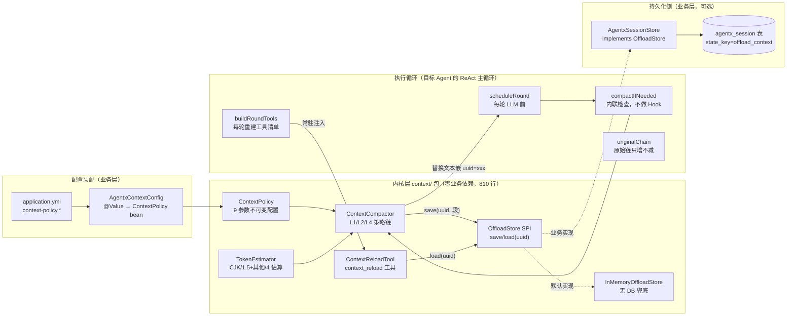

# 05 · 上下文工程迁移方案（从 0 移植到另一个 Agent）

> 对应里程碑 M7（README「M7 上下文工程」）。本文回答一个问题：
> **把这套"上下文压缩闭环"移植到另一个 Agent 工程里，从 0 开始怎么做。**
> 代码全部来自本项目真实源码（`mini-agentx-core/context` 包 + 执行器接入点 + 持久化侧），
> 标注了哪些可零修改拷贝、哪些必须适配。

---

## 1. 设计总览（先看懂再动手）

### 1.1 一条主线：压缩 → 归档 → 取回 的闭环

上下文工程的本质不是"删历史"，而是**"压缩不丢信息"**：

```
每轮 LLM 调用前检查 → 超阈值（消息数 ≥100 或 token ≥90K）→ 进策略链
→ L1/L2/L4 先触发者赢，把"值不了那么多 token 的历史段"移出工作链
→ 移出的原文按 uuid 存 OffloadStore（归档，不删除）
→ 工作链原位替换为"摘要/预览 + uuid=xxx 标记"
→ LLM 后续需要原文时，调 context_reload(uuid) 从归档取回（32K 截断）
```

### 1.2 架构图



### 1.3 一次真实压缩的时序（联调实测）

```
第 N 轮 scheduleRound：
  round++ → compactIfNeeded()
    → shouldCompact？工作链 96 条消息 + 估算 87K tokens，未达 → 跳过
第 N+1 轮 scheduleRound：
    → 104 条消息 ≥ msgThreshold(100) → 触发
    → tryL1：历史区找"连续工具消息段"——找到一段 8 条工具响应（约 9800 tokens）
      ≥6 条且 ≥5000 tokens → 整段 offload 存档(uuid=3f2a…)，
      原位替换为「[历史工具调用记录（已压缩 offload，uuid=3f2a…)] + 逐条 名(args前100字)→结果前200字」
    → 压缩生效，返回 L1 结果；L2/L4 本轮不再尝试（先触发者赢）
  → 用压缩后的工作链调 LLM（token 曲线回落）
第 N+3 轮：
  → LLM 需要某条精确数字 → 调 context_reload(uuid="3f2a…") → 返回归档原文（≤32000 字符）
终态落库：originalChain（原始链，只增不减）追加 original 视图；working 链全量替换
```

### 1.4 八个关键设计决策（迁移时不要改掉）

| # | 决策 | 理由 |
|---|---|---|
| 1 | **压缩内联进循环，不做 Hook 体系** | 检查点唯一且时序确定（每轮 LLM 调用前、工具回灌后）；Hook 抽象是为多检查点服务的，单检查点加抽象只添复杂度 |
| 2 | **策略链"先触发者赢"**（一次 compact 只执行一个策略，命中即返回） | 一次只压一层，压完下轮重新评估，避免一次压太狠；每个策略独立可测（10 个单测全绿的基础） |
| 3 | **original 链与 working 链分离**（originalChain 只增不减） | 落库的 original 视图必须是用户真实看到过的对话；working 链被压缩污染后不能当"原始对话"持久化 |
| 4 | **协议配对安全高于压缩收益**：assistant(toolCalls) 与 tool 响应必须成对 | L1 整段移除时把前导 assistant 一并带走；L2 遇到带 toolCalls 的 assistant 直接跳过；L4 只摘"完整轮次段"。破坏配对 = OpenAI 协议 400 报错 |
| 5 | **offload 原文按 uuid 归档 + 替换文本嵌标记**（而非直接丢弃） | "压缩不丢信息"闭环——LLM 可按需取回精确数字/完整查询结果；归档失败只 warn 不阻断（替换文本已带预览兜底） |
| 6 | **零依赖 token 估算**（CJK 字符/1.5 + 非CJK字符/4），不引 tokenizer | 用途仅是"触发阈值判断 + 段大小比较"，不追求精度（验收口径：与真实 tokenizer 误差 ±20% 内）；省掉一行依赖与模型词典维护 |
| 7 | **保护区 lastKeep 从链尾倒数**（最近 50 条任何策略不碰） | 近期上下文是模型正在推理的依据；压缩永远只动历史区 |
| 8 | **ContextCompactor/Tool 三件套非 Spring Bean**（普通对象，每请求经 ReactAgent 装配） | conversationId 绑定、无状态竞争；测试直接 new，不起容器 |

---

## 2. 迁移总览：文件清单与拷贝性评估

**总量：6 个内核类（810 行）+ 1 个序列化器（175 行，多数 Agent 已有等价物）+ 2 处接入点 + 1 个配置类。内核部分半天，接入联调 1–2 人天。**

| 文件 | 层 | 依赖 | 迁移方式 |
|---|---|---|---|
| `context/ContextPolicy` | 内核 | 纯 JDK | ✅ 零修改拷贝 |
| `context/TokenEstimator` | 内核 | Spring AI `Message` 四子类 | ✅ 零修改拷贝（目标同为 Spring AI 1.x 时） |
| `context/OffloadStore` | 内核 | Spring AI `Message` | ✅ 零修改拷贝 |
| `context/InMemoryOffloadStore` | 内核 | 纯 JDK | ✅ 零修改拷贝 |
| `context/ContextCompactor` | 内核 | 上四个 + Spring AI `ChatModel` + slf4j | ✅ 零修改拷贝（注意：类内 `serializer` 字段是遗留未用，可不拷） |
| `context/ContextReloadTool` | 内核 | Spring AI `ToolCallback`/`FunctionToolCallback`/`@ToolParam` | ✅ 零修改拷贝 |
| `memory/MessageJsonSerializer` | 内核 | Jackson + Spring AI Message | 🔧 **多数情况不用拷**——目标 Agent 落库/快照已有等价序列化器即可；仅持久化侧 OffloadStore 实现需要"Message ⇄ JSON"能力 |
| `memory/AgentxSessionStore`（offload 段） | 业务 | JdbcTemplate + Jackson | 🔧 参考 §5 按目标存储改写（也可先用 InMemory 跑通） |
| `config/AgentxContextConfig` | 业务 | Spring `@Configuration` | ✅ 零修改拷贝（改 yml 前缀即可） |
| `AgentLoopExecutor` 接入点 ①②③ | 装配 | 本项目特有 | ❌ **必须重写**——唯一的真正适配工作（见 §6：compactIfNeeded / context_reload 注入 / originalChain 双链） |
| `ReactAgent` Builder 三参数 | 装配 | 本项目特有 | 🔧 在目标 Agent 的构建处加 `enableCompaction` + `contextPolicy` + `offloadStore` 三开关 |
| 测试 `ContextCompactorTest` 等 4 个 | 测试 | JUnit5 + Mockito | ✅ 零修改拷贝（迁移验收的基线，见 §8） |

> **若目标 Agent 不是 Spring AI**：`Message` 四子类（UserMessage/AssistantMessage/ToolResponseMessage/SystemMessage）、
> `ChatModel.call()`、`FunctionToolCallback` 是仅有的三个框架触点，按目标框架 SPI 平移即可，
> **策略逻辑、协议配对规则、uuid 标记协议、阈值语义全部不变**（契约见 §11）。

---

## 3. Phase 0 · 前置准备

### 3.1 版本矩阵（本项目实测组合）

| 依赖 | 版本 | 说明 |
|---|---|---|
| JDK | 21 | record / 文本块 / switch 表达式 |
| Spring AI | 1.1.0（BOM） | `Message` 模型、`FunctionToolCallback`、`ChatModel.call()` |
| Jackson | Spring Boot 自带 | 仅持久化侧需要 |
| **新增第三方依赖** | **无** | 这是这套设计最重要的迁移友好性：内核不引 tokenizer、不引存储客户端 |

### 3.2 迁移前先回答三个问题

1. **目标 Agent 的"工作链"在哪个对象里、什么类型？**（本项目是 `AgentLoopExecutor.messages: List<Message>`）
2. **每轮 LLM 调用在哪个方法里发起？**（本项目是 `scheduleRound(boolean noTools)`）——压缩检查点就插在它开头
3. **工具清单怎么注入每次 LLM 调用？**——`context_reload` 要混进去（本项目是 `buildRoundTools`）

三个答案齐了，迁移就是"拷包 + 插三行 + 实现一个接口"。

---

## 4. Phase 1 · 内核层（零修改拷贝，6 个类）

### 4.1 ContextPolicy —— 9 参数不可变配置

```java
package com.llmetor.miniagentx.context;

/**
 * 上下文压缩策略配置。
 * <ul>
 *   <li>lastKeep=50：保护区条数——最近 50 条消息不被任何策略压缩</li>
 *   <li>msgThreshold=100：消息数触发阈值（≥100 条进策略链）</li>
 *   <li>tokenThreshold=90000：token 触发阈值（≈128K×0.7）</li>
 *   <li>minConsecutiveToolMessages=6：L1 连续工具消息段的最小条数</li>
 *   <li>minCompressionTokens=5000：L1/L4 段的最小 token 数（不值得压的小段直接跳过）</li>
 *   <li>largePayloadTokens=2000：L2 单条大消息判定阈值</li>
 *   <li>offloadPreviewChars=200：offload 替换文本里保留的原文预览长度</li>
 *   <li>maxLlmCompressionCount=3：单次压缩最多 LLM 调用次数（= L4 最多摘要轮数）</li>
 *   <li>currentRoundRatio=0.3：L6 当前轮目标压缩比（预留，未启用 L5/L6）</li>
 * </ul>
 * <p>不可变对象；builder 便于业务按 yml 覆盖个别值。
 */
public class ContextPolicy {

    private final int lastKeep;
    private final int msgThreshold;
    private final int tokenThreshold;
    private final int minConsecutiveToolMessages;
    private final int minCompressionTokens;
    private final int largePayloadTokens;
    private final int offloadPreviewChars;
    private final int maxLlmCompressionCount;
    private final double currentRoundRatio;

    private ContextPolicy(Builder b) { /* 逐字段赋值，略 */ }

    public static Builder builder() { return new Builder(); }

    /** 文档默认值 */
    public static ContextPolicy defaults() { return builder().build(); }

    // 9 个标准 getter，略

    public static class Builder {
        private int lastKeep = 50;
        private int msgThreshold = 100;
        private int tokenThreshold = 90_000;
        private int minConsecutiveToolMessages = 6;
        private int minCompressionTokens = 5_000;
        private int largePayloadTokens = 2_000;
        private int offloadPreviewChars = 200;
        private int maxLlmCompressionCount = 3;
        private double currentRoundRatio = 0.3;

        public Builder lastKeep(int v) { this.lastKeep = v; return this; }
        public Builder msgThreshold(int v) { this.msgThreshold = v; return this; }
        public Builder tokenThreshold(int v) { this.tokenThreshold = v; return this; }
        public Builder minConsecutiveToolMessages(int v) { this.minConsecutiveToolMessages = v; return this; }
        public Builder minCompressionTokens(int v) { this.minCompressionTokens = v; return this; }
        public Builder largePayloadTokens(int v) { this.largePayloadTokens = v; return this; }
        public Builder offloadPreviewChars(int v) { this.offloadPreviewChars = v; return this; }
        public Builder maxLlmCompressionCount(int v) { this.maxLlmCompressionCount = v; return this; }
        public Builder currentRoundRatio(double v) { this.currentRoundRatio = v; return this; }
        public ContextPolicy build() { return new ContextPolicy(this); }
    }
}
```

> 联调技巧：**联调环境把 `msgThreshold` 调到 6、`tokenThreshold` 调到 3000**，几轮对话就能真实触发压缩；
> 生产保持默认。全部参数 yml 可配（见 §7）。

### 4.2 TokenEstimator —— 零依赖估算器

公式：`tokens = CJK字符数/1.5 + 非CJK字符数/4`（向上取整到整数）。
按消息子类型统计：assistant = 正文 + toolCall 的 name/arguments；tool = 全部 response 的 responseData；
user/system = 正文。

```java
public final class TokenEstimator {

    private TokenEstimator() { }

    /** 单条消息估算 token 数 */
    public static long estimate(Message msg) {
        if (msg == null) return 0;
        if (msg instanceof AssistantMessage am) {
            long n = estimateText(am.getText());
            if (am.getToolCalls() != null) {
                for (AssistantMessage.ToolCall tc : am.getToolCalls()) {
                    n += estimateText(tc.name()) + estimateText(tc.arguments());
                }
            }
            return n;
        }
        if (msg instanceof ToolResponseMessage trm) {
            long n = 0;
            if (trm.getResponses() != null) {
                for (ToolResponseMessage.ToolResponse r : trm.getResponses()) {
                    n += estimateText(r.responseData()) + estimateText(r.name());
                }
            }
            return n;
        }
        return estimateText(safeText(msg));   // user / system / 其它：正文
    }

    /** 消息链总估算 */
    public static long estimateAll(Iterable<Message> messages) {
        long total = 0;
        for (Message m : messages) total += estimate(m);
        return total;
    }

    /** 混合文本估算：CJK 字符按 1.5 token/字，其余按 4 字符/token */
    public static long estimateText(String text) {
        if (text == null || text.isEmpty()) return 0;
        int cjk = 0, other = 0;
        for (int i = 0; i < text.length(); i++) {
            if (isCjk(text.charAt(i))) cjk++; else other++;
        }
        return Math.round(cjk / 1.5) + (other + 3) / 4;
    }

    /** CJK 统一表意文字区（含扩展 A 常用段；够阈值估算用） */
    private static boolean isCjk(char c) {
        return (c >= 0x4E00 && c <= 0x9FFF)
                || (c >= 0x3400 && c <= 0x4DBF)
                || (c >= 0xF900 && c <= 0xFAFF);
    }
}
```

> 为什么不引 tokenizer：估算只服务"触发阈值判断 + 段大小比较"两个决策，±20% 误差不影响决策质量；
> 换来的是零依赖、零词典、纳秒级速度。目标 Agent 若已有 tokenizer，把 `estimateText` 换掉即可，其余代码不动。

### 4.3 OffloadStore SPI + 内存实现

```java
package com.llmetor.miniagentx.context;

/**
 * offload 内容存取 SPI——压缩不丢信息闭环的存储侧。
 * 被压缩策略移出上下文的原文段，按 uuid 存档；LLM 看到 uuid=xxx 标记后
 * 可经 context_reload 工具按 uuid 取回原文。
 */
public interface OffloadStore {
    /** 保存一段被 offload 的原文（同 uuid 重复保存覆盖） */
    void save(String conversationId, String uuid, List<Message> messages);
    /** 按 uuid 取回原文；不存在返回 null */
    List<Message> load(String conversationId, String uuid);
}
```

```java
/** 内存版：无 DB Agent 与单测用；进程重启即失（退化为取不到原文，不影响主流程） */
public class InMemoryOffloadStore implements OffloadStore {
    private final Map<String, List<Message>> store = new ConcurrentHashMap<>();

    @Override public void save(String conversationId, String uuid, List<Message> messages) {
        store.put(conversationId + "::" + (uuid == null ? "" : uuid), new ArrayList<>(messages));
    }
    @Override public List<Message> load(String conversationId, String uuid) {
        List<Message> m = store.get(conversationId + "::" + (uuid == null ? "" : uuid));
        return m == null ? null : List.copyOf(m);
    }
}
```

### 4.4 ContextCompactor —— 策略链核心（迁移中的理解重点）

触发条件与调度骨架：

```java
public class ContextCompactor {

    /** L4 摘要输入里单条消息的字符上限（防个别大消息撑爆摘要调用） */
    private static final int SUMMARY_MSG_CAP_CHARS = 4000;
    /** L1 args 展示截断长度（"args前100字"） */
    private static final int L1_ARGS_CHARS = 100;

    private final ContextPolicy policy;
    private final OffloadStore offloadStore;
    /** L4 摘要用（可为 null——此时 L4 跳过） */
    private final ChatModel chatModel;

    public ContextCompactor(ContextPolicy policy, OffloadStore offloadStore, ChatModel chatModel) { ... }

    /** 压缩结果：compacted=false 表示未触发任何策略（链保持原样） */
    public record CompactResult(boolean compacted, String strategy, String detail) { }
    public record CompactOutcome(CompactResult result, List<Message> newChain) { }

    /** 是否达到触发条件（消息数或估算 token 任一超阈） */
    public boolean shouldCompact(List<Message> workingChain) {
        long count = workingChain.stream().filter(m -> !(m instanceof SystemMessage)).count();
        if (count >= policy.getMsgThreshold()) return true;
        return TokenEstimator.estimateAll(workingChain) >= policy.getTokenThreshold();
    }

    /**
     * 对工作链尝试压缩：L1 → L2 → L4 依次尝试，先触发者赢。
     * @param workingChain 工作链（含首部 SystemMessage；不被本方法修改，新链在 outcome 里）
     */
    public CompactOutcome tryCompact(String conversationId, List<Message> workingChain) {
        if (!shouldCompact(workingChain)) {
            return new CompactOutcome(CompactResult.none(), workingChain);
        }
        // 布局：[0]=SystemMessage；历史区=[1, protectedFrom)；保护区=[protectedFrom, size)
        int protectedFrom = Math.max(1, workingChain.size() - policy.getLastKeep());

        CompactOutcome outcome = tryL1(conversationId, workingChain, protectedFrom);
        if (outcome.result().compacted()) return outcome;
        outcome = tryL2(conversationId, workingChain, protectedFrom);
        if (outcome.result().compacted()) return outcome;
        return tryL4(conversationId, workingChain, protectedFrom);
    }
}
```

**L1 · HistoricalToolList（工具密集区整段 offload）**——最容易写错的是"连续段"的判定与配对安全：

```java
private CompactOutcome tryL1(String conversationId, List<Message> chain, int protectedFrom) {
    // 找"工具密集区"：连续的 assistant(toolCalls) | ToolResponseMessage 区块。
    // 注意 ReAct 链里轮与轮之间隔着 assistant，所以按区内的工具响应数计数
    // （6 轮×1 响应 或 1 轮×6 响应都算达标）；跨进保护区的区块整段跳过
    // （只切一半会让保护区内的 tool 响应失去配对的 assistant，协议非法）。
    List<int[]> regions = new ArrayList<>(); // {start, end}
    int i = 1;
    while (i < chain.size()) {
        if (isToolRegionMember(chain.get(i))) {
            int start = i;
            while (i < chain.size() && isToolRegionMember(chain.get(i))) i++;
            regions.add(new int[]{start, i});
        } else {
            i++;
        }
    }

    // 从右往左替换，前面的下标不受影响
    List<Message> replaced = new ArrayList<>(chain);
    int offloadedRegions = 0;
    long savedTokens = 0;
    for (int r = regions.size() - 1; r >= 0; r--) {
        int segStart = regions.get(r)[0], segEnd = regions.get(r)[1];
        if (segEnd > protectedFrom) continue;                    // 区块跨保护区边界，整段跳过
        long responseCount = countResponses(replaced.subList(segStart, segEnd));
        if (responseCount < policy.getMinConsecutiveToolMessages()) continue;
        List<Message> segment = new ArrayList<>(replaced.subList(segStart, segEnd));
        long segTokens = TokenEstimator.estimateAll(segment);
        if (segTokens < policy.getMinCompressionTokens()) continue;
        String uuid = UUID.randomUUID().toString();
        offloadStore.save(conversationId, uuid, segment);        // 原文归档（整段含前导 assistant）
        replaced.subList(segStart, segEnd).clear();              // 整段移除（协议配对一起带走）
        replaced.add(segStart, new UserMessage(l1Template(uuid, segment)));
        offloadedRegions++;
        savedTokens += segTokens;
    }
    if (offloadedRegions == 0) return new CompactOutcome(CompactResult.none(), chain);
    return new CompactOutcome(
            new CompactResult(true, "L1", "offload %d 段历史工具记录（约 %.0f tokens）"
                    .formatted(offloadedRegions, (double) savedTokens)), replaced);
}

/** 工具密集区成员：带 toolCalls 的 assistant 或工具响应消息 */
private static boolean isToolRegionMember(Message m) {
    if (m instanceof ToolResponseMessage) return true;
    return m instanceof AssistantMessage am && am.getToolCalls() != null && !am.getToolCalls().isEmpty();
}
```

L1 替换模板（`l1Template`）——LLM 看到的替换文本长这样（工具名 + args 前 100 字 + 结果前 200 字 + uuid 取回指引）：

```
[历史工具调用记录（已压缩 offload，uuid=3f2a-…）]
以下 8 条历史工具调用及其结果已归档；需要原文时调用 context_reload 工具并传入上述 uuid。
- executeSql({"sql":"SELECT count(*) FROM orders …"}) → {"count": 1523, …}
- getTableSchema({"table":"orders"}) → CREATE TABLE orders (id BIGINT …)
```

**L2 · LargeMsgOffloadWithKeep（单条大消息原地替换预览）**：

```java
private CompactOutcome tryL2(String conversationId, List<Message> chain, int protectedFrom) {
    List<Message> replaced = new ArrayList<>(chain);
    int offloaded = 0;
    long savedTokens = 0;
    for (int i = 1; i < protectedFrom; i++) {
        Message m = replaced.get(i);
        long tokens = TokenEstimator.estimate(m);
        if (tokens <= policy.getLargePayloadTokens()) continue;
        if (m instanceof AssistantMessage am && am.getToolCalls() != null && !am.getToolCalls().isEmpty()) {
            continue;   // 带 toolCalls 的 assistant 不动（移除会破坏与 tool 响应的配对）
        }
        String uuid = UUID.randomUUID().toString();
        offloadStore.save(conversationId, uuid, List.of(m));
        replaced.set(i, rebuildWithPreview(m, uuid));   // 原地替换，消息类型不变
        offloaded++;
        savedTokens += tokens;
    }
    if (offloaded == 0) return new CompactOutcome(CompactResult.none(), chain);
    return new CompactOutcome(new CompactResult(true, "L2",
            "offload %d 条大消息（约 %.0f tokens）".formatted(offloaded, (double) savedTokens)), replaced);
}
```

`rebuildWithPreview` 的要点：**保持消息类型与协议配对不变**——
tool 消息按 response 逐条替换为"前 200 字预览"（多 response 时 uuid 标记只附在末条，避免重复占上下文）；
assistant 用 builder 重建（content=预览+标记、toolCalls 置空、metadata 保留）；
user 直接替换为"预览+标记"。标记文案：

```
…[本条原文已压缩 offload，uuid=3f2a-…；调用 context_reload 可取回]
```

**L4 · HistoricalRoundSummary（LLM 摘要历史轮次）**——`chatModel == null` 时直接跳过（无 LLM 场景只靠 L1/L2）：

```java
private CompactOutcome tryL4(String conversationId, List<Message> chain, int protectedFrom) {
    if (chatModel == null) return new CompactOutcome(CompactResult.none(), chain);
    // 切轮：round = [user 起，下一个 user 前）；只考虑完整收尾的轮——
    // 撞到保护区边界时，仅当边界处恰是新 user（下一轮已开始）才算完整，
    // 否则该轮延伸进保护区，摘要会让边界后的消息失去协议配对，跳过
    List<int[]> rounds = new ArrayList<>();
    int i = 1;
    while (i < protectedFrom) {
        if (chain.get(i) instanceof UserMessage) {
            int start = i;
            i++;
            while (i < protectedFrom && !(chain.get(i) instanceof UserMessage)) i++;
            boolean completed = i < protectedFrom
                    || (protectedFrom < chain.size() && chain.get(protectedFrom) instanceof UserMessage);
            rounds.add(new int[]{start, completed ? i : -i});
        } else {
            i++;
        }
    }

    // 从最近往前挑 ≤maxLlmCompressionCount 个达标的轮做摘要
    int summarized = 0;
    long savedTokens = 0;
    List<Message> replaced = new ArrayList<>(chain);
    for (int r = rounds.size() - 1; r >= 0 && summarized < policy.getMaxLlmCompressionCount(); r--) {
        int start = rounds.get(r)[0], end = rounds.get(r)[1];
        if (end < 0) continue;                              // 截断轮跳过
        List<Message> roundMsgs = new ArrayList<>(replaced.subList(start, end));
        long roundTokens = TokenEstimator.estimateAll(roundMsgs);
        if (roundTokens < policy.getMinCompressionTokens()) continue;
        String summary = summarizeRound(roundMsgs);         // 调 LLM；失败返回 null
        if (summary == null || summary.isBlank()) continue; // 摘要失败：跳过该轮，不阻断
        String uuid = UUID.randomUUID().toString();
        offloadStore.save(conversationId, uuid, roundMsgs); // 摘要前原文也归档
        // user 原话保留：只摘 [start+1, end)，摘要以 assistant 身份插在 user 之后
        replaced.subList(start + 1, end).clear();
        replaced.add(start + 1, AssistantMessage.builder()
                .content("[历史轮次摘要（原文已 offload，uuid=%s）]\n%s".formatted(uuid, summary.trim()))
                .toolCalls(List.of())
                .build());
        summarized++;
        savedTokens += roundTokens;
    }
    if (summarized == 0) return new CompactOutcome(CompactResult.none(), chain);
    return new CompactOutcome(new CompactResult(true, "L4",
            "摘要 %d 个历史轮次（约 %.0f tokens）".formatted(summarized, (double) savedTokens)), replaced);
}
```

L4 摘要提示词（`summarizeRound`，单轮转录每条消息截 4000 字符防爆）：

```java
private String summarizeRound(List<Message> roundMsgs) {
    try {
        // transcript：[user]/[assistant]/[assistant 调用工具 name(args前200)]/[tool 名: 结果前4000] 逐行拼接
        String prompt = """
                你是会话记录压缩器。请把下面的历史对话轮次压缩成一段摘要，供后续对话作为背景知识使用。
                必须保留：
                1) 用户的核心请求与约束（时间范围、口径、过滤条件等原样保留）；
                2) 已完成的关键步骤与工具调用结论；
                3) 查询得到的关键数据（数字、表名、字段名、代码等硬信息原样保留）；
                4) 已得出的结论与未完成事项。
                不要评论、不要客套，直接输出摘要正文（中文）。

                --- 历史对话开始 ---
                %s
                --- 历史对话结束 ---
                """.formatted(transcript.toString());
        return chatModel.call(new Prompt(prompt)).getResult().getOutput().getText();
    } catch (Exception e) {
        log.warn("[compaction] L4 轮次摘要调用失败（跳过该轮）: {}", e.getMessage());
        return null;
    }
}
```

### 4.5 ContextReloadTool —— 闭环的取回侧

```java
public final class ContextReloadTool {

    /** 取回内容上限（32000 字符截断） */
    public static final int MAX_CHARS = 32_000;

    private static final String TOOL_DESCRIPTION = """
            取回一段被压缩归档（offload）的历史对话原文。
            上下文里的历史工具调用记录、大结果或轮次摘要旁带有 uuid=xxx 标记，表示原文已归档；
            当你需要其中的完整原文（如当时的完整查询结果、精确数字）时，调用本工具并传入该 uuid。
            返回归档的原始消息内容（超长时截断到 32000 字符）。传入未知的 uuid 会得到"未找到"提示。
            """;

    /** 工具入参：offload 标记里的 uuid */
    public record ReloadInput(
            @ToolParam(description = "offload 标记中的 uuid，例如 \"3f2a...\"。仅传 uuid 本身")
            String uuid) { }

    /** 取回函数：uuid → 原文（多消息拼接，32000 字符截断） */
    public static class ReloadFunction implements Function<ReloadInput, String> {
        private final OffloadStore offloadStore;
        private final String conversationId;

        @Override
        public String apply(ReloadInput input) {
            String uuid = input == null ? null : input.uuid();
            if (uuid == null || uuid.isBlank()) {
                return "参数错误：uuid 不能为空。请从上下文中的 offload 标记（uuid=xxx）复制 uuid。";
            }
            List<Message> messages = offloadStore.load(conversationId, uuid.trim());
            if (messages == null || messages.isEmpty()) {
                return "未找到 uuid=" + uuid + " 对应的归档内容（可能已失效）。请勿编造原文，"
                        + "如仍需要请说明你需要的具体信息。";
            }
            StringBuilder sb = new StringBuilder();
            for (Message m : messages) sb.append(m.getText() == null ? "" : m.getText()).append('\n');
            String text = sb.toString();
            if (text.length() > MAX_CHARS) {
                text = text.substring(0, MAX_CHARS) + "\n…[原文超长，已截断到 32000 字符]";
            }
            return text;
        }
    }

    /** 构建工具实例（每请求新建，绑定当前会话的 offload 存取） */
    public static ToolCallback build(OffloadStore offloadStore, String conversationId) {
        return FunctionToolCallback.builder("context_reload", new ReloadFunction(offloadStore, conversationId))
                .description(TOOL_DESCRIPTION)
                .inputType(ReloadInput.class)
                .build();
    }
}
```

> description 里"请勿编造原文"一句不是废话——实测能显著降低模型取回失败时的幻觉率。

---

## 5. Phase 2 · 持久化侧（可选，先用 InMemory 也能跑通）

`OffloadStore` 只有两个方法。两种落地方式按目标工程情况二选一：

### 5.1 方式 A：无 DB / 快速验证 → InMemoryOffloadStore

零工作。代价是进程重启后历史消息里的 uuid 标记取不到原文（LLM 得到"未找到"提示并优雅降级）。

### 5.2 方式 B：有 DB → 复用会话状态表，无独立表

本项目把 offload 原文存进 `agentx_session` 状态表（`state_key='offload_context'`），一行一条记录：

```sql
-- state_data 结构（对齐原框架 §4.3）
{"uuid": "3f2a-…", "message": [消息JSON数组，OpenAI 风格行]}
```

核心实现（`AgentxSessionStore` 节选，JdbcTemplate 版，按目标 ORM 改写）：

```java
public class AgentxSessionStore implements OffloadStore {   // 该类同时负责会话三表持久化

    public static final String STATE_OFFLOAD = "offload_context";
    private final MessageJsonSerializer serializer = new MessageJsonSerializer(); // Message ⇄ JSON

    @Override
    public synchronized void save(String conversationId, String uuid, List<Message> messages) {
        try {
            // 同 uuid 覆盖语义：先删后插
            jdbc.update("DELETE FROM agentx_session WHERE conversation_id = ? AND state_key = ? "
                    + "AND state_data LIKE ?", conversationId, STATE_OFFLOAD, "%\"" + uuid + "\"%");
            ObjectNode node = mapper.createObjectNode();
            node.put("uuid", uuid);
            node.set("message", mapper.readTree(serializer.toJsonArray(messages)));
            // item_index 取当前最大 +1（offload 行跨轮共享，无明确归属 session）
            jdbc.update("INSERT INTO agentx_session (id, conversation_id, session_id, state_key, item_index, state_data) "
                            + "VALUES (?, ?, ?, ?, ?, ?)",
                    SnowflakeIdGenerator.nextId(), conversationId, sessionIdOf(conversationId),
                    STATE_OFFLOAD, maxIndex + 1, node.toString());
        } catch (Exception e) {
            // 归档失败只影响"取回原文"，不影响主流程（替换文本已带预览）
            log.warn("offload 归档失败（context_reload 将取不到该段）: convId={}, uuid={}", conversationId, uuid, e);
        }
    }

    @Override
    public List<Message> load(String conversationId, String uuid) {
        try {
            List<String> rows = jdbc.queryForList(
                    "SELECT state_data FROM agentx_session WHERE conversation_id = ? AND state_key = ? "
                            + "ORDER BY item_index ASC", String.class, conversationId, STATE_OFFLOAD);
            for (String row : rows) {
                JsonNode node = mapper.readTree(row);
                if (uuid.equals(node.path("uuid").asText(null))) {
                    JsonNode messageArr = node.get("message");
                    return messageArr == null ? null : serializer.fromJsonArray(messageArr.toString());
                }
            }
            return null;
        } catch (Exception e) {
            log.warn("offload 取回失败: convId={}, uuid={}", conversationId, uuid, e);
            return null;
        }
    }
}
```

> "Message ⇄ JSON" 用目标 Agent 已有的会话序列化器即可（OpenAI 风格行：
> system/user/assistant(含 tool_calls)/tool 四种 role；连续 tool 行合并回一条 ToolResponseMessage）。
> 本项目实现见 `memory/MessageJsonSerializer`（175 行），目标工程没有等价物时再拷。

---

## 6. Phase 3 · 执行循环接入（唯一的真正适配工作）

三处改动，逐条对照目标 Agent 的 ReAct 主循环。

### 6.1 接入点①：每轮 LLM 调用前内联压缩检查

```java
private void scheduleRound(boolean noTools) {
    if (interruptCtx.isInterrupted() || terminalEmitted.get()) return;
    round++;
    // M7：每轮 LLM 调用前尝试上下文压缩（超阈值才进策略链；内联实现，不做 Hook）
    compactIfNeeded();
    // ...原有逻辑：构建本轮工具 → 调 LLM
}

/** 每轮 LLM 调用前尝试上下文压缩（超阈值才进策略链；失败仅告警不阻断） */
private void compactIfNeeded() {
    if (compactor == null) return;              // null = 未启用压缩，零开销直通
    synchronized (this) {                        // 与工具回灌/轮次收尾互斥
        if (interruptCtx.isInterrupted() || terminalEmitted.get()) return;
        try {
            ContextCompactor.CompactOutcome outcome = compactor.tryCompact(conversationId(), messages);
            if (outcome.result().compacted()) {
                messages.clear();                // 原地替换 working 链
                messages.addAll(outcome.newChain());
                log.info("[agent] 上下文已压缩: convId={}, round={}, 策略={}, {}",
                        conversationId(), round, outcome.result().strategy(), outcome.result().detail());
            }
        } catch (Exception e) {
            log.warn("上下文压缩失败（跳过，不影响主流程）: convId={}", conversationId(), e);
        }
    }
}
```

三个要点：

1. **位置**：必须在"本轮 LLM 调用"之前、且在"上一轮工具响应回灌完成"之后——本项目放在 `round++` 之后第一行，天然满足两个条件；
2. **互斥**：`messages` 是共享可变列表，压缩替换要与消息追加（工具回灌、轮次收尾）互斥；
3. **容错**：整个 try-catch 包住——压缩是增益功能，任何异常都不能打断主对话。

### 6.2 接入点②：context_reload 混入每轮工具清单

```java
// 构造器里（compactor 启用时）：
this.offloadStore = offloadStore != null ? offloadStore
        : (compactor != null ? new InMemoryOffloadStore() : null);   // 兜底：忘传 store 不至于 NPE
this.contextReloadTool = this.offloadStore != null
        ? ContextReloadTool.build(this.offloadStore, conversationId())   // 每请求新建，绑定会话
        : null;

// 每轮重建工具清单处：
private List<ToolCallback> buildRoundTools(boolean noTools) {
    if (noTools) return List.of();
    List<ToolCallback> round = new ArrayList<>(tools);
    // ...其他工具来源
    if (contextReloadTool != null) {
        round.add(contextReloadTool);        // 常驻注入，任何轮次都可取回
    }
    return List.copyOf(round);
}
```

> 若目标 Agent 还有"中断恢复重放"之类的旁路工具映射，同样要把 `contextReloadTool` 加进去
> （本项目 `fullAvailableToolMap()`），否则恢复轮 LLM 调 context_reload 会找不到工具。

### 6.3 接入点③：original 链与 working 链分离

```java
/** 原始消息链（只增不减，永不被压缩污染）——original 视图落库来源 */
private final List<Message> originalChain = new ArrayList<>();

// 初始化时：original = 历史 + 本次新增
private void initMessages() {
    List<Message> history = sessionStore != null ? sessionStore.loadHistory(conversationId()) : List.of();
    messages.add(new SystemMessage(buildSystemPrompt()));
    messages.addAll(history);
    UserMessage userMessage = new UserMessage(query);
    messages.add(userMessage);
    originalChain.addAll(history);        // ← original 只增不减
    originalChain.add(userMessage);
}

// 之后所有"追加新消息"的地方（assistant 入链、工具响应回灌）同步 add 到 originalChain；
// 唯独 compactIfNeeded 的替换不动 originalChain。

// 终态落库：
sessionStore.persistTerminal(conversationId, sessionId, status,
        originalChain,   // original 视图：用户真实看到过的完整对话
        messages,        // working 视图：压缩后的链（用于下次加载进上下文？——见下方注意）
        historySize);    // original 视图追加起点（本轮 user 消息之前的历史条数）
```

> **注意**：本项目落库分两视图——original 增量追加新增切片、working **全删全插**当前链；
> 且 `loadHistory` **优先加载 working 视图**（working 为空才回退 original）。也就是说
> 下次请求加载进上下文的就是压缩后的链，**压缩收益跨请求复利**（历史不会再线性膨胀）。
> 若你只想单请求内生效，落库 original 一份即可，working 链用完即弃。

### 6.4 Agent 门面装配（Builder 三开关）

```java
// ReactAgent（目标 Agent 的门面）Builder 增加：
private boolean enableCompaction = true;                 // 默认开；无 chatModel 场景需关闭
private ContextPolicy contextPolicy = ContextPolicy.defaults();
// offloadStore 可选注入；不注入且有 DB 时用业务实现，否则退化为内存

private ReactAgent(Builder b) {
    // ...
    this.offloadStore = b.enableCompaction
            ? (sessionStore != null ? sessionStore : new InMemoryOffloadStore())  // 有 DB 优先跨请求可取回
            : null;
    this.compactor = b.enableCompaction
            ? new ContextCompactor(b.contextPolicy, offloadStore, chatModel)
            : null;
}

// 每请求创建执行器时透传：
new AgentLoopExecutor(..., deferredRegistry, compactor, offloadStore);
```

---

## 7. Phase 4 · 配置装配（零修改拷贝，改 yml 前缀）

```java
@Configuration
public class AgentxContextConfig {

    @Bean
    public ContextPolicy contextPolicy(
            @Value("${data-agent.agent.context-policy.last-keep:50}") int lastKeep,
            @Value("${data-agent.agent.context-policy.msg-threshold:100}") int msgThreshold,
            @Value("${data-agent.agent.context-policy.token-threshold:90000}") int tokenThreshold,
            @Value("${data-agent.agent.context-policy.large-payload-tokens:2000}") int largePayloadTokens,
            @Value("${data-agent.agent.context-policy.offload-preview-chars:200}") int offloadPreviewChars,
            @Value("${data-agent.agent.context-policy.max-llm-compression-count:3}") int maxLlmCompressionCount) {
        return ContextPolicy.builder()
                .lastKeep(lastKeep).msgThreshold(msgThreshold).tokenThreshold(tokenThreshold)
                .largePayloadTokens(largePayloadTokens).offloadPreviewChars(offloadPreviewChars)
                .maxLlmCompressionCount(maxLlmCompressionCount)
                .build();
    }
}
```

```yaml
# application.yml（默认值即文档值；联调环境调小可真实触发）
data-agent:
  agent:
    context-policy:
      last-keep: 50
      msg-threshold: 100
      token-threshold: 90000
      large-payload-tokens: 2000
      offload-preview-chars: 200
      max-llm-compression-count: 3
```

可选增强（本项目已做）：在 `/agent/capabilities` 能力探测接口里暴露 `toolLayers`，
前端/运维可直接确认 `context_reload` 是否已注入常驻层。

---

## 8. Phase 5 · 测试与验收

### 8.1 单测清单（迁移完成的基线，直接拷贝 `src/test/.../context/` + `AgentLoopContextM7Test`）

| 测试类 | 用例 | 验证点 |
|---|---|---|
| `TokenEstimatorTest` | CJK/混合/空串/toolCalls 计入 | 估算公式与边界 |
| `ContextCompactorTest` | `shouldCompactOnMessageCountOrTokenThresholdOnly` | 双阈值 OR 触发，缺一不压 |
| | `l1OffloadsToolRegionAndKeepsProtectedZone` | L1 整段 offload + 保护区不碰 |
| | `l1SkipsRegionCrossingProtectedBoundary` | 跨保护区边界的区块整段跳过（协议安全） |
| | `l2OffloadsSingleLargeMessagesWithPreview` | L2 原地替换 + 预览 + uuid 标记 |
| | `l2NeverTouchesAssistantWithToolCalls` | 带 toolCalls 的 assistant 永不动 |
| | `l4SummarizesHistoricalRoundsKeepingUserWords` | user 原话保留、摘要插 user 后、原文归档 |
| | `l4RespectsMaxLlmCompressionCount` | 最多摘要 3 轮 |
| | `l1WinsBeforeL2WhenBothApplicable` | 先触发者赢 |
| | `belowThresholdNeverCompacts` | 未达阈值链原样返回 |
| `ContextReloadToolTest` | 空 uuid / 未知 uuid / 正常取回 / 32K 截断 | 取回侧四分支 |
| `AgentLoopContextM7Test` | 循环内联：触发后链被替换、context_reload 注入本轮 | 接入点①②联动 |

> L4 测试用 Mockito mock `ChatModel.call()` 返回固定摘要，不依赖真实 LLM。

### 8.2 联调验收清单（本项目 M7 实测口径）

- [ ] 联调环境调小阈值（如 `msg-threshold: 6`）跑一个多轮工具对话，日志出现 `[compaction] L1/L2/L4 生效`
- [ ] 压缩前后 LLM 实际 prompt token 对比：L2 单次实测压缩约 8517 tokens，token 曲线每轮回拉
- [ ] 压缩后问"当时查询结果里的具体数字"，观察 LLM 调 `context_reload` 取回原文并正确作答（闭环通）
- [ ] 传入伪造 uuid，返回"未找到"提示且 LLM 不编造数据
- [ ] 压缩轮之后对话继续正常（协议未破坏：无 400、无 tool_call_id 配对报错）
- [ ] 关闭 `enableCompaction=false` 重启，行为与未迁移前完全一致（开关可逆）
- [ ] 终态落库后检查 original 视图未被压缩标记污染、working 视图为压缩后链

---

## 9. 踩坑与不变量（迁移必读，每条都付过学费）

1. **协议配对是铁律**。assistant(toolCalls) 与 tool 响应必须成对出现：L1 整段移除时把前导 assistant 一并带走；L2 跳过带 toolCalls 的 assistant；L4 只摘完整轮。任何"只切一半"的优化都会在 OpenAI 协议上炸出 400。
2. **L1 的"连续段"按区内工具响应数计数，不是消息条数**。ReAct 链里轮与轮之间隔着 assistant(toolCalls)，一条 assistant + 一条 tool 交替出现；数消息条数会把正常多轮误判成两个不达标的小段。
3. **跨保护区边界的工具区块整段跳过**（不是截断到边界）。切一半会让保护区内的 tool 响应失去配对的 assistant。
4. **L4 完整轮判定**：轮延伸进保护区时，仅当保护区起点恰好是新 user 才算完整轮，否则跳过。
5. **压缩替换的是"working 视图"，original 链永远只增不减**。用被压缩的链当"原始对话"落库，用户翻历史会看到 `[已压缩 offload…]` 占位符。
6. **`messages.clear()+addAll` 要与消息追加互斥**（本项目 synchronized(this)），且压缩点必须处于"上轮工具已回灌、本轮 LLM 未调用"之间。
7. **压缩任何异常只 warn 不阻断**——包括 LLM 摘要失败（跳过该轮）、offload 归档失败（退化预览兜底）。压缩是增益功能，不是关键路径。
8. **token 估算不是精确值**。阈值语义是"大约 90K"，别拿估算值做计费或审计。
9. **`context_reload` 是每请求新建的**（绑定 conversationId），不要做成单例——串了会话就串了归档。
10. **替换文本里的 uuid 标记协议是给 LLM 读的**，改动模板文案时保持 `uuid=xxx` 的格式可被模型理解，并保留"调用 context_reload 传 uuid"的指引。
11. **无 chatModel 的场景 `enableCompaction` 要能关**（L4 依赖 ChatModel；内核已做成 null 时跳过 L4，门面再给开关兜底）。
12. **同 uuid 重复保存是覆盖语义**（先删后插）——L2 对同一消息多次压缩、测试重复运行都依赖这一点。

---

## 10. 目标 Agent 适配点速查表

| 你需要改的 | 位置 | 工作量 |
|---|---|---|
| yml 前缀 | `AgentxContextConfig` 的 `@Value` key | 5 分钟 |
| OffloadStore 持久化 | 参考 §5.2 按目标存储改写（或先用 InMemory） | 0.5–1 小时 |
| 压缩检查点 | 目标 ReAct 循环"每轮 LLM 调用前"插 `compactIfNeeded()` | 10 分钟 |
| context_reload 注入 | 目标工具清单构建处 `round.add(contextReloadTool)` | 10 分钟 |
| original/working 双链 | 目标执行器加 `originalChain` 字段 + 落库分视图 | 0.5–1 小时 |
| 非 Spring AI 框架 | 平移三个框架触点：消息模型四子类 / `ChatModel.call()` / 工具 SPI | 0.5–1 天 |

**唯一不建议改的**：策略链顺序（L1→L2→L4）、先触发者赢、协议配对规则、保护区语义、
uuid 标记协议、`context_reload` 的 32K 截断。这些是闭环成立的不变量，动了其中任何一个，
§8.2 的验收清单至少挂两条。

---

## 附：本方案对应源码索引

| 内容 | 路径 |
|---|---|
| 内核六类 | `backend/mini-agentx-core/src/main/java/com/llmetor/miniagentx/context/` |
| 执行循环接入 | `backend/mini-agentx-core/src/main/java/com/llmetor/miniagentx/agent/AgentLoopExecutor.java`（`compactIfNeeded` / `buildRoundTools` / `originalChain`） |
| 门面装配 | `backend/mini-agentx-core/src/main/java/com/llmetor/miniagentx/agent/ReactAgent.java`（Builder：`enableCompaction` / `contextPolicy`） |
| 持久化侧 | `backend/mini-agentx-core/src/main/java/com/llmetor/miniagentx/memory/AgentxSessionStore.java`（M7 offload 段） |
| 消息序列化 | `backend/mini-agentx-core/src/main/java/com/llmetor/miniagentx/memory/MessageJsonSerializer.java` |
| 业务配置 | `backend/data-agent-server/.../config/AgentxContextConfig.java` |
| 单测 | `mini-agentx-core/src/test/java/com/llmetor/miniagentx/context/`（3 个）+ `agent/AgentLoopContextM7Test.java` |
