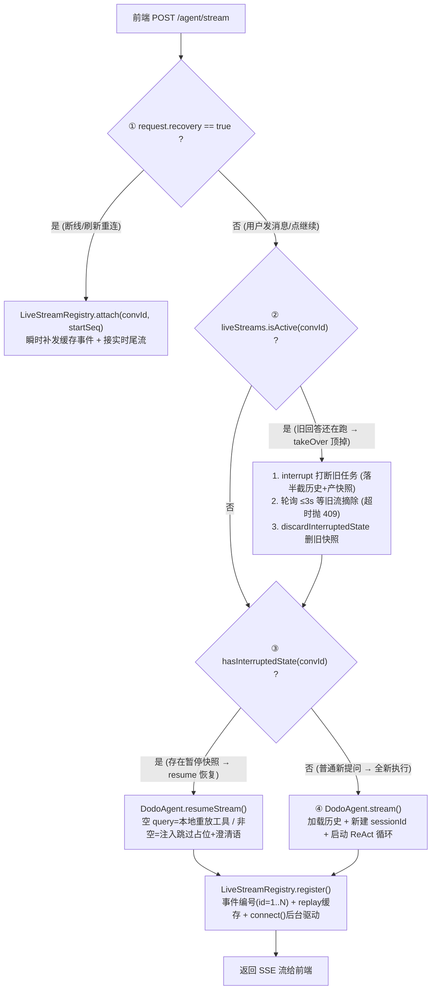
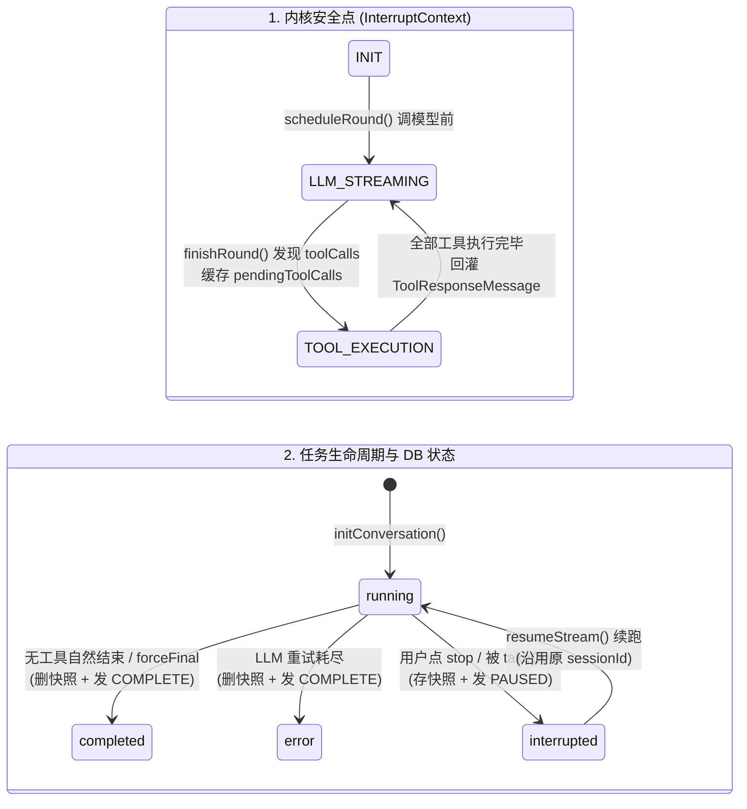

# Agent 基础底座核心机制全景梳理：中断暂停、可恢复、可顶掉、刷新不掉

这套能力是当前项目（`mini-agentx-core` 内核 + `data-agent-server` 编排层 + `ChatView.vue` 前端）最核心的运行时底座。理解它的关键在于先抓住**一句话总纲**：

> 整个底座通过**拆解三件事的生命周期**来实现：
> 1. **管“连接”的生死（刷新不掉 / 断网续传 `recovery`）**：把 Agent 执行与 HTTP 连接彻底解耦，中间加一层内存“直播重放台”（`LiveStreamRegistry`），前端断线只是观众退场，主播（Agent）在后台照跑。
> 2. **管“任务”的生死（中断暂停 `interrupt` + 可恢复 `resume`）**：在安全点切断执行，补齐大模型协议配对占位符，把完整现场拍成快照存进数据库（`agentx_pause_state`）；下次发消息按“空消息重放工具 / 非空消息交模型自决”续跑。
> 3. **管“意图”的生死（新消息顶掉 `takeOver`）**：内核零改动，编排层复用“中断暂停”把半截问答留进历史，等旧流彻底摘除后**删掉刚生成的断点快照**（防旧任务诈尸），再以全新任务启动新问题。

---

## 0. 全局架构鸟瞰与三路边界对照

所有流式请求统一收口在 [AgentController.java](file:///d:/work/zrkj-huaxi/code/huaxi-data-agent/backend/data-agent-server/src/main/java/com/llmetor/dataagent/dataagent/controller/AgentController.java#L69-L133) 的 `POST /agent/stream`，按以下优先级漏斗分发：



### 三条核心路径的本质区别（最易混淆点）

| 维度 | `recovery`（刷新不掉/断线续传） | `resume`（暂停后恢复执行） | `takeOver`（新消息顶掉旧回答） |
| :--- | :--- | :--- | :--- |
| **触发条件** | 前端显式传 `recovery=true, startSeq=N` | 发消息时无活跃流，但 `agentx_pause_state` 有快照 | 发消息时 `liveStreams.isActive(convId) == true` |
| **解决痛点** | 页面刷新、切路由、短暂断网，连接断了但任务没断 | 用户主动点停止，稍后想接着跑或补充条件 | 回答太慢或用户改主意了，直接敲新问题作废旧回答 |
| **是否新起执行器** | **否**（直接订阅正在跑的内存重放流） | **是**（新建 `AgentLoopExecutor`，喂入快照） | **是**（先杀旧流删快照，再新建 `AgentLoopExecutor`） |
| **现场载体** | JVM 内存 `InMemoryLiveStreamRegistry` | PostgreSQL 表 `agentx_pause_state`（TTL 7天） | 借 `interrupt` 产快照后**立即删除**，只留半截历史表 |
| **逻辑轮次 `session_id`** | 不变（本来就是同一次执行） | **沿用快照原 `session_id`**（归属同一轮提问） | **生成全新 `session_id`**（旧轮次定格为 `interrupted`） |
| **异常/边界状态码** | 流已结束返回 `404`（前端据此转拉历史表）；非本人 `403` | 快照缺失抛异常兜底 | 旧流 3 秒内停不下来返回 `409 Conflict` 拒绝并发 |

---

## 一、表结构设计与持久化纪律

数据库建表脚本位于 [agentx_pg.sql](file:///d:/work/zrkj-huaxi/code/huaxi-data-agent/sql/agentx_pg.sql#L9-L73)，核心涉及 **3 张主运行表**（外加监控双写表）。

### 1.1 先分清两个核心 ID（贯穿全栈的钥匙）
* **`conversation_id`（会话窗口 ID）**：左侧边栏里的“一个聊天窗口”（如 `dodo_conv_xxx`），前端新建会话时生成 UUID 并同步到浏览器 URL `?conversationId=...`，跨多轮问答、跨页面刷新保持不变。
* **`session_id`（单次提问轮次 ID）**：雪花算法生成的唯一 ID（[AgentLoopExecutor.java](file:///d:/work/zrkj-huaxi/code/huaxi-data-agent/backend/mini-agentx-core/src/main/java/com/llmetor/miniagentx/agent/AgentLoopExecutor.java#L143)）。用户每提一个新问题生成一行新的 `session_id`。**特例：暂停后 `resume` 恢复执行时，不会生成新 `session_id`，而是强行沿用快照里的原 `session_id`**，从而保证“提问 → 暂停 → 恢复完成”在历史回放和监控审计里属于同一轮问答。

### 1.2 三张核心表职责拆解

#### ① `agentx_conversation`（会话提问轮次表 —— “一问一行”）
源码操作见 [AgentxSessionStore.java](file:///d:/work/zrkj-huaxi/code/huaxi-data-agent/backend/mini-agentx-core/src/main/java/com/llmetor/miniagentx/memory/AgentxSessionStore.java#L51-L65) 与 [SessionService.java](file:///d:/work/zrkj-huaxi/code/huaxi-data-agent/backend/data-agent-server/src/main/java/com/llmetor/dataagent/dataagent/session/SessionService.java#L79-L105)：
* **关键字段**：`id` (PK)、`conversation_id`、`session_id` (`UNIQUE`)、`user_id`、`question`（用户问题原文）、`status`（默认 `'running'`）、`created_at`、`completed_at`。
* **读写时机**：
  1. **全新提问启动时**：`initConversation()` 插入一行，`status = 'running'`（注意：此时消息表里还没有任何本轮内容）。
  2. **流到达终态时**：`persistTerminal()` 更新 `status` 为 `'completed'`（同时写 `completed_at = NOW()`）、`'interrupted'` 或 `'error'`。
  > [!NOTE]
  > **源码细节提示**：当前 [AgentxSessionStore.java](file:///d:/work/zrkj-huaxi/code/huaxi-data-agent/backend/mini-agentx-core/src/main/java/com/llmetor/miniagentx/memory/AgentxSessionStore.java#L149-L155) 中 `UPDATE agentx_conversation SET status = ... WHERE conversation_id = ?` 按窗口 ID 更新了全窗口行的状态/完成时间；而监控侧的新表 `agentx_monitor_session`（见 [MonitorTraceCollector.java](file:///d:/work/zrkj-huaxi/code/huaxi-data-agent/backend/data-agent-server/src/main/java/com/llmetor/dataagent/dataagent/monitor/MonitorTraceCollector.java#L92-L113)）则是精准按 `session_id` 维护每轮独立状态。

#### ② `agentx_session`（会话消息链状态表 —— 双视图设计）
源码操作见 [AgentxSessionStore.java](file:///d:/work/zrkj-huaxi/code/huaxi-data-agent/backend/mini-agentx-core/src/main/java/com/llmetor/miniagentx/memory/AgentxSessionStore.java#L66-L167)：
* **关键字段**：`conversation_id`、`session_id`、`state_key`、`item_index`（自增序号）、`state_data`（OpenAI 风格消息 JSON 数组文本）。
* **三种 `state_key` 分工**：
  * **`original_messages`（原始真相链，只增不减）**：每次终态落库时，只把本轮新增的消息切片（从 `historySize` 下标起）`INSERT` 追加进去，带上本轮 `session_id`。**前端历史详情页回放 timeline 只读这个视图**（按 `conversation_id + session_id` 查），永远不会被上下文压缩破坏。
  * **`working_messages`（模型工作链，全删全插）**：每次终态落库时 `DELETE` 旧行再全量 `INSERT` 当前 `messages`（不含 `SystemMessage`）。下一轮提问 `loadHistory()` 优先读它——如果触发过 M7 上下文压缩，这里存的就是压缩后的精简上下文。
  * **`offload_context`**：M7 大报文卸载归档，供模型调 `context_reload` 取回原文。

#### ③ `agentx_pause_state`（暂停现场快照表 —— 跨进程重启可恢复）
源码操作见 [JdbcPauseStateStore.java](file:///d:/work/zrkj-huaxi/code/huaxi-data-agent/backend/mini-agentx-core/src/main/java/com/llmetor/miniagentx/interrupt/JdbcPauseStateStore.java#L31-L138)：
* **关键字段**：
  * `conversation_id`（**唯一约束 `uk_conversation_id`**：一个会话窗口同一时刻最多只有一份待恢复快照，多次暂停走 `ON CONFLICT (conversation_id) DO UPDATE` 覆盖写）。
  * `reason`（`USER_INTERRUPT` / 预留 `HITL_TOOL_REQUEST`）。
  * `safe_point`（`INIT` / `LLM_STREAMING` / `TOOL_EXECUTION`）。
  * `current_round`（中断时所处 ReAct 轮次）。
  * `interrupted_at`、`expires_at`（默认 TTL 7 天，每次 `save` 顺手清理过期行）。
  * `snapshot_json`：手工序列化（防框架类反射脆弱性）的完整 [PauseState.java](file:///d:/work/zrkj-huaxi/code/huaxi-data-agent/backend/mini-agentx-core/src/main/java/com/llmetor/miniagentx/model/PauseState.java) JSON，包含 `sessionId`、原始 `query`、`params`（含 `userId`、`toolParams` 鉴权凭证）、完整 `messagesJson`（**含 SystemMessage、半截输出及链尾 `[占位]` 响应**）、`pendingToolCalls`（未执行完的工具 id/name/arguments）、累计 Prompt/Completion Tokens。

### 1.3 核心落库纪律：“循环期零写入，终态一次落库”
在 [AgentLoopExecutor.java](file:///d:/work/zrkj-huaxi/code/huaxi-data-agent/backend/mini-agentx-core/src/main/java/com/llmetor/miniagentx/agent/AgentLoopExecutor.java#L1060-L1095) 中，无论 Agent 跑了 1 轮还是 20 轮工具调用，**执行中途绝不写 `agentx_session`**，只在进入终态（`completed` / `error` / `interrupted`）时通过 `persisted.compareAndSet(false, true)` 一次性落库，并挂了 Reactor `.doFinally(sig -> fallbackPersist())` 兜底。
* **为什么这对“刷新不掉”至关重要？** 因为正在跑的当前轮不在历史表里！前端刷新页面时先拉历史表（拿到之前已结束的所有轮次），再探测发现当前有活跃流，直接新建一个助手气泡从 1 号事件重放——**历史轮次与当前实时轮次边界绝对清晰，既不会出现空助手气泡，也不会重复渲染**。

---

## 二、四层状态设计与流转关系

系统里共有 **4 套状态** 在不同层级协同工作：



| 层级 | 状态载体与位置 | 取值集合 | 核心作用 |
| :--- | :--- | :--- | :--- |
| **① 内存流存活态** | `InMemoryLiveStreamRegistry.live` | 存在 Key (`active=true`) / 已摘除 (`false`) | 前端进页探测“是否正在生成”、侧边栏绿点 `生成中`、`takeOver` 判断是否需要顶掉旧流并等待其真正停稳 |
| **② 内核任务与安全点** | `AgentTaskManager.tasks` + `InterruptContext` | `INIT` / `LLM_STREAMING` / `TOOL_EXECUTION` + `interrupted` | 同会话并发互斥锁（`putIfAbsent`）；记录被打断瞬间究竟是在流式吐字还是在跑工具、有哪些 `pendingToolCalls` |
| **③ SSE 流事件协议** | [AgentStreamEvent.java](file:///d:/work/zrkj-huaxi/code/huaxi-data-agent/backend/mini-agentx-core/src/main/java/com/llmetor/miniagentx/model/AgentStreamEvent.java#L19-L34) | 过程：`THINKING`, `TEXT`, `TOOL_START`, `TOOL_END`, `ERROR`<br/>终态：`PAUSED` **或** `COMPLETE` | 每条流必以 `PAUSED` 或 `COMPLETE` 之一收尾（`terminalEmitted` CAS 保证单次发射），驱动前端气泡收尾 |
| **④ 前端会话视图态** | [ChatView.vue](file:///d:/work/zrkj-huaxi/code/huaxi-data-agent/frontend/src/views/ChatView.vue#L758-L763) `sessions[cid]` + `msg` | `streaming` / `interrupted` + 工具项 `running` / `completed` / `failed` / `interrupted` | 控制输入栏显示红框“停止”还是蓝框“发送”、是否允许空输入点“从断点恢复”、是否展开过程折叠条 |

---

## 三、后端程序核心实现深挖

### 3.1 “刷新不掉 / 断线不丢”实现（`InMemoryLiveStreamRegistry`）
传统 SSE 写法把 `agent.stream()` 直接 return 给 Spring MVC/WebFlux，浏览器一关页面，HTTP 连接断开产生 `cancel` 信号逆流而上传给 Reactor 上游，大模型流和工具直接被掐死。

本项目的解法见 [InMemoryLiveStreamRegistry.java](file:///d:/work/zrkj-huaxi/code/huaxi-data-agent/backend/data-agent-server/src/main/java/com/llmetor/dataagent/dataagent/stream/InMemoryLiveStreamRegistry.java#L35-L65)，短短 30 行做了 4 件精密的事：
1. **`.index((i, evt) -> ServerSentEvent.builder(evt).id(String.valueOf(i + 1)).build())`**：给每个流事件打上从 `1` 自增的序号，塞进标准 SSE `id:` 字段。
2. **`.doFinally(signal -> live.remove(conversationId, entry))`**：流真正结束时从注册表摘除。注意用的是**双参数 `remove(key, value)`**——如果旧流刚结束、takeOver 的新流已经用同一个 `conversationId` 注册进去了，旧流的异步 `doFinally` 绝不会误删新流！
3. **`.replay()`**：把冷流包成 `ConnectableFlux`，在当前流生命周期内缓存所有已编号的 SSE 事件。
4. **`replay.connect()`**：**立即在后台启动订阅驱动**！哪怕前端第 0 秒就断网，后端照样跑完 ReAct 循环并调用 `persistTerminal` 落库。
5. **断线/刷新重连接回 `attach(convId, startSeq)`**：一行 `entry.replay().skipUntil(sse -> Long.parseLong(sse.id()) >= from)` 检票放行——刷新页面传 `startSeq = 1` 瞬时全量回放已产出事件再无缝接上实时尾流；网络闪断传 `startSeq = lastSeq + 1` 精准补齐缺失片段。

此外，[GlobalExceptionHandler.java](file:///d:/work/zrkj-huaxi/code/huaxi-data-agent/backend/data-agent-server/src/main/java/com/llmetor/dataagent/common/GlobalExceptionHandler.java#L56-L105) 做了两处关键配套：
* **透传真实 HTTP 状态码**：单独拦截 `ResponseStatusException`，防止 SSE 接口抛出的 `404`（流已结束）、`403`（非本人流）、`409`（顶掉超时）被全局兜底吞成 `HTTP 200 + {code:500}` 导致前端状态机瘫痪。
* **客户端断连降噪**：识别 Tomcat/Windows 下的 `AsyncRequestNotUsableException`、`ClientAbortException`、`broken pipe` / `远程主机强迫关闭`，仅打一行 `warn` 返回 `null`，不刷异常堆栈。

---

### 3.2 “中断 / 暂停”实现（`AgentTaskManager` + `onInterrupt`）
当用户点击停止调用 `GET /agent/stop`（[AgentController.java](file:///d:/work/zrkj-huaxi/code/huaxi-data-agent/backend/data-agent-server/src/main/java/com/llmetor/dataagent/dataagent/controller/AgentController.java#L184-L194)）时：

1. **任务摘除与流切断**：[AgentTaskManager.java](file:///d:/work/zrkj-huaxi/code/huaxi-data-agent/backend/mini-agentx-core/src/main/java/com/llmetor/miniagentx/agent/AgentTaskManager.java#L80-L93) 执行 `tasks.remove(conversationId)`（原子移除，防并发连点触发两次中断），调用 `disposable.dispose()` 立即掐断当前轮正在接收的 LLM HTTP 流（注：[AgentLoopExecutor.java](file:///d:/work/zrkj-huaxi/code/huaxi-data-agent/backend/mini-agentx-core/src/main/java/com/llmetor/miniagentx/agent/AgentLoopExecutor.java#L890-L893) 的 `handleLlmError` 开头检查 `interruptCtx.isInterrupted()`，避免把掐流误判为模型报错去重试）。
2. **打断线程同步整理现场**（[AgentLoopExecutor.java](file:///d:/work/zrkj-huaxi/code/huaxi-data-agent/backend/mini-agentx-core/src/main/java/com/llmetor/miniagentx/agent/AgentLoopExecutor.java#L925-L992) `onInterrupt`）：
   * 先置 `interruptCtx.markInterrupted()` 门闩，所有后续 `scheduleRound` 和异步工具回调看到门闩立即退出，不再续轮。
   * **为什么要“补占位响应”？（OpenAI 协议铁律）**：OpenAI / DeepSeek / Qwen 等工具调用协议强制要求：只要 `assistant` 消息带了 `tool_calls`，紧跟其后必须有每一个 `tool_call_id` 对应的 `role: "tool"` 消息，否则下次发请求直接报 `400 Bad Request`。
   * **现场 A：正在接收大模型流时被打断（`current != null`）**
     * 把缓冲区里已收到的半截思考（`flushParser`）和半截正文刷成一条 `AssistantMessage` 塞进 `messages` 和 `originalChain`（已吐出的字绝不丢失）。
     * 如果模型已经流式吐出了 `toolCalls`（但还没开始执行）：把它们登记进 `interruptCtx.enterToolExecution(pending)`，并立刻追加 `[占位] 本轮工具调用未产生真实结果...` 的 `ToolResponseMessage`。
   * **现场 B：正在并发跑工具时被打断（`current == null`）**
     * 此时 `interruptCtx.pendingToolCalls` 在进工具前早已登记好；调用 `closeDanglingToolCalls()` 倒序扫描链尾 `AssistantMessage`，对还没写入 `respondedToolCallIds` 的工具调用补上 `[占位]` 响应。
3. **落快照、落历史、发终态**：
   * `stateStore.save(snapshot)` 写入 `agentx_pause_state` 表；
   * `persistTerminal("interrupted")` 把这半截问答写入 `agentx_session` 与 `agentx_conversation`；
   * 发射 `PAUSED` 事件 → `sink.tryEmitComplete()` 关闭 SSE 流 → `LiveStreamRegistry` 触发 `doFinally` 摘除活跃流。

---

### 3.3 “可恢复”实现（`initMessagesFromResume` 三分支语义）
当会话在 `agentx_pause_state` 中存在快照时，用户下次在同窗口发请求（[AgentController.java](file:///d:/work/zrkj-huaxi/code/huaxi-data-agent/backend/data-agent-server/src/main/java/com/llmetor/dataagent/dataagent/controller/AgentController.java#L104-L107) 分支③）自动进入 `resumeStream`（[AgentLoopExecutor.java](file:///d:/work/zrkj-huaxi/code/huaxi-data-agent/backend/mini-agentx-core/src/main/java/com/llmetor/miniagentx/agent/AgentLoopExecutor.java#L336-L480)）：

1. **还原账本**：反序列化快照 `messagesJson` 重建消息链（含原 `SystemMessage`）；沿用快照的 `round`、`sessionId`、`totalPromptTokens`、`totalCompletionTokens`。
2. **保守剥离占位符**（`stripTrailingPlaceholderResponses`）：检查链尾的 `ToolResponseMessage`，**只有当整批响应的 `id` 全在 `pendingToolCalls` 内且文本全部包含 `"[占位]"` 时才移除**（防止同一 `tool_call_id` 被回答两次报 400，同时绝不误伤真实工具结果）。
3. **核心设计灵魂 —— 空与非空分道扬镳**（`appendResumeToolResponses`）：
   * **分支 1：用户空手点继续（`resumeQuery` 为空）→ “代码说了算，确定性重放”**
     * 遍历 `pendingToolCalls`，直接调用 `toolExecutor.executeSync()` 在本地同步真实执行刚才没跑完的工具（发射 `TOOL_START` / `TOOL_END`），把真实结果回灌进消息链，**省掉重调一次 LLM**，随后直接 `scheduleRound(false)` 让模型看工具结果往下走。
   * **分支 2 & 3：用户带了文字发送（无论是敲了“继续”还是“改成只查2025年”）→ “模型说了算，语义自决策”**
     * **绝不自动重放旧工具**（万一旧工具是写操作或重查询，而用户新消息正是想改主意，盲目重放会闯祸）。
     * 给每个 `pendingToolCall` 回灌一段 `TOOL_SKIPPED_PLACEHOLDER`（告诉模型：“原工具调用 `xxx` 被用户中断未执行，请按用户新指示决定是否重调”）。
     * 在链尾追加一条用 `RESUME_INTERRUPT_USER_PROMPT` 模板包装的 `UserMessage`（同时摆出「原始任务」与「用户中断后返回的消息」），交由 LLM 判断是细化方向、切换新任务还是继续原任务。
4. **防重复落库与延迟工具恢复**：
   * 将 `historySize` 设为恢复初始化完成后的非 System 消息数——因为中断前那半截已经落进 `original_messages` 了，恢复跑完终态落库时只追加恢复后新产生的切片！
   * 调用 `restoreDiscoveredToolsFromHistory()` 扫描消息链中出现过的延迟工具名并恢复激活，防止中断前通过 `tool_search` 发现的 SQL/业务工具在恢复后的新实例里变成“未发现”而调不通。
5. **消费后销毁防“僵尸恢复”**：一旦本次执行到达 `completeTerminal` 或 `errorTerminal`，立即调用 `discardSnapshot()` 删除 `agentx_pause_state` 记录（如果恢复途中用户又点了停止，则会 `UPSERT` 新快照覆盖旧快照）。

---

### 3.4 “可顶掉（`takeOver`）”实现（四步严格时序）
代码位于 [AgentController.java](file:///d:/work/zrkj-huaxi/code/huaxi-data-agent/backend/data-agent-server/src/main/java/com/llmetor/dataagent/dataagent/controller/AgentController.java#L201-L217) 的 `takeOverActiveStream(convId)`，完全复用了上面的机制，但**顺序一步都不能错**：

```java
private void takeOverActiveStream(String convId) {
    // ① 复用 interrupt 打断旧任务（附言留痕；内部会同步落半截历史 + 存一份快照 + 发 PAUSED 关流）
    boolean interrupted = dodoAgent.interrupt(convId, "新消息顶掉旧回答");
    // ② 轮询等待旧流从 LiveStreamRegistry 真正摘除（最多 30 × 100ms = 3s）
    for (int i = 0; i < TAKEOVER_POLL_TIMES && liveStreams.isActive(convId); i++) {
        Thread.sleep(TAKEOVER_POLL_INTERVAL_MS);
    }
    // ④ 若 3s 还没停下，抛 409 拒绝本次新请求，严防同会话双流并发写坏历史
    if (liveStreams.isActive(convId)) {
        throw new ResponseStatusException(HttpStatus.CONFLICT, "当前会话回答尚未停止，请稍后重试");
    }
    // ③ 关键！必须在等停之后删掉①产生的断点快照，防止走入③恢复通道导致旧任务“诈尸”
    dodoAgent.discardInterruptedState(convId);
}
```
* **为什么必须“先等 `isActive == false`，再删快照”？** 因为快照的 `save` 在 `onInterrupt` 收尾链里，如果不等旧流彻底收尾摘除就调 `delete`，万一遇上并发边界 `save` 晚于 `delete` 落地，表里就会残留一份“僵尸快照”，紧接着往下走到路由③ `hasInterruptedState(convId)` 就变成 `true`，或者下次发消息时旧任务突然复活！
* **最后一道物理防线**：万一极端竞态下两个请求同时闯过检查，内核 [AgentTaskManager.java](file:///d:/work/zrkj-huaxi/code/huaxi-data-agent/backend/mini-agentx-core/src/main/java/com/llmetor/miniagentx/agent/AgentTaskManager.java#L48-L53) 的 `tasks.putIfAbsent` 会直接抛出 `IllegalStateException("会话已有进行中的执行")`，宁可报错也绝不让两个执行器同时污染同一个会话。

---

## 四、前端渲染与状态机协同（`ChatView.vue` + `agent.js`）

前端代码集中在 [agent.js](file:///d:/work/zrkj-huaxi/code/huaxi-data-agent/frontend/src/api/agent.js#L21-L109) 与 [ChatView.vue](file:///d:/work/zrkj-huaxi/code/huaxi-data-agent/frontend/src/views/ChatView.vue)：

### 4.1 为什么手写 `fetch` 解析 SSE 而不用原生 `EventSource`？
因为浏览器原生 `EventSource` **只支持 GET、无法携带自定义 POST JSON Body 和动态 Bearer Token**。因此 `openAgentStream()` 用 `fetch('/agent/stream', { method: 'POST', signal: ctrl.signal })` + `resp.body.getReader()` 按 `\n\n` 切块手动解析 `event:`、`id:`、`data:`，并同步返回 `{ abort: () => ctrl.abort() }` 句柄。

### 4.2 模块级 `liveStreams` + 游标防重（切会话不丢、重连不重字）
* **视图与流解耦**（[ChatView.vue](file:///d:/work/zrkj-huaxi/code/huaxi-data-agent/frontend/src/views/ChatView.vue#L871)）：`const liveStreams = new Map()` 维护所有正在跑的会话流（`cid -> { cid, aiMsg, question, controller, lastSeq, retries, paused }`）。用户在侧边栏切去别的会话，旧会话的 `fetch` 根本不断开，后台继续往响应式对象 `aiMsg.timeline` 里 push 内容；切回来时（`openConversation` L1072）发现 `liveStreams.has(cid)` 直接挂载渲染，**零网络请求**。
* **游标去重**（[ChatView.vue](file:///d:/work/zrkj-huaxi/code/huaxi-data-agent/frontend/src/views/ChatView.vue#L1198-L1204)）：每收到一个 SSE 事件先读 `id` 转数字 `seq`，若 `seq <= entry.lastSeq` 直接 `return` 丢弃，否则推进 `entry.lastSeq = seq`。这保证了后端 `replay` 缓存与实时尾流交界处即使出现重发也绝不会在界面上拼出重复文字。

### 4.3 断线重连与 F5 刷新的三套组合拳
1. **F5 刷新页面 / 重新打开 URL**：
   * `onMounted` 从 URL `?conversationId=xxx` 取出 `cid` → 调 `loadConversation(cid)` 拉取 `/session/{cid}` 渲染之前**已落库**的历史轮次；
   * 紧接着调 `tryResumeOnLoad(cid)`（L1159）请求 `/agent/stream/status`：若返回 `{ active: true }`，说明当前还有一轮正在后台跑（尚未落库），立即在界面末尾挂一个新的 `aiMsg` 气泡，发送 `{ conversationId: cid, recovery: true, startSeq: 1 }` 瞬时全量回放所有缓存事件并接上实时流！
2. **网络闪断自动重连**（`streamHandlers.onError` L1358）：
   * 只要 `entry.lastSeq > 0`（曾经连上收到过事件）且重试未满 3 次，按 `1s -> 2s -> 3s` 退避重发 `{ conversationId: cid, recovery: true, startSeq: entry.lastSeq + 1 }` 增量续传。
3. **重连瞬间后端刚好跑完了（404 优雅降级）**（L1344）：
   * 如果断网这 2 秒内后端刚好跑完落库并摘除了内存流，重连请求会收到后端的 `HTTP 404`。前端捕获 `err.status === 404`，不报错，而是调用 `finishStream` + 重新调用 `loadConversation(cid)` 直接从数据库把完整终态拉出来渲染！

### 4.4 暂停与空消息恢复的 UI 细节
* **点停止不抢先 `abort`**：[ChatView.vue](file:///d:/work/zrkj-huaxi/code/huaxi-data-agent/frontend/src/views/ChatView.vue#L1690-L1702) 的 `onStop()` 只调 `GET /agent/stop`，**故意不立即调本地 `controller.abort()`**，而是等 SSE 通道自然收到后端发来的 `PAUSED` 事件再走 `onClose` 收尾，确保状态不丢（只有 `/agent/stop` 网络请求本身失败才兜底 `abort`）。
* **中断态定格渲染**（`applyPausedState` L1322）：
  * 把所有还在转圈（`status === 'running'`）的工具卡片改为 `status = 'interrupted'`，结果填入提示文案；
  * 气泡底部渲染琥珀色提示条：`⏸ 已中断 — 发送消息（可为空发送/继续）可从断点恢复`（L312-L316）；
  * **过程不折叠**：`workCollapsed(msg)` 规定 `msg.interrupted` 时保持思考与工具过程展开，方便用户看清断在哪一步；
  * **解锁空发送**：`sendDisabled`（L1537）在 `s.interrupted === true` 时哪怕输入框为空也允许点击发送按钮（鼠标悬停提示变为 `从断点恢复（Enter 亦可）`）。

### 4.5 顶掉（`takeOver`）的前端“身份守卫（Identity Guard）”
这是前端最精妙的防坑设计（[ChatView.vue](file:///d:/work/zrkj-huaxi/code/huaxi-data-agent/frontend/src/views/ChatView.vue#L1334-L1409)）：
* 当旧回答还在流式输出时，用户敲入新问题按回车：
  * 防抖保护（L1566）：若 `liveStreams.get(cid).lastSeq === 0`（上一条消息刚发出连第 1 个字节都没回来，后端可能还没注册进 `liveStreams`），拦截连发防并发穿透。
  * 新请求发出，`openStream` 立即用**新 `entry`** 覆盖 `liveStreams.set(cid, newEntry)`，界面新增一轮用户气泡 + 新 AI 气泡。
  * 几百毫秒后，后端把旧流打断，**旧流的 SSE 连接收到 `PAUSED` 并触发 `onClose` 异步回调**！
  * 此时全靠**身份比对 `liveStreams.get(cid) === entry`**：
    * 旧流的 `entry.aiMsg` 会被正确标上 `⏸ 已中断`（定格在上面那个旧气泡里）；
    * 但在清理会话级状态时，由于 `liveStreams.get(cid)` 已经是 `newEntry` 了（`!== oldEntry`），旧流**不会删除 `liveStreams` 里的新流，不会把会话 `s.streaming` 误关为 `false`，也不会把会话级 `s.interrupted` 误标为 `true`**！

---

## 五、大白话全场景推演（6 个真实剧本）

假设业务员**小王**打开华西数据智能体，窗口 ID 是 `conv_001`。我们用大白话看系统在 6 种折腾下是怎么运转的：

### 剧本 1：跑一半手滑按了 F5 刷新（刷新不掉 · 运行中重放）
1. 小王问：“*统计各片区投资完成率并分析原因*”。
2. 后端在 `agentx_conversation` 插了一行 `session_id=S1, status='running'`，启动 ReAct 循环并在 `LiveStreamRegistry` 开播：第 1 秒产出 `id:1 (THINKING)`、第 2 秒 `id:2 (TOOL_START: executeSql)`、第 4 秒 `id:3 (TOOL_END)`……
3. 第 5 秒，模型正吐答案吐到一半，小王手滑按了浏览器 **F5 刷新**。
4. **那一瞬间发生了什么？** 浏览器的 HTTP 连接断了，后端 `GlobalExceptionHandler` 捕获断管异常只打了一行日志；但因为 `LiveStreamRegistry` 用了 `connect()` 后台驱动，Agent 根本没停，第 6 秒继续产出 `id:15 (TEXT)` 存进内存 `replay` 队列。
5. 第 6.5 秒新页面加载完：
   * 先拉 `/session/conv_001`：因为当前轮 `S1` 还没结束（循环期零落库），历史返回空；
   * 再问 `/agent/stream/status?conversationId=conv_001`：后端答 `{ active: true }`；
   * 前端立刻发 `POST /agent/stream { conversationId: "conv_001", recovery: true, startSeq: 1 }`；
   * 后端把内存里缓存的 `1~18` 号事件**在几毫秒内一口气灌给前端**，瞬间还原出刚才的思考框、SQL 工具卡片和半截文字，紧接着第 19 号、20 号实时文字继续往外蹦，直到 `COMPLETE` 落库！

### 剧本 2：合上电脑去开会，半小时后回来刷新（刷新不掉 · 终态落库兜底）
* 接上例，假如小王刷新或断网后过了半小时才回来。此时后端早就跑完第 30 号 `COMPLETE` 事件，把完整问答写进了 `agentx_session` 并从内存 `LiveStreamRegistry` 摘除了 `conv_001`。
* 小王重新打开页面，`/session/conv_001` 直接从数据库的 `original_messages` 把思考过程（还从 `agentx_trace` 对齐了思考秒数）、SQL 执行卡片、最终 Markdown 报告原封不动组装好返回，而 `/agent/stream/status` 返回 `active: false`，收工。
* **极端情况**：如果小王断网 2 秒自动重连时，后端恰好在第 1.9 秒刚跑完摘除，重连请求拿到 `404`，前端 `onError` 看到 `404` 知道“哦，我断线这会儿它刚好干完了”，自动调一次 `loadConversation` 把刚落库的答案拉出来！

### 剧本 3：点“停止”去接电话，回来啥也不敲直接按回车（中断 + 纯恢复重放）
1. 小王问：“*帮我查一下待审台账明细*”。模型第 1 轮决定调用工具 `listReviewTasks({"page":1})`，刚进入工具执行阶段，小王电话响了，顺手点了红色 **停止按钮**。
2. 后端 `/agent/stop` 掐断任务：发现当前处于 `TOOL_EXECUTION`，`listReviewTasks` 还没回灌结果。后端给消息链末尾补上一条 `"[占位] 本轮工具调用未产生真实结果..."` 凑齐配对，把完整现场（含 `pendingToolCalls=[listReviewTasks]`、`sessionId=S2`）存进数据库 `agentx_pause_state` 表，并发出 `PAUSED`。
3. 哪怕此时**后端服务器重启了**也没关系，因为快照在 PostgreSQL 里！
4. 5 分钟后小王打完电话回来，看到界面写着 `⏸ 已中断`，输入框啥也没敲，直接按了一下 **Enter（空发送）**。
5. 后端发现 `agentx_pause_state` 有 `conv_001` 的快照，且 `query` 为空：
   * 把刚才的 `"[占位]"` 撕掉；
   * **不花钱重调大模型**，直接在本地同步重跑 `listReviewTasks({"page":1})` 拿到真实台账数据塞进消息链；
   * 沿用原 `sessionId=S2` 进入第 2 轮调大模型总结输出，跑完后删掉 `agentx_pause_state` 快照！

### 剧本 4：点“停止”后发现条件漏说了，补一句话再发（中断 + 带消息自决策恢复）
1. 同剧本 3，小王在模型正准备跑全院 SQL 查询时点了 **停止**。
2. 小王在输入框敲：“*不用查全院了，只查锦江院区 2026 年的数据*”，点击发送。
3. 后端进入恢复通道，看到这次 `resumeQuery` **非空**：
   * 把 `"[占位]"` 撕掉，**绝不去重跑刚才那个全院慢 SQL 工具**，而是塞入一条提示：`“工具执行被用户中断，用户给出了新指示，原调用 executeSql(...) 未执行”`；
   * 再追加包装后的用户消息，把「原始任务」和「只查锦江院区 2026 年的数据」一起摆给大模型；
   * 大模型一看秒懂，放弃全院 SQL，重新生成带锦江院区过滤条件的新 SQL 继续执行！

### 剧本 5：看它答歪了，懒得点停止，直接敲新问题回车（豆包式 `takeOver` 顶掉）
1. 小王问了问题 A，Agent 正在吭哧吭哧第 2 轮流式吐字。
2. 小王一看方向不对，**根本不去点停止按钮**，直接在输入框敲入问题 B 按回车。
3. 后端 `POST /agent/stream` 发现 `liveStreams.isActive("conv_001") == true`：
   * **第 1 步（打断留史）**：调 `interrupt("conv_001", "新消息顶掉旧回答")`，问题 A 已吐出的半截文字被刷进历史表定格为 `interrupted`（页面上问题 A 的旧气泡立刻停住并挂上 `⏸ 已中断` 标签，历史不丢）；
   * **第 2 步（等旧流真死透）**：每 100ms 看一次 `liveStreams.isActive`，第 200ms 旧流收尾完毕摘除；
   * **第 3 步（毁尸灭迹删断点）**：调 `discardInterruptedState` 把第 1 步顺带写进 `agentx_pause_state` 的快照**删掉**；
   * **第 4 步（另起炉灶）**：往下走发现已无快照，带着问题 B 开启全新 `sessionId=S3` 流式输出（同时大模型通过 `loadHistory` 依然能看到上一轮问题 A 的半截对话上下文）。

### 剧本 6：旧工具死锁卡住，顶不掉时的安全熔断（`409 Conflict`）
* 假设极端情况下旧流在某处卡死，3 秒（30 × 100ms）内都没从 `LiveStreamRegistry` 摘除。
* `takeOverActiveStream` 立即抛出 `409 Conflict`（“当前会话回答尚未停止，请稍后重试”），新问题 B 不会入库、不会开启第二个并发 Agent 循环，前端在新气泡里展示红字提示，严格保护会话数据一致性。

---

## 六、前瞻：在这套底座上扩展 `Subagent as Tool` 的 5 个关键耦合点

掌握了上述单 Agent 底座后，你接下来要做 **多 Agent（`Subagent as Tool`，即主 Agent 把子 Agent 当作一个 Tool 调用）** 时，这套底座有 **5 个核心机关** 必须提前设计对齐，否则一接就会踩坑：

> [!IMPORTANT]
> 下面这 5 点正是单 Agent 底座与 `Subagent as Tool` 架构直接碰撞的边界：

1. **会话 ID 隔离（严禁主子共用同一个 `conversationId`）**
   * **底座约束**：`AgentTaskManager.tasks`（`putIfAbsent` 互斥）、`JdbcPauseStateStore`（`uk_conversation_id` 唯一键）、`AgentxSessionStore`（`working_messages` 全删全插）全部是以 `conversationId` 为主键的共享单例！
   * **扩展影响**：如果主 Agent 在跑 `conv_001` 时调 `SubagentTool`，子 Agent 内部也用 `ReactAgent` 且传了同一个 `conv_001`：
     * 子 Agent 启动 `registerTask("conv_001")` 会瞬间撞上主 Agent 自己的锁，直接抛 `IllegalStateException("会话已有进行中的执行")`！
     * 即使绕过锁，子 Agent 终态落库会把主 Agent 的 `working_messages` 全删替换成子 Agent 的局部上下文！
   * **演进方向**：子 Agent 必须使用派生的独立子会话 ID（如 `conv_001:sub:{toolCallId}`）或不注入主 `sessionStore`（纯内存跑完只把结论作为 Tool Result 返回给主 Agent，上下文隔离这本来也是 Subagent as Tool 最大的优势）。

2. **中断信号的级联传播（父停子必停，防后台孤儿流与 Token 泄漏）**
   * **底座现状细节**：仔细看 [ToolCallExecutor.java](file:///d:/work/zrkj-huaxi/code/huaxi-data-agent/backend/mini-agentx-core/src/main/java/com/llmetor/miniagentx/agent/ToolCallExecutor.java#L71-L90) 与 [AgentLoopExecutor.java](file:///d:/work/zrkj-huaxi/code/huaxi-data-agent/backend/mini-agentx-core/src/main/java/com/llmetor/miniagentx/agent/AgentLoopExecutor.java#L925-L968)——普通工具（如查个 SQL 耗时 200ms）跑在 `toolPool` 线程池里时，`onInterrupt` 是在 `/agent/stop` 的 HTTP 线程上直接把主 `sink` 关掉并补 `[占位]` 收尾的，并没有去 `Future.cancel` 或通知正在跑的工具线程（普通短工具跑完在回调里看到 `interruptCtx.isInterrupted()` 就静默丢弃结果了）。
   * **扩展影响**：但 `Subagent as Tool` 自己是一个可能跑 10 轮 LLM、耗时 30 秒的重型任务！如果用户点了停止或发新消息 `takeOver` 顶掉主 Agent，若不把父 `InterruptContext.onInterrupt(callback)` 级联传导去调用 `subAgent.stopStream(subConvId)`（或 `interrupt`），**子 Agent 会在后台变成无人认领的“孤儿任务”继续疯狂烧 Token 甚至执行写操作**！`InterruptContext` 里已经预留好了 `onInterrupt(Runnable callback)` 列表（见 [InterruptContext.java](file:///d:/work/zrkj-huaxi/code/huaxi-data-agent/backend/mini-agentx-core/src/main/java/com/llmetor/miniagentx/interrupt/InterruptContext.java#L50-L65)，目前内核还没消费它），这简直是为级联打断子 Agent 量身留好的挂点！

3. **断点恢复策略选择（粗粒度重放 vs 细粒度子快照级联）**
   * 当主 Agent 在调用 `SubagentTool` 期间被用户点停止：主 Agent 的 `PauseState.pendingToolCalls` 记录的是 `[SubagentTool(task="...")]`。
   * 用户空手点“继续”时：
     * **轻量方案（推荐起步）**：子 Agent 被打断时调 `stopTask` 丢弃子状态；主 Agent 恢复时按现有逻辑重放 `SubagentTool`（子 Agent 重跑一次该子任务）。适合只读分析型子 Agent。
     * **进阶方案**：子 Agent 被打断时也调 `interrupt` 以 `subConvId` 存子快照；主 Agent 恢复重放 `SubagentTool` 时，工具内部检测 `hasInterruptedState(subConvId)` 自动从子快照 `resumeStream` 续跑！

4. **子 Agent 过程事件的流式透传与“刷新不掉”兼容**
   * `LiveStreamRegistry` 缓存的是主 Agent `sink` 吐出的 `AgentStreamEvent` 序列。
   * 如果希望前端在 `SubagentTool` 运行期间不是干等几十秒转圈，而是能实时看到子 Agent 内部正在调什么工具/怎么思考（折叠在子 Agent 工具卡片内部），子 Agent 事件只需附加一个 `parentToolCallId`（或 `subAgentName`）字段，通过主 Agent 传入 `ToolContext` 的同一个 `sink` + `emitLock` 往外发射——**这样无需改动 `InMemoryLiveStreamRegistry`，子 Agent 的实时进度天然自动获得编号、自动进 `replay` 缓存、天然支持“F5 刷新不掉”和“断线续传”**！

5. **Trace 与监控审计树的父子挂载**
   * 当前 `agentx_trace` 和 `agentx_monitor_trace` 按 `(conversation_id, session_id, round)` 记录。子 Agent 执行时若要进监控台可观测，建议带上 `parent_session_id` / `parent_tool_call_id` 或独立标识，避免子 Agent 的 `round=1,2,3` 与主 Agent 的 `round=1,2,3` 在同一 `session_id` 下撞车导致时间线乱序。
