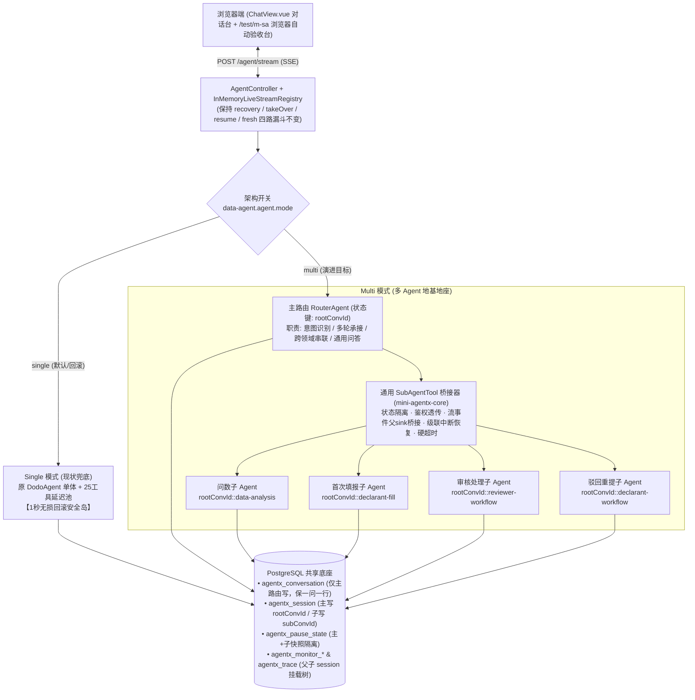
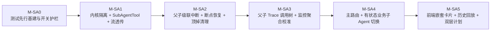

# 单 Agent 平滑过渡多 Agent 地基框架：分步实施与全场景测试验收手册

> **文档定位**：本文档将 [01-单Agent底座核心机制梳理与Subagent扩展前瞻.md](file:///d:/work/zrkj-huaxi/code/huaxi-data-agent/docs/多agent技术调研/单agent演进多agent文档/01-单Agent底座核心机制梳理与Subagent扩展前瞻.md) 与 [02-主路由与有状态垂类子Agent架构演进技术方案.md](file:///d:/work/zrkj-huaxi/code/huaxi-data-agent/docs/多agent技术调研/单agent演进多agent文档/02-主路由与有状态垂类子Agent架构演进技术方案.md) 整合为一份**面向研发落地、测试先行、可随时回滚的工程执行手册**。
>
> **核心目标**：拒绝“一次性大爆炸重构裸跑”。聚焦构建一套**能从单 Agent 安全过渡到多 Agent 的内核与地基框架**，严格执行 **「先写浏览器自动化测试用例 → 再改单个功能点 → 程序自动校验 + 人工校验双通过 → 打标留档 → 再进下一里程碑」** 的推进纪律。
>
> **进度标记规范**：每通过一个功能点验收，将 `[ ]` 改为 `[x]` 并标注 `（验收通过 YYYY-MM-DD，Git Commit: xxx）`。未通过前严禁进入下一功能点。

---

## 0. 全局演进总纲与“零裸跑”安全护栏

### 0.1 我们要建的多 Agent 地基长什么样？（01+02 核心浓缩）



### 0.2 三大核心架构铁律（贯穿全部里程碑）

| 铁律 | 设计规格 | 解决的致命风险 |
| :--- | :--- | :--- |
| **① 三键物理隔离** | • 根窗口键：`rootConvId`（如 `dodo_conv_xxx`）<br>• 子记忆键：`subConvId = {rootConvId}::{agentCode}`<br>• 子运行锁：按 `subConvId` 互斥登记 | 防止主子争抢 `AgentTaskManager` 会话锁抛异常；防止子 Agent 全删覆盖主 Agent 的 `working_messages`；防止并行子调用互相覆盖记忆 |
| **② 单流透传兼容底座** | 子 Agent 过程事件打上 `agentCode` + `parentToolCallId`，经父 `ToolContext.stepEmitter` 写入主 `sink`，拦截子 `COMPLETE/PAUSED` 不外泄 | 零改动复用 `InMemoryLiveStreamRegistry`，天然继承单 Agent 底座的 **F5 刷新不掉、断线续传、流序号去重** |
| **③ 一问一行不虚增** | 子 Agent `subAgent=true` 时跳过 `agentx_conversation` 写入；监控表通过 `parent_session_id` 区分根提问与子调用 | 左侧历史列表不冒出子任务废行；监控大盘提问数不翻倍，同时完整汇总主+子总 Token 与耗时 |

### 0.3 怎么做到“改前有用例、自己能通过浏览器自动验证、改坏秒回滚”？

本项目前端已内置原生浏览器自动化测试引擎 **TestHub**（见 [run.js](file:///d:/work/zrkj-huaxi/code/huaxi-data-agent/frontend/src/testhub/run.js)、[assert.js](file:///d:/work/zrkj-huaxi/code/huaxi-data-agent/frontend/src/testhub/assert.js)）及后端查库探针（见 [KernelDemoController.java](file:///d:/work/zrkj-huaxi/code/huaxi-data-agent/backend/data-agent-server/src/main/java/com/llmetor/dataagent/agentdemo/KernelDemoController.java#L117)）。我们直接在其上建立**四层自验证与回滚机制**：

1. **浏览器一键自动跑批（`/test/m-sa`）**：在 `frontend/src/testhub/scenarios/m-sa.js` 中预先录入所有里程碑的 `auto` 测试用例（覆盖 HTTP 状态、SSE 事件流顺序、子工具调用名、数据库落表探针）。无论是人工点「运行全部」还是 AI 浏览器子 Agent 打开 `http://localhost:5173/test/m-sa` 自动点击运行并读取绿标 `passed`，都能在浏览器里完成端到端无人值守验证。
2. **对话台真实交互巡检（`/chat`）**：涉及 F5 刷新、点红色停止按钮、右侧计划面板折叠等 UI 交互场景，由浏览器自动化（或人工）在 `/chat` 页面按固定剧本实操核验。
3. **老功能防劣化回归（`/test/m1` + `/test/m3`）**：每个里程碑收尾时，必须顺手重跑原有的 `M1（内核）` 与 `M3（流式恢复）` 自动化用例，确保单 Agent 原有能力零退化。
4. **三级无损回滚机制**：
   * **秒级配置回滚**：`application.yml` 设置 `data-agent.agent.mode: single`（或请求体透传），1 秒切回原单 Agent 链路；
   * **数据库向后兼容**：新增列全部带 `DEFAULT` 值（`agent_code DEFAULT 'router'`、`parent_session_id DEFAULT NULL`），回滚代码无需回滚表结构；
   * **里程碑 Git 锚点**：每过一个里程碑打一个本地标签（`tag: m-sa1-verified` ~ `m-sa5-verified`），任一步骤验证不过直接回退至上一锚点。

---

## 1. 里程碑全景路线图（严格串行闯关）



| 里程碑 | 核心交付目标 | 涉及模块 | 准出红线（全过才准进下一棒） |
| :--- | :--- | :--- | :--- |
| **M-SA0** | 搭好 `single/multi` 双模开关、`/agent/demo/subagent-check` 查库探针、`/test/m-sa` 浏览器自动化测试页 | `agentdemo` / `testhub` | 浏览器打开 `/test/m-sa` 可见全部预置用例（未开发项显示 `blocked/failed`，基线项 `passed`） |
| **M-SA1** | 内核支持 `subAgent` 状态隔离、`SubAgentTool` 凭证继承与超时保护、子事件带 `parentToolCallId` 经父流透传 | `mini-agentx-core` / `agentdemo` | 主调子不撞锁、不污染 `agentx_conversation`、子记忆跨轮延续、SSE 实时收到带归属标记的子事件 |
| **M-SA2** | 激活 `InterruptContext.fireInterrupt` 级联打断、修复 `JdbcPauseStateStore` 序列化、打通子恢复与 `takeOver`/删除级联清理 | `mini-agentx-core` / `SessionService` | 父停子必停无后台孤儿流；空消息从子断点续跑；带新消息恢复/顶掉/删会话不残留僵尸子快照 |
| **M-SA3** | 迁移 `uk_trace_session_round` 唯一索引，落库 `parent_session_id` / `agent_code`，校准监控计数与 Token 汇总 | `sql` / `trace` / `monitor` | 同窗口主子 `round=1` 不撞唯一键；监控窗口与 5 分钟指标提问数只计根提问，Token 计主+子总和 |
| **M-SA4** | 物理拆分工具池，上线 `RouterAgent` + 4 个有状态垂类子 Agent（含两段式 `ConfirmToken` 提审确认与 `/` 斜杠路由） | `data-agent-server` / `skills` | `mode=multi` 下问数追问、首次填报跨轮暂存+提审确认、审核、驳回重提全链路跑通；切回 `single` 仍正常 |
| **M-SA5** | `ChatView.vue` 子工具折叠卡渲染、确认卡外层冒泡、历史详情回放子步骤、右侧自适应双层 `TodoWrite` 面板 | `frontend` / `SessionService` | 实时流、F5 刷新续传、关页重开历史回放三态一致；单垂类/跨垂类计划面板不闪烁不互盖 |

---

## 2. 分里程碑实施细则与全场景测试验收

---

### 里程碑 M-SA0：测试先行基建与双模回滚护栏

#### 改造目标与代码清单
在不动任何内核与现有业务执行逻辑的前提下，先把**安全网**和**自动化裁判员**搭好：
1. **配置开关**：在 [application.yml](file:///d:/work/zrkj-huaxi/code/huaxi-data-agent/backend/data-agent-server/src/main/resources/application.yml) 增加 `data-agent.agent.mode: single`（可选 `single` / `multi`），并在 `ChatRequest` 增加可选调试字段 `agentMode`（便于 `/test/m-sa` 在不重启后端的情况下同时自动对比测试 `single` 与 `multi` 两条链路！）。
2. **后端验证探针**：在 [KernelDemoController.java](file:///d:/work/zrkj-huaxi/code/huaxi-data-agent/backend/data-agent-server/src/main/java/com/llmetor/dataagent/agentdemo/KernelDemoController.java) 新增：
   * `POST /agent/demo/subagent/stream`：用内核 `ReactAgent` 装配一个轻量 `DemoRouterAgent` + `DemoCalcSubAgent`（含慢工具 `sleepEcho`，专门用来稳定测试级联打断、记忆延续和超时，不受业务库数据波动影响）。
   * `GET /agent/demo/subagent-check?conversationId=xxx`：只读查询 PostgreSQL，一次性返回该窗口下主会话行数、子会话（`xxx::%`）消息条数、主/子 `agentx_pause_state` 快照存在性、主/子 Trace 轮次与 `parent_session_id` 关联情况，供浏览器 `TestHub` 直接做 JSON 断言。
3. **前端 TestHub 断言器与测试页扩展**：
   * 在 [assert.js](file:///d:/work/zrkj-huaxi/code/huaxi-data-agent/frontend/src/testhub/assert.js) 新增 3 个断言原语：
     * `subEventHas`：断言 SSE 事件流中存在 `parentToolCallId != null && agentCode === exp.agentCode` 的事件；
     * `subToolCalled`：断言子 Agent 内部调用了指定工具（`e.type === 'TOOL_START' && e.parentToolCallId && e.toolName === exp.value`）；
     * `terminalCountEq`：断言整条 SSE 流中 `COMPLETE` / `PAUSED` 终态事件总次数严格等于 `1`（严防子 Agent 终态漏出提前掐断父流）。
   * 新增 `frontend/src/testhub/scenarios/m-sa.js` 并注册到 [scenarios/index.js](file:///d:/work/zrkj-huaxi/code/huaxi-data-agent/frontend/src/testhub/scenarios/index.js)，生成浏览器路由 `/test/m-SA`。

---

#### 功能点 F0.1：双模开关兜底与测试探针自检

##### 1. 涉及场景清单
* **场景 S0.1-A**：默认 `single` 模式下现有单 Agent 对话完全不受影响（基线防劣化）。
* **场景 S0.1-B**：浏览器打开 `/test/m-SA` 自动运行探针接口，未开发的里程碑用例准确识别为受阻/待交付，基线用例全绿。

##### 2. 大白话场景阐述
* **S0.1-A 大白话**：就像给高速公路修新匝道前先装一个道闸。默认道闸指向老路（`single` 模式），业务员小王正常进聊天页查项目、填资料，走的还是原来那套一字没改的老代码；哪怕后面新匝道（`multi` 模式）施工出了问题，只要配置切回 `single`，线上业务 1 秒钟就能恢复正常。
* **S0.1-B 大白话**：我们在网页侧边栏“测试功能”下新开了一个叫 `M-SA · 多Agent地基` 的自动化考场页面。代码还没开改前先把考卷发下去——点一下按钮，浏览器自己去调后端接口和查库探针，老功能打绿勾，还没写的新功能标成黄色“待交付”或红叉，后续每写完一小块代码就来点一次按钮看它变绿。

##### 3. 测试步骤（自动校验 + 人工校验）
* **程序自动校验步骤**：
  1. 启动前后端服务，请求 `GET /agent/capabilities`，断言返回 `200` 且包含当前默认 `agentMode: "single"`。
  2. 请求 `POST /agent/stream`（不传 `agentMode`），断言流正常返回 `TEXT` 并以单次 `COMPLETE` 结束。
  3. 请求 `GET /agent/demo/subagent-check?conversationId=probe_init`，断言返回 `code=200` 且 `rootConvCount=0, subSessionCount=0`。
* **人工手工校验步骤**：
  1. 浏览器登录 `admin`，观察左侧菜单“测试功能”下是否出现 `M-SA · 多Agent地基`，点击进入 `/test/m-SA`。
  2. 点击页面右上角「运行全部自动用例」，观察 S0.1 基线卡片变绿 `PASSED`。
  3. 切到 `/test/m1` 和 `/test/m3` 各跑一次自动用例，确认改造前基线全绿。

##### 4. 浏览器自验证测试用例（写入 `m-sa.js`）
```javascript
// 预置进 frontend/src/testhub/scenarios/m-sa.js -> groups[0] (Key: 'M0')
{
  id: 'MSA-001',
  prio: 'P0',
  title: '双模开关基线与子Agent查库探针就绪',
  steps: '1) 查 /agent/capabilities 确认开关存在；2) 调 /agent/demo/subagent-check 验证数据库探针可用；3) 跑一次默认 single 流确保原链路畅通',
  expected: 'capabilities 返回 agentMode；subagent-check 返回 200 及空会话统计；默认流正常 COMPLETE',
  auto: {
    steps: [
      {
        method: 'GET',
        url: '/agent/capabilities',
        expect: [
          { kind: 'bodyCode', value: 200 },
          { kind: 'jsonKeys', path: 'data', value: ['onlineAvailable', 'toolLayers', 'agentMode'] }
        ]
      },
      {
        method: 'GET',
        url: '/agent/demo/subagent-check?conversationId=probe_{{uuid}}',
        expect: [
          { kind: 'bodyCode', value: 200 },
          { kind: 'jsonEq', path: 'data.rootConversationFound', value: false },
          { kind: 'jsonEq', path: 'data.subWorkingCount', value: 0 }
        ]
      },
      {
        kind: 'sse',
        url: '/agent/stream',
        body: { query: '你好，请用一句话介绍你自己', conversationId: '{{convId}}', agentMode: 'single' },
        expect: [
          { kind: 'terminal', value: 'COMPLETE' },
          { kind: 'textLenMin', min: 2 }
        ]
      }
    ]
  }
}
```
* **浏览器自动验证执行方式**：通过浏览器打开 `http://localhost:5173/test/m-SA`，点击 `#MSA-001` 的「运行」按钮，检查卡片状态徽标变为 `通过`（`state === 'passed'`）。
* **准出与回滚**：`[x] MSA-001 浏览器自动验证通过（验收通过 2026-11-24）`。回滚方式：`git checkout` 新增测试脚手架文件，对生产运行零影响。

---

### 里程碑 M-SA1：内核 `mini-agentx-core` 状态隔离、`SubAgentTool` 与流透传地基

#### 改造目标与代码清单
打通“主 Agent 把有状态子 Agent 当作一个 Tool 调用”的全部内核机关（对应 `01` §6 与 `02` §2.1~2.3、§4.1）：
1. **[RunnableParams.java](file:///d:/work/zrkj-huaxi/code/huaxi-data-agent/backend/mini-agentx-core/src/main/java/com/llmetor/miniagentx/model/RunnableParams.java)**：新增 `subAgent(boolean)`、`agentCode(String)`、`rootConversationId(String)`、`parentSessionId(String)`、`parentToolCallId(String)`。
2. **[AgentStreamEvent.java](file:///d:/work/zrkj-huaxi/code/huaxi-data-agent/backend/mini-agentx-core/src/main/java/com/llmetor/miniagentx/model/AgentStreamEvent.java)**：新增可选字段 `agentCode`、`parentToolCallId` 及拷贝方法 `withSource(agentCode, parentToolCallId)`（主 Agent 事件保持 `null`，老报文兼容）。
3. **[AgentLoopExecutor.java](file:///d:/work/zrkj-huaxi/code/huaxi-data-agent/backend/mini-agentx-core/src/main/java/com/llmetor/miniagentx/agent/AgentLoopExecutor.java)**：
   * 当 `params.isSubAgent() == true` 时，`initMessages()` **跳过** `sessionStore.initConversation(...)`，`persistTerminal()` **跳过** `UPDATE agentx_conversation`（只读写 `subConvId` 下的 `agentx_session`）；
   * 暴露本次执行的累计 Token 与最终文本至 `AgentResult`。
4. **[ToolCallExecutor.java](file:///d:/work/zrkj-huaxi/code/huaxi-data-agent/backend/mini-agentx-core/src/main/java/com/llmetor/miniagentx/agent/ToolCallExecutor.java)**：在 `ToolContext` 中额外注入父级 `stepEmitter`（线程安全写入父 `sink`）、`parentSessionId`、`toolCallId`、`interruptCtx`。
5. **新增 `SubAgentTool.java`（核心桥接组件）**：
   * 派生子状态键 `subConvId = rootConvId + "::" + agentCode`，对同一 `subConvId` 加串行锁防止同窗口并发写坏 `working_messages`；
   * **跨线程凭证继承**：原样复制父 `RunnableParams` 中的 `userId` 与 `toolParams`（含 `token`、`tenantId`、`conversationId=rootConvId`），彻底避开异步线程池丢失 `HuaxiAuthContext` `ThreadLocal` 陷阱；
   * **流事件透传与终态拦截**：订阅子 Agent `stream()`，将子 `THINKING / TEXT / TOOL_START / TOOL_END` 打上 `(agentCode, parentToolCallId)` 后经 `stepEmitter` 实时推入父流；**严格拦截消费子 `COMPLETE / PAUSED` 事件不外发**，提取子 Agent 最终结论作为 Tool 字符串返回给父 Agent；
   * **硬超时保护**：默认 `180s` 超时兜底，超时自动调用 `subAgent.stopTask(subConvId)` 并返回结构化超时提示，严防父线程永久挂死。

---

#### 功能点 F1.1：主子状态键物理隔离、记忆跨轮延续与防并发覆盖

##### 1. 涉及场景清单
* **场景 S1.1-A（主调子不撞锁、不污染会话列表）**：主 Agent 调用子 Agent 完成问答，`agentx_conversation` 严格只有主 Agent 1 行记录，主/子 `working_messages` 分存两套 key 互不覆盖。
* **场景 S1.1-B（有状态子 Agent 跨轮记忆延续）**：第 1 轮子 Agent 查出一个内部编号（未在主对话展示细节），第 2 轮用户简短追问“刚才那个编号翻倍是多少”，子 Agent 从自己的 `subConvId` 历史里准确找回上下文算出答案。
* **场景 S1.1-C（同轮双调同一子 Agent 串行保护）**：主 Agent 在同一轮同时发出 2 个针对同一子 Agent 的调用，系统排队串行执行，两次记忆均保留，不抛并发锁冲突异常、不丢前次记忆。

##### 2. 大白话场景阐述
* **S1.1-A 大白话**：以前只有一个账本（`conv_001`），如果大总管（主 Agent）和跑腿专员（子 Agent）抢同一个账本写字，一上来就会打架报错（`会话已有进行中的执行`），写完还会把大总管的账全撕了换成跑腿小账。现在大总管用主账本 `conv_001`，专员用副账本 `conv_001::demo-sub`，而且规定只有大总管能在门口签到表（`agentx_conversation`）上登记，这样左侧聊天记录列表干干净净，只显示用户问的那一句话。
* **S1.1-B 大白话**：小王第一句让专员办件事，专员在自己的副账本里记下了长长的内部单号 `DOC-9527`；第二句小王只偷懒说了句“接着把刚才那单提交了”。大总管看聊天脉络知道还是找这个专员，专员翻开自己的副账本 `conv_001::demo-sub`，一眼看到上一轮的 `DOC-9527`，丝滑接着往下办。
* **S1.1-C 大白话**：万一大总管性子急，一口气派了两个活给同一个专员，专员必须做完第一件把副账本存好，再打开副账本做第二件，绝不能两个分身同时抄旧账本、最后谁慢谁把别人的记录盖掉。

##### 3. 测试步骤（自动校验 + 人工校验）
* **程序自动校验步骤**：
  1. 执行内核单测：`cd backend && mvn test -pl mini-agentx-core -Dtest=SubAgentIsolationTest`。
  2. 通过 `/agent/demo/subagent/stream` 用固定 `convId` 连续发送第 1 轮（写入暗号 `SECRET-8848` 到子工具）和第 2 轮（追问“我上一轮存进子工具的暗号是什么”）。
  3. 调用 `/agent/demo/subagent-check?conversationId={convId}`：断言 `rootConvRowCount === 2`（两问两行，无子行混入）、`rootWorkingCount > 0`、`subWorkingCount > 0` 且第 2 轮回答包含 `SECRET-8848`。
* **人工手工校验步骤**：
  1. 浏览器进入 `/chat`，查侧边栏历史列表，确认完成一轮带子 Agent 的问答后，会话列表只出现 1 个窗口且提问条数为 `1`（不会变成 `2`）。
  2. 在 DBeaver / psql 执行 `SELECT conversation_id, state_key, item_index FROM agentx_session WHERE conversation_id LIKE 'demo_conv_%';`，肉眼确认同时存在 `xxx` 和 `xxx::demo-sub` 两组互不干扰的状态记录。

##### 4. 浏览器自验证测试用例（写入 `m-sa.js`）
```javascript
{
  id: 'MSA-101',
  prio: 'P0',
  title: '主子状态键隔离 + 跨轮子记忆延续 + 不污染 conversation 主表',
  steps: '1) 第1轮经主Agent让子Agent调用 rememberSecret 记录暗号 HX-2026；2) 第2轮同窗口仅问"刚才记下的暗号是什么"；3) 调 subagent-check 核验双账本与主表行数',
  expected: '第2轮准确答出 HX-2026；agentx_conversation 严格等于 2 行（无子Agent行）；root 与 sub working_messages 均独立存在',
  auto: {
    steps: [
      {
        kind: 'sse',
        url: '/agent/demo/subagent/stream',
        body: { query: '请委派子助手调用 rememberSecret 工具保存暗号 HX-2026', conversationId: '{{convId}}' },
        expect: [
          { kind: 'toolNameCalled', value: 'call_demo_sub' },
          { kind: 'terminal', value: 'COMPLETE' }
        ]
      },
      {
        kind: 'sse',
        url: '/agent/demo/subagent/stream',
        body: { query: '再问一下子助手，刚才保存的暗号是什么？', conversationId: '{{convId}}' },
        expect: [
          { kind: 'toolNameCalled', value: 'call_demo_sub' },
          { kind: 'textIncludes', value: 'HX-2026' },
          { kind: 'terminal', value: 'COMPLETE' }
        ]
      },
      {
        method: 'GET',
        url: '/agent/demo/subagent-check?conversationId={{convId}}',
        expect: [
          { kind: 'bodyCode', value: 200 },
          { kind: 'jsonEq', path: 'data.rootConvRowCount', value: 2 },
          { kind: 'jsonEq', path: 'data.subConvRowCount', value: 0 },
          { kind: 'jsonNumMin', path: 'data.rootWorkingCount', min: 1 },
          { kind: 'jsonNumMin', path: 'data.subWorkingCount', min: 1 }
        ]
      }
    ]
  }
}
```

---

#### 功能点 F1.2：跨线程安全凭证透传与子 Agent 硬超时保护

##### 1. 涉及场景清单
* **场景 S1.2-A（跨线程身份与权限凭证零丢失）**：子 Agent 运行在异步工具线程池中，其内部工具仍能拿到真实的当前登录 `userId`、`token`、`tenantId` 和 `rootConvId`（不能为 `null` 或被大模型伪造覆盖）。
* **场景 S1.2-B（子 Agent 卡死硬超时熔断）**：子 Agent 内部某轮卡住超过设定阈值（演示接口设 `3s` 超时），`SubAgentTool` 自动掐断子任务并返回超时错误 JSON，主 Agent 正常收尾发出 `COMPLETE`，不永久挂死连接。

##### 2. 大白话场景阐述
* **S1.2-A 大白话**：用户的登录工牌（`token` 和 `userId`）原本挂在大门接待员（HTTP 请求线程）脖子上。当大总管派活给后台房间里的子专员（`toolPool` 异步线程）时，如果不把工牌复印件塞进任务袋（`RunnableParams.toolParams`）带过去，子专员去查华西数据库或调主系统接口时就会被当成“黑户”拦在门外，或者查出全院越权数据。而且这个工牌必须由框架强行塞进去，大模型自己乱编一个 `userId=1` 也得被强制覆盖回真实登录人。
* **S1.2-B 大白话**：万一子专员在里面打电话等对方回话卡死了，大总管不能陪着它等一辈子（否则用户整个聊天框就彻底死锁了）。闹钟一到点，大总管直接把子专员叫停，礼貌告诉用户“子任务响应超时，请重试”，保证聊天窗口随时可用。

##### 3. 测试步骤（自动校验 + 人工校验）
* **程序自动校验步骤**：
  1. 登录测试账号发起 `/agent/demo/subagent/stream`，诱导大模型故意在参数里传假 `userId="999999"` 调用子 Agent 内的 `whoamiProbe` 回显工具，断言工具实际收到的 `userId` 等于真实登录用户 ID、`tokenPresent=true`、`conversationId` 等于外层 `rootConvId`（不含 `::` 后缀）。
  2. 调用触发 6 秒慢工具的演示子 Agent（超时阈值设为 2 秒），断言总耗时 `< 15s`，主 Agent 收到超时错误 JSON 后正常以 `COMPLETE` 收尾，且 `/agent/demo/subagent-check` 确认 `runningTaskCount === 0`。
* **人工手工校验步骤**：
  1. 在 `/test/m-SA` 点击运行 `#MSA-102`、`#MSA-103`，展开测试详情查看 `whoamiProbe` 返回 JSON 中的真实 `userId` 与 `conversationId`。

##### 4. 浏览器自验证测试用例（写入 `m-sa.js`）
```javascript
{
  id: 'MSA-102',
  prio: 'P0',
  title: '子Agent异步线程透传 userId/token/rootConvId 防伪造',
  steps: '让主Agent委派子Agent调用 whoamiProbe（提示词故意要求传伪造 userId=999999），检查子工具实际拿到的注入参数',
  expected: '子工具拿到的 userId 为当前真实登录ID（非999999），token 非空，conversationId 为外层 rootConvId',
  auto: {
    steps: [
      {
        kind: 'sse',
        url: '/agent/demo/subagent/stream',
        body: { query: '请让子助手调用 whoamiProbe 工具（尝试传 userId 为 999999），并原样输出返回结果', conversationId: '{{convId}}' },
        expect: [
          { kind: 'subToolCalled', value: 'whoamiProbe' },
          { kind: 'toolResultIncludes', tool: 'whoamiProbe', value: '"tokenPresent":true' },
          { kind: 'textExcludes', value: '"userId":"999999"' },
          { kind: 'terminal', value: 'COMPLETE' }
        ]
      }
    ]
  }
},
{
  id: 'MSA-103',
  prio: 'P1',
  title: '子Agent执行超时自动熔断不挂死主循环',
  steps: '触发耗时超阈值的 hangProbe 子任务（demo 子超时设为 2s），检查主Agent自愈收尾与后台任务清理',
  expected: 'SubAgentTool 触发超时停止子任务并返回超时提示，主流正常 COMPLETE，无残留运行任务',
  auto: {
    steps: [
      {
        kind: 'sse',
        url: '/agent/demo/subagent/stream',
        body: { query: '请让子助手调用 hangProbe 慢工具（等待5秒）', conversationId: '{{convId}}', subTimeoutMs: 2000 },
        timeoutMs: 30000,
        expect: [
          { kind: 'terminal', value: 'COMPLETE' },
          { kind: 'terminalCountEq', value: 1 }
        ]
      },
      {
        method: 'GET',
        url: '/agent/demo/subagent-check?conversationId={{convId}}',
        expect: [
          { kind: 'jsonEq', path: 'data.anySubTaskRunning', value: false }
        ]
      }
    ]
  }
}
```

---

#### 功能点 F1.3：子 Agent 内部事件经父流实时透传与“刷新不掉”兼容

##### 1. 涉及场景清单
* **场景 S1.3-A（子事件带身份标签实时透出且不提前关流）**：主 Agent 调用子 Agent 期间，SSE 流中实时收到携带 `agentCode` 和 `parentToolCallId` 的子 `TOOL_START / TOOL_END` 事件，且整条流只在主 Agent 结束时发射**唯一一次** `COMPLETE` 事件，序号 `id` 从 `1..N` 严格连续递增。
* **场景 S1.3-B（子 Agent 运行中途断线/刷新重连 `recovery` 零丢失）**：子 Agent 正在后台跑多步工具时前端断开连接，随后发 `recovery=true, startSeq=1` 接回，所有已产出的主事件 + 子嵌套事件按原序号完整重放并接上尾流。

##### 2. 大白话场景阐述
* **S1.3-A 大白话**：以前如果把子专员关在黑屋子里干活，外面小王盯着屏幕转圈干等 30 秒啥也看不见，以为死机了。现在我们在黑屋子里装了麦克风，子专员每查一次表、调一个工具，都贴上“我是问数专员、在干主任务第 X 号活”（`agentCode` + `parentToolCallId`）顺着大总管的同一个喇叭喊出来；但子专员干完说“我干完了”（子 `COMPLETE`）时会被拦住不直接关掉总广播，等大总管最后总结完才正式关播。
* **S1.3-B 大白话**：因为子专员喊的话全都进了大总管同一个“直播回放台”（`LiveStreamRegistry`）编号录音，所以哪怕子专员干到一半小王手滑按了浏览器 F5 刷新，页面重连上来一拉回放带，刚才子专员干到第几步、调了什么工具一秒钟原样还原，一个字都不丢！

##### 3. 测试步骤（自动校验 + 人工校验）
* **程序自动校验步骤**：
  1. 消费 `/agent/demo/subagent/stream` SSE 全流，断言：① `idsIncreasing` 为真；② 存在 `parentToolCallId` 非空且等于外层 `call_demo_sub` 的 `toolCallId` 的子事件；③ `COMPLETE` 事件仅出现 1 次。
  2. 对接入 `LiveStreamRegistry` 的流发起提问（含 3 秒慢子工具），1 秒后另起请求调用 `POST /agent/stream { conversationId, recovery: true, startSeq: 1 }`，断言重连流同样拿到子工具 `TOOL_START` 及最终 `COMPLETE`。
* **人工手工校验步骤**：
  1. 打开浏览器 DevTools -> Network -> EventStream，发起一次多 Agent 提问，肉眼观察 SSE 事件帧：`id: 1, 2, 3...` 连续递增，子工具事件的 JSON 中带有 `"agentCode": "..."` 与 `"parentToolCallId": "call_..."`。
  2. 在子工具运行那几秒内直接按键盘 **F5 刷新浏览器**，观察页面恢复后流式动画不断、最终完整显示答案。

##### 4. 浏览器自验证测试用例（写入 `m-sa.js`）
```javascript
{
  id: 'MSA-104',
  prio: 'P0',
  title: '子事件携带 agentCode + parentToolCallId 实时透传且单次终态收尾',
  steps: '调用带工具的子Agent流，校验 SSE id 严格递增、子工具事件携带溯源字段、COMPLETE 仅发射1次',
  expected: '存在 parentToolCallId 非空的子 TOOL_START/TOOL_END；idsIncreasing 通过；terminalCountEq = 1',
  auto: {
    steps: [
      {
        kind: 'sse',
        url: '/agent/demo/subagent/stream',
        body: { query: '请让子助手调用 echo 工具输出 hello-sub-stream', conversationId: '{{convId}}' },
        expect: [
          { kind: 'idsIncreasing' },
          { kind: 'subEventHas', agentCode: 'demo-sub' },
          { kind: 'subToolCalled', value: 'echo' },
          { kind: 'terminal', value: 'COMPLETE' },
          { kind: 'terminalCountEq', value: 1 }
        ]
      }
    ]
  }
}
```
* **M-SA1 里程碑准出闸门与回滚**：
  * `[ ]` 内核单元测试全绿（`mvn test -pl mini-agentx-core`）
  * `[ ]` 浏览器 `/test/m-SA` 中 `MSA-101 ~ MSA-104` 全绿，且回归 `/test/m1` 全绿
  * **回滚预案**：内核改动全部受 `subAgent == true` 条件分支控制，单 Agent 默认 `subAgent == false` 零行为变化；若验收异常直接回退至 `M-SA0` 标签。

---

### 里程碑 M-SA2：父子级联中断（Stop）、断点恢复（Resume）与新消息顶掉（TakeOver）闭环

#### 改造目标与代码清单
补齐多 Agent 下最容易漏 Token 和出脏数据的“生死控制链”（对应 `01` §3.2~3.4、§6.2~6.3 与 `02` §2.4）：
1. **[InterruptContext.java](file:///d:/work/zrkj-huaxi/code/huaxi-data-agent/backend/mini-agentx-core/src/main/java/com/llmetor/miniagentx/interrupt/InterruptContext.java) & [AgentLoopExecutor.java](file:///d:/work/zrkj-huaxi/code/huaxi-data-agent/backend/mini-agentx-core/src/main/java/com/llmetor/miniagentx/agent/AgentLoopExecutor.java#L926)**：将 `onInterrupt` 中的 `interruptCtx.markInterrupted()` 升级为 `interruptCtx.fireInterrupt()`，触发注册在其上的所有子 Agent 级联中断回调。
2. **[JdbcPauseStateStore.java](file:///d:/work/zrkj-huaxi/code/huaxi-data-agent/backend/mini-agentx-core/src/main/java/com/llmetor/miniagentx/interrupt/JdbcPauseStateStore.java#L148-L183)（关键防坑补丁）**：在手工序列化 `toMap` / `fromMap` 中完整保存并还原 `RunnableParams` 的 `subAgent`、`agentCode`、`rootConversationId`、`parentSessionId`、`parentToolCallId`，防止子快照跨请求恢复后身份丢失。
3. **`SubAgentTool` 级联暂停与智能恢复分流**：
   * 启动子流前注册 `parentInterruptCtx.onInterrupt(() -> subAgent.interrupt(subConvId, reason))`；
   * 执行时检查 `subAgent.getInterruptedState(subConvId)`：
     * **仅当存在子快照且快照的 `parentToolCallId` 等于当前 `toolCallId` 时**（说明是主 Agent 空消息纯恢复重放同一个工具调用），调用 `subAgent.resumeStream(subConvId, null)` 从子断点接着跑；
     * 若存在旧子快照但 `parentToolCallId` 不同（说明用户带了新补充指令，主路由发起了新调用），先 `discardInterruptedState(subConvId)` 删旧子快照再走全新 `stream()`！
4. **级联清理（`takeOver` 与 `DELETE`）**：
   * `DodoAgent.discardInterruptedState(rootConvId)` 与 [SessionService.deleteConversation](file:///d:/work/zrkj-huaxi/code/huaxi-data-agent/backend/data-agent-server/src/main/java/com/llmetor/dataagent/dataagent/session/SessionService.java#L377-L396) 同步清理 `conversation_id LIKE (rootConvId || '::%')` 的所有子会话消息与子暂停快照（顺带清理 `FillNodeSelectionCache`）。

---

#### 功能点 F2.1：父停子必停 —— 级联暂停与主子双快照落库

##### 1. 涉及场景清单
* **场景 S2.1-A（子 Agent 运行中途点停止）**：主 Agent 委派子 Agent 执行慢任务中途，用户点击停止（调用 `/stop`），主、子任务在百毫秒内双双停下，后台零孤儿任务继续烧 Token，且数据库同时存下主快照与子快照（子快照保留 `subAgent=true` 元数据）。

##### 2. 大白话场景阐述
* **S2.1-A 大白话**：小王让助手干个大活，大总管派给了问数专员，问数专员正打算连查 5 次数据库。刚跑第 1 步，小王接电话点了红色“停止”按钮。如果大总管自己下班走了，却没通知里面的问数专员，问数专员就会在后台偷偷把剩下 4 步全跑完白烧钱！现在大总管一收到“停止”，立刻拉响联动铃把问数专员也按停，两人各自把干到一半的进度拍张快照存进数据库，整整齐齐停好等小王回来。

##### 3. 测试步骤（自动校验 + 人工校验）
* **程序自动校验步骤**：
  1. 用 `TestHub` 的 `sseStop` 步骤启动带 5 秒慢工具的子 Agent 流，运行 `1500ms` 后自动调用 `/stop?conversationId={convId}`。
  2. 断言主流以 `PAUSED` 收尾，随后调 `/agent/demo/subagent-check?conversationId={convId}` 断言：`anySubTaskRunning === false`、`rootPauseSnapshot === true`、`subPauseSnapshot === true`、`subSnapshotIsSubAgent === true`。
* **人工手工校验步骤**：
  1. 在 `/chat` 开启 `multi` 模式提一个复杂问题，看到子工具正在转圈时点击红色「停止」按钮。
  2. 观察气泡立刻定格出现琥珀色 `⏸ 已中断` 提示条，且后端控制台不再有后续轮次的 LLM 请求日志滚动。

##### 4. 浏览器自验证测试用例（写入 `m-sa.js`）
```javascript
{
  id: 'MSA-201',
  prio: 'P0',
  title: '父停子必停：运行中点 stop 级联打断子Agent并落主子双快照',
  steps: '1) 启动含 5s 慢工具的子Agent流；2) 1.5s 后自动调 stop；3) 调 subagent-check 检查运行态与双快照元数据',
  expected: '流以 PAUSED 收尾；后台无残留子任务；主快照与子快照均落库且 subSnapshotIsSubAgent=true',
  auto: {
    steps: [
      {
        kind: 'sseStop',
        stopAfterMs: 1500,
        sse: {
          url: '/agent/demo/subagent/stream',
          body: { query: '请让子助手调用 slowStep 工具（耗时5秒）完成计算', conversationId: '{{convId}}' }
        },
        stop: {
          method: 'GET',
          url: '/agent/demo/subagent/stop?conversationId={{convId}}'
        },
        expect: [
          { kind: 'terminal', value: 'PAUSED' }
        ]
      },
      {
        method: 'GET',
        url: '/agent/demo/subagent-check?conversationId={{convId}}',
        expect: [
          { kind: 'jsonEq', path: 'data.anySubTaskRunning', value: false },
          { kind: 'jsonEq', path: 'data.rootPauseSnapshot', value: true },
          { kind: 'jsonEq', path: 'data.subPauseSnapshot', value: true },
          { kind: 'jsonEq', path: 'data.subSnapshotIsSubAgent', value: true }
        ]
      }
    ]
  }
}
```

---

#### 功能点 F2.2 & F2.3：空消息断点续跑、带新消息恢复、顶掉（TakeOver）与删除级联清理

##### 1. 涉及场景清单
* **场景 S2.2-A（空消息纯恢复续跑）**：接暂停现场，用户啥也不敲直接点继续（发空 `query`），主 Agent 重放 `SubAgentTool`，子 Agent 自动识别匹配的子快照从断点续跑直至 `COMPLETE`，完成后主、子快照双双自动销毁。
* **场景 S2.2-B（暂停后带补充文字恢复防旧快照诈尸）**：接暂停现场，用户输入新指令“不用算慢的了，直接让子助手回显 NEW-PLAN”，系统自动清掉旧子快照，按新指令执行并输出 `NEW-PLAN`，绝不重跑刚才被中断的旧慢工具。
* **场景 S2.3-A（新消息顶掉 `takeOver` + 删除窗口级联清干净）**：旧回答还在跑子 Agent 时直接发新问题顶掉，旧主/子流停止且所有断点快照清空，新问题顺利 `COMPLETE`；随后调用 `DELETE /session/{convId}`，主表、子 `agentx_session`、子快照一行不留。

##### 2. 大白话场景阐述
* **S2.2-A 大白话**：小王打完电话回来，啥字也没敲直接按回车。大总管看了一眼快照，继续叫醒问数专员，问数专员翻出自己刚才存的半截快照接着往下跑完，跑完顺手把两张临时书签（快照）撕掉扔进垃圾桶。
* **S2.2-B 大白话**：小王点停止是因为发现自己条件说错了，回来敲了一句“改成只查锦江院区”。这时候大总管带着新指令重新派活，问数专员一看任务单号换新的了，必须先把刚才那张“查全院”的旧书签撕掉，老老实实按新条件查锦江院区，绝不能犯傻去翻旧书签重跑全院慢查询！
* **S2.3-A 大白话**：小王看它跑歪了懒得点停止，直接敲新问题回车（豆包式顶掉），系统先把正在跑的大总管和子专员一起叫停、把两人的临时书签全撕干净，再清爽开跑新问题；等小王最后在左边侧栏点“删除会话”，大总管的账本和所有子专员的副账本一锅端全删干净，数据库里不留任何垃圾。

##### 3. 测试步骤（自动校验 + 人工校验）
* **程序自动校验步骤**：
  1. `MSA-202`：先 `sseStop` 制造主子双快照 → 再发空 `query: ""` 恢复 → 断言 `COMPLETE` 且 `subagent-check` 中 `rootPauseSnapshot=false, subPauseSnapshot=false, subConvRowCount=0`。
  2. `MSA-203`：先 `sseStop` 制造主子双快照 → 再发非空 `query: "改为让子助手调用 echo 输出 NEW-PLAN"` → 断言回答含 `NEW-PLAN` 且快照全部清空。
  3. `MSA-204`：跑通一轮带子 Agent 的正式 `/agent/stream (agentMode='multi')` 后调用 `DELETE /session/{convId}` → 调 `subagent-check` 断言 `rootWorkingCount=0` 且 `subWorkingCount=0`。
* **人工手工校验步骤**：
  1. 在 `/chat` 页面提问触发子 Agent → 点停止 → 输入框留空直接回车，观察从断点继续跑完；
  2. 再次提问 → 不点停止直接敲一个新问题回车（顶掉），观察上一条气泡定格 `⏸ 已中断`，新气泡正常流式输出完成；
  3. 在左侧列表删除该会话，确认列表消失且数据库 `agentx_session` 无 `::` 残留行。

##### 4. 浏览器自验证测试用例（写入 `m-sa.js`）
```javascript
{
  id: 'MSA-202',
  prio: 'P0',
  title: '空消息纯恢复：主子双快照联动续跑并在完成后自动清理快照',
  steps: '1) sseStop 中断子Agent流产生双快照；2) 发空 query 恢复执行；3) 检查流正常 COMPLETE 且主子快照均被清理',
  expected: '恢复流 COMPLETE；rootPauseSnapshot 与 subPauseSnapshot 均变为 false；不误写子 conversation 行',
  auto: {
    steps: [
      {
        kind: 'sseStop',
        stopAfterMs: 1200,
        sse: { url: '/agent/demo/subagent/stream', body: { query: '请让子助手调用 slowStep（3秒）并返回 OK-RESUME', conversationId: '{{convId}}' } },
        stop: { method: 'GET', url: '/agent/demo/subagent/stop?conversationId={{convId}}' },
        expect: [{ kind: 'terminal', value: 'PAUSED' }]
      },
      {
        kind: 'sse',
        url: '/agent/demo/subagent/resume',
        body: { query: '', conversationId: '{{convId}}' },
        expect: [
          { kind: 'terminal', value: 'COMPLETE' },
          { kind: 'textIncludes', value: 'OK-RESUME' }
        ]
      },
      {
        method: 'GET',
        url: '/agent/demo/subagent-check?conversationId={{convId}}',
        expect: [
          { kind: 'jsonEq', path: 'data.rootPauseSnapshot', value: false },
          { kind: 'jsonEq', path: 'data.subPauseSnapshot', value: false },
          { kind: 'jsonEq', path: 'data.subConvRowCount', value: 0 }
        ]
      }
    ]
  }
},
{
  id: 'MSA-203',
  prio: 'P0',
  title: '带补充消息恢复：自动丢弃旧子快照按新指令执行（防诈尸）',
  steps: '1) sseStop 中断慢工具子流；2) 带新指令 query="改调 echo 输出 NEW-PLAN" 恢复；3) 校验输出新结果且无残留快照',
  expected: '子Agent不重放旧慢工具，直接执行 echo 输出 NEW-PLAN；主子快照全部清除',
  auto: {
    steps: [
      {
        kind: 'sseStop',
        stopAfterMs: 1200,
        sse: { url: '/agent/demo/subagent/stream', body: { query: '请让子助手调用 slowStep（5秒）', conversationId: '{{convId}}' } },
        stop: { method: 'GET', url: '/agent/demo/subagent/stop?conversationId={{convId}}' },
        expect: [{ kind: 'terminal', value: 'PAUSED' }]
      },
      {
        kind: 'sse',
        url: '/agent/demo/subagent/resume',
        body: { query: '放弃刚才的慢任务，改为让子助手调用 echo 输出 NEW-PLAN', conversationId: '{{convId}}' },
        expect: [
          { kind: 'subToolCalled', value: 'echo' },
          { kind: 'textIncludes', value: 'NEW-PLAN' },
          { kind: 'terminal', value: 'COMPLETE' }
        ]
      },
      {
        method: 'GET',
        url: '/agent/demo/subagent-check?conversationId={{convId}}',
        expect: [
          { kind: 'jsonEq', path: 'data.rootPauseSnapshot', value: false },
          { kind: 'jsonEq', path: 'data.subPauseSnapshot', value: false }
        ]
      }
    ]
  }
},
{
  id: 'MSA-204',
  prio: 'P0',
  title: 'DELETE /session/{id} 级联删除主会话与全部 :: 子会话状态及快照',
  steps: '1) 产生带子记忆的会话；2) 调用 DELETE /session/{convId}；3) 调 subagent-check 确认主子表记录全清',
  expected: 'DELETE 返回 200；rootWorkingCount=0 且 subWorkingCount=0 且快照全空',
  auto: {
    steps: [
      {
        kind: 'sse',
        url: '/agent/demo/subagent/stream',
        body: { query: '请让子助手调用 echo 输出 cleanup-test', conversationId: '{{convId}}' },
        expect: [{ kind: 'terminal', value: 'COMPLETE' }]
      },
      {
        method: 'DELETE',
        url: '/session/{{convId}}',
        expect: [{ kind: 'bodyCode', value: 200 }]
      },
      {
        method: 'GET',
        url: '/agent/demo/subagent-check?conversationId={{convId}}',
        expect: [
          { kind: 'jsonEq', path: 'data.rootWorkingCount', value: 0 },
          { kind: 'jsonEq', path: 'data.subWorkingCount', value: 0 },
          { kind: 'jsonEq', path: 'data.subPauseSnapshot', value: false }
        ]
      }
    ]
  }
}
```
* **M-SA2 里程碑准出闸门与回滚**：
  * `[ ]` 浏览器 `/test/m-SA` 中 `MSA-201 ~ MSA-204` 全部 `PASSED`
  * `[ ]` 回归 `/test/m3`（单 Agent 流式恢复与顶掉）全部通过
  * **回滚预案**：代码回退至 `m-sa1-verified` 标签，`agentx_pause_state` 表结构未变动，无脏数据影响。

---

### 里程碑 M-SA3：父子全链路 Trace 留痕与监控聚合不虚增

#### 改造目标与代码清单
打通监控台与诊断工具对子 Agent 内部轮次的穿透可视能力，同时严防监控指标虚增（对应 `02` §3）：
1. **幂等 DDL 脚本 `sql/trace-monitor/V08__subagent_trace_hierarchy.sql`（及启动自建表同步）**：
   * 将 `agentx_trace` 旧唯一索引 `uk_trace_conv_round (conversation_id, round)` 迁移为 `uk_trace_session_round (session_id, round)`（解决同窗口主子 `round=1` 撞唯一键丢 Trace 的老隐患）；
   * 为 `agentx_trace`、`agentx_monitor_session`、`agentx_monitor_trace` 幂等补齐 `agent_code varchar(50) DEFAULT 'router'`、`parent_session_id varchar(100) DEFAULT NULL`（及 `agentx_monitor_session.parent_tool_call_id`）。
2. **[TraceCollector.java](file:///d:/work/zrkj-huaxi/code/huaxi-data-agent/backend/mini-agentx-core/src/main/java/com/llmetor/miniagentx/trace/TraceCollector.java) / [TraceManager.java](file:///d:/work/zrkj-huaxi/code/huaxi-data-agent/backend/mini-agentx-core/src/main/java/com/llmetor/miniagentx/trace/TraceManager.java) / [MonitorTraceCollector.java](file:///d:/work/zrkj-huaxi/code/huaxi-data-agent/backend/data-agent-server/src/main/java/com/llmetor/dataagent/dataagent/monitor/MonitorTraceCollector.java)**：
   * 子 Agent 写 Trace 时，`conversation_id` 统一传 `rootConvId`（便于按窗口一次捞全），同时写入自身的 `agent_code`、`parent_session_id` 和 `parent_tool_call_id`（子会话 `seq = 0`）。
3. **三处监控统计口径同步校准（防提问量翻倍）**：
   * `MonitorTraceCollector.refreshConversation`：`question_count = COUNT(*) FILTER (WHERE parent_session_id IS NULL)`；`total_rounds / prompt_tokens / completion_tokens` 汇总主+子全量行；
   * [MetricAggregateJob.java](file:///d:/work/zrkj-huaxi/code/huaxi-data-agent/backend/data-agent-server/src/main/java/com/llmetor/dataagent/dataagent/monitor/MetricAggregateJob.java#L154)：5 分钟桶 `convs` 指标加 `AND parent_session_id IS NULL`；
   * [MonitorQueryService.java](file:///d:/work/zrkj-huaxi/code/huaxi-data-agent/backend/data-agent-server/src/main/java/com/llmetor/dataagent/dataagent/monitor/MonitorQueryService.java#L96)：提问主列表默认加 `AND s.parent_session_id IS NULL`（详情接口与 [TraceQueryTools.java](file:///d:/work/zrkj-huaxi/code/huaxi-data-agent/backend/data-agent-server/src/main/java/com/llmetor/dataagent/dataagent/eval/trace/TraceQueryTools.java) 按 `session_id = ? OR parent_session_id = ?` 展开子调用树）。

---

#### 功能点 F3.1 & F3.2：父子 Trace 树无损落库与监控提问数/Token 口径校准

##### 1. 涉及场景清单
* **场景 S3.1-A（主子同处第 1 轮不撞唯一键、父子链完整串联）**：一次提问中主路由跑 2 轮、子 Agent 跑 2 轮，两者的 `round=1` 均成功落入 `agentx_trace` 与 `agentx_monitor_trace`（零 `trace_write_failures`），且子会话的 `parent_session_id` 精准指向根提问 `sessionId`。
* **场景 S3.2-A（提问数只算 1 次，Token 与总轮次真实累加主+子）**：上述一次提问结束后，监控窗口表 `question_count` 严格为 `1`，监控提问主列表只出现 `1` 条根提问记录，但窗口总轮次等于 `主轮次 + 子轮次`（如 `2 + 2 = 4`），Token 等于主+子消耗之和。

##### 2. 大白话场景阐述
* **S3.1-A 大白话**：以前审计账本有个死规矩“同一个聊天窗口里只能有一条第 1 轮记录”。现在大总管有自己的第 1 轮，子专员也有自己的第 1 轮，不改规矩的话子专员记账就会撞车报错丢记录。改成“按每次独立任务单号 + 轮次”记账，并在子专员账单抬头写清“我是受大总管哪张单子指派的”（`parent_session_id`），管理员在后台点开就能像看文件夹树一样一层层点开排错。
* **S3.2-A 大白话**：老板看监控大盘时：小王明明只问了 1 个问题，大盘上的“用户提问数”绝不能因为后台派了 2 个子专员就虚报成 3 个问题；但是算成本账（花了多少 Token、总共调了几次大模型）时，又必须把大总管和子专员花的钱加在一起算实账，不能漏算子专员的开销。

##### 3. 测试步骤（自动校验 + 人工校验）
* **程序自动校验步骤**：
  1. 用全新 `convId` 跑完一轮 `/agent/demo/subagent/stream`（主跑 ≥2 轮，子跑 ≥2 轮）。
  2. 调 `/agent/demo/subagent-check?conversationId={convId}`，断言：`monitorQuestionCount === 1`、`monitorSubSessionCount === 1`、`subParentSessionMatched === true`、`monitorTotalRounds >= 3`、`oldTraceCount >= 3`。
  3. 调监控提问列表接口 `GET /api/monitor/sessions?conversationId={convId}`，断言返回分页 `total === 1`（子会话不混入主列表）。
* **人工手工校验步骤**：
  1. 浏览器进入 `/monitor/traces`（会话跟踪页），搜索刚才测试的会话，确认列表只显示 1 行用户提问（不显示子 Agent 内部提示词行）。
  2. 点击进入 `/monitor/traces/{conversationId}` 会话详情页，核对顶部“提问数 = 1”，而“总轮次 / Token”包含了子 Agent 的消耗。

##### 4. 浏览器自验证测试用例（写入 `m-sa.js`）
```javascript
{
  id: 'MSA-301',
  prio: 'P0',
  title: '父子 Trace 树完整落库（round=1 不撞键）且监控提问数不虚增',
  steps: '1) 新窗口执行1次主调子完整问答；2) 调 subagent-check 核验新旧 Trace 表行数与父子挂载；3) 调 /api/monitor/sessions 核验列表条数',
  expected: 'question_count=1，subSession=1 且 parent_session_id 匹配根 sessionId；新旧 trace 均落库无丢失；监控提问主列表仅1行',
  auto: {
    steps: [
      {
        kind: 'sse',
        url: '/agent/demo/subagent/stream',
        body: { query: '请委派子助手调用 echo 工具输出 trace-tree-ok', conversationId: '{{convId}}' },
        expect: [{ kind: 'terminal', value: 'COMPLETE' }]
      },
      {
        method: 'GET',
        url: '/agent/demo/subagent-check?conversationId={{convId}}',
        expect: [
          { kind: 'bodyCode', value: 200 },
          { kind: 'jsonEq', path: 'data.monitorQuestionCount', value: 1 },
          { kind: 'jsonEq', path: 'data.monitorSubSessionCount', value: 1 },
          { kind: 'jsonEq', path: 'data.subParentSessionMatched', value: true },
          { kind: 'jsonNumMin', path: 'data.monitorTotalRounds', min: 3 },
          { kind: 'jsonNumMin', path: 'data.oldTraceCount', min: 3 }
        ]
      },
      {
        method: 'GET',
        url: '/api/monitor/sessions?conversationId={{convId}}&page=0&size=10',
        expect: [
          { kind: 'bodyCode', value: 200 },
          { kind: 'jsonEq', path: 'data.total', value: 1 }
        ]
      }
    ]
  }
}
```
* **M-SA3 里程碑准出闸门与回滚**：
  * `[ ]` `MSA-301` 浏览器自动验证通过，且监控页面总览 KPI 中 `trace_write_failures` 零新增
  * **回滚预案**：新增字段全部允许 `NULL` 或带默认值 `router`，且 `(session_id, round)` 唯一索引天然兼容单 Agent 模式；即使代码回退到 `M-SA2`，数据库无需回滚即可正常运行。

---

### 里程碑 M-SA4：业务编排平滑切换 —— 主路由 + 有状态垂类子 Agent 落地

#### 改造目标与代码清单
在 M-SA1 ~ M-SA3 坚固地基之上，将华西 4 大业务域装入独立有状态子 Agent，并通过 `agentMode` 实现新老架构平滑并存切换（对应 `02` §1、§2.3、§5.2）：
1. **工具池硬物理隔离（[DataAgentToolsConfig.java](file:///d:/work/zrkj-huaxi/code/huaxi-data-agent/backend/data-agent-server/src/main/java/com/llmetor/dataagent/dataagent/config/DataAgentToolsConfig.java)）**：
   * 拆分为 4 个独立专属工具组（子 Agent 工具数量仅 5~8 个，直接在各自子 Agent 内**常驻下发**，免去首轮 `tool_search` 延迟并彻底根治跨业务工具串台）：
     * `data-analysis`（问数子 Agent）：`lookupGlossary` + SQL 六工具 + MCP 图表工具 `charts` + `TodoWrite`（豁免 `executeSql` 循环熔断）；
     * `declarant-fill`（首次填报子 Agent）：填报 7 工具 + `cancelConfirm` + `TodoWrite`；
     * `reviewer-workflow`（审核处理子 Agent）：审核 6 工具 + `cancelConfirm` + `TodoWrite`；
     * `declarant-workflow`（驳回重提子 Agent）：任务重提 5 工具（含 `cancelConfirm`）+ `TodoWrite`。
2. **动态提示词与管理端兼容（`SubAgentRegistry.java`）**：
   * 各子 Agent 的 `instructions` 动态读取 [SkillManager](file:///d:/work/zrkj-huaxi/code/huaxi-data-agent/backend/data-agent-server/src/main/java/com/llmetor/dataagent/dataagent/skill/SkillManager.java) 中对应 `SKILL.md` 的最新正文（自动剥离旧版 `tool_search` 提示段，保留管理员在 `/skills` 页面在线改提示词与启停开关的能力）；同时按 `rootConvId` 共享会话附件上下文与 `AnalyzeFileTool`。
   * 主路由 `RouterAgent` 常驻装配：启用的 4 个垂类 `SubAgentTool`（`call_data_analysis`、`call_declarant_fill`、`call_reviewer_workflow`、`call_declarant_resubmit`）+ `cancelConfirm`（支持用户点取消按钮 1 轮秒级作废令牌）+ 非垂类扩展 `SkillsTool`（如 `skill-creator`）+ 联网工具 + `TodoWrite`。
3. **主路由提示词与高危确认/交接铁律**：
   * **自包含交接**：委派 `SubAgentTool(task)` 时，必须原样带上用户消息中的项目名/阶段/筛选条件，以及 `[业务文件已上传]`、`确认执行 ct_xxx` 等结构化文本与令牌；
   * **高危计划原样上浮**：子 Agent 返回待确认提审/重提/审批计划时，主路由原样展示给用户，严禁自行二次调用确认；
   * **单/多模式双轨并存**：`DodoAgent` 根据 `agentMode`（请求参数优先，其次配置项 `data-agent.agent.mode`）决定走原单体 `buildSingleAgent` 还是新主路由 `buildRouterAgent`。

---

#### 功能点 F4.1：问数子 Agent 路由隔离、行级数据权限生效与多轮追问

##### 1. 涉及场景清单
* **场景 S4.1-A（纯闲聊/通用问题直答不瞎调子 Agent）**：用户问“你好，你能帮我做什么”，主路由 1 轮直接回答，不浪费开销唤醒任何业务子 Agent。
* **场景 S4.1-B（问数路由 + 行级权限注入 + 跨轮下钻追问）**：`multi` 模式下用户第 1 轮问“统计各项目类型下的项目数量”，主路由委派 `call_data_analysis`，子 Agent 内部调 `executeSql`（自动注入真实 `userId` 数据权限）返回真实统计表，且工具池里绝对看不到任何填报/审核写工具；第 2 轮追问“其中数量最多的类型列出前 3 个项目名称”，子 Agent 延续上一轮 SQL 上下文精准下钻。
* **场景 S4.1-C（`/` 斜杠命令强制定向委派）**：前端传 `skill="data-analysis"`（模拟用户输入 `/data-analysis`），主路由第一步强制委派 `call_data_analysis`。

##### 2. 大白话场景阐述
* **S4.1-A/B/C 大白话**：小王打招呼时，前台大总管自己微笑回复，不用去后台摇人；小王一问“统计项目数量”，大总管立刻转接给“问数专员”。问数专员桌面上只有查表和算数的工具（根本碰不到改台账、审单子的危险按钮，物理上杜绝误操作），而且查库时带着小王的工牌做权限过滤。等小王追问“最多的那个展开看看”，问数专员记得上一句刚查完什么表、用了什么口径，直接接着查明细，不用重头猜一遍。

##### 3. 测试步骤（自动校验 + 人工校验）
* **程序自动校验步骤**：
  1. `MSA-401`：以 `agentMode: 'multi'` 请求闲聊问题，断言 `noEventType: 'TOOL_START'` 且 `COMPLETE`。
  2. `MSA-402`：同 `convId` 连发两轮问数请求（`agentMode: 'multi'`），断言两轮均调用 `call_data_analysis` 且子事件调用了 `executeSql`，绝未调用任何写工具，且最终文本含真实数字/表格。
* **人工手工校验步骤**：
  1. 在 `/chat` 输入 `/data-analysis 统计目前共有多少个项目`，观察选择斜杠技能后正常路由给问数子 Agent 并输出 Markdown 统计表；紧接着输入“按项目状态再拆一下”，核对上下文承接自然。

##### 4. 浏览器自验证测试用例（写入 `m-sa.js`）
```javascript
{
  id: 'MSA-401',
  prio: 'P0',
  title: 'Multi模式-闲聊直答：主路由直接响应不误唤醒业务子Agent',
  steps: 'agentMode=multi 发送问候语，检查不触发任何子Agent工具调用直接返回',
  expected: '无 TOOL_START 事件，正文正常返回助手能力介绍，COMPLETE 收尾',
  auto: {
    steps: [
      {
        kind: 'sse',
        url: '/agent/stream',
        body: { query: '你好，请简单一句话告诉我你是谁', conversationId: '{{convId}}', agentMode: 'multi' },
        expect: [
          { kind: 'noEventType', value: 'TOOL_START' },
          { kind: 'terminal', value: 'COMPLETE' },
          { kind: 'textLenMin', min: 5 }
        ]
      }
    ]
  }
},
{
  id: 'MSA-402',
  prio: 'P0',
  title: 'Multi模式-问数有状态子Agent：查库权限生效 + 跨轮下钻追问',
  steps: '1) 第1轮问当前可见项目总数；2) 第2轮同窗口追问"把刚才这些项目按状态分组统计数量"',
  expected: '两轮均路由 call_data_analysis 且子内部调用 executeSql；返回真实统计结果正常 COMPLETE',
  auto: {
    steps: [
      {
        kind: 'sse',
        url: '/agent/stream',
        body: { query: '帮我查一下目前库里我能看到的项目一共有多少个？', conversationId: '{{convId}}', agentMode: 'multi', skill: 'data-analysis' },
        timeoutMs: 120000,
        expect: [
          { kind: 'toolNameCalled', value: 'call_data_analysis' },
          { kind: 'subToolCalled', value: 'executeSql' },
          { kind: 'terminal', value: 'COMPLETE' }
        ]
      },
      {
        kind: 'sse',
        url: '/agent/stream',
        body: { query: '把刚才查到的这些项目按状态分组统计一下各自的数量', conversationId: '{{convId}}', agentMode: 'multi' },
        timeoutMs: 120000,
        expect: [
          { kind: 'toolNameCalled', value: 'call_data_analysis' },
          { kind: 'subToolCalled', value: 'executeSql' },
          { kind: 'terminal', value: 'COMPLETE' }
        ]
      }
    ]
  }
}
```

---

#### 功能点 F4.2：办理类有状态子 Agent 路由隔离、跨轮 SOP 记忆与高危确认令牌闭环

##### 1. 涉及场景清单
* **场景 S4.2-A（首次填报 vs 审核 vs 驳回重提精准分流与多轮记忆）**：用户说“我要填报项目资料”精准进 `call_declarant_fill`（调 `listMyProjects`）；说“查看我的待审任务”进 `call_reviewer_workflow`（调 `listReviewTasks`）；说“查看我被驳回需重提的任务”进 `call_declarant_resubmit`（调 `listMyTasks`），三者工具池物理隔离绝不串台。
* **场景 S4.2-B（高危两段式 `ConfirmToken` 签发上浮与一键取消闭环）**：在子 Agent 内触发高危计划签发 `ct_xxx` 令牌后，子 Agent 严禁自行二轮确认，必须上浮展示给用户；用户发送 `取消 ct_xxx`（或 `确认执行 ct_xxx`）后，令牌被正确作废（或路由回对应有状态子 Agent 消费执行）。
* **场景 S4.2-C（双模一键切换回滚验证）**：在同一个运行实例上，传 `agentMode: 'single'` 仍可走通原单 Agent 链路，确保上线初期随时可切回。

##### 2. 大白话场景阐述
* **S4.2-A 大白话**：办事大厅设了三个独立专窗：“首次填报窗”、“领导审批窗”、“打回修改窗”。以前所有印章堆在一张大桌上，办事员偶尔会拿错章（把首次填报的工具用到打回重提上）。现在三个专窗各自只放本窗口的专用工具，小王来办首次填报，第 1 句看项目清单，第 2 句只说“选第 1 个项目”，填报专窗翻自己的记忆就能把 19 位长项目 ID 对上号继续拉阶段树。
* **S4.2-B 大白话**：到了最后一步“正式提交审核”这种动真格的写操作，填报专员只能先打出一张带防伪码（`ct_xxx`）的确认单递给大总管转交小王，绝不允许在后台自己替小王签字提交！等小王看清了点“确认执行”，大总管再把防伪码交回填报专员真正落库；要是小王点了“取消”，大总管当场就能把这张防伪码撕毁作废。

##### 3. 测试步骤（自动校验 + 人工校验）
* **程序自动校验步骤**：
  1. `MSA-403`：`agentMode='multi'` 下分别测试填报入口（断言调 `call_declarant_fill` -> 子调 `listMyProjects`）与待审入口（断言调 `call_reviewer_workflow` -> 子调 `listReviewTasks`）。
  2. `MSA-404`：先调演示/测试签发或发送 `取消 ct_not_exist_probe` 指令（`agentMode='multi'`），断言 `cancelConfirm` 工具被调用并优雅返回令牌状态提示，不抛异常。
* **人工手工校验步骤**：
  1. 打开 `/chat`，对照原 [m-e2.js](file:///d:/work/zrkj-huaxi/code/huaxi-data-agent/frontend/src/testhub/scenarios/m-e2.js) 话术走一遍首次填报：「我要填报项目资料」→「选第 1 个」→ 选子阶段 → 确认节点 → 暂存 →「提交审核」，确认子 Agent 未越权自提交，而是展示提审确认计划，点取消/确认正常工作。

##### 4. 浏览器自验证测试用例（写入 `m-sa.js`）
```javascript
{
  id: 'MSA-403',
  prio: 'P0',
  title: 'Multi模式-办理类垂类子Agent精准路由与物理工具隔离',
  steps: '1) 发起首次填报意图验证路由至 call_declarant_fill 并调 listMyProjects；2) 新窗口发起待审查询验证路由至 call_reviewer_workflow 并调 listReviewTasks',
  expected: '各自命中对应垂类子Agent与专属读工具，不跨组误调 SQL 或其他组写工具',
  auto: {
    steps: [
      {
        kind: 'sse',
        url: '/agent/stream',
        body: { query: '我要填报项目资料，先列出我名下的项目清单', conversationId: 'test_fill_{{uuid}}', agentMode: 'multi' },
        timeoutMs: 90000,
        expect: [
          { kind: 'toolNameCalled', value: 'call_declarant_fill' },
          { kind: 'subToolCalled', value: 'listMyProjects' },
          { kind: 'terminal', value: 'COMPLETE' }
        ]
      },
      {
        kind: 'sse',
        url: '/agent/stream',
        body: { query: '帮我查一下我名下有哪些待我审核审批的任务', conversationId: 'test_rev_{{uuid}}', agentMode: 'multi' },
        timeoutMs: 90000,
        expect: [
          { kind: 'toolNameCalled', value: 'call_reviewer_workflow' },
          { kind: 'subToolCalled', value: 'listReviewTasks' },
          { kind: 'terminal', value: 'COMPLETE' }
        ]
      }
    ]
  }
},
{
  id: 'MSA-404',
  prio: 'P0',
  title: 'Multi模式-高危确认令牌取消指令直达与 Single 模式回滚可用性',
  steps: '1) 发送"取消 ct_probe_0000"验证 cancelConfirm 秒级响应；2) 切 agentMode=single 验证回滚通道随时可用',
  expected: 'cancelConfirm 被正确调用并返回作废/失效说明；single 模式正常 COMPLETE',
  auto: {
    steps: [
      {
        kind: 'sse',
        url: '/agent/stream',
        body: { query: '取消 ct_probe_0000', conversationId: 'test_cancel_{{uuid}}', agentMode: 'multi' },
        timeoutMs: 60000,
        expect: [
          { kind: 'toolNameCalled', value: 'cancelConfirm' },
          { kind: 'terminal', value: 'COMPLETE' }
        ]
      },
      {
        kind: 'sse',
        url: '/agent/stream',
        body: { query: '当前系统时间是多少？', conversationId: 'test_rb_{{uuid}}', agentMode: 'single' },
        timeoutMs: 60000,
        expect: [
          { kind: 'terminal', value: 'COMPLETE' },
          { kind: 'textLenMin', min: 2 }
        ]
      }
    ]
  }
}
```
* **M-SA4 里程碑准出闸门与回滚**：
  * `[ ]` 浏览器 `/test/m-SA` 中 `MSA-401 ~ MSA-404` 全部 `PASSED`
  * `[ ]` 切换 `data-agent.agent.mode: single` 与 `multi` 双向验证无异常
  * **回滚预案**：若业务提示词或边缘场景在 `multi` 下表现不稳定，仅需将 `application.yml` 中 `data-agent.agent.mode` 保持为 `single`，即可在不回滚任何代码的情况下 100% 恢复原单 Agent 线上表现。

---

### 里程碑 M-SA5：前端嵌套流可视化、历史回放对齐与自适应双层 `TodoWrite` 计划面板

#### 改造目标与代码清单
让前端聊天界面和历史回放把多 Agent 的内部协作透明、优雅地呈现给用户（对应 `02` §4.2~4.3、§5.3）：
1. **[ChatView.vue](file:///d:/work/zrkj-huaxi/code/huaxi-data-agent/frontend/src/views/ChatView.vue) 子 Agent 嵌套工具卡与确认卡冒泡**：
   * `onStreamEvent` 收到 `data.parentToolCallId` 非空的事件时：定位顶层 `timeline` 中 `toolCallId === data.parentToolCallId` 的父委派工具项（如 `call_data_analysis` 渲染为「🤖 数据分析专员」），将子 `THINKING / TOOL_START / TOOL_END / 过程TEXT` 推入该父工具项的 `subSteps: []` 数组中折叠/展开渲染，**不混入顶层 `timeline` 的 `text` 块**（保护 `msgBlocks` 的 `ansStart` 折叠边界不乱）；
   * **确认卡冒泡**：当子工具命中 `CARD_TOOLS`（如 `submitLedgerForReview`、`resubmitLedger`）产出 `__card: "confirm"` JSON 时，提取出的 `{ type: 'card', card }` 推入顶层 `msg.timeline`，确保 `[确认执行]` / `[取消]` 按钮正常显示在消息底部！
2. **[SessionService.java](file:///d:/work/zrkj-huaxi/code/huaxi-data-agent/backend/data-agent-server/src/main/java/com/llmetor/dataagent/dataagent/session/SessionService.java#L178-L330) 历史详情回放对齐**：
   * `buildSessionMessage` 查询某轮根提问时，通过 `agentx_monitor_session` 联查 `parent_session_id = rootSessionId` 的所有子会话（拿到 `subSessionId`、`agent_code`、`parent_tool_call_id`），加载对应 `rootConvId::agentCode` 的 `original_messages` 构建 `subSteps` 塞回父工具事件中，并在前端 `hydrateCards` 中同步支持从 `subSteps` 提取确认卡——保证**实时流、F5 刷新续传、关掉浏览器重开历史回放三种视图 100% 一致**！
3. **右侧 `TodoWrite` 自适应双层计划面板（[ChatView.vue](file:///d:/work/zrkj-huaxi/code/huaxi-data-agent/frontend/src/views/ChatView.vue#L641-L686)）**：
   * **单垂类任务（主路由未建计划，仅子 Agent 调 `TodoWrite`）**：子计划直接提升为顶层计划列表展示，右上角附带子 Agent 领域徽标（如 `数据分析`）；
   * **跨垂类复合任务（主路由已建顶层计划，子 Agent 再调 `TodoWrite`）**：子计划自动挂载到当前处于 `in_progress` 的主步骤 `subItems` 下缩进展示，主步骤完成后自动收起子步骤，彻底消除主子计划互相覆盖闪烁。

---

#### 功能点 F5.1 & F5.2：嵌套子卡片渲染、历史回放不丢步与双层计划面板不互盖

##### 1. 涉及场景清单
* **场景 S5.1-A（实时流嵌套展示 + 关页重拉 `/session/{id}` 完整还原）**：提问触发问数子 Agent 调多个 SQL 工具，实时流可在「数据分析专员」卡片内点开看到每一步 `describeTables` / `executeSql`；回答结束后刷新页面（走 `/session/{id}` 数据库回放），点开历史气泡依然能看到这几个子工具步骤，不会退化成空的 `call_data_analysis` 外壳。
* **场景 S5.2-A（单垂类子计划直展 vs 跨垂类双层计划挂载）**：单问数复杂分析时右侧计划面板正常显示子 Agent 的 4~6 个步骤；跨领域复合任务（如“先查低备案率项目，再列我的填报草稿”）时，主计划 2 步保持在顶层，子 Agent 计划缩进挂载在对应主步骤下方，不把主计划顶没。

##### 2. 大白话场景阐述
* **S5.1-A 大白话**：聊天界面上不能光显示一行冷冰冰的“调用了问数专员（耗时18秒）”，点开它得像剥洋葱一样能看清专员在里面先查了词典、又看了哪张表、跑了什么 SQL；而且不能只有当时盯着看才有，第二天重新打开这条历史记录，剥开洋葱里面的步骤还得一模一样全在！同时，一旦填报专员开出了“提审确认卡”，这张卡得递到最外层桌面上让小王点按钮，不能锁在洋葱芯里让人找不着。
* **S5.2-A 大白话**：屏幕右边的“执行计划”看板很聪明：如果今天只让问数专员一个人干活，看板就直接贴问数专员的 5 步清单；如果大总管统筹安排了“第一步让问数专员查缺项、第二步让填报专员去补录”，看板上就会像大纲一样保留大总管的 1、2 两大步，把专员的小步骤整整齐齐缩进挂在正在干的那一大步下面，不会一会儿显示 2 步、一会儿突然跳成 5 步把用户晃晕。

##### 3. 测试步骤（自动校验 + 人工校验）
* **程序自动校验步骤**：
  1. `MSA-501`：跑完一轮 `agentMode='multi'` 的问数查询后，立即调用 `GET /session/{convId}`，解析返回的 `messages[0].timeline` JSON 字符串，断言其中 `call_data_analysis` 工具节点内部包含非空的 `subSteps` 数组（内含 `executeSql` 子工具项）！
  2. `MSA-502`：调用演示跨层计划流（主发 2 步 `TodoWrite` → 子发 3 步 `TodoWrite`），断言 SSE 流中先后包含 `parentToolCallId == null` 与 `parentToolCallId != null` 的 `TodoWrite` 事件，且 `GET /session/{convId}` 回放的 `todo` 事件已正确归并出 `subItems` 层级结构。
* **人工 / 浏览器 UI 自动巡检步骤**：
  1. 浏览器访问 `/chat`，发送：“统计各部门项目数量排名并分析原因”，实时观察：① 气泡内出现「数据分析专员」分组卡，展开可见内部 SQL 工具步骤；② 右侧计划面板显示分析步骤且完成后全部打绿勾；③ 完成后气泡自动收起为 `已工作 · X 秒`，正文报告完整暴露在折叠区外。
  2. 按 **F5 刷新浏览器**，重新展开该条历史消息的 `已工作` 折叠条和「数据分析专员」卡片，确认内部 SQL 步骤与刷新前完全一致。

##### 4. 浏览器自验证测试用例（写入 `m-sa.js`）
```javascript
{
  id: 'MSA-501',
  prio: 'P0',
  title: '历史回放对齐：GET /session/{id} 的 timeline 完整内嵌子Agent执行步骤 subSteps',
  steps: '1) multi 模式执行一次问数查询直至 COMPLETE；2) 请求 GET /session/{{convId}}；3) 校验返回的 timeline JSON 中包含 subSteps 与子工具名',
  expected: 'session 详情返回 200；timeline 字符串中包含 call_data_analysis 及嵌套的 subSteps 与 executeSql',
  auto: {
    steps: [
      {
        kind: 'sse',
        url: '/agent/stream',
        body: { query: '请帮我查一下当前一共有多少个项目？', conversationId: '{{convId}}', agentMode: 'multi', skill: 'data-analysis' },
        timeoutMs: 120000,
        expect: [
          { kind: 'toolNameCalled', value: 'call_data_analysis' },
          { kind: 'subToolCalled', value: 'executeSql' },
          { kind: 'terminal', value: 'COMPLETE' }
        ]
      },
      {
        method: 'GET',
        url: '/session/{{convId}}',
        expect: [
          { kind: 'bodyCode', value: 200 },
          { kind: 'jsonMatch', path: 'data.messages[0].timeline', value: '"subSteps"\\s*:\\s*\\[' },
          { kind: 'jsonMatch', path: 'data.messages[0].timeline', value: 'executeSql' }
        ]
      }
    ]
  }
},
{
  id: 'MSA-502',
  prio: 'P1',
  title: '双层 TodoWrite 计划归并：主宏观计划挂载子微观 subItems 不互相覆盖',
  steps: '1) 触发主路由2步计划 + 子Agent 3步计划演示流；2) 检查 SSE 双层 TodoWrite 事件与 /session 回放归并结构',
  expected: 'SSE 含主子两级 TodoWrite；历史回放 todo 事件保留顶层2步且对应步骤内含 subItems 数组',
  auto: {
    steps: [
      {
        kind: 'sse',
        url: '/agent/demo/subagent/stream',
        body: { query: '请先建立2步主计划，再委派子助手建立3步子计划并完成任务', conversationId: '{{convId}}', enableDualTodoDemo: true },
        expect: [
          { kind: 'toolNameCalled', value: 'TodoWrite' },
          { kind: 'subToolCalled', value: 'TodoWrite' },
          { kind: 'terminal', value: 'COMPLETE' }
        ]
      },
      {
        method: 'GET',
        url: '/session/{{convId}}',
        expect: [
          { kind: 'bodyCode', value: 200 },
          { kind: 'jsonMatch', path: 'data.messages[0].timeline', value: '"subItems"\\s*:\\s*\\[' }
        ]
      }
    ]
  }
}
```

---

## 3. 总体验收与上线切换执行总表（Checklist）

> **执行铁律**：严格自上而下逐项推进，每一行必须在浏览器 `/test/m-SA` 自动跑绿 + 手工抽检确认后方可勾选推进。

### 阶段 0：安全护栏与浏览器测试台就绪（M-SA0）
- [x] 增加 `data-agent.agent.mode=single|multi` 配置与 `ChatRequest.agentMode` 调试覆写支持（验收通过 2026-11-24）
- [x] 实现 `/agent/demo/subagent-check` 数据库探针（`/agent/demo/subagent/stream` 随 M-SA1 上线）（验收通过 2026-11-24）
- [x] 扩展 `assert.js` 子事件断言器，上线 `/test/mSA` 浏览器自动化验收页（按里程碑逐批录入用例）（验收通过 2026-11-24）
- [x] **【闸门验收】**：浏览器跑通 `MSA-001` 绿灯，且原 `/test/m1`、`/test/m3` 回归全绿 → 打标 `m-sa0-verified`（验收通过 2026-11-24）

### 阶段 1：内核多 Agent 隔离与透传底座（M-SA1）
- [ ] 扩展 `RunnableParams` 与 `AgentStreamEvent` 多 Agent 归属字段
- [ ] 改造 `AgentLoopExecutor`（`subAgent=true` 跳过 `agentx_conversation` 写表）与 `ToolCallExecutor`（注入 `stepEmitter`）
- [ ] 实现 `SubAgentTool`（`subConvId` 串行锁、凭证强制继承、子流事件透传与终态拦截、`180s` 硬超时）
- [ ] **【闸门验收】**：浏览器跑通 `MSA-101 ~ MSA-104` 全绿 → 打标 `m-sa1-verified`

### 阶段 2：父子级联中断、恢复与清理闭环（M-SA2）
- [ ] 激活 `InterruptContext.fireInterrupt()` 并在 `JdbcPauseStateStore` 补齐新增多 Agent 参数序列化
- [ ] 实现 `SubAgentTool` 级联 `interrupt` 与基于 `parentToolCallId` 校验的子快照恢复/清理分流
- [ ] 升级 `discardInterruptedState` 与 `SessionService.deleteConversation` 支持 `rootConvId::%` 级联清理
- [ ] **【闸门验收】**：浏览器跑通 `MSA-201 ~ MSA-204` 全绿，且 `/chat` 实测点停止/空回车恢复/顶掉正常 → 打标 `m-sa2-verified`

### 阶段 3：父子 Trace 调用树与监控校准（M-SA3）
- [ ] 执行 `V08__subagent_trace_hierarchy.sql`（迁移 `uk_trace_session_round` + 补齐 `agent_code` / `parent_session_id`）
- [ ] 改造 `TraceManager`、`MonitorTraceCollector` 落库父子链路
- [ ] 校准 `refreshConversation`、`MetricAggregateJob`、`MonitorQueryService.sessions` 三处提问计数过滤条件
- [ ] **【闸门验收】**：浏览器跑通 `MSA-301` 全绿，监控中心会话跟踪页核验提问不虚增 → 打标 `m-sa3-verified`

### 阶段 4：主路由 + 四大有状态垂类子 Agent 接入（M-SA4）
- [ ] 拆分 `DataAgentToolsConfig` 为 4 个独立常驻工具组，同步图表 MCP 工具至问数子 Agent
- [ ] 实现 `SubAgentRegistry` 动态装配 4 个垂类子 Agent（复用 `SkillManager` 热加载正文并剥离旧 `tool_search` 段）
- [ ] 重构 `DodoAgent` 支持 `single / multi` 双模路由，主路由常驻挂载 `cancelConfirm` 与自包含交接提示词
- [ ] **【闸门验收】**：浏览器跑通 `MSA-401 ~ MSA-404` 全绿，实测填报两段式确认与 `single` 一键回滚可用 → 打标 `m-sa4-verified`

### 阶段 5：前端嵌套交互、回放对齐与双层计划面板（M-SA5）
- [ ] 升级 `ChatView.vue` 支持 `parentToolCallId` 子步骤折叠卡渲染及 `__card: "confirm"` 外层冒泡
- [ ] 升级 `SessionService.buildSessionMessage` 联查子会话 `original_messages` 还原历史 `subSteps`
- [ ] 升级 `ChatView.vue` 与 `SessionService` 支持单层自动提升 + 双层 `subItems` 折叠的执行计划面板
- [ ] **【闸门验收】**：浏览器跑通 `MSA-501 ~ MSA-502` 全绿，`/chat` 实测 F5 刷新与重开历史一致 → 将默认配置切换为 `data-agent.agent.mode: multi` 完成平滑过渡！
