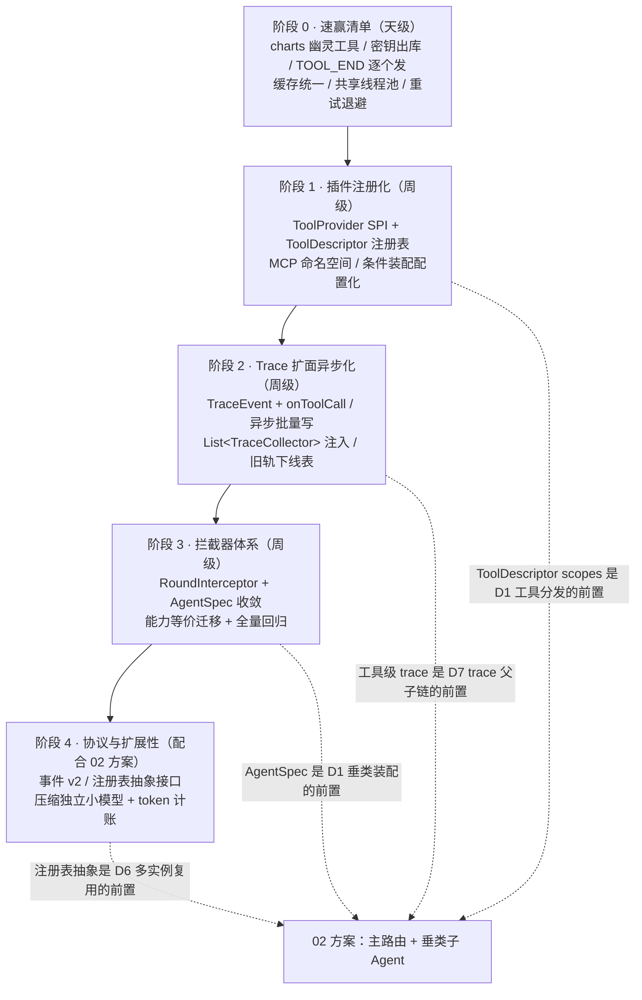

# Harness 进阶：执行内核拦截器化与插件注册化改造方案

> **定位（与 01/02/03 的关系）**：[01](file:///d:/work/zrkj-huaxi/code/huaxi-data-agent/docs/多agent技术调研/单agent演进多agent文档/01-单Agent底座核心机制梳理与Subagent扩展前瞻.md) 梳理现有底座机制全景；[02](file:///d:/work/zrkj-huaxi/code/huaxi-data-agent/docs/多agent技术调研/单agent演进多agent文档/02-主路由与有状态垂类子Agent架构演进技术方案.md) 定下多 Agent 目标架构（D1–D8 决策）；[03](file:///d:/work/zrkj-huaxi/code/huaxi-data-agent/docs/多agent技术调研/单agent演进多agent文档/03-单Agent演进多Agent地基分步实施与测试验收方案.md) 给分步实施与验收手册。本文回答的是**动手做多 Agent 之前，单 Agent 底座自身还有哪些结构性债务需要先偿还**——从 **harness（内核执行层）** 与 **插件/扩展机制** 两个视角给出完整诊断与改造设计，作为 03 实施手册的"前置阶段 0"输入。
>
> **一句话总纲**：harness 的下一步是把"内联能力"变成**可插拔拦截器**，插件的下一步是把"手工装配"变成**元数据注册**。这两件事做完，02 方案里"主路由 + 4 个垂类子 Agent"才有落地的地基，而不是在 20 参数构造器上继续叠。

---

## 0. 诊断总览

### 0.1 现状中值得肯定、改造中必须保留的资产

| 资产 | 位置 | 为什么值钱 |
| :--- | :--- | :--- |
| 中断/恢复闭环 | `InterruptContext` SafePoint 状态机 + `agentx_pause_state` 快照 + 占位响应配对剥离 | 同类自研内核里最扎实的一块；02 方案的 HITL 两段式 ConfirmToken 直接复用它 |
| 双视图落库 | `original_messages`（只增不减）/ `working_messages`（全删全插） | 压缩不污染真相链，历史回放与监控审计同源 |
| 延迟工具发现 | `DeferredToolRegistry` 请求内累积、跨请求隔离 + `tool_search` | 工具规模上量时的上下文节流底座 |
| LoopGuard 循环熔断 | 纯单工具轮 + 参数指纹区分复读与真实进展 | 2026-11-12 TodoWrite 死循环事故的实战修复，语义已被验证 |
| 内核二次消费范式 | `MonitorDiagnoseService` 的 `enableTrace(false)` + `enableCompaction(true)` | 证明内核"可选装配"路线可行，改造方向应顺着它走 |
| 终态一次落库 | 循环期间零 DB 写 + CAS 幂等 + doFinally 兜底 | 主循环保住了流式低延迟特性 |

### 0.2 两个核心结论（改造的出发点）

1. **Harness 的能力是"长"出来的，不是"插"上去的。** LoopGuard、上下文压缩、计划同步提醒、trace 挂点全部**内联**在 1200+ 行的 [AgentLoopExecutor.java](file:///d:/work/zrkj-huaxi/code/huaxi-data-agent/backend/mini-agentx-core/src/main/java/com/llmetor/miniagentx/agent/AgentLoopExecutor.java) 主流程里（[ContextCompactor.java](file:///d:/work/zrkj-huaxi/code/huaxi-data-agent/backend/mini-agentx-core/src/main/java/com/llmetor/miniagentx/context/ContextCompactor.java#L24) 注释自认"内联实现，不做 Hook"）。单 Agent 阶段还能维护；02 方案要主路由 + 4 个垂类子 Agent，**每个内联能力都要在主/子 Agent 间重新取舍一遍**，不改架构，维护成本按 Agent 数量线性放大。
2. **插件机制"有 SPI 之名、无注册之实"。** trace 有 `TraceCollector` 接口、技能存储有 `SkillContentStore` 接口，唯独**工具本身没有 Provider 抽象**——26 个业务工具靠 [DataAgentToolsConfig.java](file:///d:/work/zrkj-huaxi/code/huaxi-data-agent/backend/data-agent-server/src/main/java/com/llmetor/dataagent/dataagent/config/DataAgentToolsConfig.java#L48-L73) 一个 26 参数构造器硬编码装配。而**工具装配恰恰是多 Agent 按 agentCode 分发工具集的核心**（02 方案 D1：垂类子 Agent 各持有自己的工具面）。

---

## 一、Harness 视角诊断（内核执行层）

### 1.1 架构扩展性：能力内联、无拦截器体系 ★ 最高优先

**现状证据链**：

* [AgentLoopExecutor.java](file:///d:/work/zrkj-huaxi/code/huaxi-data-agent/backend/mini-agentx-core/src/main/java/com/llmetor/miniagentx/agent/AgentLoopExecutor.java) 单类 **1244 行**，一个类承担：消息初始化/恢复、压缩调度（`compactIfNeeded` [L567](file:///d:/work/zrkj-huaxi/code/huaxi-data-agent/backend/mini-agentx-core/src/main/java/com/llmetor/miniagentx/agent/AgentLoopExecutor.java#L567)）、循环熔断评估（`finishRound` [L809](file:///d:/work/zrkj-huaxi/code/huaxi-data-agent/backend/mini-agentx-core/src/main/java/com/llmetor/miniagentx/agent/AgentLoopExecutor.java#L809)）、计划同步提醒（[L850](file:///d:/work/zrkj-huaxi/code/huaxi-data-agent/backend/mini-agentx-core/src/main/java/com/llmetor/miniagentx/agent/AgentLoopExecutor.java#L850)）、trace 挂点（[L284](file:///d:/work/zrkj-huaxi/code/huaxi-data-agent/backend/mini-agentx-core/src/main/java/com/llmetor/miniagentx/agent/AgentLoopExecutor.java#L284) / [L806](file:///d:/work/zrkj-huaxi/code/huaxi-data-agent/backend/mini-agentx-core/src/main/java/com/llmetor/miniagentx/agent/AgentLoopExecutor.java#L806) / [L1077](file:///d:/work/zrkj-huaxi/code/huaxi-data-agent/backend/mini-agentx-core/src/main/java/com/llmetor/miniagentx/agent/AgentLoopExecutor.java#L1077)）、终态落库、中断快照、事件流。
* 构造器膨胀已显形：**3 个 telescoping 构造器，全参 20 个参数**（[L177-L188](file:///d:/work/zrkj-huaxi/code/huaxi-data-agent/backend/mini-agentx-core/src/main/java/com/llmetor/miniagentx/agent/AgentLoopExecutor.java#L177-L188)），`ReactAgent.Builder` 同步膨胀到 18 个可配项。
* 每新增一个横切能力（工具审批、token 预算、子 Agent 派发、prompt 改写），都要同时改：执行器 + 门面 Builder + 全参构造器透传。

> [!NOTE]
> 判断一个内核是否"可演进"的试金石：**加一个横切能力，要不要碰主循环代码？** 当前答案是"要"，且至少碰三处。

### 1.2 工具执行通道：无超时、无隔离、无预算 ★ 高优先

| 问题 | 证据 | 后果 |
| :--- | :--- | :--- |
| 无 per-tool 超时 | [ToolCallExecutor.java#L137](file:///d:/work/zrkj-huaxi/code/huaxi-data-agent/backend/mini-agentx-core/src/main/java/com/llmetor/miniagentx/agent/ToolCallExecutor.java#L137) 同步 `callback.call()` 直接阻塞 | 一个挂死工具（慢 SQL / 外部 HTTP）永远卡住整轮 |
| 每请求无界线程池 | [AgentLoopExecutor.java#L96](file:///d:/work/zrkj-huaxi/code/huaxi-data-agent/backend/mini-agentx-core/src/main/java/com/llmetor/miniagentx/agent/AgentLoopExecutor.java#L96) `Executors.newCachedThreadPool()`，`finishSink()` 才 shutdown | 每请求建池开销 + 高并发下线程堆积；异常路径 sink 不 complete 则泄漏 |
| TOOL_END 批量统一发 | [ToolCallExecutor.java#L76-L83](file:///d:/work/zrkj-huaxi/code/huaxi-data-agent/backend/mini-agentx-core/src/main/java/com/llmetor/miniagentx/agent/ToolCallExecutor.java#L76-L83) 全部完成后才按序发 | 一个 30s 慢工具扣住同轮快工具的完成事件，前端所有徽章一起转圈 |
| 工具结果无大小上限 | 大结果先污染一轮上下文，才轮到 L2 兜底压缩 | 单轮上下文被一个超大结果打穿 |
| 重名工具静默吞掉 | 常驻层 `putIfAbsent`（[AgentLoopExecutor.java#L192-L196](file:///d:/work/zrkj-huaxi/code/huaxi-data-agent/backend/mini-agentx-core/src/main/java/com/llmetor/miniagentx/agent/AgentLoopExecutor.java#L192-L196)）连 warn 都没有 | MCP 工具与业务工具重名时无声让位，排障困难 |

### 1.3 LLM 重试与模型管道

* **固定间隔重试不分错误类型**（`handleLlmError` [L889-L921](file:///d:/work/zrkj-huaxi/code/huaxi-data-agent/backend/mini-agentx-core/src/main/java/com/llmetor/miniagentx/agent/AgentLoopExecutor.java#L889-L921)）：429/5xx 应指数退避 + 抖动，400/上下文超限重试纯浪费；`maxRetries=3` 写死在 DodoAgent 不进 yml。
* **压缩摘要用对话主模型**：[ContextCompactor.java#L372](file:///d:/work/zrkj-huaxi/code/huaxi-data-agent/backend/mini-agentx-core/src/main/java/com/llmetor/miniagentx/context/ContextCompactor.java#L372) 同一个 `chatModel.call()`，在 `compactIfNeeded` 的 `synchronized(this)` 里同步执行——长会话触发压缩时**整轮停摆且无超时**，也无法配独立便宜的小模型。
* **摘要 token 不计账**：既不累计进 `totalPromptTokens` 也不进 trace——监控口径漏算，成本核算失真。
* **内核不 provider 中立**：`buildRoundOptions`（[L534-L547](file:///d:/work/zrkj-huaxi/code/huaxi-data-agent/backend/mini-agentx-core/src/main/java/com/llmetor/miniagentx/agent/AgentLoopExecutor.java#L534-L547)）硬编码 `OpenAiChatOptions` + `extra_body`，mini-agentx-core 的 pom 直接依赖 spring-ai-openai——换 provider 时"内核"要动刀。

### 1.4 上下文压缩三坑（可独立小修）

1. **offload 存取 LIKE 全扫**：[AgentxSessionStore.java](file:///d:/work/zrkj-huaxi/code/huaxi-data-agent/backend/mini-agentx-core/src/main/java/com/llmetor/miniagentx/memory/AgentxSessionStore.java) `save()` 的 `DELETE ... state_data LIKE '%"uuid"%'`、`load()` 遍历该会话全部 offload 行——无索引 O(n) 文本匹配，压缩频繁的会话每次 `context_reload` 都全扫。
2. **historySize 跨请求口径靠隐式约定**：`persistTerminal` 的 originalAppendFrom 与 resume 通道的 `filter(...).count()`（[L360](file:///d:/work/zrkj-huaxi/code/huaxi-data-agent/backend/mini-agentx-core/src/main/java/com/llmetor/miniagentx/agent/AgentLoopExecutor.java#L360)）两条链各自数"历史条数"，无对账校验，错位即重复/丢失 original 切片。
3. **策略参数半配置化**：`AgentxContextConfig` 只暴露 6/9 个参数，`minConsecutiveToolMessages` / `minCompressionTokens` / `currentRoundRatio` 想调只能改代码。

### 1.5 水平扩展：三处 JVM 态构成天花板 ★ 多 Agent 前必须处理

| 设施 | 位置 | 多实例后果 |
| :--- | :--- | :--- |
| `AgentTaskManager` 内存 map | [AgentTaskManager.java#L43](file:///d:/work/zrkj-huaxi/code/huaxi-data-agent/backend/mini-agentx-core/src/main/java/com/llmetor/miniagentx/agent/AgentTaskManager.java#L43) | interrupt 打不到别的实例 |
| `InMemoryLiveStreamRegistry` replay 无界 | [InMemoryLiveStreamRegistry.java#L34-L66](file:///d:/work/zrkj-huaxi/code/huaxi-data-agent/backend/data-agent-server/src/main/java/com/llmetor/dataagent/dataagent/stream/InMemoryLiveStreamRegistry.java#L34-L66) | recovery 跨实例 404 + 长回答全事件缓存内存不可控 |
| 诊断 running 去重 Set | [MonitorDiagnoseService.java#L92](file:///d:/work/zrkj-huaxi/code/huaxi-data-agent/backend/data-agent-server/src/main/java/com/llmetor/dataagent/dataagent/monitor/MonitorDiagnoseService.java#L92) | 双跑 |

> [!WARNING]
> 02 方案 D6 明确"子 Agent 事件经主 sink 透传，复用 recovery/takeOver/级联中断"——**这三处 JVM 态不抽象，多 Agent 方案就被锁死在单机**。另有一个隐藏项：孤儿执行无 TTL（客户端走丢后执行继续烧 token 直到终态）。

### 1.6 事件协议与正确性细节（速赢清单）

* `PAUSED` 固定 `"USER_INTERRUPT"`（[AgentLoopExecutor.java#L964](file:///d:/work/zrkj-huaxi/code/huaxi-data-agent/backend/mini-agentx-core/src/main/java/com/llmetor/miniagentx/agent/AgentLoopExecutor.java#L964)）——用户主动停 / takeOver 顶掉 / 将来的 HITL 审批，前端无法区分。
* `stopTask` 直接 `tryEmitComplete()` **不发任何终态事件**（[AgentTaskManager.java#L106](file:///d:/work/zrkj-huaxi/code/huaxi-data-agent/backend/mini-agentx-core/src/main/java/com/llmetor/miniagentx/agent/AgentTaskManager.java#L106)）——前端收到流关闭但不知原因，展示悬空。
* 占位响应识别靠中文文案 `contains("[占位]")`（[L329](file:///d:/work/zrkj-huaxi/code/huaxi-data-agent/backend/mini-agentx-core/src/main/java/com/llmetor/miniagentx/agent/AgentLoopExecutor.java#L329) / [L449](file:///d:/work/zrkj-huaxi/code/huaxi-data-agent/backend/mini-agentx-core/src/main/java/com/llmetor/miniagentx/agent/AgentLoopExecutor.java#L449)）——文案一改即碎，应改结构化 metadata 标记。
* `restoreDiscoveredToolsFromHistory` 用文本 contains 匹配工具名（[L392-L409](file:///d:/work/zrkj-huaxi/code/huaxi-data-agent/backend/mini-agentx-core/src/main/java/com/llmetor/miniagentx/agent/AgentLoopExecutor.java#L392-L409)）——误报面大且 O(消息×工具)；发现态可在终态落库时**结构化存进 `agentx_session`（新增 state_key）**，恢复时直读。
* 控制器竞态：`isActive` 检查与 `registerTask` 之间有窗口，并发第二请求抛 `IllegalStateException` 走全局异常处理返回 **500 而非 409**；takeOver 用 `Thread.sleep` 轮询占请求线程（[AgentController.java#L201-L217](file:///d:/work/zrkj-huaxi/code/huaxi-data-agent/backend/data-agent-server/src/main/java/com/llmetor/dataagent/dataagent/controller/AgentController.java#L201-L217)）。
* `errorJson` 手拼 JSON 转义不完全（[ToolCallExecutor.java#L190-L193](file:///d:/work/zrkj-huaxi/code/huaxi-data-agent/backend/mini-agentx-core/src/main/java/com/llmetor/miniagentx/agent/ToolCallExecutor.java#L190-L193)，只替换引号，控制字符未处理）。
* **末轮工具观察盲区**：工具结果靠"下一轮 INPUT 配对"，末轮没有下一轮——检测规则 REACT-003/005 与追溯视图都看不到末轮工具结果（规则侧注释自认）。根因在 TraceCollector 无工具级挂点，见 2.4。

---

## 二、插件视角诊断（扩展机制）

### 2.1 工具注册：没有 ToolProvider SPI ★ 插件化最大缺口

* [DataAgentToolsConfig.java#L48-L73](file:///d:/work/zrkj-huaxi/code/huaxi-data-agent/backend/data-agent-server/src/main/java/com/llmetor/dataagent/dataagent/config/DataAgentToolsConfig.java#L48-L73) 的 **26 参数构造器**是唯一注册点：新增/下线工具必改此类（加参数 + import + `ToolCallbacks.from` 实参）。`DeferredToolCandidates` record 本身就是绕开 Spring AI `toolCallbackResolver` 单 bean 约束的 workaround（注释自认）。
* 条件装配（有文件→analyzeFile、online→MCP、斜杠→单技能）是写死在 [DodoAgent.availableTools](file:///d:/work/zrkj-huaxi/code/huaxi-data-agent/backend/data-agent-server/src/main/java/com/llmetor/dataagent/dataagent/agent/DodoAgent.java#L410-L440) 的 if 链，不可配置。
* 无 per-tool 启停/灰度/版本/**权限标签**——启停只存在于技能（`agentx_skill.enabled`）和 MCP 服务（`agentx_mcp_server.enabled`）两级，26 个业务工具永远在线、对所有用户可调。
* 重名处理三层不一致：常驻层静默、延迟层 warn 保留先注册、MCP 无 `server:tool` 命名空间。
* **幽灵工具**：`data-analysis/SKILL.md` 工具表和 [ToolSearchTool.TOOL_DESCRIPTION](file:///d:/work/zrkj-huaxi/code/huaxi-data-agent/backend/mini-agentx-core/src/main/java/com/llmetor/miniagentx/tools/search/ToolSearchTool.java#L33-L35) 都引导 LLM 去 tool_search 一个**不存在的 charts 工具**——LLM 会按 SOP 白搜一轮。
* 演示代码进生产上下文：`KernelDemoConfig` 的 echo/boom 与正式 DodoAgent 并存。

### 2.2 技能（skills）体系

* **每请求 FS 全量重扫零缓存**：[DodoAgent.java#L427](file:///d:/work/zrkj-huaxi/code/huaxi-data-agent/backend/data-agent-server/src/main/java/com/llmetor/dataagent/dataagent/agent/DodoAgent.java#L427) → [SkillsTool.loadDirectory](file:///d:/work/zrkj-huaxi/code/huaxi-data-agent/backend/mini-agentx-core/src/main/java/com/llmetor/miniagentx/tools/SkillsTool.java#L190-L224) 每次 `Files.walk` + 逐文件读 + frontmatter 解析 + XML 渲染——O(技能数) 的每请求税。
* `Files.walk(FOLLOW_LINKS)` 无环防护、不限深度（[L199](file:///d:/work/zrkj-huaxi/code/huaxi-data-agent/backend/mini-agentx-core/src/main/java/com/llmetor/miniagentx/tools/SkillsTool.java#L199)）——链接环抛 `FileSystemLoopException` 直接炸掉整个请求的工具装配；嵌套 SKILL.md 会被误注册。
* 自制 frontmatter 解析器边角缺陷：值含 `---` 截断错乱（[FrontmatterUtils.java#L80](file:///d:/work/zrkj-huaxi/code/huaxi-data-agent/backend/mini-agentx-core/src/main/java/com/llmetor/miniagentx/utils/FrontmatterUtils.java#L80)）、name 缺失时 DB 用目录名兜底而 SkillsTool 键为空串（两口径键不一致）。
* 无版本化/回滚（覆盖上传即删目录重拷）；无技能级权限；斜杠"强制加载"只是 prompt 软约束——真正强制应把 SKILL.md 正文**确定性注入 system prompt**；zip 上传无大小/条目数限制（只防了路径穿越）。

### 2.3 MCP 接入

* **无健康检查/自动重连**：status=OK 永不更新，远端挂掉只能等每轮调用失败；重连全靠管理员手动 `POST /{id}/sync`；`tools/list_changed` 通知未处理，工具快照连接后不刷新。
* 无工具级 allowlist——一个百工具服务会灌满延迟目录。
* **STDIO = 无约束本地命令执行面**：command/args/env 直读 DB 配置，无命令白名单、无沙箱。
* 凭据明文落库（仅 API 层脱敏）；无按用户/租户隔离。

### 2.4 TraceCollector SPI：方向对、执行三处硬伤

1. **伪 SPI**：组合关系硬编码 `new CompositeTraceCollector(List.of(...))` 在 [DodoAgent.java#L150-L152](file:///d:/work/zrkj-huaxi/code/huaxi-data-agent/backend/data-agent-server/src/main/java/com/llmetor/dataagent/dataagent/agent/DodoAgent.java#L150-L152)——不注入 `List<TraceCollector>`、无 `@ConditionalOnProperty`；加第三个 sink（OTel/Kafka）必改源码；第二个用内核的门面要复制这段易漏布线（`setDetectDispatcher` 手工注入链同理）。
2. **SPI 面太窄 + 胖签名**：只有 session/round 级三挂点，**没有工具级事件**——工具耗时/成败靠事后解析 `outputData` 反推（末轮盲区根因）；`trace()` 11 个位置参数，加字段破坏所有实现。
3. **同步 JDBC 写在流式热路径**：每轮"序列化全量 input + 双 INSERT 独立事务"（[MonitorTraceCollector.java#L214-L256](file:///d:/work/zrkj-huaxi/code/huaxi-data-agent/backend/data-agent-server/src/main/java/com/llmetor/dataagent/dataagent/monitor/MonitorTraceCollector.java#L214-L256)），DB 抖动直接吃进每轮延迟；双轨让 payload 大字段**每轮存两份**（存储放大 2×，无回收计划）。构造期跑 DDL——DB 不可用即启动失败。

### 2.5 模型管理

* **评测/诊断模型完全绕开 ChatModelManager**：[AgentEvalJudgeService.java#L40-L66](file:///d:/work/zrkj-huaxi/code/huaxi-data-agent/backend/data-agent-server/src/main/java/com/llmetor/dataagent/dataagent/eval/AgentEvalJudgeService.java#L40-L66) 直读 yml 且默认值硬编码——聊天模型可 DB 热切换，裁判/诊断模型改 yml 要重启，两套构建管道重复。
* 每请求全表查无缓存；缓存键含**明文 apiKey**；`moveDefaultTo` 无事务两步 UPDATE 有瞬时零默认窗口；`provider` 列纯展示，实际只构造 `OpenAiChatModel`。

### 2.6 工具检索（tool_search）

* `ToolSearchConfig.Mode` 里 LLM/HYBRID 是空壳枚举，只有关键词一种；中文 query 搜英文驼峰工具名只能靠描述 +10 弱命中；score>0 即入选、8 个工具完整 description+schema 全文返回**无截断**；检索失败零可观测。
* 项目里 **EmbeddingService + pgvector 基础设施现成**（file/RAG 在用）——embedding/混合检索是低成本高收益项。

---

## 三、改造设计

### 3.1 RoundInterceptor 拦截器体系（harness 核心改造）

**目标**：把主循环里的横切能力抽成有序拦截器链，主循环只保留"调度骨架"。判断标准回到 1.1 的试金石：加横切能力不再碰主循环。

**接口草图**（内核新增 `com.llmetor.miniagentx.agent.intercept` 包）：

```java
public interface RoundInterceptor {
    /** 每轮 LLM 调用前（可改写 working 链/工具清单/终止本轮） */
    default void beforeRound(RoundContext ctx) {}
    /** 每轮收尾后（可注入工具结果修饰文本、决定 forceFinal） */
    default void afterRound(RoundContext ctx) {}
    /** 工具执行前后（可审批/鉴权/超时/截断结果） */
    default ToolCallDecision aroundToolCall(RoundContext ctx, MergedToolCall call) {
        return ToolCallDecision.proceed();
    }
    /** 终态（completed/error/paused）统一出口 */
    default void onTerminal(TerminalContext ctx) {}
    /** LLM 错误（可否决重试/改写退避策略） */
    default RetryDecision onLlmError(ErrorContext ctx) { return RetryDecision.deferDefault(); }
}
```

**现有能力的迁移映射**（迁移即回归验证，行为不变）：

| 现有内联点 | 迁移后拦截器 |
| :--- | :--- |
| `compactIfNeeded`（每轮 LLM 前） | `ContextCompactionInterceptor` |
| LoopGuard 评估 + noteText 注入（`finishRound`） | `LoopGuardInterceptor` |
| `planSyncReminder.evaluate` + 追加末工具结果 | `PlanSyncInterceptor` |
| `traceCollector.openSession/trace/closeSession` 三挂点 | `TraceInterceptor`（转发给 TraceCollector） |
| （新增能力）工具审批 / token 预算 / 子 Agent 派发 | 各自一个拦截器，**零改动主循环** |

> [!NOTE]
> **迁移纪律**：拦截器化必须"行为等价迁移"——先抽接口、逐个搬、每个搬完跑既有测试（内核 100 + server 177 全绿）再搬下一个。禁止趁机顺手改行为，行为变更放独立提交。

**构造参数收敛**：`AgentLoopExecutor` 的 3 个 telescoping 构造器（20 参）收敛为一个 `AgentSpec` 值对象（模型、指令、工具、运行参数、拦截器链），`ReactAgent.Builder` 变成 `AgentSpec` 的工厂。这是 02 方案"主路由 Agent 与垂类子 Agent 用不同 AgentSpec 装配"的直接前置。

### 3.2 工具执行通道加固（随拦截器落地，也可先行独立做）

* **共享有界线程池**：进程级一个 `ThreadPoolExecutor`（或 Java 21 虚拟线程 + Semaphore 限流），替换每请求 `newCachedThreadPool`。
* **per-tool 超时**：`aroundToolCall` 里 `timeoutMs`（来自工具元数据，默认 60s），超时返回错误 JSON 语义同现有 fail-safe。
* **TOOL_END 逐个发**：结果按序回灌（保持协议配对顺序）不变，事件完成即发——前端徽章不再被慢工具拖住。
* **结果截断**：超限（如 >30K 字符）截断 + 提示"结果已截断，可调 context_reload 取回原文"（复用 offload 机制）。
* **重试升级**：429/5xx 指数退避 + 抖动；4xx 直接失败；`maxRetries` 进 yml。

### 3.3 ToolProvider SPI + ToolDescriptor（插件化核心改造）

**接口草图**（server 新增 `toolspi` 包）：

```java
public interface ToolProvider {
    /** 本 provider 提供的工具清单（含元数据） */
    List<ToolDescriptor> descriptors();
    /** 按名称取可执行 callback（惰性构建） */
    ToolCallback resolve(String toolName);
}

public record ToolDescriptor(
        String name,            // 全局唯一，MCP 工具强制 server:tool 命名空间
        String description,
        Set<String> scopes,     // 适用场景标签（data-analysis / fill / audit ...）
        Set<String> requiredPermissions, // 权限标签（对比数据权限五档）
        long timeoutMs,         // per-tool 超时
        boolean resident        // true=常驻层 false=延迟层（tool_search 发现）
) {}
```

**收益对照**（一个问题一个机制解决，而非各处打补丁）：

| 现状问题 | ToolDescriptor 解决方式 |
| :--- | :--- |
| 26 参数硬编码构造器 | 每个业务域一个 Provider（数据分析/填报/审核/通用），`List<ToolProvider>` 注入注册表自动发现 |
| 工具永远在线 | descriptors() 查 DB/配置启停位 → 按用户/角色过滤 |
| MCP 重名静默让位 | 注册表统一冲突检测：命名空间 + 显式 warn + 管理页可见 |
| 条件装配 if 链 | scopes + 权限标签驱动装配（也是 02 方案按 agentCode 分发工具集的底座） |
| charts 幽灵工具 | 注册表成为唯一事实源，SKILL.md/提示词里的工具表从注册表生成 |

### 3.4 TraceCollector 扩面与异步化

1. **接口升级为事件对象**：`trace()` 11 参胖签名改 `onEvent(TraceEvent)`，新增 `TOOL_CALL` 事件类型（工具名/参数摘要/结果摘要/耗时/成败）——**末轮盲区与"事后反推工具耗时"一并解决**，检测规则 REACT-003/005 直接消费结构化工具事件。
2. **异步化**：采集器改内存队列（有界 + 满则丢弃计数，已有 `trace_write_failures` 指标位）+ 后台批量落库——流式热路径与 DB 解耦。
3. **真插件化**：`List<TraceCollector>` 注入替代 DodoAgent 手工 new；旧轨 TraceManager 定下线时间表（双轨期结束删 payload 双写）。
4. **DDL 出构造器**：建表移交给启动迁移（见 3.6 统一 Schema 管理）。

### 3.5 事件协议 v2（配合多 Agent 透传）

* `PAUSED` 带 `pauseReason` 枚举（`USER_INTERRUPT` / `TAKE_OVER` / `HITL_TOOL_REQUEST`）——02 方案 HITL 审批需要前端区分展示。
* `stopTask` 补发终态事件（COMPLETE with reason=`STOPPED`）。
* 新增轮次边界事件（ROUND_START 含轮次号）——前端执行过程条与监控时间轴不再靠 TOOL_START/END 推断。
* `__card` 尾缀 JSON 约定 schema 化（字段校验 + 版本号），前后端各自解析处共用 schema 定义。
* 拦截器/工具元数据统一进事件（如 TOOL_END 带 durationMs），诊断流等二次消费者不用再吞 PAUSED。

### 3.6 速赢清单（不依赖大改造、天级工作量、风险近零）

| # | 事项 | 位置 |
| :--- | :--- | :--- |
| 1 | 修 charts 幽灵工具提示（SKILL.md + TOOL_DESCRIPTION） | 2.1 |
| 2 | `application-local.yml` 真实 key 出库 + **轮换已泄漏 key**（历史提交里已存在） | 横向 |
| 3 | `errorJson` 换 ObjectMapper 序列化 | 1.6 |
| 4 | TOOL_END 改逐个发（只动 ToolCallExecutor 一处） | 1.2 |
| 5 | skills/models/用户上下文上"版本号惰性缓存"（McpClientRegistry.version 范式推广） | 横向 |
| 6 | 共享有界线程池替换每请求 newCachedThreadPool | 1.2 |
| 7 | `restoreDiscoveredToolsFromHistory` 的发现态落库结构化（agentx_session 新 state_key） | 1.6 |
| 8 | LLM 重试区分错误类型 + 退避 | 1.3 |
| 9 | MCP 调用失败指数退避自动重连 + 工具级 allowlist | 2.3 |
| 10 | `maxRetries`、context-policy 缺的 3 参数等补进 yml（消灭"半配置化"） | 1.4 |

### 3.7 横向配套（随结构性改造顺带）

* **密钥安全**：`agentx_chat_model.api_key` 与 MCP token 明文 → 加密列或环境变量引用；与速赢 #2 构成完整整改。
* **Schema 单一权威**：内核构造期 DDL + Store ensureSchema + `sql/` 脚本三处来源 → Flyway/Liquibase 收口（监控 V01-V07 已是雏形，推广即可）。
* **提示词资产收敛**：md（重启生效）/ Java 常量 / DB / skills 目录四分裂 → 统一提示词配置面（版本化 + 热加载），诊断侧 v1/v2 模板切换已是现成范式。
* **告警外发通道**：detect 引擎 15 条规则做了，闭环缺最后一环——risk 落库后加 webhook/钉钉 notifier（配置驱动，SPI 化）。
* **建评测口径**：tool_search 召回率（检索失败可观测）+ 拦截器迁移前后全量回归。

---

## 四、分阶段实施路线图



| 阶段 | 交付物 | 验收口径 | 与 02 方案的衔接 |
| :--- | :--- | :--- | :--- |
| 0 速赢 | 速赢清单 10 项 | 各项独立可回滚，测试全绿 | 无依赖，立即可做 |
| 1 插件注册化 | `List<ToolProvider>` 注入 + 注册表 + MCP 命名空间 | 新增一个工具不改任何既有类；重名冲突显式 warn 且管理页可见 | D1（垂类工具分发）前置 |
| 2 Trace 扩面 | TraceEvent 模型 + 工具级事件 + 异步批量写 | 末轮工具结果在追溯视图可见；REACT-003/005 消费结构化事件；热路径无同步 DB 写 | D7（trace 父子链）前置 |
| 3 拦截器体系 | RoundInterceptor + AgentSpec + 四个拦截器迁移 | **行为等价**：迁移前后内核 100 + server 177 测试全绿；加一个 demo 拦截器不碰主循环 | D1/D2（AgentSpec 装配子 Agent）前置 |
| 4 协议与扩展性 | 事件 v2 + taskManager/liveStreamRegistry 抽象接口 + 压缩小模型 | PAUSED 带原因；注册表接口出第二个实现（哪怕只是测试桩） | D6（多实例复用）前置 |

> [!IMPORTANT]
> **顺序纪律**：阶段 3（拦截器）排在阶段 1/2 之后，不是因为它不重要，而是因为它是唯一动主循环的改造——先做完外围加固、让工具通道与 trace 稳定，再动主循环时回归面最小。03 手册的"前置阶段 0"即本文阶段 0+1+2 的合集。

---

## 五、风险与回归护栏

1. **拦截器迁移最大的风险是"行为漂移"**：LoopGuard 的参数指纹语义、压缩的保护区边界、占位响应配对——这些是事故修复换来的精确语义，迁移时逐条对照既有单测（`LoopGuardForceFinalIntegrationTest` / `AgentLoopContextM7Test` / `RestoreScanTest` 等），**先补测试再搬代码**。
2. **拦截器链本身要防"又一个 20 参数"**：拦截器之间有顺序依赖（压缩必须先于工具清单重建、LoopGuard 必须在工具执行前），用显式 `order()` + 启动时冲突检测，不靠装配顺序隐式约定。
3. **Trace 异步化的丢数据语义**：队列满丢弃是既定姿势（`trace_write_failures` 计数），但要给监控大盘加丢弃率告警阈值，否则"静默丢"变成新盲区。
4. **事件协议 v2 必须带版本协商**：前端 ChatView 已按 7 事件实现（含 `__card` 私有协议），v2 事件以"新增字段 + 新增类型"演进，旧字段不删不改，前端渐进消费。
5. **改造与上游同步的冲突面**（见 [UPSTREAM.md](file:///d:/work/zrkj-huaxi/code/huaxi-data-agent/UPSTREAM.md)）：AgentLoopExecutor 拦截器化是**新的永久冲突区**——上游 patch 进来此区域必人工审。改造落地后应在 UPSTREAM.md 冲突区表格补一行登记。

---

## 附：与既有三篇的关系速查

| 想了解 | 看哪篇 |
| :--- | :--- |
| 现有底座机制（中断/恢复/顶掉/刷新不掉）怎么工作 | 01 |
| 多 Agent 目标架构与 D1-D8 决策 | 02 |
| 多 Agent 分步实施与验收 | 03 |
| **动手前单 Agent 底座还有哪些债、怎么还（本文）** | **04** |
