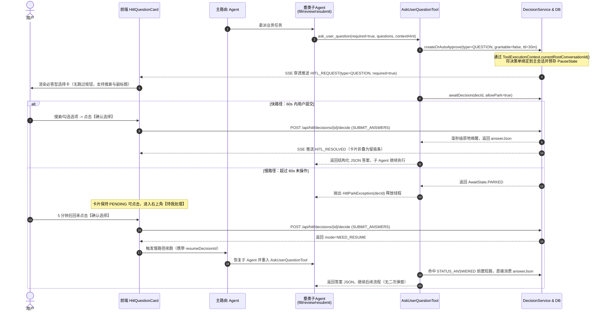
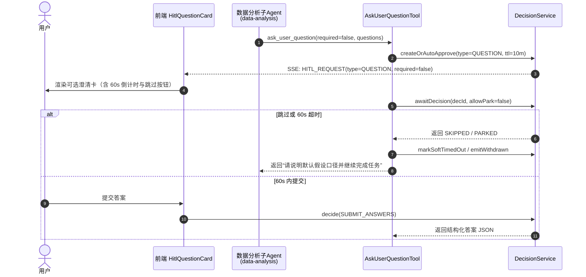

# 业务改造-01：子 Agent 接入 HITL 与必答型选择卡底座方案

> **里程碑定位**：业务改造第一阶段（M-HITL-BIZ-1）—— 打通“主路由 + 4 大垂类子 Agent”的 HITL 工具通路，将 `ask_user_question` 升级为 **可选澄清（`required=false`） + 业务必答（`required=true`）双模式**，并增强前端 `HitlQuestionCard`（必答态防跳过、选项搜索过滤、副标题展示），为全业务提示词“去暗号化”夯实底座。
>
> **总纲**：表格看全景，卡片做决策；可选澄清 60s 软跳过，业务必答超 60s 转慢路径挂起，绝不让 AI 替人盲猜。
>
> **关联文档**：
> - 下一阶段：[业务改造-02-提示词与四大业务技能HITL交互重构方案.md](./业务改造-02-提示词与四大业务技能HITL交互重构方案.md)
> - HITL 一期底座：[ing-一期-HITL底座与授权型闭环方案.md](./ing-一期-HITL底座与授权型闭环方案.md)
> - HITL 三期扩展：[todo-三期-HITL多类型扩展(收集型_核对型_计划确认型)方案.md](./todo-三期-HITL多类型扩展(收集型_核对型_计划确认型)方案.md)
> - 安全与审计规范：[done-审计留痕_权限追责_与同类放行安全规范.md](./done-审计留痕_权限追责_与同类放行安全规范.md)

---

## 1. 本期目标与已拍板参数

### 1.1 本期解决什么问题（大白话）
目前一期~三期 HITL 底座（`DecisionService`、`HitlToolHelper`、`AskUserQuestionTool`、`ConfirmPlanTool`、`HitlQuestionCard.vue`）已在代码里落地，但直接用于“资料填报 / 审核审批 / 驳回重提 / 数据分析”四大业务域时存在 **3 个底座卡点**：
1. **子 Agent 调不到工具**：`DataAgentToolsConfig.subAgentToolGroups(...)` 没有把 `ask_user_question` 和 `confirm_plan` 装配到 4 个垂类子 Agent（`data-analysis`、`declarant-fill`、`reviewer-workflow`、`declarant-workflow`）的工具列表中，真正干活的专员根本无法弹出选择卡或计划确认卡。
2. **缺少“业务必答”模式**：现有 `AskUserQuestionTool` 只有 60 秒软等待（超时自动标记 `TIMED_OUT_SOFT` 并让 AI 按默认假设继续）。这适合问数口径澄清，但绝不能用于**选项目、选填报节点、选驳回目标、填驳回意见、选下级审批人**——这些业务关键项若超时自动跳过，会导致 AI 替用户乱选节点或瞎填意见。
3. **长列表与业务信息展示受限**：`HitlQuestionCard.vue` 目前只支持纯字符串选项且无搜索框。当用户有十几个项目/节点或需要区分草稿批次与进度时，单选列表容易撑爆屏幕且信息不够直观。

### 1.2 已拍板核心参数
- **必答型 `QUESTION` 超时策略（方案 A）**：
  - `required=false`（默认，可选澄清）：保留 60s 轻量软等待，显示【跳过，让AI自行决定】，超时自动软跳过（`TIMED_OUT_SOFT`），AI 说明默认假设继续。
  - `required=true`（业务必答）：**隐藏【跳过】按钮**；60s 内快路径原地唤醒；**超过 60s 自动抛出 `HitlParkException` 转入二期慢路径挂起**（默认有效期 **30 分钟**，进入顶部【待我处理】抽屉），用户随时回来点选后无缝恢复执行，**绝不自动跳过**。
- **数据层策略**：**零表结构变更**，完全复用现有 `agentx_decision` 表（`type='QUESTION'`，通过 `payload_json` 透传 `required` 与选项副标题 `description`）。
- **权限红线**：无论 `required=true` 还是 `false`，`QUESTION` 类型**绝对永不授予任何工具权限**（`grantable=false`，绝不写入 `agentx_decision_grant` 表）。

---

## 2. 核心场景与界面设计

### 场景 B1.1：子 Agent 穿透拉起必答型选择卡（`required=true` + 搜索 + 副标题）

#### 1. 大白话场景
申报人进入资料填报，资料填报子 Agent（`declarant-fill`）拉出候选草稿/项目清单后，调用 `ask_user_question(required=true)`。决策单自动归属到主会话 `rootConversationId` 并通过 SSE 穿透推到主聊天框。前端渲染必答型选择卡：不显示跳过按钮，选项超过 6 个时自动出现搜索框，每个选项支持主标题 + 灰色副标题（展示批次号、已填进度）。用户在 60s 内点击【确认选择】，子 Agent 原地毫秒级唤醒并继续拉出填报面板。

#### 2. 界面呈现设计（UI 线框图）

```text
┌──────────────────────────────────────────────────────────┐
│ 📋 请选择要填报的项目 / 草稿            [必选] 步骤 1 / 1 │
│ ━━━━━━━━━━━（选择后立即为您继续处理）━━━━━━━━━━━━━━━━━━━ │
│                                                          │
│ Q1. 请选择本次要继续填报的草稿或新建项目：        [单选]  │
│ ┌──────────────────────────────────────────────────────┐ │
│ │ 🔍 输入关键词快速筛选选项...      (选项>6时自动显示)  │ │
│ └──────────────────────────────────────────────────────┘ │
│ ┌─ 限高可滚动区域 (max-h-64 overflow-y-auto) ──────────┐ │
│ │ ◉ [续填草稿] 1012测试 / 前期配套文件 / 产业投资类项目 │ │
│ │   草稿批次 DOC-202611 · 已填 2/8 项                  │ │
│ │ ○ [续填草稿] 南三高速公路 / 合同管理 / 合同签订及评审 │ │
│ │   草稿批次 DOC-202610 · 已填 5/6 项                  │ │
│ │ ○ [新建填报] 从我的项目列表重新选择项目与阶段         │ │
│ └──────────────────────────────────────────────────────┘ │
│   ○ 其他：[ 直接输入自定义内容... ]                      │
│                                                          │
│ 💡 提示：选定后将打开填报面板，可直接上传资料自动关联     │
│                                            [ 确认选择 ]  │
└──────────────────────────────────────────────────────────┘
```
- **交互中态**：点击【确认选择】后按钮置灰 Loading，前端携带幂等 `commandId` 与乐观锁 `revision` 提交，防双击重复提交。
- **完成后留痕态**：折叠为单行只读条 `📋 已确认选择：1012测试 / 前期配套文件 / 产业投资类项目 [展开查看 ▾]`。
- **超 60s 挂起态**：前端不触发“已自动跳过”，卡片继续保持可操作，头部倒计时切换为剩余业务有效期（如 `剩余 28:55`），并出现在右上角【待我处理】抽屉中。

#### 3. 端到端时序图



---

### 场景 B1.2：可选型澄清卡（`required=false`）向下兼容

#### 1. 大白话场景
数据分析子 Agent（`data-analysis`）在需求口径不明时调用 `ask_user_question(required=false)`（或不传 `required`），行为与三期完全一致：弹出蓝色轻量问答卡，展示 `60s 后自动跳过` 与【跳过，让AI自行决定】按钮；超时或跳过后卡片收起，AI 说明默认假设继续查库。

#### 2. 端到端时序图



---

## 3. 生产级异常与边界场景处理

| 异常场景 | 处理规则 | 界面表现 |
| :--- | :--- | :--- |
| **F5 刷新 / 切换会话 / 后端重启** | 必答型 `QUESTION` 决策单已落库 `agentx_decision` 且预存 `PauseState`，前端重新进入会话时拉取 `/api/hitl/decisions/pending?conversationId=xxx` 精准还原卡片与 `required=true` 状态，点选后走慢路径续跑 | 卡片完整还原，不丢失上下文与选项 |
| **用户不点卡片，直接打字回复（TakeOver）** | 复用 M3 TakeOver 机制：发新消息时自动将当前会话 `PENDING` 决策单置为 `SUPERSEDED`，新消息正常被 Agent 处理，习惯打字的用户不会被卡片卡死 | 旧卡片自动灰显“已被新对话取代”，新对话正常响应 |
| **必答型 30 分钟过期未处理** | 前端倒计时归零自动禁用【确认选择】按钮；后端 `decide` 接口校验 `NOW() > expires_at` 置为 `EXPIRED` 并拒绝提交 | 卡片灰显：`⌛ 该选择确认已过期，如需继续请重新发起` |
| **慢路径恢复防重复弹窗** | `AskUserQuestionTool` 入口处检测 `createOrAutoApprove` 返回的 `entity.status()`：若已是 `ANSWERED`（慢路径恢复重入），直接发 `HITL_RESOLVED` 并返回 `answerJson`，**绝不重新 await 或二次弹窗** | 卡片保持已确认留痕态，无闪烁重复弹窗 |
| **搜索过滤后勾选状态保留** | 前端在搜索关键词筛选选项时，仅过滤可见列表，不清空用户已勾选的 `singleMap` / `multiMap` 状态；多选时在底部显示 `已选 N 项` 提示 | 切换搜索词不丢已选项 |
| **双击连点 / 并发提交** | 前端按钮 Loading 锁 + 生成唯一 `commandId`；后端 `DecisionService.decide` 通过 `revision` 乐观锁与 `uk_decision_cmd` 唯一索引保证严格幂等 | 第 1 次成功，第 2 次幂等或返回友好提示 |

---

## 4. 本期精确代码改造清单

### 4.1 后端改造（`backend/data-agent-server`）
1. **[DataAgentToolsConfig.java](file:///d:/work/zrkj-huaxi/code/huaxi-data-agent/backend/data-agent-server/src/main/java/com/llmetor/dataagent/dataagent/config/DataAgentToolsConfig.java)**
   - 在 `subAgentToolGroups(...)` 中提取 `ToolCallback askUserQuestion = ToolCallbacks.from(askUserQuestionTool)[0]` 和 `ToolCallback confirmPlan = ToolCallbacks.from(confirmPlanTool)[0]`。
   - 分别注入到 4 个垂类子 Agent 工具组：
     - `dataAnalysis`：加入 `askUserQuestion`、`confirmPlan`
     - `declarantFill`：加入 `askUserQuestion`、`confirmPlan`
     - `reviewerWorkflow`：加入 `askUserQuestion`、`confirmPlan`
     - `declarantWorkflow`：加入 `askUserQuestion`、`confirmPlan`
2. **[AskUserQuestionTool.java](file:///d:/work/zrkj-huaxi/code/huaxi-data-agent/backend/data-agent-server/src/main/java/com/llmetor/dataagent/dataagent/hitl/AskUserQuestionTool.java)**
   - 新增入参 `@ToolParam(description = "是否必答：true=业务必选（禁止跳过，超60s转挂起待办）；false=可选澄清（默认，60s自动跳过）", required = false) Boolean required`。
   - `QuestionItem` 扩展选项描述支持：新增可选字段 `Map<String, String> optionDescriptions`（键为选项文案，值为副标题/进度/批次说明），向下完全兼容现有纯 `List<String> options` 调用方式。
   - `rawPayload` 写入 `required`（boolean）与每题的 `optionDescriptions`；`ttlMinutes` 在 `required=true` 时传 `null`（采用默认 30 分钟），`required=false` 时传 `10`。
   - **慢路径恢复前置短路**：在 `createOrAutoApprove` 之后、调用 `awaitDecision` 之前，检查 `entity.status()`：
     - `STATUS_ANSWERED` → 调 `emitResolved` 直接返回 `answerJson`；
     - `STATUS_EXPIRED` / `STATUS_SUPERSEDED` → 调 `emitWithdrawn` 返回已结束提示。
   - **双模式等待分流**：
     - `isRequired == true`：调用 `decisionService.awaitDecision(decId, true)`；当返回 `PARKED` 时抛出 `new HitlParkException(decId, "等待用户选择确认超时，已转入后台挂起")`；
     - `isRequired == false`：保持 `decisionService.awaitDecision(decId, false)`，返回 `PARKED` 时调用 `markSoftTimedOut(decId)`。
3. **单元测试补齐**
   - 新增/扩展 `AskUserQuestionToolTest`：覆盖 `required=true` 快路径作答、超 60s 抛 `HitlParkException`、慢路径 `STATUS_ANSWERED` 短路恢复、`required=false` 软超时、以及 `optionDescriptions` 序列化。
   - 扩展 `DataAgentToolsConfig` 相关测试，断言 4 个垂类子 Agent 工具组均包含 `ask_user_question` 与 `confirm_plan`。

### 4.2 前端改造（`frontend/src`）
1. **[HitlQuestionCard.vue](file:///d:/work/zrkj-huaxi/code/huaxi-data-agent/frontend/src/components/HitlQuestionCard.vue)**
   - 新增计算属性 `isRequired = computed(() => Boolean(props.card?.rawPayload?.required))`。
   - **头部状态栏**：
     - `isRequired=true` 时：标题可优先读取 `card.rawPayload.contextHint`（或默认“需要您做出选择确认”），隐藏 `60s 后自动跳过`，显示 `必选` 徽章及业务剩余有效期倒计时（基于 `card.expiresAt` / `remainingSeconds`）。
   - **底部按钮栏**：
     - `isRequired=true` 时：通过 `v-if="!isRequired"` 隐藏【跳过，让AI自行决定】按钮；单题提交按钮文案显示【确认选择】，多题末步显示【提交确认】。
   - **选项搜索与限高滚动**：
     - 当 `currentQ.options.length > 6` 时，渲染轻量搜索框 `searchKeyword`（按选项主标题与副标题模糊过滤），选项列表容器加 `max-h-64 overflow-y-auto`。
   - **副标题渲染**：
     - 读取 `currentQ.optionDescriptions?.[opt]`，若有值则在选项主文案下方渲染一行 `text-[11px] text-gray-500` 副标题；若传入 `contextHint` 且作为底部提示（`footerTip`），在底部轻量展示。
2. **[PendingHitlDrawer.vue](file:///d:/work/zrkj-huaxi/code/huaxi-data-agent/frontend/src/components/PendingHitlDrawer.vue)**
   - 验证挂起的 `QUESTION(required=true)` 单据在【全部】与【提问】筛选项下可正常显示标题、剩余时间，并支持点击【去处理】跳转高亮对应卡片。

---

## 5. 本期验收测试清单（TestHub 覆盖项）

- [ ] **TC-B1.1 子 Agent 工具装配校验**：验证 `data-analysis`、`declarant-fill`、`reviewer-workflow`、`declarant-workflow` 4 个子 Agent 均能直接调用 `ask_user_question` 与 `confirm_plan`，且卡片正确穿透渲染在主聊天窗口。
- [ ] **TC-B1.2 必答型隐藏跳过**：调用 `ask_user_question(required=true)`，验证前端不渲染【跳过，让AI自行决定】按钮，且不显示“60s 后自动跳过”。
- [ ] **TC-B1.3 必答型快路径唤醒**：在 60s 内点击选项并提交，验证子 Agent 毫秒级原地唤醒拿到准确 JSON 答案，卡片折叠为已确认留痕条。
- [ ] **TC-B1.4 必答型超 60s 慢路径挂起与恢复**：等待超过 60s 不操作，验证卡片不自动跳过而是转入挂起态并出现在右上角【待我处理】抽屉；刷新页面后点击选项提交，验证慢路径恢复成功且不重复弹窗。
- [ ] **TC-B1.5 选项搜索与副标题**：构造 10 个带 `optionDescriptions` 的选项，验证自动出现搜索框、关键字过滤准确、列表限高滚动不撑屏、副标题正常渲染。
- [ ] **TC-B1.6 可选型向下兼容**：调用 `ask_user_question(required=false)`，验证仍显示【跳过】按钮且 60s 超时后软跳过让 AI 按默认口径继续。
- [ ] **TC-B1.7 TakeOver 与权限红线**：必答卡挂起时用户直接打字发新消息，验证旧卡变为 `SUPERSEDED`；完成任意 `QUESTION` 卡片后核查 `agentx_decision_grant` 表无新增授权记录。
