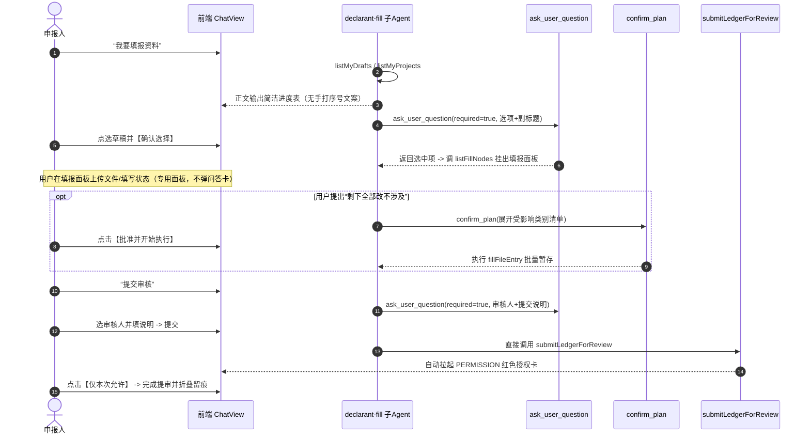
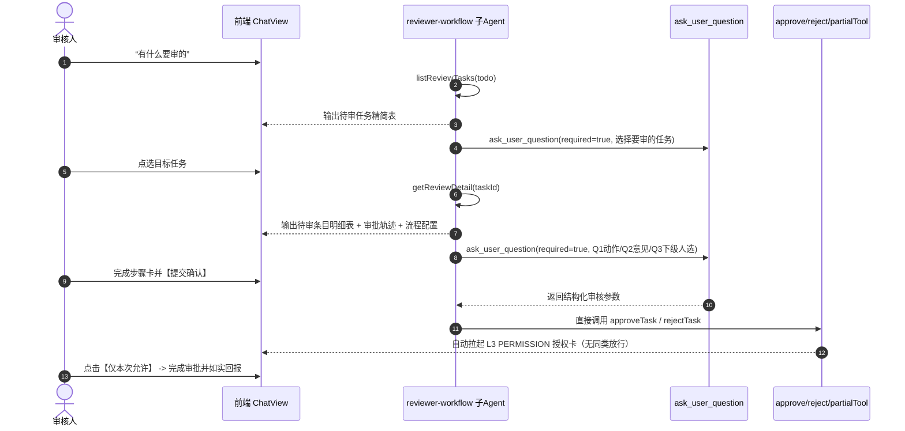
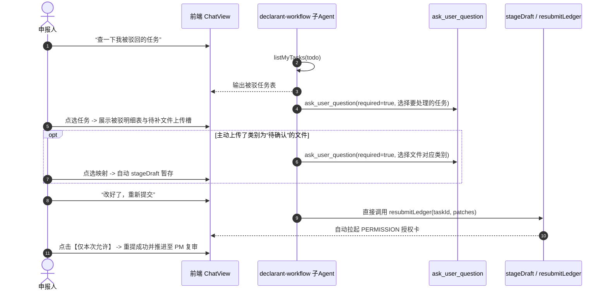
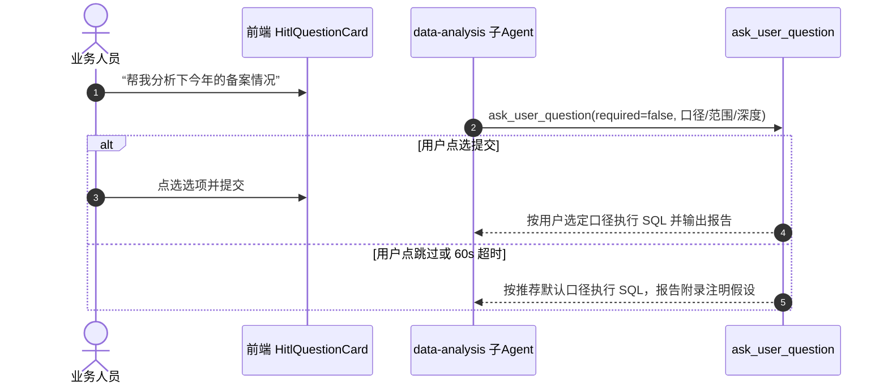

# 业务改造-02：提示词与四大业务技能 HITL 交互重构方案

> **里程碑定位**：业务改造第二阶段（M-HITL-BIZ-2）—— 在第一阶段底座就绪之上，全面重构主系统提示词（`system-prompt.md`）、子 Agent 角色提示词（`SubAgentRegistry.java`）以及 4 大业务技能（`declarant-fill`、`reviewer-workflow`、`declarant-workflow`、`data-analysis`），**彻底移除旧版“回复序号 A1 / 手打确认令牌 `ct_xxx` / `cancelConfirm`”文案**，统一升级为 **“表格看全景，卡片做决策”** 的现代 HITL 交互体系。
>
> **前置依赖**：[业务改造-01-子Agent接入HITL与必答型选择卡底座方案.md](./业务改造-01-子Agent接入HITL与必答型选择卡底座方案.md) 已完成上线。
>
> **关联文档**：
> - 上一阶段：[业务改造-01-子Agent接入HITL与必答型选择卡底座方案.md](./业务改造-01-子Agent接入HITL与必答型选择卡底座方案.md)
> - HITL 一期底座：[ing-一期-HITL底座与授权型闭环方案.md](./ing-一期-HITL底座与授权型闭环方案.md)
> - HITL 三期扩展：[todo-三期-HITL多类型扩展(收集型_核对型_计划确认型)方案.md](./todo-三期-HITL多类型扩展(收集型_核对型_计划确认型)方案.md)
> - 安全与审计规范：[done-审计留痕_权限追责_与同类放行安全规范.md](./done-审计留痕_权限追责_与同类放行安全规范.md)

---

## 1. 本期目标与已拍板规范

### 1.1 本期解决什么问题（大白话）
在引入 HITL 之后，虽然底层已经支持结构化卡片，但现有提示词仍然在教大模型按“旧时代纯文本方式”和用户对话，导致线上频繁出现两类割裂体验：
1. **满屏“打字暗号”引导**：例如填报/审核选对象时，AI 反复输出“请直接回复任一形式即可：序号如「填 A1」「填 C1」，或文字「1012测试 / 前期配套文件 / 产业投资类项目」……”，用户不得不看表、记编号、手动敲字。
2. **新旧授权话术打架**：4 个 `SKILL.md` 和 `SubAgentRegistry.java` 里还写着“首轮不传 `confirmToken` 领 `ct_xxx`，二轮传 `confirmToken` 执行，取消调 `cancelConfirm`”，而底层工具已经切换为 HITL 授权卡（`dec_xxx`），导致大模型偶尔混乱甚至在正文里要求用户手打令牌。

### 1.2 已拍板交互规范
- **正文与卡片配合方式（方案 A：表格看全景 + 卡片做决策）**：
  - 选项目、选阶段、选节点、选待审/被驳任务时，正文先输出**简洁的 Markdown 状态/进度总览表**，紧接着调用 `ask_user_question(required=true)` 弹出单选卡片；
  - 正文中**严禁再输出“请回复序号如「填 A1」或文字「xxx」”等手打引导文案**。
- **旧版 `ct_xxx` 文案处理（彻底移除）**：
  - 从 `system-prompt.md`、`SubAgentRegistry.java` 与全部 `SKILL.md` 中**彻底删除**两段式 `confirmToken` / `ct_xxx` / `cancelConfirm` 教学文案，全面对齐 HITL 授权卡协议（由高危工具自动拦截落库并弹窗，用户点按钮即完成审批与原地执行）。

### 1.3 五层交互边界红线（防“过度弹窗疲劳”）

| 交互类型 | 触发方式 | 适用业务场景 | 严禁滥用红线 |
| :--- | :--- | :--- | :--- |
| **L1：可选澄清** | `ask_user_question(required=false)` | 数据分析统计口径、时间窗口、报告深度歧义 | 需求明确或已有标准术语口径时，禁止多此一举弹窗 |
| **L2：业务必选与参数收集** | `ask_user_question(required=true)` | 选项目/草稿/阶段/节点、选待审/被驳任务、选审核结论（通过/驳回/部分通过）+ 填意见 + 选下级审批人、主动上传文件绑定类别 | **唯一命中绝不弹**（用户已点名具体项目/节点/任务时直接进入下一步）；**能合在一张 2~3 步卡里绝不连弹两张卡** |
| **L3：批量/多步计划确认** | `confirm_plan` | “全部改成不涉及”展开清单确认、新增自定义类别确认、PM 部分通过逐条判定清单确认 | 单条低危暂存直接执行，不弹计划卡 |
| **L4：高危写操作授权** | 高危工具内置 `PERMISSION` | `submitLedgerForReview`、`approveTask`、`rejectTask`、`partialApproveLedger`、`resubmitLedger` | 由工具内部自动拦截弹窗，大模型只需在参数收齐后直接调用工具，严禁自己口头写“请回复确认执行” |
| **L5：专用业务面板（保留）** | 填报面板 / 待补文件上传槽 | 进入节点后的逐类状态勾选、文件上传、多行摘要填写 | **严禁用 `ask_user_question` 替代填报面板**（文件上传与多行表单走专用面板更高效） |

---

## 2. 核心业务改造场景（大白话 + 界面原型 + 独立时序图）

### 场景 B2.1：首次资料填报（`declarant-fill`）—— 选草稿/项目/阶段/节点全卡片化

#### 1. 大白话场景
用户说“我要填报资料”。`declarant-fill` 专员调用 `listMyDrafts` / `listMyProjects` 后，正文输出简洁的草稿与项目进度表，紧接着拉起 `ask_user_question(required=true)` 让用户点选（附带批次号与进度副标题）。用户一点即进入对应节点并挂出填报面板；后续若用户提出“把剩下 4 项全部改成不涉及”，先调 `confirm_plan` 确认受影响清单再暂存；最终说“提交审核”时，收集齐提交说明和审核人后直接调用 `submitLedgerForReview` 拉起红色 `PERMISSION` 授权卡完成提审。

#### 2. 界面呈现设计（改造前后对比）

```text
【改造前（已废弃）】
请直接回复任一形式即可：
• 序号：如「填 A1」「填 C1」
• 或文字：「1012测试 / 前期配套文件 / 产业投资类项目」
• 或「新项目 + 子阶段 + 节点名」...

【改造后（表格看全景 + 卡片做决策）】
聊天正文：
| 类型 | 项目 / 子阶段 / 节点 | 状态 / 进度 |
|---|---|---|
| 草稿 | 1012测试 / 前期配套文件 / 产业投资类项目 | `草稿` 已填 2/8 |
| 草稿 | 南三高速公路 / 合同管理 / 合同签订及评审 | `草稿` 已填 5/6 |

底部单焦点槽位（HitlQuestionCard，必答态）：
┌──────────────────────────────────────────────────────────┐
│ 📋 请选择本次要填报的对象               [必选] 步骤 1 / 1 │
│   ◉ [续填草稿] 1012测试 / 前期配套文件 / 产业投资类项目   │
│     批次 DOC-202611 · 已填 2/8 项                        │
│   ○ [续填草稿] 南三高速公路 / 合同管理 / 合同签订及评审   │
│     批次 DOC-202610 · 已填 5/6 项                        │
│   ○ [新建填报] 从我的项目列表选择新项目与阶段             │
│   ○ 其他：[ 输入新项目 / 子阶段 / 节点名... ]            │
│ 💡 选定后将为您打开填报面板，可直接上传文件自动关联       │
│                                            [ 确认选择 ]  │
└──────────────────────────────────────────────────────────┘
```

#### 3. 端到端时序图



---

### 场景 B2.2：审核审批工作台（`reviewer-workflow`）—— 一卡收集意向 + 红卡终审签字

#### 1. 大白话场景
审核人说“看看我有什么要审的”。`reviewer-workflow` 专员调用 `listReviewTasks` 输出待审任务表并弹出必答选择卡；用户点选某条任务后，专员调 `getReviewDetail` 展示待审条目明细表与流程配置，随后用一张 2~3 步的 `ask_user_question(required=true)` 卡片一次收集“审核结论（通过/驳回/部分通过）+ 意见文本（+特殊流程下级会签人员）”。收集完成后直接调用 `approveTask` / `rejectTask` / `partialApproveLedger`（部分通过前可先走 `confirm_plan` 核对逐条清单），自动弹出 L3 红色 `PERMISSION` 授权卡（不提供同类放行）完成签字落库。

#### 2. 界面呈现设计（UI 线框图）

```text
┌──────────────────────────────────────────────────────────┐
│ 📋 请确认审核处理方式                   [必选] 步骤 1 / 2 │
│ ━━━━━━━━━━━░░░░░░░░░░░░░░░░░░░░░░░░░░░░░░░░░░░░░░░░░░░░  │
│ Q1. 请选择对「南三高速-前期配套文件」的审核结论：  [单选] │
│   ◉ 审批通过（常规流程，通过即办结定稿）                  │
│   ○ 驳回退回发起人修改                                   │
│   ○ 驳回退回指定上级节点                                 │
│   ○ 部分通过（逐条判定，不通过项退回补正）                │
│                                             [ 下一题 → ] │
└──────────────────────────────────────────────────────────┘
                 ↓ 步2填完意见提交，无缝拉起 ↓
┌──────────────────────────────────────────────────────────┐
│ ⚠️ 需要您的授权确认                         [剩余 29:58] │
│ 动作类型：审批驳回 (rejectTask)                           │
│ 影响对象：南三高速-前期配套文件 (任务 #T-8821)            │
│ 驳回目标：退回发起人（张三）                              │
│ 驳回意见：总投资金额与批复不一致，请核对后重传。          │
│                           [拒绝 ▾]          [仅本次允许] │
└──────────────────────────────────────────────────────────┘
```

#### 3. 端到端时序图



---

### 场景 B2.3：驳回重提工作台（`declarant-workflow`）—— 选任务/绑文件/批量改/重提闭环

#### 1. 大白话场景
申报人说“我被驳回的任务怎么改”。`declarant-workflow` 专员调用 `listMyTasks` 列出被驳任务表并通过 `ask_user_question(required=true)` 让用户点选任务；若用户主动上传了未标明类别的业务文件，专员弹出多题 `ask_user_question(required=true)` 一次完成“文件 → 资料类别”映射绑定；若用户要求批量修改，走 `confirm_plan` 确认后 `stageDraft` 暂存；最后用户说“重新提交”时直接调用 `resubmitLedger` 拉起 `PERMISSION` 授权卡完成重提。

#### 2. 端到端时序图



---

### 场景 B2.4：数据分析澄清（`data-analysis`）—— 轻量可选问答卡

#### 1. 大白话场景
用户提出模糊分析需求（如“分析下今年的备案情况”）。`data-analysis` 专员不再在正文打印一长串澄清问题清单等用户打字，而是直接调用 `ask_user_question(required=false)` 弹出 1~3 题轻量澄清卡（带推荐默认项和 60s 自动跳过），拿到精确口径后直接查库生成报告。

#### 2. 端到端时序图



---

## 3. 异常与边界控制（提示词硬纪律）

1. **长列表防撑爆**：当候选项目/节点/人员超过 12 项时，提示词要求大模型先在正文表格展示关键项，卡片选项放最相关的前 8~10 项并开启 `allowCustom=true`（允许用户在“其他”里输入名称或关键字）。
2. **禁止在正文重复念选项**：调用 `ask_user_question` 前，正文只允许输出简洁的 Markdown 状态表（看全景）或一句话过渡叙述，**严禁把卡片里的 A/B/C 选项和“请回复序号...”再在正文复述一遍**。
3. **高危授权拒绝后的闭环**：当用户在 `PERMISSION` 卡片点【拒绝】并填写理由（如“审核人换李四”）时，提示词要求大模型严格采纳拒绝理由，重新组装参数再次发起调用，严禁忽略理由直接重试原参数。
4. **单次决策聚焦原则**：一轮中只允许发起一次 `ask_user_question` 或 `confirm_plan`，严禁同一轮并发调用多个 HITL 工具导致前端队列拥堵。

---

## 4. 本期精确改造清单（提示词与角色配置）

### 4.1 全局与子 Agent 角色提示词
1. **[system-prompt.md](file:///d:/work/zrkj-huaxi/code/huaxi-data-agent/backend/data-agent-server/src/main/resources/prompts/system-prompt.md)**
   - 新增 **「HITL 交互规范」** 章节：明确“表格看全景，卡片做决策”、五层交互边界、以及“严禁输出手打序号/确认令牌文案”的全局铁律。
   - 重写 **「写操作红线」** 章节：彻底移除 `confirmToken` / `ct_xxx` / `cancelConfirm` 描述，改为 HITL 授权卡机制（高危工具内部拦截落库并弹授权卡，用户点按钮即执行，拒绝理由必须采纳）。
   - 调整 **「UI 排版语法」第 5 条**：强动作引导改为“需选对象/拍板一律走 HITL 卡片，有序列表仅用于纯建议性步骤说明”。
2. **[SubAgentRegistry.java](file:///d:/work/zrkj-huaxi/code/huaxi-data-agent/backend/data-agent-server/src/main/java/com/llmetor/dataagent/dataagent/agent/SubAgentRegistry.java)**
   - 修改 `declarant-fill`（L163~166）、`reviewer-workflow`（L183~186）、`declarant-workflow`（L202~205）的内嵌角色提示：彻底删除 `签发确认令牌（ct_xxx）后严禁自行二次确认` 文案，统一替换为 HITL 交互要求（必选交互调 `ask_user_question(required=true)`、批量变更调 `confirm_plan`、高危动作由系统自动弹授权卡）。
   - 在 `data-analysis`（L143~147）角色提示中补充：遇到关键口径/范围歧义时调用 `ask_user_question(required=false)` 弹出轻量澄清卡。

### 4.2 四大业务技能 `SKILL.md` 重构
1. **[backend/skills/declarant-fill/SKILL.md](file:///d:/work/zrkj-huaxi/code/huaxi-data-agent/backend/skills/declarant-fill/SKILL.md)**
   - **可用工具表**：新增 `ask_user_question`、`confirm_plan`；彻底删除 `cancelConfirm`。
   - **第 1~3 步（选项目 / 选阶段 / 选节点）**：明确“先输出精简 Markdown 状态表，再调 `ask_user_question(required=true)` 弹单选卡（带进度/批次副标题）”，删除“报序号/回复文字”引导；保留“唯一命中直接跳过”规则。
   - **第 5 步（批量修改 & 新增自定义类别）**：将“先展开清单让用户确认”改为调用 `confirm_plan`。
   - **第 7 步（提审）**：收集齐审核人（可走 `ask_user_question(required=true)`）与提交说明后，直接调用 `submitLedgerForReview` 触发 `PERMISSION` 授权卡；彻底删除两段式 `confirmToken` 与 5 分钟令牌文案。
2. **[backend/skills/reviewer-workflow/SKILL.md](file:///d:/work/zrkj-huaxi/code/huaxi-data-agent/backend/skills/reviewer-workflow/SKILL.md)**
   - **可用工具表**：新增 `ask_user_question`、`confirm_plan`；彻底删除 `cancelConfirm`。
   - **第一步（选待审任务）**：多条待审任务时输出精简表 + `ask_user_question(required=true)`。
   - **第三步（收集审核意向）**：展示明细表与流程配置后，通过 1 张 2~3 步 `ask_user_question(required=true)` 一次收集“动作 + 意见 +（特殊流程）下级审批人/直接办结”；部分通过逐条清单先走 `confirm_plan`。
   - **第四步（执行）**：直接调用 `approveTask` / `rejectTask` / `partialApproveLedger` 触发 L3 红色 `PERMISSION` 授权卡；彻底删除两段式 `confirmToken` 文案。
3. **[backend/skills/declarant-workflow/SKILL.md](file:///d:/work/zrkj-huaxi/code/huaxi-data-agent/backend/skills/declarant-workflow/SKILL.md)**
   - **可用工具表**：新增 `ask_user_question`、`confirm_plan`；彻底删除 `cancelConfirm`。
   - **第一步（选被驳任务） & 第二步（主动上传文件“待确认”类别绑定）**：改为 `ask_user_question(required=true)`。
   - **第三步（批量修改）**：改为 `confirm_plan`。
   - **第五步（重提）**：直接调用 `resubmitLedger` 触发 `PERMISSION` 授权卡；彻底删除两段式 `confirmToken` 文案。
4. **[backend/skills/data-analysis/SKILL.md](file:///d:/work/zrkj-huaxi/code/huaxi-data-agent/backend/skills/data-analysis/SKILL.md)**
   - **可用工具表**：新增 `ask_user_question`。
   - **需求范围与澄清**：将“直接输出问题清单”改为“调用 `ask_user_question(required=false)` 弹出 1~4 题轻量澄清卡，并注明推荐默认项”。

---

## 5. 本期验收测试清单（TestHub 覆盖项）

- [ ] **TC-B2.1 资料填报“去暗号化”验收**：发送“我要填报资料”，验证正文输出简洁草稿/项目进度表且**不再出现**“请回复序号「填 A1」或文字...”文案；紧接着弹出必答单选卡，点选后直接打开填报面板。
- [ ] **TC-B2.2 唯一命中不冗余弹窗**：发送“我要填报 1012测试 / 前期配套文件 / 产业投资类项目”，验证直接拉出填报面板，**不弹出**多余的 `ask_user_question` 选择卡。
- [ ] **TC-B2.3 填报批量修改计划确认**：在节点内说“把剩下的全部改成不涉及，原因暂未开展”，验证弹出 `HitlPlanCard` 列出全部受影响类别；点【打回修改】剔除某项后重新出计划，点【批准并开始执行】后成功暂存。
- [ ] **TC-B2.4 填报提审无缝授权**：说“提交审核”，通过卡片选定审核人并填说明后，直接弹出红色 `PERMISSION` 授权卡（正文无任何 `ct_xxx` 或手打确认提示），点击【仅本次允许】成功提审。
- [ ] **TC-B2.5 审核一卡收参 + L3 红卡签字**：在审核工作台查看某台账明细后，通过 1 张多步 `QUESTION(required=true)` 卡选择“驳回退回发起人 + 填驳回理由”，提交后自动弹出 L3 红色 `PERMISSION` 卡（无【本会话同类放行】按钮），点批准成功驳回。
- [ ] **TC-B2.6 驳回重提文件绑定与重提**：在被驳任务中上传 2 个未标明类别的文件，验证弹出 `QUESTION(required=true)` 完成类别绑定并暂存；说“重新提交”直接弹出 `PERMISSION` 授权卡完成重提。
- [ ] **TC-B2.7 数据分析轻量澄清**：问“分析下今年各项目备案情况”，验证弹出蓝色 `QUESTION(required=false)` 澄清卡；点【跳过】后 AI 说明默认口径并正常查库产出报告。
- [ ] **TC-B2.8 全仓旧暗号清零扫描**：回归检查 `system-prompt.md`、`SubAgentRegistry.java` 及 4 个 `SKILL.md`，确认已无任何 `ct_xxx`、`confirmToken`、`cancelConfirm` 过时提示词残留。
