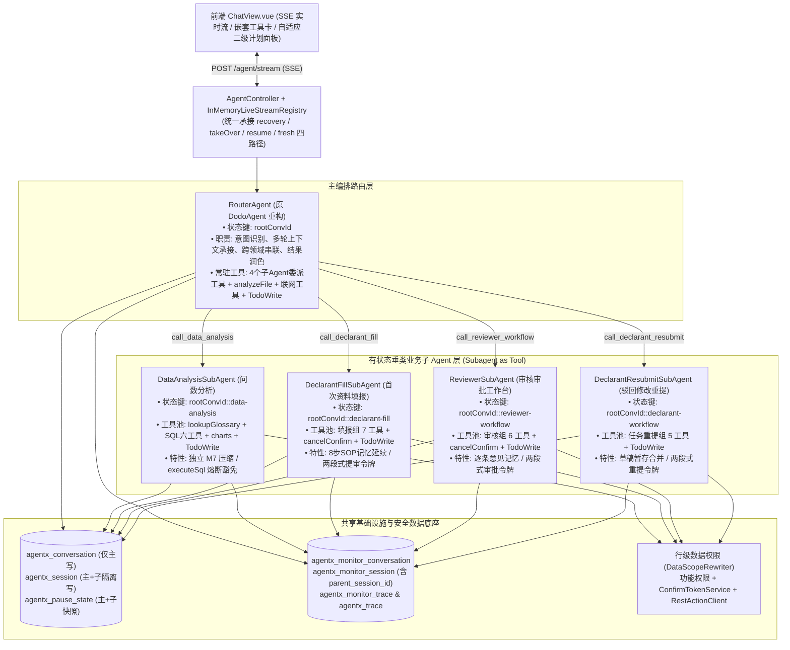
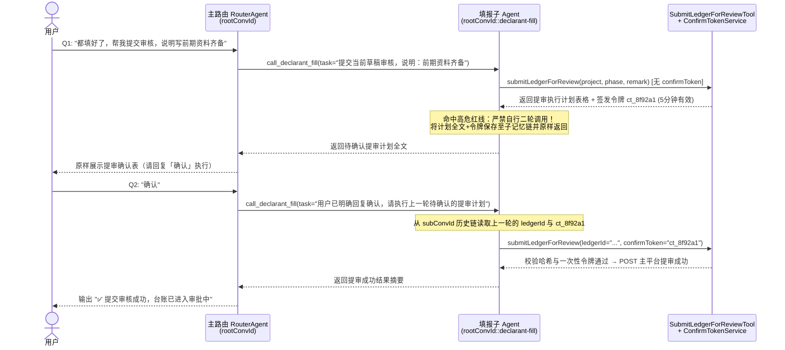

# 主路由与有状态垂类子 Agent 架构演进技术方案

> 本文档承接 [01-单Agent底座核心机制梳理与Subagent扩展前瞻.md](file:///d:/work/zrkj-huaxi/code/huaxi-data-agent/docs/多agent技术调研/单agent演进多agent文档/01-单Agent底座核心机制梳理与Subagent扩展前瞻.md)，给出华西智能体从「单主 Agent + 多 Skill 软隔离」演进为 **「主路由 Agent + 有状态垂类业务子 Agent」** 的完整落地方案。
> 状态标记规则：每完成一个里程碑任务，把对应 `- [ ]` 改为 `- [x]`，并在任务后追加 `（完成于 YYYY-MM-DD）`。

---

## 0. 演进背景与核心架构决策

### 0.1 现状痛点（单 Agent + 多 Skill 软隔离瓶颈）

当前主对话入口收口在单体 [DodoAgent.java](file:///d:/work/zrkj-huaxi/code/huaxi-data-agent/backend/data-agent-server/src/main/java/com/llmetor/dataagent/dataagent/agent/DodoAgent.java)，4 个业务域（问数分析 `data-analysis`、首次填报 `declarant-fill`、审核处理 `reviewer-workflow`、驳回重提 `declarant-workflow`）共享同一套上下文窗口与同一个 25 工具延迟池（[DataAgentToolsConfig.java](file:///d:/work/zrkj-huaxi/code/huaxi-data-agent/backend/data-agent-server/src/main/java/com/llmetor/dataagent/dataagent/config/DataAgentToolsConfig.java#L48-L82)），随着业务复杂度上升暴露出三大瓶颈：

1. **主上下文交叉污染与膨胀**：一轮复杂问数的 5~8 次探表/SQL 试错结果、或多轮逐项资料填报的草稿核对明细，全部堆积在同一条 `working_messages` 中，挤占后续跨业务对话窗口并增加幻觉风险。
2. **工具池缺乏硬物理边界**：25+ 个业务工具同处一个 `DeferredToolRegistry`，仅靠 [system-prompt.md](file:///d:/work/zrkj-huaxi/code/huaxi-data-agent/backend/data-agent-server/src/main/resources/prompts/system-prompt.md#L29-L31) 提示词软约束“不要跨技能组调用”，`tool_search` 关键字召回时容易跨领域串台（如填报与驳回重提工具混用）。
3. **模型与运行策略无法按领域差异化**：主意图路由、复杂多表 SQL 推理、标准化表单填报被迫共用同一个 `ChatModel`、`maxRounds` 和 `LoopGuardConfig`。

### 0.2 已确认核心架构决策（评审定稿）

| 编号 | 决策维度 | 最终结论 | 决策依据 |
| :--- | :--- | :--- | :--- |
| **D1** | **总体拓扑** | **主路由 Agent + 垂类业务子 Agent**（`Subagent as Tool` 模式） | 主 Agent 专注意图识别、跨领域编排与收口；垂类子 Agent 各自独享专属工具集、SOP 提示词与模型策略，新增业务只需新注册一个子 Agent 工具 |
| **D2** | **子 Agent 状态性** | **有状态子 Agent（Stateful Sub-Agent）** | 华西核心业务（8 步首次填报、多轮待审审批、问数追问下钻）天然跨越多次用户交互；子 Agent 必须在同一对话窗口内跨轮延续自身上下文记忆 |
| **D3** | **记忆隔离粒度** | **窗口级 × 垂类级**（`subConvId = rootConvId + "::" + agentCode`） | 同一窗口内同一垂类子 Agent 跨轮共享状态链并独立触发 M7 上下文压缩；不同垂类子 Agent 之间、子与主之间上下文物理隔离 |
| **D4** | **系统表写入纪律** | 子 Agent **只写 `agentx_session`**，**不写 `agentx_conversation`** | 保持 `agentx_conversation` 严格对应「用户一问一行」，不污染左侧历史会话列表与提问计数 |
| **D5** | **Trace 全链路留痕** | **子 Agent 完整开启 Trace 与监控入库**，通过父子字段串联 | 建立 `rootSessionId → parentToolCallId → subSessionId → subRound` 调用树；大盘不虚增提问数，但完整统计主+子 Token 消耗并支持穿透排错 |
| **D6** | **流式体验与底座兼容** | 子 Agent 实时事件附带 `parentToolCallId` **经主 `sink` 透传** | 零侵入复用 `InMemoryLiveStreamRegistry`，天然继承单 Agent 底座的 **刷新不掉（`recovery`）**、**级联中断（`stop`）** 与 **顶掉（`takeOver`）** 能力 |
| **D7** | **高危写操作 HITL** | **两段式 `ConfirmToken` 上浮主对话确认** | 子 Agent 首轮触发高危工具拿到计划与 `ct_` 令牌后立即收尾上浮，严禁自行确认；用户下一轮回复确认后再路由回该有状态子 Agent 执行二轮消费 |
| **D8** | **`TodoWrite` 计划机制** | **模型侧零侵入 + 前端自适应双层计划面板** | 兼容 85% 单垂类复杂任务（仅子 Agent 建计划，自动顶层展示）与 5%~10% 跨垂类复合任务（主宏观计划 + 子微观计划二级挂载折叠展示） |

---

## 1. 总体架构与请求流转设计

### 1.1 多 Agent 分层拓扑图



### 1.2 多轮简短回复的路由承接机制

在有状态多轮交互中，用户经常发送极短的上下文依赖回复（如 `“选第 2 个”`、`“前期配套文件”`、`“确认提交”`、`“换张经理审核”`）：

1. **主路由视角**：`RouterAgent` 的 `rootConvId` 工作链中保留了上一轮「调用 `call_declarant_fill`」以及子 Agent 返回的追问结论（如“已列出名下 3 个项目，请问您要填报哪一个？”）。因此主路由无需知道子 Agent 内部的 19 位主键 ID，仅凭对话脉络即可准确将 `“选第 2 个”` 继续路由给 `call_declarant_fill(task="用户在上一轮项目清单中选择第 2 个项目，继续填报流程")`。
2. **垂类子 Agent 视角**：`DeclarantFillSubAgent` 按 `rootConvId::declarant-fill` 从 `agentx_session` 加载自己的 `working_messages`，其中完整保存着上一轮 `listMyProjects()` 返回的原始 JSON（含真实 `projectId`、编码、草稿状态），无缝推进第 2 步 `listPhaseTree`。
3. **前端 `/` 斜杠命令兼容**：当用户在输入框使用斜杠命令显式指定技能（`ChatRequest.skill` 非空，见 [AgentController.java](file:///d:/work/zrkj-huaxi/code/huaxi-data-agent/backend/data-agent-server/src/main/java/com/llmetor/dataagent/dataagent/controller/AgentController.java#L100-L101)）时，`RouterAgent` 在本轮提示词尾部注入强路由指令，强制委派对应垂类子 Agent。

---

## 2. 核心设计一：有状态子 Agent 的记忆隔离、鉴权透传与中断恢复

### 2.1 三类关键 ID 的命名空间划分

为彻底规避 [01 文档第六节](file:///d:/work/zrkj-huaxi/code/huaxi-data-agent/docs/多agent技术调研/单agent演进多agent文档/01-单Agent底座核心机制梳理与Subagent扩展前瞻.md#L298-L304) 指出的锁冲突与消息覆盖问题，系统严格区分三个 ID：

| ID 名称 | 格式示例 | 长度 | 作用范围与用途 |
| :--- | :--- | :---: | :--- |
| **`rootConvId`**<br>（根窗口 ID） | `dodo_conv_550e8400-e29b-41d4-a716-446655440000` | ~46 | • 前端 URL 会话标识、`LiveStreamRegistry` 注册键<br>• 主路由 Agent 的 `agentx_conversation` / `agentx_session` 键<br>• **业务写工具缓存与审计键**（注入 `toolParams.conversationId`） |
| **`subConvId`**<br>（子记忆状态键） | `{rootConvId}::{agentCode}`<br>例：`dodo_conv_550e...::declarant-fill` | ~65 | • **有状态子 Agent 在 `agentx_session` 中的持久化主键**（跨轮复用）<br>• 适配现有表 `varchar(100)` 列宽，无需改表扩长<br>• 子 Agent 断点快照在 `agentx_pause_state` 中的存储键 |
| **`taskLockKey`**<br>（运行态互斥锁键） | 主：`{rootConvId}`<br>子：`{subConvId}#{toolCallId}` | ~80 | • `AgentTaskManager` 运行任务登记键<br>• 支持主 Agent 在同一轮内串/并行多次调用同一子 Agent 而不触发 `CONCURRENT_EXECUTION` 异常 |

### 2.2 `AgentxSessionStore` 持久化边界改造

在 [RunnableParams.java](file:///d:/work/zrkj-huaxi/code/huaxi-data-agent/backend/mini-agentx-core/src/main/java/com/llmetor/miniagentx/model/RunnableParams.java) 中扩展多 Agent 上下文元数据：

```java
// RunnableParams 新增字段（向后兼容：默认 subAgent = false，单 Agent 调用零感知）
private boolean subAgent = false;
private String agentCode = "router";          // router / data-analysis / declarant-fill / ...
private String rootConversationId;            // 子 Agent 指向外层窗口 rootConvId
private String parentSessionId;               // 子 Agent 指向外层本轮提问 sessionId
private String parentToolCallId;              // 子 Agent 指向触发它的主 Agent toolCallId
```

[AgentLoopExecutor.java](file:///d:/work/zrkj-huaxi/code/huaxi-data-agent/backend/mini-agentx-core/src/main/java/com/llmetor/miniagentx/agent/AgentLoopExecutor.java) 与 [AgentxSessionStore.java](file:///d:/work/zrkj-huaxi/code/huaxi-data-agent/backend/mini-agentx-core/src/main/java/com/llmetor/miniagentx/memory/AgentxSessionStore.java) 调整如下：
1. **`initMessages()` 阶段**：
   * `sessionStore.loadHistory(conversationId())`：主 Agent 传 `rootConvId`，子 Agent 传 `subConvId`，各自加载独立历史。
   * **仅当 `!params.isSubAgent()` 时**，调用 `sessionStore.initConversation(...)` 写入 `agentx_conversation` 开局行。
2. **`persistTerminal()` 阶段**：
   * 主、子 Agent 均按各自的 `conversationId()`（`rootConvId` vs `subConvId`）正常追加 `original_messages` 并全量替换 `working_messages`。
   * **仅当 `!params.isSubAgent()` 时**，执行 `UPDATE agentx_conversation SET status = ...`。
3. **M7 上下文压缩天然隔离**：
   * 子 Agent 的 `ContextCompactor` 与 `ContextReloadTool` 绑定在 `subConvId` 上，`offload_context` 原文归档亦落在 `subConvId` 名下，主子互不干扰。
4. **会话级联清理（[SessionService.java](file:///d:/work/zrkj-huaxi/code/huaxi-data-agent/backend/data-agent-server/src/main/java/com/llmetor/dataagent/dataagent/session/SessionService.java#L383-L395)）**：
   * 用户删除窗口时，除删除 `conversation_id = ?` 外，同步执行：
     ```sql
     DELETE FROM agentx_session WHERE conversation_id = ? OR conversation_id LIKE (? || '::%');
     DELETE FROM agentx_pause_state WHERE conversation_id = ? OR conversation_id LIKE (? || '::%');
     ```

### 2.3 跨线程安全身份透传与高危写操作（HITL）时序

> [!WARNING]
> **`ThreadLocal` 登录态丢失陷阱**：[DodoAgent.java](file:///d:/work/zrkj-huaxi/code/huaxi-data-agent/backend/data-agent-server/src/main/java/com/llmetor/dataagent/dataagent/agent/DodoAgent.java#L260-L270) 在 HTTP 入口线程通过 `HuaxiAuthContext.getOrNull()` 读取 `token` 和 `tenantId`。而 `SubAgentTool.call()` 运行在内核 `toolPool` 异步线程上，此时直接读 `HuaxiAuthContext` 必为 `null`！

* **凭证继承铁律**：`SubAgentTool` 从 `ToolContext` 取出父级 `RunnableParams`，**原样继承父级的 `userId` 与 `toolParams` Map**（内含真实 `userId`、`token`、`tenantId` 以及值为 `rootConvId` 的 `conversationId`）。如此一来：
  * 问数子 Agent 内的 `ExecuteSqlTool` 自动按真实 `userId` 注入华西 yudao 五档行级权限条件；
  * 填报/审核子 Agent 内的 `RestActionClient` 自动携带当前用户 `token` / `tenantId` 转发主后端，且 `FillNodeSelectionCache` / `ActionAuditLogger` 继续按 `rootConvId` 关联。

* **高危写操作两段式确认（`ConfirmTokenService`）跨层交互时序**：



### 2.4 父子级联中断（Stop / TakeOver）与断点恢复

1. **激活内核 `InterruptContext` 回调链**：
   * 现状：[InterruptContext.java](file:///d:/work/zrkj-huaxi/code/huaxi-data-agent/backend/mini-agentx-core/src/main/java/com/llmetor/miniagentx/interrupt/InterruptContext.java#L50-L65) 已有 `onInterrupt(Runnable)` 与 `fireInterrupt()`，但 [AgentLoopExecutor.java](file:///d:/work/zrkj-huaxi/code/huaxi-data-agent/backend/mini-agentx-core/src/main/java/com/llmetor/miniagentx/agent/AgentLoopExecutor.java#L926) 目前只调了 `markInterrupted()`。
   * 改造：将 `AgentLoopExecutor.onInterrupt` 第 926 行改为 `interruptCtx.fireInterrupt()`，并通过 `ToolContext` 把父级 `InterruptContext` 暴露给 `SubAgentTool`。
2. **级联暂停与恢复流程**：
   * `SubAgentTool` 启动子 Agent 前，向父 `interruptCtx` 注册回调：`parentInterruptCtx.onInterrupt(() -> subAgent.interrupt(subTaskKey, reason))`。
   * **当用户点击“停止”**：主 Agent 触发 `onInterrupt` → 同步级联触发子 Agent `interrupt` → 子 Agent 将已跑完的前 N 轮上下文及未完成工具存入 `agentx_pause_state`（键为 `subConvId`），主 Agent 亦存主快照（`pendingToolCalls = [call_xxx_agent]`）。
   * **当用户空消息点击“继续”（纯恢复）**：主 Agent 本地重放 `SubAgentTool` → `SubAgentTool` 检测到 `subAgent.hasInterruptedState(subConvId) == true`，自动走 `subAgent.resumeStream(subConvId, null)` 从子断点接着跑，不浪费已消耗的子轮次 Token！
   * **当用户发新消息 `takeOver` 顶掉（或带补充指令恢复）**：主 Agent 调 `discardInterruptedState(rootConvId)` 时，级联清理该窗口下所有 `rootConvId::*` 子断点快照；子 Agent 已完成的历史轮次已通过 `interrupted` 终态保存在 `subConvId` 的 `agentx_session` 中，下一轮自然衔接到最新上下文。

---

## 3. 核心设计二：子 Agent 全链路 Trace 留痕与监控观测升级

### 3.1 串联数据模型

一次用户提问（`rootSessionId`）下可挂载 0~N 个子 Agent 执行会话（`subSessionId`），形成清晰的两级调用树：

```text
窗口 agentx_monitor_conversation (conversation_id = rootConvId)
 └── 根提问 agentx_monitor_session (session_id = S_100, agent_code = 'router', parent_session_id = NULL, seq = 1)
      ├── 主轮次 R1: agentx_monitor_trace (session_id = S_100, round = 1, tool_names = ['call_data_analysis'])
      │    └── [挂载子会话] agentx_monitor_session
      │         (session_id = S_101, agent_code = 'data-analysis',
      │          parent_session_id = 'S_100', parent_tool_call_id = 'call_abc123', seq = 0)
      │          ├── 子轮次 Sub-R1: lookupGlossary / listTables
      │          ├── 子轮次 Sub-R2: describeTables
      │          ├── 子轮次 Sub-R3: validateSql / executeSql
      │          └── 子轮次 Sub-R4: 产出分析结论文本
      └── 主轮次 R2: agentx_monitor_trace (session_id = S_100, round = 2, round_type = 'text' 汇总输出)
```

### 3.2 数据库表结构增量改造（Flyway / 幂等 DDL）

新增迁移脚本 `sql/trace-monitor/V08__subagent_trace_hierarchy.sql`（同步更新内建幂等 DDL）：

```sql
-- 1. 修复旧轨 agentx_trace 历史唯一索引冲突（原 uk_trace_conv_round 在多轮/主子同窗口 round=1 时必撞键丢数据）
DROP INDEX IF EXISTS uk_trace_conv_round;
CREATE UNIQUE INDEX IF NOT EXISTS uk_trace_session_round ON agentx_trace (session_id, round);
ALTER TABLE agentx_trace ADD COLUMN IF NOT EXISTS agent_code varchar(50) DEFAULT 'router';
ALTER TABLE agentx_trace ADD COLUMN IF NOT EXISTS parent_session_id varchar(100) DEFAULT NULL;

-- 2. 监控提问表：增加子 Agent 归属与父调用挂载列
ALTER TABLE agentx_monitor_session ADD COLUMN IF NOT EXISTS agent_code varchar(50) DEFAULT 'router';
ALTER TABLE agentx_monitor_session ADD COLUMN IF NOT EXISTS parent_session_id varchar(100) DEFAULT NULL;
ALTER TABLE agentx_monitor_session ADD COLUMN IF NOT EXISTS parent_tool_call_id varchar(100) DEFAULT NULL;
CREATE INDEX IF NOT EXISTS idx_ams_parent ON agentx_monitor_session (parent_session_id) WHERE parent_session_id IS NOT NULL;

-- 3. 监控轮次表：冗余 agent_code 与 parent_session_id 便于单表检索免 JOIN
ALTER TABLE agentx_monitor_trace ADD COLUMN IF NOT EXISTS agent_code varchar(50) DEFAULT 'router';
ALTER TABLE agentx_monitor_trace ADD COLUMN IF NOT EXISTS parent_session_id varchar(100) DEFAULT NULL;
```

### 3.3 `TraceCollector` SPI 与监控大盘聚合口径调整

1. **`TraceCollector` 接口扩展默认重载**（[TraceCollector.java](file:///d:/work/zrkj-huaxi/code/huaxi-data-agent/backend/mini-agentx-core/src/main/java/com/llmetor/miniagentx/trace/TraceCollector.java)）：
   * 新增带 `TraceMeta(agentCode, rootConversationId, parentSessionId, parentToolCallId)` 的重载方法（默认委托回原方法，保证单测与旧实现零破坏）。
   * 子 Agent 调用 `traceCollector` 时，`conversationId` 统一记为 `rootConvId`（确保窗口级检索一次捞全），同时写入 `agent_code`、`parent_session_id` 和 `parent_tool_call_id`。
2. **窗口指标聚合不虚增提问数**（[MonitorTraceCollector.java](file:///d:/work/zrkj-huaxi/code/huaxi-data-agent/backend/data-agent-server/src/main/java/com/llmetor/dataagent/dataagent/monitor/MonitorTraceCollector.java#L356-L382)）：
   * `openSession`：当 `parentSessionId != null`（子会话）时，`seq` 置 `0`，不新建窗口标题；
   * `refreshConversation` 聚合 SQL 调整口径：
     * `question_count`：`COUNT(*) FILTER (WHERE parent_session_id IS NULL)` —— **严格只计用户的真实提问次数**；
     * `total_rounds` / `fail_rounds` / `prompt_tokens` / `completion_tokens`：汇总该 `conversation_id` 下**全部主会话 + 子会话**，真实反映总 Token 消耗与总执行轮次；
     * 窗口 `status`：仅以根会话（`parent_session_id IS NULL`）状态为准。
3. **异常规则引擎与 AI 诊断联动**：
   * **异常规则巡检（`DetectDispatcher`）**：子会话 `closeSession` 时照常运行规则检测（如 `REACT` 死循环、`TOOL` 连续报错），命中风险写入 `agentx_monitor_risk`（可通过 `session_id` 反查 `parent_session_id` 聚合展示到根提问卡片上，标注 `[问数子Agent · Sub-R3]`）。
   * **AI 诊断工具（[TraceQueryTools.java](file:///d:/work/zrkj-huaxi/code/huaxi-data-agent/backend/data-agent-server/src/main/java/com/llmetor/dataagent/dataagent/eval/trace/TraceQueryTools.java)）**：查询某次根提问全貌时，通过 `WHERE session_id = ? OR parent_session_id = ?` 一并拉出挂载的子 Agent 执行轨迹，使诊断 Agent 能直接穿透定位子 Agent 内部的 SQL 语法错误或提示词缺陷。

---

## 4. 核心设计三：流式进度透传与 `TodoWrite` 自适应双层计划方案

### 4.1 子 Agent 内部事件实时透传协议

1. **[AgentStreamEvent.java](file:///d:/work/zrkj-huaxi/code/huaxi-data-agent/backend/mini-agentx-core/src/main/java/com/llmetor/miniagentx/model/AgentStreamEvent.java) 扩展两个可选溯源字段**：
   * `agentCode`（如 `"data-analysis"`；主路由为 `null` 保持老报文体积不变）
   * `parentToolCallId`（指向主路由触发该子 Agent 的 `toolCallId`）
2. **父 `sink` 桥接转发**：
   * [ToolCallExecutor.java](file:///d:/work/zrkj-huaxi/code/huaxi-data-agent/backend/mini-agentx-core/src/main/java/com/llmetor/miniagentx/agent/ToolCallExecutor.java#L133-L138) 在 `ToolContext` 中传入线程安全回调 `Consumer<AgentStreamEvent> stepEmitter`（内部使用父循环的 `synchronized (emitLock) { sink.tryEmitNext(evt); }`）。
   * `SubAgentTool` 订阅子 Agent 的 `stream()`：
     * 将子 Agent 的 `THINKING`、`TOOL_START`、`TOOL_END` 事件附加上 `agentCode` 与 `parentToolCallId` 后通过 `stepEmitter` 实时推出；
     * 子 Agent 的中间过程叙述 `TEXT` 可作为子卡片内状态文案透传，而子 Agent 终态事件（`COMPLETE` / `PAUSED`）在 `SubAgentTool` 内部拦截消费并提取最终答案返回给主 Agent，**绝不向外层发出 `COMPLETE` 提前终止父流**。

### 4.2 实际业务中的 `TodoWrite` 分布规律

在「主路由 + 有状态垂类子 Agent」架构下，结合华西四大业务 SOP，真实用户提问呈现三种分布：

| 场景分类 | 实际占比 | 主路由 Agent | 垂类业务子 Agent | 典型华西业务场景 |
| :--- | :---: | :---: | :---: | :--- |
| **场景 A：单垂类复杂任务** | **~85%** | **不调 `TodoWrite`**<br>（仅 1 步路由委派） | **调用 `TodoWrite`**<br>（4~8 步领域 SOP） | • *“统计各部门备案率排名并下钻垫底项目缺项”*（问数子 Agent：查口径→探表→汇总→下钻→算环比→出报告）<br>• *“填报南三高速前期配套文件”*（填报子 Agent：按批1→批2→核对→提审推进） |
| **场景 B：单垂类简单操作** | **~10%** | **不调 `TodoWrite`** | **不调 `TodoWrite`** | • *“查一下我有几条待审任务”*（1 轮工具调用即回） |
| **场景 C：跨垂类复合任务** | **~5%** | **调用 `TodoWrite`**<br>（建 2~3 步宏观跨域计划） | **调用 `TodoWrite`**<br>（在某步内建微观领域计划） | • *“先帮我查出备案率低于60%的项目和缺项明细（问数子Agent），再带我把排第一项目的空缺说明暂存上（填报子Agent）”* |

> [!IMPORTANT]
> **为什么必须支持自适应双层计划？**
> 1. 绝不能禁掉子 Agent 的 `TodoWrite`——否则占比 85% 的单领域复杂问数与分批填报将彻底失去右侧进度面板；
> 2. 但在占比 5% 的跨垂类复合任务中，当前前端 [ChatView.vue](file:///d:/work/zrkj-huaxi/code/huaxi-data-agent/frontend/src/views/ChatView.vue#L771-L802) 采用单层 `activeSession.plan` 全量覆盖，会导致主计划（2 步）与子计划（5 步）互相覆盖闪烁。

### 4.3 「模型零侵入 + 前端二级父子挂载树」交互设计

无需修改 [TodoWriteTool.java](file:///d:/work/zrkj-huaxi/code/huaxi-data-agent/backend/data-agent-server/src/main/java/com/llmetor/dataagent/dataagent/tools/TodoWriteTool.java) 的工具入参（大模型仍只传扁平的 `todos: [{content, status}]`，不增加任何心智负担），仅靠 SSE 事件上的 `parentToolCallId` 和 `agentCode` 即可在前端与回放层自动归并：

1. **提示词纪律分工**：
   * **主路由 Agent**：仅当识别到用户诉求需要**串联 ≥2 个不同子 Agent（或分阶段多次委派）**时，才调用 `TodoWrite` 建立宏观计划；单一垂类诉求直接一步路由，严禁建单步冗余计划。
   * **垂类子 Agent**：保持现有各 `SKILL.md` 的 `TodoWrite` 纪律不变（领域内 ≥3 步建计划）。
2. **右侧计划面板状态机（[ChatView.vue](file:///d:/work/zrkj-huaxi/code/huaxi-data-agent/frontend/src/views/ChatView.vue#L641-L686) & [SessionService.java](file:///d:/work/zrkj-huaxi/code/huaxi-data-agent/backend/data-agent-server/src/main/java/com/llmetor/dataagent/dataagent/session/SessionService.java#L289-L295)）**：
   * 数据结构扩展为：`plan = { ownerAgent, items: [{ text, status, agentLabel?, subItems?: [...] }], updatedAt }`。
   * **规则 1（收到主路由 `TodoWrite`，即 `parentToolCallId == null`）**：
     更新顶层 `items`（按序号保留已挂载在各主步骤上的 `subItems`；当某主步骤状态变为 `completed` 时，其 `subItems` 默认自动折叠收起）。
   * **规则 2（收到子 Agent `TodoWrite`，即 `parentToolCallId != null`）**：
     * **若当前不存在主路由顶层计划（对应 85% 的场景 A）**：直接将该子 Agent 的 `todos` 作为顶层 `items` 渲染，面板右上角展示领域徽章（如 `数据分析` / `资料填报`），视觉体验与单 Agent 时代完全一致；
     * **若当前已存在主路由顶层计划（对应 5% 的场景 C）**：找到顶层 `items` 中当前处于 `in_progress` 的主步骤，将该子 Agent 的 `todos` 挂载为其 `subItems` 缩进渲染！

#### 双层计划面板渲染示意（场景 C）

```text
┌──────────────────────────────────────────────┐
│ 📋 执行计划                              1/2 │
│ ━━━━━━━━━━━━━━━━━━━━━━━━░░░░░░░░░░░░░░░░░░░░ │
│                                              │
│ ✅ 1. 盘点低备案率项目及缺项明细     [展开 ▸] │
│                                              │
│ 🔄 2. 办理南三高速空缺资料填报暂存 [资料填报] │
│     ├─ ✅ 拉取项目阶段树并定位子阶段          │
│     ├─ 🔄 第 1 批空缺类别原因收集与暂存       │
│     └─ ⭕ 核对填报总览并询问是否提审          │
│                                              │
│                              更新于 17:02:15 │
└──────────────────────────────────────────────┘
```

---

## 5. 各模块代码改造清单

### 5.1 内核模块 `mini-agentx-core`

| 改动文件 | 操作 | 具体改造内容 |
| :--- | :---: | :--- |
| [RunnableParams.java](file:///d:/work/zrkj-huaxi/code/huaxi-data-agent/backend/mini-agentx-core/src/main/java/com/llmetor/miniagentx/model/RunnableParams.java) | 修改 | 新增 `subAgent`、`agentCode`、`rootConversationId`、`parentSessionId`、`parentToolCallId` 字段及 Builder 方法 |
| [AgentStreamEvent.java](file:///d:/work/zrkj-huaxi/code/huaxi-data-agent/backend/mini-agentx-core/src/main/java/com/llmetor/miniagentx/model/AgentStreamEvent.java) | 修改 | 新增可选字段 `agentCode`、`parentToolCallId` 及带归属拷贝辅助方法 `withSource(agentCode, parentToolCallId)` |
| [InterruptContext.java](file:///d:/work/zrkj-huaxi/code/huaxi-data-agent/backend/mini-agentx-core/src/main/java/com/llmetor/miniagentx/interrupt/InterruptContext.java) & [AgentLoopExecutor.java](file:///d:/work/zrkj-huaxi/code/huaxi-data-agent/backend/mini-agentx-core/src/main/java/com/llmetor/miniagentx/agent/AgentLoopExecutor.java) | 修改 | ① `onInterrupt` 改调 `interruptCtx.fireInterrupt()` 触发级联中断回调；<br>② `subAgent=true` 时跳过 `sessionStore.initConversation` 与 `agentx_conversation` 状态更新；<br>③ 任务登记支持独立 `taskLockKey` |
| [ToolCallExecutor.java](file:///d:/work/zrkj-huaxi/code/huaxi-data-agent/backend/mini-agentx-core/src/main/java/com/llmetor/miniagentx/agent/ToolCallExecutor.java) | 修改 | 在 `ToolContext` 中注入 `stepEmitter`（父 `sink` 线程安全发射器）、`parentSessionId`、`toolCallId` 与 `interruptCtx` |
| `agent/SubAgentTool.java` | **新增** | 标准 `Subagent as Tool` 封装类：构建派生 `subConvId`、继承父级 `userId/toolParams`、桥接子流事件、注册级联中断与子快照 `resumeStream` 恢复 |
| [TraceCollector.java](file:///d:/work/zrkj-huaxi/code/huaxi-data-agent/backend/mini-agentx-core/src/main/java/com/llmetor/miniagentx/trace/TraceCollector.java) & [TraceManager.java](file:///d:/work/zrkj-huaxi/code/huaxi-data-agent/backend/mini-agentx-core/src/main/java/com/llmetor/miniagentx/trace/TraceManager.java) | 修改 | 增加 `TraceMeta` 透传 `agentCode/parentSessionId/parentToolCallId`；修复 `agentx_trace` 唯一索引为 `(session_id, round)` |

### 5.2 业务服务模块 `data-agent-server`

| 改动文件 | 操作 | 具体改造内容 |
| :--- | :---: | :--- |
| `dataagent/subagent/SubAgentSpec.java` & `SubAgentRegistry.java` | **新增** | 定义并管理 4 个有状态垂类业务子 Agent（`data-analysis`、`declarant-fill`、`reviewer-workflow`、`declarant-workflow`），支持按子 Agent 独立配置模型 `modelCode`、`maxRounds`、`loopGuard` 与专属工具集 |
| [DataAgentToolsConfig.java](file:///d:/work/zrkj-huaxi/code/huaxi-data-agent/backend/data-agent-server/src/main/java/com/llmetor/dataagent/dataagent/config/DataAgentToolsConfig.java) | 修改 | 拆分原 25 工具大池为 4 个领域独立工具组 Bean（读分析组、填报组、审核组、重提组），消除跨领域串台 |
| [DodoAgent.java](file:///d:/work/zrkj-huaxi/code/huaxi-data-agent/backend/data-agent-server/src/main/java/com/llmetor/dataagent/dataagent/agent/DodoAgent.java) & [system-prompt.md](file:///d:/work/zrkj-huaxi/code/huaxi-data-agent/backend/data-agent-server/src/main/resources/prompts/system-prompt.md) | 修改 | 瘦身为主路由编排门面：装配 4 个 `SubAgentTool` + 通用附件/联网/`TodoWrite`；重写主路由提示词（明确路由判据、高危计划上浮规则、跨垂类才用 `TodoWrite` 纪律）；`discardInterruptedState` 支持级联清理子快照 |
| [MonitorTraceCollector.java](file:///d:/work/zrkj-huaxi/code/huaxi-data-agent/backend/data-agent-server/src/main/java/com/llmetor/dataagent/dataagent/monitor/MonitorTraceCollector.java) & `MonitorQueryService.java` | 修改 | 落库 `agent_code`、`parent_session_id`、`parent_tool_call_id`；修正 `refreshConversation` 提问计数过滤条件；监控详情接口支持返回子会话轮次树 |
| [TraceQueryTools.java](file:///d:/work/zrkj-huaxi/code/huaxi-data-agent/backend/data-agent-server/src/main/java/com/llmetor/dataagent/dataagent/eval/trace/TraceQueryTools.java) | 修改 | AI 诊断全貌查询联查 `parent_session_id`，支持穿透诊断子 Agent 异常轮次 |
| [SessionService.java](file:///d:/work/zrkj-huaxi/code/huaxi-data-agent/backend/data-agent-server/src/main/java/com/llmetor/dataagent/dataagent/session/SessionService.java) | 修改 | ① `deleteConversation` 级联清理 `rootConvId::%` 子会话与子快照；<br>② `buildTimeline` 支持组装子 Agent 内部步骤与双层 `todo` 归并回放 |

### 5.3 数据库脚本与前端模块 `sql/` & `frontend/`

| 改动文件 | 操作 | 具体改造内容 |
| :--- | :---: | :--- |
| `sql/trace-monitor/V08__subagent_trace_hierarchy.sql` | **新增** | 增量补齐 `agent_code`、`parent_session_id`、`parent_tool_call_id` 列及索引，迁移 `uk_trace_session_round` |
| [ChatView.vue](file:///d:/work/zrkj-huaxi/code/huaxi-data-agent/frontend/src/views/ChatView.vue) | 修改 | ① 消息流工具卡片识别子 Agent 委派调用，支持折叠展示子 Agent 内部实时思考与工具执行步骤；<br>② 右侧计划面板支持单层自动提升与双层 `subItems` 嵌套挂载/完成自动折叠 |
| 监控中心前端视图（`Timeline` / `DiagnoseDrawer`） | 修改 | 提问详情轮次列表支持展开主轮次下的子 Agent 调用栈并显示子 Agent 徽章 |

---

## 6. 渐进式落地里程碑（实施 Checklist）

为控制改造风险、确保每一步均可独立回归验收，建议分 4 个阶段推进：

### M-SA1：内核多 Agent 底座就绪（`mini-agentx-core`）
- [ ] 扩展 `RunnableParams` 与 `AgentStreamEvent` 多 Agent 溯源字段
- [ ] 激活 `InterruptContext.fireInterrupt()`，扩展 `ToolCallExecutor` 注入父 `stepEmitter` 与中断上下文
- [ ] 实现通用 `SubAgentTool`（状态键隔离、凭证透传、流事件桥接、级联中断与子快照恢复）
- [ ] 修改 `AgentLoopExecutor` 对 `subAgent=true` 跳过 `agentx_conversation` 写表
- [ ] 补齐内核单测（主子锁不冲突、主子 `working_messages` 跨轮各自延续不覆盖、父停子必停）

### M-SA2：Trace 全链路留痕与监控适配（`trace` + `monitor`）
- [ ] 新增 `V08__subagent_trace_hierarchy.sql`，修复 `agentx_trace` 唯一索引撞键问题
- [ ] 扩展 `TraceCollector`、`TraceManager` 与 `MonitorTraceCollector` 写入父子关联列
- [ ] 调整 `refreshConversation` 聚合 SQL（根提问计数不变，Token/轮次汇总主+子）
- [ ] 升级 `MonitorQueryService` 与 `TraceQueryTools` 支持子会话穿透查询与规则检测

### M-SA3：四大垂类有状态子 Agent 拆分与主路由切换（`data-agent-server`）
- [ ] 物理拆分 `DataAgentToolsConfig` 工具池为 4 个独立业务组
- [ ] 装配 `DataAnalysisSubAgent`、`DeclarantFillSubAgent`、`ReviewerSubAgent`、`DeclarantResubmitSubAgent`（支持差异化模型配置）
- [ ] 重构 `DodoAgent` 为主路由编排器并精简 `system-prompt.md`
- [ ] 验证多轮有状态场景（首次填报跨轮选项目/选阶段/暂存/两段式 `ConfirmToken` 提审、问数多轮追问）与 `SessionService` 级联删除

### M-SA4：前端嵌套流可视化与自适应双层计划面板（`frontend`）
- [ ] `ChatView.vue` 工具卡片支持按 `parentToolCallId` 嵌套渲染子 Agent 实时执行步骤（并验证 F5 刷新重放一致）
- [ ] `ChatView.vue` 与 `SessionService.buildTimeline` 落地自适应双层 `TodoWrite` 计划面板（单层直展 + 双层挂载折叠）
- [x] 监控中心前端支持展开子 Agent Trace 轮次树（完成于 2026-11-25，见 `ing-02-补充方案-监控链路跟踪子Agent穿透实施方案.md`：M-TT1~M-TT5 全部落地，追溯视图委派行可展开子会话轮次树，风险/筛选/深链按命名空间穿透）
