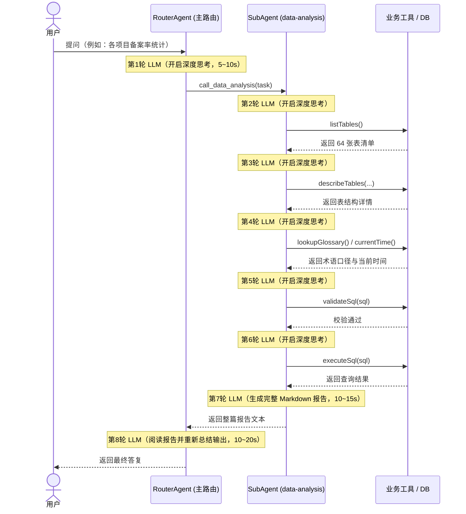

# 子 Agent 耗时排查与架构优化方案

> 日期：2026-11-27  
> 适用范围：`huaxi-data-agent` 多 Agent 架构（`RouterAgent` + 4 个垂类 `SubAgent`）  
> 核心目标：定位多 Agent 链路中子 Agent 耗时过长的根因，给出分阶段可落地的性能优化方案，将常规问数/业务办理端到端耗时从 **55~105s** 压降至 **12~24s**。

---

## 一、现状链路拆解

当前系统在 `data-agent.agent.mode=multi` 模式下，采用「主路由 `RouterAgent` + 4 个有状态垂类子 Agent（`SubAgentTool`）」架构。以最常见的**问数分析（`call_data_analysis`）**为例，一次看似简单的问题，实际执行链路如下：

**核心结论**：哪怕是一个极简的问数请求，也会触发 **6~10 轮串行 LLM 调用**，叠加每轮深度思考推理和首尾两次长文本生成，导致整体等待时间极长。

---

## 二、四大核心耗时根因（附代码定位）

### 根因 1：主路由与所有子 Agent 共用同一“慢模型 + 深度思考开关”
- **代码定位**：
  - `backend/data-agent-server/src/main/java/com/llmetor/dataagent/dataagent/agent/DodoAgent.java`（L395-L420）
  - `backend/data-agent-server/src/main/java/com/llmetor/dataagent/dataagent/agent/SubAgentRegistry.java`（L112-L216）
- **问题分析**：
  - `DodoAgent.buildRouterAgent` 解析出唯一的 `resolvedModel` 和 `thinkingOffParam` 后，原样透传给 `subAgentRegistry.buildSubAgentTools(...)`。
  - 路由分发、查表清单、校验 SQL、填报/审核流程推进等**确定性极强**的步骤，每一轮都在输出大量 `reasoning_content` 思考 Token，单轮耗时 5~15 秒，产生严重的“逐轮复利延迟”。

### 根因 2：SOP 诱导“伪串行”多轮调用，浪费底层并行能力
- **代码定位**：
  - `backend/skills/data-analysis/SKILL.md`（L65-L108）
  - `backend/mini-agentx-core/src/main/java/com/llmetor/miniagentx/agent/ToolCallExecutor.java`（L141-L176）
  - `backend/mini-agentx-core/src/main/java/com/llmetor/miniagentx/agent/PlanSyncReminder.java`（L25）
- **问题分析**：
  - **校验与执行强拆两轮**：`data-analysis/SKILL.md` 强制要求先调 `validateSql`，等 LLM 再思考一轮，再调 `executeSql`。这白白多出 1 轮完整 LLM 往返。
  - **探查工具串行化**：虽然 `ToolCallExecutor` 底层已支持单轮多 ToolCall 并行执行，但 SOP 文案按“先调 `listTables` → 再调 `describeTables` → 再查 `lookupGlossary` / `currentTime`”顺序编写，诱导模型每轮只发 1 个工具调用。
  - **固定表清单每次现查**：当前白名单表固定 64 张（见 `application.yml` L90-L112），每次新会话都要专门花 1 轮 LLM 调 `listTables`。
  - **TodoWrite 额外耗轮**：4 个子 Agent 均常驻挂载 `todoWrite`（`DataAgentToolsConfig.java` L142-L159），且 `PlanSyncReminder` 每 5 轮提醒同步计划，模型常专门花 1 轮只为更新待办状态。

### 根因 3：“双重总结”造成首尾两次长文本生成
- **代码定位**：
  - `backend/mini-agentx-core/src/main/java/com/llmetor/miniagentx/agent/SubAgentTool.java`（L282-L286）
  - `backend/data-agent-server/src/main/java/com/llmetor/dataagent/dataagent/agent/DodoAgent.java`（L77-L94）
- **问题分析**：
  - 子 Agent 严格遵循 `SKILL.md` 的报告结构，流式输出一整篇完整的 Markdown 报告；
  - `SubAgentTool` 将整段文本作为工具返回值交给 `RouterAgent`；
  - `RouterAgent` 拿到长文本后，再次经历一轮“深度思考 + 重新整理排版 + 流式输出”，白白多消耗 10~25 秒，且用户体验上看到内容被重复表达。

### 根因 4：单轮输入 Token 过重（Prefill 慢）与结构性阻塞
- **代码定位**：
  - `backend/data-agent-server/src/main/java/com/llmetor/dataagent/dataagent/agent/SubAgentRegistry.java`（L135-L214, L265-L309）
  - `backend/mini-agentx-core/src/main/java/com/llmetor/miniagentx/agent/AgentLoopExecutor.java`（L278）
  - `backend/mini-agentx-core/src/main/java/com/llmetor/miniagentx/agent/SubAgentTool.java`（L151-L154）
  - `backend/data-agent-server/src/main/resources/application.yml`（L82）
- **问题分析**：
  - **System Prompt 偏重**：每次都会将整份 `SKILL.md`（`data-analysis` 15.6KB、`declarant-fill` 14KB）+ `userCtx` + `filesCtx` + 全量常驻工具 Schema（`lookupGlossary` description 内嵌 40+ 条术语）塞入子 Agent 首轮上下文。
  - **历史上下文压缩阈值过高**：子 Agent 具有跨轮记忆（`subConvId = rootConvId + "::" + agentCode`），历史中堆积了大量 `describeTables` 和 SQL 返回的大 JSON，但默认压缩阈值高达 `100 条消息 / 90K token`，多轮追问后每轮 Prefill 耗时急剧上升。
  - **请求入口无谓预加载**：`buildSubAgentTools` 在每次请求入口就同步读取 4 份磁盘 `SKILL.md` 并构建全部 4 个子 Agent 的 Prompt，即使本轮只路由其中 1 个。
  - **同名子 Agent 串行互斥锁**：`SubAgentTool` 对 `subConvId` 加 `synchronized (lock)`，主路由无法对同一垂类（如只读的 `data-analysis`）并行下发多个独立子任务。

---

## 三、分阶段优化方案

按**“改造成本最低、耗时降幅最大”**原则，分为 P0 / P1 / P2 三个阶段推进：

### P0 阶段：立竿见影（预计总耗时直接下降 40%～60%）

#### 1. 差异化模型与思考开关配置
- **改造思路**：
  - **主路由（RouterAgent）**：仅负责意图识别、实体透传与简单汇总，**强制关闭深度思考**（或绑定轻量快模型），将首跳路由耗时从 5~10s 压至 **1~2s**。
  - **流程型子 Agent（`declarant-fill` / `reviewer-workflow` / `declarant-workflow`）**：遵循确定性业务 SOP 调用 REST 接口，**默认关闭深度思考**。
  - **分析型子 Agent（`data-analysis`）**：保留可选深度思考（或区分简单问数/复杂分析）。
- **涉及文件**：
  - `DodoAgent.java`、`SubAgentRegistry.java`、`application.yml`（可参考已有调研文档《`docs/多agent技术调研/多agent技术架构/多agent架构之进阶（四）模型选择（差异化配置）.md`》）。
- **预期收益**：单轮推理耗时降低 50%~70%，首跳响应速度质变。

#### 2. 将 `validateSql` 校验逻辑内置进 `executeSql`，砍掉 1 整轮 LLM
- **改造思路**：
  - 在 `ExecuteSqlTool` 执行查询前，直接内部调用 `SqlSafetyGuard` 完成白名单/防注入/LIMIT 校验；校验失败时直接返回结构化错误 JSON 让模型修正 SQL，无需单独暴露 `validateSql` 给模型分两轮调用。
  - 同步更新 `DataAgentToolsConfig.java`（从 `dataAnalysisTools` 移除或设为非必需）及 `backend/skills/data-analysis/SKILL.md`（删除强制先调 `validateSql` 的步骤）。
- **涉及文件**：
  - `ExecuteSqlTool.java`、`DataAgentToolsConfig.java`、`backend/skills/data-analysis/SKILL.md`。
- **预期收益**：每次问数稳定减少 **1 轮完整 LLM 耗时（省 5~15s）**。

#### 3. 消除“双重总结”开销
- **改造思路（二选一，推荐方案 A）**：
  - **方案 A（直出透传 / 跳过 Router 复述）**：当 Router 本轮仅委派了单个子 Agent 且无需跨领域汇总时，支持 `directReturn` 标记——子 Agent 的最终输出流直接作为本次会话的最终答复，**跳过 Router 最后一轮 LLM 调用**。
  - **方案 B（职责彻底拆分）**：修改子 Agent Prompt，要求子 Agent 仅返回**精简结构化数据/核心结论要点**（不写长篇 Markdown 报告），统一由 Router 做一次面向用户的最终排版输出，减少子 Agent 大量 Output Token 生成耗时。
- **涉及文件**：
  - `SubAgentTool.java`、`AgentLoopExecutor.java`、`DodoAgent.java`。
- **预期收益**：减少 **1 轮长文本 LLM 生成（省 10~25s）**。

---

### P1 阶段：砍轮次与上下文瘦身（预计再降 20%～30%）

#### 4. 合并首轮探查：预置精简表目录 + 强制单轮并行工具调用
- **改造思路**：
  - 将 64 张白名单表的**极简目录（表名 + 一句话业务注释，约 1~1.5K token）**直接从 `MschemaCacheService` 摘要后注入 `data-analysis` 的 System Prompt，省去 `listTables` 这一整轮。
  - 在 `data-analysis/SKILL.md` 中明确指令：**首轮同时并行发出** `describeTables(目标表列表)` + `lookupGlossary(关键词)` + `currentTime()`（充分利用 `ToolCallExecutor` 已有的并发能力），把原本 3~4 轮串行探查压为 **1 轮**。
- **涉及文件**：
  - `SubAgentRegistry.java`、`MschemaCacheService.java`、`backend/skills/data-analysis/SKILL.md`。
- **预期收益**：探查阶段减少 **2~3 轮 LLM 往返（省 15~30s）**。

#### 5. 精简 `SKILL.md`、内存缓存加载、收敛子 Agent 的 `TodoWrite`
- **改造思路**：
  - 瘦身 4 个垂类 `SKILL.md`（压缩单 Agent 时期遗留的冗余模板与重复示例，体积缩减 40%~50%）。
  - 在 `SubAgentRegistry` 中改为**按需懒加载 + 内存缓存**（监听 `SkillManager` 变更刷新），不再每请求入口读取 4 份磁盘文件。
  - 对于简单问数或单步办理子 Agent，关闭或降低 `PlanSyncReminder` 触发频率，避免模型专门耗费 1 轮只调 `todoWrite`。
- **涉及文件**：
  - `SubAgentRegistry.java`、`AgentLoopExecutor.java`、`PlanSyncReminder.java`、`backend/skills/*/SKILL.md`。
- **预期收益**：显著降低单轮 Prefill Token 数，减少无效工具轮次。

#### 6. 为子 Agent 单独配置更激进的上下文压缩策略（`ContextPolicy`）
- **改造思路**：
  - 子 Agent 会话中充斥大量大体积工具返回值（Schema JSON、SQL 结果集、填报节点树），不能沿用主会话 `100 条 / 90K token` 的宽松阈值。
  - 在 `SubAgentRegistry.buildSubReactAgent` 中注入专属 `ContextPolicy`（如 `maxMessages = 24~30`、`maxTokens = 20_000~25_000`），及时对历史工具结果执行 L1 offload，保持多轮追问时上下文轻量化。
- **涉及文件**：
  - `SubAgentRegistry.java`、`application.yml`。
- **预期收益**：解决“同一会话聊得越久、子 Agent 越慢”的衰减问题。

---

### P2 阶段：架构级提速（体验质变）

#### 7. 确定性场景 Fast-Path（跳过主路由 LLM）
- **改造思路**：
  - 对于前端按钮触发的结构化消息（如 `[填报-选择节点]`、`[填报配置]`）或用户显式输入的 `/斜杠命令`（已有 `SubAgentRegistry.SKILL_TO_TOOL` 映射），**路由目标 100% 确定**，在 `DodoAgent.stream` 入口直接规则分发给对应子 Agent，**0ms 跳过 Router 首轮 LLM**。
- **涉及文件**：
  - `DodoAgent.java`。

#### 8. 只读子 Agent 细粒度并发
- **改造思路**：
  - `SubAgentTool` 当前按 `subConvId` 加全局互斥锁；对于只读类 `data-analysis` 子任务，允许主路由拆解多个独立指标并行派发（以无状态临时子会话并发执行），避免串行排队。
- **涉及文件**：
  - `SubAgentTool.java`。

---

## 四、优化前后耗时对比估算

以一次常规问数任务（如“统计各项目当前备案率并列出排名靠后的项目”）为例：

| 执行阶段 | 优化前（现状） | 优化后（落地 P0 + P1） | 关键变化 |
|---|---|---|---|
| **1. Router 意图路由** | 1 轮（开思考，5~10s） | 关思考/快模型（1~2s）或 Fast-Path（0s） | 模型分级 + 关思考 |
| **2. 探查阶段（表/字段/口径/时间）** | 3~4 轮串行（20~40s） | 表目录预置 + 首轮并行（3~6s） | 砍 `listTables` + 强制并行 |
| **3. SQL 校验 + 执行** | 2 轮串行（10~20s） | 合并为 1 轮（3~6s） | `validateSql` 内置进 `executeSql` |
| **4. 报告生成 + Router 复述** | 2 轮长文本（20~35s） | 单次输出 / 直出透传（5~10s） | 消除双重总结 |
| **端到端总耗时** | **约 55 ~ 105 秒** | **约 12 ~ 24 秒** | **提速约 70% ~ 78%** |

---

## 五、建议落地顺序与验收指标

1. **第一批（建议立即实施）**：P0-1（Router 与流程型子 Agent 关思考/差异化模型） + P0-2（`validateSql` 合并进 `executeSql`）。改动风险极低，收益最直观。
2. **第二批**：P0-3（消除双重总结） + P1-4（预置精简表目录 + 探查工具强制并行）。
3. **第三批**：P1-5 / P1-6（Prompt 瘦身与缓存、子 Agent 独立压缩阈值） + P2（Fast-Path 与只读并发）。
4. **验收指标**：依托现有监控中心（`agentx_monitor_*` 表与 Trace 时间线），对比优化前后同一批问数/填报测试集的：
   - **TTFT（首字响应时间）**
   - **子 Agent 平均 LLM 轮次数**（目标：问数 ≤ 3 轮，单步填报/审批 ≤ 2 轮）
   - **端到端总耗时 P50 / P90**
   - **总 Prompt / Completion Token 消耗**
